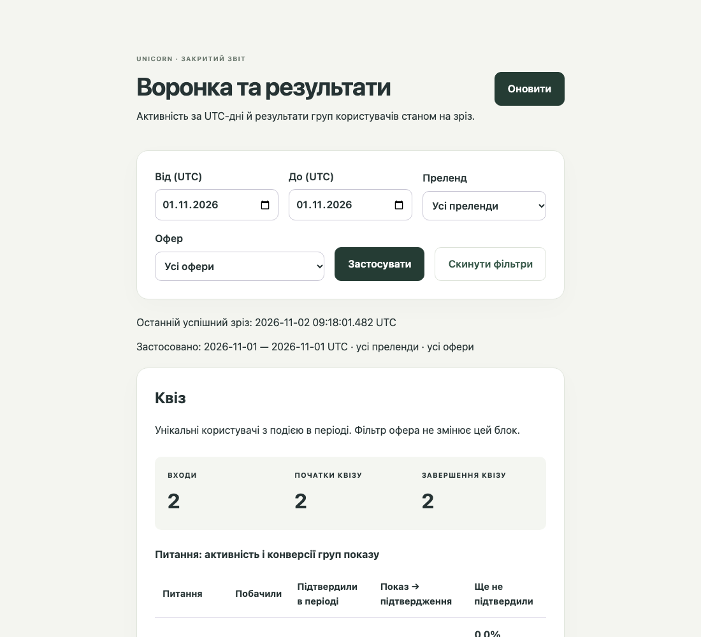
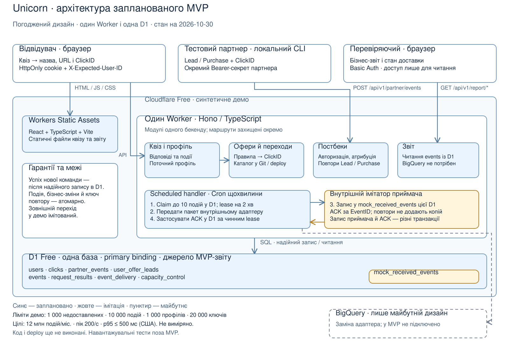

# Unicorn — події та аналітика воронок

Квіз із трьох кроків, серверний вибір партнерського офера та звіт за
реально записаними подіями. Lead повертає користувача до його офера без
повторного квізу; повтор постбека не подвоює результат, окремі покупки
рахуються окремо.

## Подивитися демо

| Що відкрити | Доступ і результат |
|---|---|
| [Звіт із результатами за 1 листопада](https://unicorn-demo.unicorn-deysan.workers.dev/report?from=2026-11-01&to=2026-11-01) | Логін і пароль у стандартному вікні браузера; перегляд воронки, покупок і технічного стану |
| [Квіз](https://unicorn-demo.unicorn-deysan.workers.dev/) | Публічний; відкриття починає взаємодію та записує події |
| [Health](https://unicorn-demo.unicorn-deysan.workers.dev/api/v1/health) | Публічний GET; очікується статус ok для сервера й бази |
| [Результат релізу](docs/m6-release-result.md) | Версія, CI, числовий smoke, Cron і відновлення доставки |

**Вхід до звіту:** логін **`demo`**, пароль **`unicorn-demo`**.
Введіть їх у стандартному вікні браузера після відкриття звіту.
Це публічна демонстраційна пара для перегляду синтетичної статистики;
звіт доступний лише для читання. Пароль не потрібно додавати до URL.

Використовується те саме демо, без реєстрації й окремого особистого кабінету.
Якщо браузер зберіг попередній доступ, відкрийте звіт у новій приватній сесії
та введіть пару вище. **Репозиторій публічний**: README, код і документація
доступні без GitHub-входу. Демо також не потребує GitHub-акаунта.
[Доступ і перевірка публікації](docs/README.md#доступ-і-майбутня-публікація).

Для перегляду без зміни даних відкрийте звіт за посиланням вище, перегляньте
«Квіз», «Офери» й «Технічний стан», змініть фільтри та натисніть
«Застосувати». Початковий період звіту — поточний день UTC; дата в посиланні
показує наявні результати релізу. Дані спільного демо можуть змінюватися,
а історія має строк зберігання 90 днів.



Фрагмент хмарного звіту 2026-11-02 о 09:18 UTC, період 2026-11-01 UTC. Це фактичний
стан демо, а не фіксовані очікувані числа тесту.

## Відтворити сценарій

1. У новій приватній сесії пройдіть квіз: **Жінки → Азія → синтетичний
   email** (наприклад, `reviewer@example.test`). Очікується **003 — Asia Connect**,
   назва, URL та ClickID; зовнішній сайт не відкривається.
2. Відкрийте [звіт за поточний день UTC](https://unicorn-demo.unicorn-deysan.workers.dev/report),
   увійдіть як `demo` / `unicorn-demo`. Залиште поточний день, усі офери й
   преленди; натисніть «Застосувати», якщо звіт був відкритий до проходження.
   У блоці «Квіз» видно входи й завершення, у «Офери» — переходи.
   Дані спільні: перевіряйте приріст, а не фіксований загальний підсумок.
3. Для вже наявних Lead/Purchase відкрийте
   [результати за 1 листопада](https://unicorn-demo.unicorn-deysan.workers.dev/report?from=2026-11-01&to=2026-11-01).
   Саме проходження квізу не створює Lead або Purchase — їх підтверджує партнер.

Повний сценарій Lead → bypass → Purchase → повтор → друга Purchase
відтворюється локально через CLI:
[покрокова інструкція та очікувані прирости](docs/demo-walkthrough.md).
Хмарний партнерський токен не публікується й не входить у доступ до звіту.

## Результат і межі

**M0–M6 завершено, хмарне демо розгорнуто.** Історичний реліз M6 від 2026-11-01 —
[`01aaa04`](https://github.com/deysan/unicorn-funnel-analytics/commit/01aaa04d8079d0b12a59e918d51be6515b1a6752).
На ньому 2026-11-01 пройшли **571 Vitest, 89 Playwright, типи й build**;
[CI успішний](https://github.com/deysan/unicorn-funnel-analytics/actions/runs/41348201985).
Cloud smoke підтвердив прирости **1/1/1/1/1/1/2**; реальний Cron доставив
події й відновив доставку після `unavailable → normal` без reset.

Коміт `fb8a582` записав результати M6 після deploy, `96d297e` підготував
документацію для перегляду. Обидва документаційні SHA відокремлені від
розгорнутого коду. **Чинний deploy від 2026-11-02 — `2ba32c3`**:
публічна пара входу, **611 Vitest і 89 Playwright**, типи/build та
[CI успішні](https://github.com/deysan/unicorn-funnel-analytics/actions/runs/41422823606).
[Перевірки оновленого демо](docs/m6-release-result.md#оновлення-доступу-2026-11-02).
Фінальний документаційний коміт результатів зроблено після deploy;
він не змінює розгорнутий SHA.

| Статус | Що входить |
|---|---|
| Реалізовано | React/TypeScript квіз, Hono Worker, D1, атомарні події й повтори, Lead/Purchase, захищений звіт, Cron/ACK, retention, технічний стан |
| Імітується | Партнер через CLI; приймач експорту в тій самій D1 замість BigQuery |
| Лише дизайн | Реальний BigQuery, production-масштаб, виключення офера після Purchase, EPU з фактичного доходу |
| Не перевірено | Production-навантаження, p95/SLA, реальний restore; мобільні браузери перевірялися лише емуляцією Playwright |

Перевірка лише читанням 2026-11-02: health 200, захист звіту 401 без
credentials, `normal`, свіжий Cron, без пауз/помилок, pending/in-flight = 0,
історія підтверджена від 2026-11-01. [Фактичні спостереження й аудит пакета](docs/README.md#перевірка-пакета-2026-11-02).

## Системний дизайн



Один Cloudflare Worker обслуговує квіз/API та фонову доставку; D1 зберігає
профілі, переходи, події й outbox. BigQuery на схемі — майбутня інтеграція.
[Короткий дизайн і компроміси](docs/system-design.md) ·
[Редагована схема Excalidraw](docs/diagrams/system-context.excalidraw) ·
[Місткість і шлях до BigQuery](docs/capacity-and-delivery.md).

## Локальний запуск

Потрібні Node **24.22.2**, npm **11.19.1**, OpenSSL; Cloudflare login не потрібний.

```sh
nvm install
nvm use
npm ci
npm run dev
```

Відкрийте [локальний квіз](https://localhost:5173) або
[локальний звіт](https://localhost:5173/report). Прийміть локальний
self-signed сертифікат; credentials звіту генеруються в ignored `.dev.vars`.
Setup додавально застосовує локальні міграції та зберігає існуючі дані.
[Детальні інструкції, CLI, тести й CI](docs/development.md).

```sh
npx playwright install chromium firefox webkit
npm run check
```

Ці команди — для самостійного локального відтворення. CI не розгортає демо.

## Документація для перевірки

1. [Вихідне ТЗ](docs/task.md) → [вимоги й критерії](docs/requirements.md).
2. [Системний дизайн](docs/system-design.md) → [план реалізації](docs/implementation-plan.md).
3. [Демонстрація](docs/demo-walkthrough.md) → [результати M6](docs/m6-release-result.md).
4. [Робота з AI: вибрані приклади та повний журнал](docs/ai-worklog.md) → [інструкції агенту](AGENTS.md).

[Карта всієї документації](docs/README.md) відокремлює актуальні контракти,
інструкції й історичні перевірки. Стан етапів — у [плані](docs/plan.md),
прийняті рішення — у [журналі рішень](docs/decisions.md).
