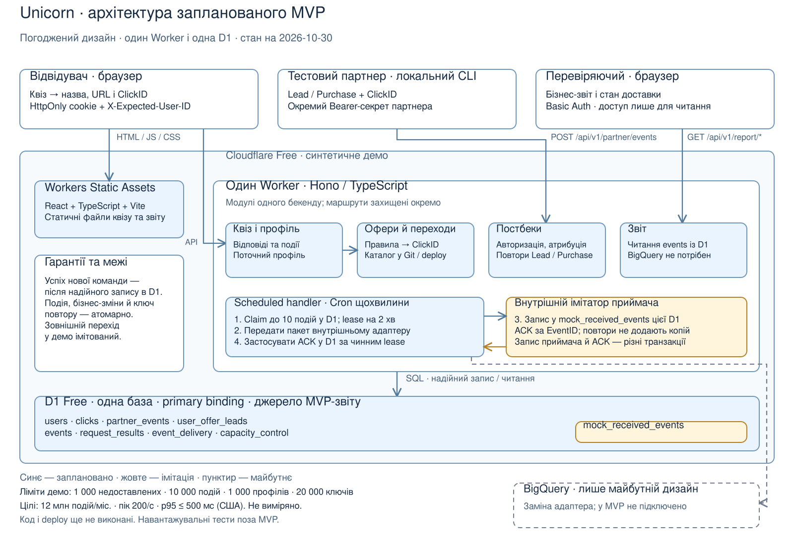

# Деталі та історія проєктування Unicorn

Створено: 2026-10-29. Збережено як довідник: 2026-10-30.
**Історія погоджень і детальні контракти.** Поточне зведення — [системний дизайн](system-design.md).
Фрази «ще відкрито» й «обговоримо» описують стан відповідного кроку;
актуальний статус — у [плані](plan.md) та фінальному звіті аудиту.
Пізніші D уточнюють ранні формулювання; джерело погоджень — [журнал рішень](decisions.md).
Аудиторія — власник та перевіряючі тестового; мета — пояснити межі системи,
потоки й компроміси та підготувати основу для implementation plan.
Це не завершена архітектура і не дозвіл почати реалізацію.

Підстави: [вимоги](requirements.md), [D-001–D-179](decisions.md),
[перевірені сценарії](scenarios.md), [AR-01–AR-10](scenarios-audit.md).
Погоджені рішення не змінюємо через появу схеми.
Актуальний залишок і межі деталізації — у [звірці з ТЗ](design-scope-check.md).

## Погоджені межі демонстрації — D-026

MVP працюватиме лише на **Cloudflare Free**, з малими синтетичними даними.
12 млн подій/місяць, пік 200/с та p95 ≤ 500 мс з обох узбереж США —
**цілі дизайну, не виміряні характеристики демо**. Навантажувальні тести
і точні вимірювання продуктивності поза обсягом тестового. Дизайн міститиме
офіційні квоти та приблизні оцінки. Перевірки бізнес-логіки й відмов залишаються;
заповнення буфера демонструємо на малому контрольованому ліміті за SC-10.

## P-01 — межі бекенду, погоджено як D-027

**Рішення власника, 2026-10-29:** модульний моноліт — один бекенд із розділеними
відповідальностями квізу/профілю, вибору офера/переходів, постбеків і звіту.
Модулі — частини коду з визначеними межами, не окремі мережеві сервіси.
Публічні та закриті маршрути залишаються окремо захищеними за D-020.
Фоновий експорт — окремий scheduled handler того самого Worker за D-055. Основне сховище MVP — одна SQL-база за D-029.

| Варіант | Перевага для цього завдання | Компроміс |
|---|---|---|
| Один бекенд із модулями | Менше мережевих меж для узгодженого запису відповідей, подій і переходів; простіша наскрізна перевірка | Межі модулів потрібно підтримувати в коді; релізи API спільні |
| Незалежні сервіси квізу, постбеків і звіту | Окремі релізи й масштабування частин | Більше інтеграцій, авторизації між компонентами й узгодження даних; перевага для поточного MVP ще не обґрунтована |

Обрано перший варіант через малий погоджений MVP (D-027).
Основна база — D1 за D-030, експорт — Cron за D-055, інтерфейс — React + Vite
за D-061, HTTP-маршрути — Hono за D-062. Доступ до D1 — прямий SQL за D-063; конкретні
SQL/API-контракти ще деталізуємо.

Початкову [перевірку Cloudflare Free](cloudflare-free-tier.md) виконано
2026-10-29: ліміти для демо, відмінність від повного навантаження та обмеження
24-годинної Queue. Це вхідні дані для подальшого вибору сервісів.

## Перший ескіз компонентів



[Редагована схема Excalidraw](diagrams/system-context.excalidraw).

Формат локального `.excalidraw` перевірено 2026-10-29 за
[офіційним описом JSON](https://docs.excalidraw.com/docs/codebase/json-schema).
SVG — окремий перегляд того самого ескізу. Імпорт у редактор Excalidraw
ще не перевірений; жодної технічної спроможності Cloudflare цим не підтверджено.
Автоматичне відкриття локального SVG у браузері заблоковане політикою
`file://`; візуальну перевірку рендеру не виконано. JSON і SVG перевіряються
як локальні документи, без завантаження схеми до зовнішнього сервісу.

Рамка бекенду — погоджене D-027. Основні дані та стан недоставлених подій
зберігаємо в одній SQL-базі за D-029; обрано D1 Free за D-030.

- Браузер працює через API; саме API перевіряє доступ і виконує бізнес-правила.
- Перевіряючий читає закритий звіт і окремо надсилає тестові постбеки з
  партнерським секретом. Ці два дозволи не взаємозамінні.
- Збережені відповіді й події є основою вибору офера та MVP-звіту.
  Успішна відповідь запису залежить від надійного збереження, не від експорту.
- Фоновий шлях доставляє прийняті події. У MVP приймач імітований;
  реальна доставка в BigQuery лишається частиною дизайну розвитку.
- Перехід на сайт партнера у MVP імітований; партнерські події справді
  приймаються тестовим endpoint і прив'язуються через ClickID.

## P-02 — каталог оферів, погоджено як D-028

Сім заданих оферів зберігаємо у конфігу репозиторію. Серверний модуль оферів
читає конфіг і застосовує правила вибору; зміна EPU, активності чи умов
проходить через Git та нове розгортання. Формат конфігу оберемо зі стеком.
Альтернативу — таблицю в БД зі змінами без релізу — відкладено через малий
каталог і відсутність адмінки. Поля історичного переходу за D-009 не
переписуємо при зміні каталогу. Узгодженість вибору та запису переходу,
включно зі зміною версії застосунку, деталізуємо в AR-04.

## P-03 — одне основне сховище MVP, погоджено як D-029

Рішення власника: одна основна реляційна база для поточного стану користувача,
історії подій і переходів, ключів повторів та стану доставки. Це окремі
логічні сутності/таблиці в одній базі; сервіс D1 обрано за D-030,
фізична схема ще деталізується.
Каталог оферів залишається в конфігу за D-028. MVP-звіт читає збережені
події цієї бази; BigQuery лишається напрямом розвитку з імітацією приймача.

Перевага: стан відповіді й відповідну подію можна проєктувати в межах однієї
транзакції, як вимагає D-017. Сам вибір однієї бази атомарність не доводить:
підтримку `batch()` перевірено за документацією D1, конкретні операції
перевіримо під час реалізації.
Компроміс — квіз, приймання подій і звіт ділять ресурси та домен відмови.
Альтернатива — окремі сховища для оперативного стану й аналітики: можна
незалежно масштабувати, але потрібні доставка, повтори й контроль узгодженості
між ними. Для малого Free-демо обрано одну основну базу.

Поведінку вже визначають D-007, D-009, D-015, D-019: поточні відповіді
оновлюються по питаннях, минулі події й переходи не переписуються під них;
компактний факт Lead живе окремо від детальної історії. Email не дублюємо
в подіях. Строки очищення залишаються різними. P-03 обирає межу сховища,
а не переглядає ці бізнес-правила.

## P-04 — Cloudflare D1, погоджено як D-030

Власник обрав D1 як реалізацію D-029: керовану SQL-базу з семантикою
SQLite та доступом через Workers binding. Це сервіс усередині Cloudflare,
доступний на Free. [Офіційний опис](https://developers.cloudflare.com/d1/),
перевірено 2026-10-29. Конкретний framework бекенду цим не обираємо.

Перевірено можливість транзакцій через `batch()`, квоти та обмеження
читання/запису: [технічні підстави вибору](cloudflare-free-tier.md#технічні-підстави-вибору-d1).
Для малого MVP обрано звичайний доступ до primary через binding.
Функціонально перевіримо повтори, конкурентні записи та відкочування
пакета; результатів таких тестів ще немає. AR-03/AR-04 цим не закриті.

Альтернатива в Cloudflare — SQLite у Durable Object: є транзакційне
сховище, доступне через його екземпляр. Для однієї спільної бази та звіту
це потребувало б додаткового шару викликів об'єкта. Це оцінка агента;
потреби в такій координації для поточного MVP поки не виявлено.
[Storage API](https://developers.cloudflare.com/durable-objects/api/sqlite-storage-api/),
перевірено 2026-10-29. P-04 погоджено як D-030; ресурсів ще не створено.

## P-05 — форма поточного профілю, погоджено як D-031

Для фіксованого квізу погоджено один запис `users` на UserID з явними
полями поточного стану. Це рішення схеми, не готова міграція.

| Поле | Призначення |
|---|---|
| `user_id` | Ідентичність користувача в межах профілю браузера; не email |
| `preferred_gender` | Кого шукає користувач: `women` / `men`; до відповіді — порожньо |
| `preferred_ethnicity` | Етніка бажаного партнера: `asia` / `europe` / `latam`; до відповіді — порожньо |
| `email` | Поточна підтверджена адреса; до підтвердження чи після очищення — порожньо |
| `email_confirmed_at` | Час останнього підтвердження email для його 30-денного строку |
| `created_at` | Час створення профілю |
| `last_active_at` | Активність у воронці за D-025 для 180-денного строку профілю |
| `selection_revision` | Серверна версія стану для умовного запису B, показів і підтверджень за D-064/D-160; клієнт її не задає |

Запит конкретного питання змінює лише відповідне поле й потрібні службові
дані за D-015; повний профіль із браузера не перезаписуємо. Один рядок
не означає оновлення всіх полів разом. Історія подій, переходи, факти Lead,
ключі повторів і доставка залишаються окремими сутностями за D-029.
Після 30 днів очищення email не видаляє вподобання; строки не змінюємо.

Альтернатива — універсальна таблиця вподобань із ключем `(user_id, question_id)`
та значенням відповіді. Вона зручніша для змінного набору питань, але потребує
збирання профілю з кількох рядків і перевірки типу за `question_id`.
Обрано явні поля, оскільки конструктор квізів поза MVP.
Механізм браузерного доступу, типи часових полів, індекси та атомарний запис
разом із подією деталізуємо окремо.

## P-06 — запис переходу ClickID, погоджено як D-032

**Рішення власника, 2026-10-29:** окрема таблиця `clicks`:
один запис на створений сервером перехід. Підстава — D-009 і D-024;
це не підтвердження завантаження сайту партнера. У MVP зовнішній вихід імітуємо.

| Поле | Призначення |
|---|---|
| `click_id` | Унікальний ID переходу, який створює сервер; повертається в постбеках |
| `user_id` | Користувач, для якого сервер створив перехід |
| `offer_id` | Стабільний ID обраного офера з конфігу, наприклад `003` |
| `preland_id` | Преленд, з якого створено саме цей перехід; для атрибуції звіту |
| `created_at` | Серверний час створення переходу в UTC, незмінний при повторах |
| `partner_id` | Партнер обраного офера на момент переходу; для зіставлення з авторизованим відправником постбека |
| `offer_name_snapshot` | Назва офера на момент переходу для повторного показу результату |
| `target_url_snapshot` | Підготовлений сервером цільовий URL цього переходу з ClickID; без email та секретів |
| `catalog_version` | Версія конфігу, використана спробою вибору; додано рішенням D-039 |
| `flow_mode` | Серверна підстава переходу: `quiz` через чинну A або `bypass` за правилами повернення; незмінна за D-152 |
| `completion_event_id` | Для `quiz` — EventID підтвердження email конкретної A; для `bypass` посилання відсутнє. Незмінне за D-153 |
| `entry_event_id` | Конкретний прийнятий `funnel_entered` для B, незмінний при повторі; D-155 |

Перші п'ять зв'язків уже визначено в D-009. Окреме поле партнера та знімок
назви/URL погоджено в D-032. `user_id` походить із перевіреного сервером
контексту користувача, дані офера — із серверного вибору за конфігом;
довільні значення з постбека не змінюють запис переходу.
`offer_id` посилається на конфіг логічно, не на таблицю оферів у БД.

Альтернатива знімку — зберігати лише ID й щоразу читати назву/URL з поточного
конфігу. Це менше полів, але після нового розгортання старий результат може
змінитися. Обрано збереження назви й URL для відтворення результату D-024.
Знімок не дозволяє новий перехід на вимкнений офер; цей випадок лишається
частиною AR-04. Зберігати весь каталог або email у переході не потрібно.

Зв'язки: один користувач → багато переходів; один перехід → багато партнерських
подій. Lead/Purchase зберігаються окремими записами з `click_id`, а не одним
статусом переходу. Сервер перевіряє авторизацію відправника та його права
на офер, знаходить перехід за ClickID і бере UserID/OfferID/PrelandID з нього.
Відсутній або невідомий ClickID відхиляється за D-009; атрибуція за останнім
переходом не застосовується.

Повтори партнерських подій визначає `(PartnerID, EventType, PartnerEventID)`
за D-010, не ClickID. Один перехід може мати кілька окремих покупок;
Purchase приймається без Lead за D-011. Наприклад, U1 створив C1 → 003,
потім C2 → 004; пізній Purchase з C1 належить 003. Інший PartnerEventID
з тим самим C1 — окрема покупка, повтор того самого ключа й даних — без дубля.

Незмінні межі: нова дія переходу створює новий ClickID; reload результату
й повтор успішного запиту повертають старий. Ключ операції, запис події
переходу та транзакційні умови деталізуємо в AR-03/AR-04, а не вважаємо
забезпеченими самим полем `click_id`.
Строк переходу — 90 днів із винятками D-019; компактний факт Lead має
власні UserID, OfferID та час реєстрації й повинен переживати очищення
детального переходу. Модель партнерських подій і Lead погоджено в P-07;
фізичні зовнішні ключі, очищення залежностей та індекси ще деталізуємо.
Коду та міграцій ще немає; рішення зафіксовано без коміту.

## P-07 — партнерські події та компактний Lead, погоджено як D-033

**Рішення власника, 2026-10-29:** `partner_events` для прийнятих
Lead/Purchase та `user_offer_leads` для чинних фактів реєстрації.
Розділення детальної історії й компактного Lead вже вимагає D-019;
модель і один компактний запис на пару користувач/офер погоджено в D-033.

`partner_events`: один запис на одну прийняту бізнес-подію партнера,
не на кожну HTTP-доставку.

| Поле | Призначення |
|---|---|
| `event_id` | Стабільний внутрішній ID події, спільний для її обліку й експорту |
| `partner_id` | Партнер, встановлений через авторизацію й звірений із переходом |
| `event_type` | `Lead` або `Purchase` |
| `partner_event_id` | ID реєстрації або конкретної оплати на стороні партнера |
| `click_id` | Перехід, який атрибутує подію |
| `user_id`, `offer_id`, `preland_id` | Незмінні значення, скопійовані сервером зі знайденого переходу при прийнятті |
| `occurred_at` | Час реєстрації/покупки у партнера, перевірений за D-012 |
| `received_at` | Серверний час першого прийняття; повтор не змінює його |
| `amount_minor`, `currency` | Дані Purchase: ціла сума в найменших одиницях валюти та код валюти; для Lead порожні |

Унікальність — `(partner_id, event_type, partner_event_id)` за D-010.
Однакові ключ і бізнес-дані повертають попередній успішний результат;
конфліктні дані відхиляються. Різні покупки одного ClickID зберігаються окремо.
Обов'язковість суми/валюти та допустимі значення погоджено в D-054/P-28;
точний числовий ліміт і представлення API ще деталізуються.

Копія атрибуції потрібна через різні строки: перехід живе 90 днів від створення,
подія — 90 днів від прийняття. Пізня подія може пережити свій перехід;
її атрибуцію не можна втратити разом із `clicks`. Новий постбек без наявного
переходу не приймаємо за D-009/D-012. Це не змінює вимогу повної історії
для звіту: якщо потрібної групи переходів уже немає, діє D-019.
Зв'язок із журналом подій та станом доставки визначають D-034–D-035:
один Lead/Purchase має один внутрішній EventID і не рахується двічі через
наявність кількох технічних таблиць. Сирий payload із довільними полями
та email не зберігаємо.

`user_offer_leads`: один запис на `(user_id, offer_id)`, поля:
`user_id`, `offer_id`, `latest_lead_at` — найбільший `occurred_at` прийнятих
Lead цієї пари. Новий валідний Lead може збільшити цей час; старіший,
доставлений пізніше, не пересуває його назад. Повтор не змінює факт.
Повернення обирає серед фактів активних оферів найбільший `latest_lead_at`,
за рівності — найменший OfferID, як уже визначено в D-008.

Purchase не створює й не змінює `user_offer_leads` за D-011. Окремий
`has_purchase` для вибору офера в MVP не потрібен. Компактний Lead живе
за 180-денним строком неактивності профілю (D-019/D-025), а не за часом
останнього постбека; його не видаляємо каскадом разом із подією чи переходом.

Альтернативи: щоразу виводити Lead із детальних подій — втрачати факт після
очищення 90-денної історії; тримати тільки прапорець `has_lead` у профілі —
не мати офера й часу для вибору між кількома Lead. Погоджене розділення
підтримує різні строки й погоджений пріоритет, але потребує узгодженого запису.
Приймання Lead, захист від повтору та оновлення компактного факту мають
відбуватися атомарно; конкретні SQL-операції, індекси, ключі дедуплікації
після очищення історії та залежності retention залишаються AR-03/AR-05.

Контрольний приклад для майбутньої перевірки: Lead L1 для U1/003 із часом
10:00 створює компактний факт; інший Lead L2 із часом 09:00, прийнятий пізніше,
залишає 10:00. Purchase P1 і P2 з одним ClickID дають дві покупки;
повтор P1 не додає третю. Очищення детального L1 не видаляє чинний факт U1/003.
Це очікування, не результати тестів; коду й міграцій немає.

## P-08 — спільний журнал подій, погоджено як D-034

**Рішення власника, 2026-10-29:** таблиця `events` як спільна основа
обліку подій квізу, переходів і партнерських результатів. MVP-звіт читає
цей журнал; фоновий експорт використовує ті самі EventID. Поточний профіль,
`clicks`, `partner_events` і `user_offer_leads` зберігають свої призначення.

Основні поля журналу: `event_id`, `event_type`, `user_id`, `preland_id`,
`occurred_at`, `received_at`; `question_id` — для подій питання,
`click_id` і `offer_id` — для переходу та його партнерських результатів.
Подія `offer_transition` також містить незмінний `flow_mode`, узгоджений
із ClickID у спільній транзакції за D-152; для `quiz` також містить
`completion_event_id` конкретної події завершення за D-153.
Для подій квізу до вибору офера `offer_id`/`click_id` порожні за D-022;
пізніший вибір не дописує їх заднім числом. Дані конкретних типів,
каталог подій і джерела часу уточнимо окремо в AR-01/AR-02.
Email у журнал не потрапляє: підтвердження адреси фіксується як дія без адреси.
За D-168 значення інших відповідей також не включаємо до events та
експортного знімка: лише факт підтвердження. Актуальні відповіді — у профілі.
Кожна `answer_confirmed` зберігає `view_event_id` конкретного прийнятого
показу за D-154, включно з фінальним підтвердженням email.
`question_viewed` та `offer_transition` зберігають `entry_event_id`
прийнятого входу за D-155; у відповіді цей зв’язок читаємо через показ.
За D-167 запис events також містить незмінний експортний JSON і
`schema_version`; створюємо їх атомарно з подією. Повторна доставка
використовує цей знімок, а не актуальний профіль чи каталог.

Для Lead/Purchase `events.event_id` і `partner_events.event_id` однакові:
одна бізнес-подія представлена записом журналу й партнерськими деталями
у зв'язку 1:1. Звіт не складає обидві таблиці як два набори подій;
за потреби деталей приєднує їх за EventID. Спільні атрибуційні й часові
поля мають збігатися; копії не редагуються незалежно. D-033 не скасовується.
Компактний Lead не є ще однією подією й не додає одиницю до звіту.

Запис журналу, зміна поточного стану або створення партнерської події
та потрібного компактного Lead повинні зберігатися атомарно за D-017.
Повтор прийнятого постбека повертає старий EventID без нового запису
в обох таблицях. Приклад: Purchase P1 → внутрішній E1 у журналі й E1
у партнерських деталях, одна покупка; повтор P1 — усе ще одна;
інша Purchase P2 того самого ClickID → E2, друга покупка.
Це вимоги до майбутніх операцій AR-03, не доказ реалізованої атомарності.

Альтернатива — збирати загальний потік запитами з окремих журналів кожного
модуля. Вона зменшує дублювання спільних полів і кількість записів,
але звіт та експорт повинні узгоджувати кілька джерел і їхні формати.
Обрано спільний журнал для простого звіту й однієї точки експорту;
ціна — додаткові записи, місце та обмеження узгодженості. Їх потрібно
врахувати в бюджеті D1 Free й оцінках AR-08, без benchmark за D-026.

Строк журналу — 90 днів від прийняття з винятками D-019. Доставленість
не змінює зміст бізнес-події; схему стану доставки погоджено в P-09.
Узгоджене очищення журналу, партнерських деталей і залежностей
експорту лишається AR-05. Каталог і поведінку подій погоджено в D-041–D-044,
повтори команд — D-036/D-065; точні формати ID й транзакційні SQL ще деталізуємо. Рішення зафіксовано
без коміту; коду й міграцій немає.

## P-09 — стан доставки подій, погоджено як D-035

**Рішення власника, 2026-10-29:** окрема таблиця `event_delivery`
у тій самій D1: один запис на EventID для одного потоку експорту MVP.
Зміст події залишається в `events` та її деталях; стан доставки змінюється
окремо. Приймач у MVP імітований за D-058; запуск — Cron за D-055.
Реальний контракт BigQuery поза реалізацією MVP.

| Поле | Призначення |
|---|---|
| `event_id` | Унікальний зв'язок 1:1 із подією журналу |
| `status` | `pending`, `in_flight` або `delivered` |
| `attempt_count` | Кількість розпочатих спроб, включно зі спробою, що обірвалася до мережевого запиту |
| `next_attempt_at` | Коли дозволено наступну спробу для `pending` |
| `lease_token` | Унікальна позначка поточної спроби для умовного оновлення її результату |
| `lease_until` | До якого часу спроба володіє записом |
| `delivered_at` | Серверний час фіксації підтвердженої доставки, інакше порожньо |
| `last_error_code` | Контрольований код останньої помилки без сирого тіла відповіді, секретів чи email |

Нова подія, пов'язані бізнес-зміни та її `pending` створюються атомарно
до успішної відповіді API. Повтор прийнятої дії не створює нового запису
доставки й не скидає `delivered`. Сам запис події без можливості знайти
її для експорту недостатній за D-017.

| Поточний стан / умова | Дія та наступний стан |
|---|---|
| `pending`, настав `next_attempt_at` | Фоновий процес атомарно забирає запис, задає token/строк, збільшує лічильник; `in_flight` |
| `in_flight`, приймач підтвердив надійне прийняття | Власник чинної спроби умовно фіксує `delivered` і час; очищає lease |
| `in_flight`, помилка або невизначений результат | Власник чинної спроби повертає в `pending` із відкладеним повтором і кодом помилки; очищає lease |
| `in_flight`, процес зник або строк спроби минув | Запис знову доступний для атомарного захоплення новою спробою з новим token |

За D-171 відправляємо лише підтверджено захоплений набір. Якщо результат
захоплення невідомий, поточний запуск не викликає приймач, не повторює
захоплення негайно й не скидає можливий lease; наступний Cron відновлює
роботу за фактичним станом D1 та строком lease.

Мережеву відправку виконуємо поза транзакцією захоплення. Позначити успіх
або помилку може лише чинна спроба за token і строком; запізніла відповідь
старої спроби не перезаписує стан нової та не повертає `delivered` у `pending`.
Lease зменшує паралельні відправки, але не виключає їх після таймауту;
конкретні SQL-умови та перевірки конкурентності залишаються AR-03/AR-06.

Якщо приймач зберіг E1, а ACK загубився, відправляємо ту саму E1 з тим
самим змістом знову. Приймач має розпізнати повтор за EventID і підтвердити
вже прийнятий результат без другого зарахування. Імітатор перевіряє цей
контракт; автоматичну дедуплікацію BigQuery не припускаємо. Гарантія цього
підходу — повторювана доставка з ідемпотентним прийманням, не одна мережева спроба.

Повтори проєктуємо з наростаючою затримкою, верхньою межею й невеликим
випадковим зсувом. Невдала подія не блокує відбір інших готових подій.
За тривалих помилок авторизації/контракту запис залишається недоставленим,
сигналізує про проблему та повторюється з обмеженою частотою після виправлення
причини. Ліміт спроб не видаляє прийняту подію і не позначає її доставленою.
Пороги віку й заповнення лишаються D-018; точні інтервали та спосіб
сповіщення обговоримо в експлуатаційному контракті.

`pending` та `in_flight` разом займають бюджет недоставлених подій;
підтверджений `delivered` звільняє цей бюджет, але не видаляє історію.
Звичайне очищення не видаляє недоставлену подію, її стан та потрібні
деталі за D-019. Звіт MVP читає прийняті події незалежно від доставки;
затримку експорту відображаємо окремо від актуальності локального звіту.
Поріг відновлення приймання погоджено в D-059. Байти, фізичне звільнення
місця й резерв для роботи доставки ще деталізуємо в AR-05/AR-06/AR-08.

Альтернатива — поля доставки в самій `events`: менше таблиць і з'єднань,
але історія та часто змінюваний стан фонового процесу живуть в одному рядку.
Обрано окремий `event_delivery` для чіткої відповідальності;
ціна — додаткові рядки/індекси й вимога атомарного початкового запису.
Це не новий сервіс або друга база. Параметри доставки й частковий ACK
погоджено в D-056/D-057; точний контракт приймача й SQL ще деталізуємо.

Майбутні перевірки: збій до/після початкового commit, перезапуск під час
відправки, прострочена спроба, два фонові процеси, втрачений ACK, збій D1
при записі підтвердження та відновлення після заповнення малого буфера.
Рішення зафіксовано без коміту; коду й результатів тестів немає.

## P-10 — ключі повторів браузерних команд, погоджено як D-036

**Рішення власника, 2026-10-29:** `operation_id` для кожної окремої
команди браузера, що змінює дані, та таблицю `request_results` для результатів
успішно виконаних команд. Це технічна реалізація правил D-015/D-024;
OperationID не є UserID, VisitID, ClickID або ідентифікатором покупки.

Браузер створює новий OperationID перед першою відправкою нової дії.
Повтор після таймауту або втрати відповіді використовує той самий ID
і бізнес-дані. Зміна відповіді чи новий фактичний перехід — нова дія та ID,
навіть якщо значення збіглися з попередніми. Ідентичність незавершеної
команди має переживати reload у межах погодженого браузерного сценарію;
механізм локального збереження уточнимо разом з API.

| Поле `request_results` | Призначення |
|---|---|
| `user_id`, `operation_id` | Унікальний ключ повтору в контексті авторизованого браузерного користувача |
| `operation_type` | Вид команди: підтвердження відповіді, створення переходу тощо |
| `request_fingerprint` | Відбиток нормалізованих бізнес-даних для виявлення іншого запиту з тим самим ключем |
| `result` | Мінімальний результат: код результату, створені EventID та ClickID за наявності; без повної копії профілю/email |
| `created_at` | Серверний час фіксації виконаної команди |

За D-174 повний серіалізований JSON поля result — до 4 KiB UTF-8;
перевіряємо до фіксації команди, без обрізання чи часткового запису.

Після перевірки доступу сервер шукає результат за ключем. Той самий ключ,
тип і бізнес-дані повертають збережений результат без повторного виконання.
Інший тип або бізнес-дані з тим самим ключем — конфлікт, а не перезапис.
Повтор R1 після новішої успішної R2 не відновлює стару відповідь у профілі;
історичний результат R1 не є актуальним профілем за D-015/SC-08.

За відсутності запису сервер виконує команду: бізнес-зміни, `events`,
`event_delivery` та успішний результат повинні фіксуватися атомарно.
Конкурентні запити одного ключа не повинні обидва застосувати зміни;
самого попереднього SELECT для цього недостатньо. Після відкочування
тимчасової невдалої спроби успішного результату немає — повтор може
виконатися. Валідаційні помилки не видаємо за завершену успішну команду.
Точні SQL-умови, відповідь на одночасний незавершений запит і HTTP-коди
залишаються AR-03.

Приклад: підтвердження R1 створило E1, але відповідь загубилася.
Повтор R1 повертає E1 без другої події. Нова дія R2 із тією самою
відповіддю створює E2; показник унікальних користувачів лишається за D-013.
Команда переходу T1 створила C1: повтор T1 повертає C1, нове повернення
з новою командою T2 може створити C2 за D-024.

Альтернатива — покладатися лише на унікальність EventID у журналі:
вона захищає сам запис події, але не описує результат команди, яка створює
ClickID або кілька пов'язаних записів. Обрано окремий ключ
команди та її результат, приймаючи додаткові записи й квоту D1.
Для партнерів зберігається ключ D-010, для експорту — EventID за D-035;
браузерний OperationID не замінює ці контракти.

Межі локального відновлення уточнено: первинні події — D-079,
Q1/Q2 — D-080 (лише пам’ять сторінки); фінальні A/B — D-047–D-049
(sessionStorage до 24 годин). Серверні строки ключів від цього не змінюються.

Відбиток не означає автоматичного знеособлення email. Спосіб порівняння,
захист відбитка й очищення всіх похідних від email даних потрібно узгодити
з D-019; сирий запит або адресу в результаті не зберігаємо. Строк життя
`request_results`, поведінка після його завершення, збереження ключів
партнерських подій після очищення історії та відновлення після частково
виконаного фінального кроку — наступні питання AR-03/AR-05. Без цього
не оголошуємо повтори безпечними необмежено в часі. Рішення зафіксовано
без коміту; коду й міграцій немає.

## P-11 — строки ключів повторів, погоджено як D-037

**Рішення власника, 2026-10-29:** різні строки для браузерних команд
і партнерських подій. Число 7 днів нижче — погоджений строк MVP,
не вимога ТЗ й не новий строк життя профілю, події чи переходу.

### Браузерні команди

- Повний мінімальний результат і відбиток у `request_results` доступні
  **7 днів від першого успішного виконання**. Повтор не поновлює строк.
  До межі повертаємо збережений результат або конфлікт за D-036.
- На межі 7 днів результат і відбиток стають недоступними для повтору;
  очищаємо їх, залишаючи в тому самому записі лише `(user_id, operation_id)`,
  час створення та позначку `expired`. Вона не містить email, його відбитка,
  відповіді, EventID або ClickID. Затримка фізичного очищення не продовжує
  логічне вікно повернення результату.
- Ця компактна позначка живе до очищення профілю за D-019/D-025.
  Для активного профілю це може бути довше 180 днів від створення команди;
  її місце й індекси потрібно врахувати в бюджеті Free за AR-08.
- Повтор поза 7-денним вікном отримує `operation_expired` без повторного
  виконання, незалежно від даних запиту. Клієнт читає актуальний стан;
  автоматично перевидавати стару команду під новим ID заборонено.
  Лише нова свідома дія користувача створює новий OperationID.
- Очищення результату команди не видаляє її подію чи перехід. Зокрема,
  показ старого результату переходу за збереженим ClickID залишається
  окремим читанням власних даних у межах D-024/D-032 та AR-04.
- Після очищення профілю старі команди не переносяться на новий UserID.
  Команда має бути прив'язана до вихідного UserID та перевірятися проти
  поточної браузерної авторизації; клієнт відкидає старі незавершені команди
  при зміні ідентичності. Деталі контракту — AR-07.

Захист не залежить від клієнтського годинника: строк рахується сервером.
Просте видалення всього запису через 7 днів небезпечне — старий ключ
виглядав би невідомим і команда могла б виконатися вдруге. Альтернатива
компактній позначці — серверно перевірюване обмеження строку самої команди,
яке дозволяло б повністю видаляти ключі; це окремий протокол видачі й
перевірки. Для малого MVP обрано позначку в наявній таблиці.
Захист відбитка протягом 7 днів погоджено в D-083: HMAC-SHA-256
з окремим серверним секретом; це не робить похідні email дані знеособленими.

### Партнерські події

Ключ `(PartnerID, EventType, PartnerEventID)` і дані порівняння конфліктів
зберігаємо щонайменше до завершення строків **обох**: переходу та прийнятої
події. Очищення дозволене лише після видалення обох записів та завершення
всіх пов'язаних утримань для доставки за D-019; ключ не видаляється першим.
Повтор не продовжує строки. Новий постбек без потрібних даних не приймаємо.

Приклад: ClickID створено в день 0, Purchase прийнято в день 89.
За звичайними строками перехід завершується в день 90, подія — в день 179;
її ключ утримується щонайменше до дня 179, а за недоставленої події — довше.

Для відомого повтору після очищення ClickID: спочатку перевірити
авторизацію й знайти збережений ключ. Якщо бізнес-дані збігаються —
підтвердити вже прийнятий результат без нового запису; інші дані — конфлікт.
Для цього разом із ключем потрібні дані атрибуції для перевірки прав,
відбиток/значення бізнес-полів і попередній EventID; конкретну схему ще
визначимо. Відсутній ключ і відсутній ClickID означають відхилення,
не відновлення за останнім переходом. Це уточнення старих повторів,
а не дозвіл приймати нові події після видалення переходу.

Ключі приймача експорту мають переживати всі дозволені повторні відправки,
включно з втраченим ACK та утриманням події понад 90 днів. Контракт імітатора
та майбутнього BigQuery узгодимо окремо; строки браузерних ключів до них
не застосовуємо. SQL очищення, межі часу, узгодження з доставкою та поведінка
після часткового фінального кроку залишаються AR-03/AR-05/AR-06.
Рішення зафіксовано без коміту; коду й результатів тестів немає.

## P-12 — фінальний крок із двох відновлюваних команд, погоджено як D-038

**Рішення власника, 2026-10-29:** одне натискання фінального «Продовжити»
виконує дві послідовні команди, кожна зі своїм OperationID і атомарною
межею. Додаткової кнопки між квізом та результатом немає за D-024.

| Команда | Що записує атомарно |
|---|---|
| A — підтвердити email | Поточний email і час підтвердження, подію підтвердження без адреси, її `event_delivery`, результат A |
| B — обрати офер і створити перехід | За наявності офера: `clicks` зі знімком, подію переходу, її `event_delivery`, результат B із ClickID |

Для звичайного завершення квізу B починається після надійного виконання A;
сервер перевіряє користувача, підставу завершення та актуальні умови вибору.
Клієнт зберігає ID обох команд і зв'язок їх із поточною дією до відправки.
Це не VisitID і не перенесення між браузерами. Формат API, спосіб збереження
незавершеного ланцюжка та серверного підтвердження зв'язку A/B ще уточнимо.

| Збій / стан | Відновлення |
|---|---|
| A не зафіксована | B не запускаємо; повтор A із тим самим ключем може виконати збереження |
| A зафіксована, відповідь загубилася | Перевіряємо її збережений результат за OperationID або повторюємо A; не створюємо друге підтвердження |
| A зафіксована, B ще не виконана або відкочена | Продовжуємо B з її початковим ключем; email і подія A залишаються збереженими |
| B створила C1, але відповідь загубилася | Повтор B повертає C1 зі збереженим результатом; новий вибір не виконується |
| Доступного офера немає | Збережене підтвердження A лишається, ClickID не створюється; показуємо погоджений стан відсутності офера |

У межах збережених результатів reload відновлює саме цей ланцюжок із тими
самими ID. Читання власного результату A не потребує повторного введення
вже збереженого email. Незбережену чернетку після закриття вкладки не
гарантуємо за SC-03. Клієнт не створює нових ключів лише через таймаут.
Після `operation_expired` діє D-037: читаємо актуальний стан і очікуємо
нової свідомої дії, не перевидаємо весь ланцюжок автоматично.
Якщо B ще не виконана, прострочений доказ A не дає автоматично завершити
старий ланцюжок. Уже виконана B повертає свій результат у межах власного
строку; старий ClickID за наявності читається окремо за D-037.

При поверненні з пропуском квізу за активним Lead або D-023 виконується
лише B з відповідною серверною перевіркою підстави пропуску. Підтвердження
email чи події пропущених питань не створюються. Новий фактичний вхід і
відновлення попередньої команди розрізняємо за D-024; точний контракт
навігації та перевірку цього розрізнення ще потрібно визначити.

Альтернатива — одна атомарна команда для email, підтвердження й переходу:
простіший загальний повтор, але збій створення переходу відкочує також
нове підтвердження email. SC-09 допускає обидва варіанти. Обрано
дві команди, щоб зберегти підтверджену відповідь при збої наступної дії;
компроміс — проміжний стан та відновлення ланцюжка. Звіт може містити
підтвердження email без переходу, як уже описано в SC-09.

Порядок вибору проти конкурентних змін відповідей/Lead/каталогу, атомарні
SQL, облік no-offer та нова спроба після нього залишаються AR-03/AR-04/AR-09.
Кожна команда окремо дотримується місткості D-018: A може зберегтися,
а B отримати тимчасову помилку заповнення; це не дозволяє видалити A.
Це погоджені межі операцій, не готовий API або підтвердження працездатності.
Документацію оновлено без коміту; коду й міграцій немає.

## P-13 — узгоджений вибір і незмінний результат переходу, погоджено як D-039

**Рішення власника, 2026-10-29:** фіксуємо результат вибору в момент
успішного атомарного створення ClickID командою B. До цього обраний у пам'яті
кандидат ще не є переходом і може змінитися.

Для нової B сервер використовує узгоджений стан профілю та компактних Lead
у межах операції, що фіксує перехід. Спочатку застосовує пріоритет активного
Lead, потім решту погоджених правил D-008/D-023 та EPU/fallback.
Зміна відповідей або надходження Lead, що зафіксовані раніше за цю операцію,
мають бути враховані. Якщо між попереднім читанням і записом потрібні дані
змінилися, кандидат переобчислюється; перевірка та запис не можуть лишати
між собою незахищене вікно. Конкретний SQL/механізм — ще AR-03/AR-04.
Це внутрішня перевірка вибору, а не відхилення запису відповіді через версію
профілю; останній успішний запис за D-015 залишається правилом відповідей.

Каталог за D-028 живе в конфігу розгортання. Використовуємо
одну незмінну версію конфігу протягом спроби B та зберігаємо додатковий
`catalog_version` у `clicks` поряд зі знімком назви й URL. За D-176 це
SHA-256 нормалізованого перевіреного каталогу, 64 lowercase hex-символи;
Git SHA релізу фіксуємо окремо. Поле доповнює D-032 за D-039.
Під час оновлення вже запущений запит може завершитися за старою версією,
а запит, який обробляє нове розгортання, — за новою. Не обіцяємо миттєвого
глобального вимкнення офера для всіх запитів у польоті. У межах однієї
спроби не змішуємо активність із однієї версії та URL/EPU з іншої.

Після фіксації C1 повтор B і reload результату повертають C1 зі знімком,
не перечитують актуальні відповіді для нового вибору й не створюють C2.
Пізніший Lead або зміна конфігу не переписують цей історичний перехід.
Читання й повтори обмежені строками D-037 та правами користувача.
Новий фактичний вхід/перехід отримує нову B, яка знову застосовує поточні
правила та конфіг тієї версії бекенду, що обробляє її.

Якщо старий офер уже вимкнений у поточному конфігу, reload у демо все одно
показує збережений історичний результат з C1, без нового зовнішнього переходу.
Саме існування C1 не дозволяє створити новий перехід на вимкнений офер.
Окремого автоматичного перенаправлення зі старого результату немає.

| Контрольний випадок | Погоджене очікування |
|---|---|
| Попередньо обрано 003, але Lead активного 001 записано до фіксації B | Переобчислити й створити перехід на 001 |
| C1 на 003 уже зафіксовано, потім прийшов Lead 001 | Повтор B повертає C1; нова дія вибору враховує Lead 001 |
| Відповіді змінені іншою вкладкою до фіксації B | Вибір враховує узгоджений серверний стан, а не старий кандидат у пам'яті |
| Після C1 оновлено URL або активність офера | Старий результат незмінний; нова дія працює за конфігом її обробника |

Альтернатива — обрати кандидата один раз до запису й не перевіряти стан:
простіше, але можна пропустити вже прийнятий Lead або вибрати за застарілою
відповіддю. Для каталогу суворе глобальне перемикання вимагало б додаткової
координації версії конфігу із записом у БД; для малого MVP обрано описану
межу версії розгортання. Це погоджений компроміс.
Точні транзакції, конкурентний deploy, живучість під навантаженням і механіка
навігації ще не перевірені. Результат no-offer та нову спробу після нього
погоджено в P-14; технічні деталі лишаються AR-09.
Документацію оновлено без коміту; коду й міграцій немає.

## P-14 — відсутній офер і нова спроба вибору, погоджено як D-040

**Рішення власника, 2026-10-29:** `no_offer` є завершеним
бізнес-результатом команди B після перевірки всіх правил і fallback 007.
Фіксуємо його та `catalog_version` у `request_results`, без ClickID,
знімка офера або події успішного переходу. Окремий тип аналітичної події
відсутності офера цим пунктом не вводиться; каталог подій погоджено в D-041.
Підтвердження email та попередні відповіді не відкочуються за D-038/SC-05.

На екрані «Немає доступного офера» показуємо кнопку «Спробувати ще раз».
Її натискання — нова дія: створюється новий OperationID для B, сервер
перевіряє актуальні підстави доступу до вибору, відповіді, Lead і конфіг
свого розгортання за D-039. За чинного завершення квізу або bypass A повторно
не виконується; додаткового підтвердження email та подій кроків немає.
Якщо підтвердження A прострочене та підстав bypass немає, автоматично
завершувати старий ланцюжок не можна за D-037/D-038: потрібна нова
свідома дія підтвердження. За недостатніх відповідей діють правила квізу.

| Дія / результат | Очікування |
|---|---|
| Повтор уже виконаної B1 або reload її no-offer результату | Повернути збережений `no_offer` у межах 7 днів, навіть після зміни каталогу |
| Натискання «Спробувати ще раз» | Нова B2; якщо офер з'явився — один новий ClickID, інакше новий збережений `no_offer` |
| Таймаут або помилка збереження результату | Технічний повтор тієї самої B з тим самим ключем; не видавати помилку за `no_offer` |

Поки запит виконується, кнопку блокуємо від повторного натискання.
Автоматичної періодичної перевірки чи нового вибору на кожен reload немає.
Після `operation_expired` не відтворюємо відсутній результат із припущень;
читаємо поточний стан і застосовуємо D-037. Нове відкриття преленда окремо
від екрана результату зберігає звичайні правила D-004/D-023, а не отримує
право обходу квізу через старий `no_offer`.

Сам вибір `no_offer` має бути узгоджений зі станом даних і однією версією
каталогу за D-039; результат зберігаємо до відповіді клієнту. Якщо D1 або
доступна місткість не дозволяє записати його, повертаємо тимчасову помилку,
а не непідтверджений бізнес-результат. HTTP-коди й SQL ще не обрані.

Альтернатива — змушувати користувача проходити квіз заново після кожного
`no_offer`. Обрано окрему явну повторну спробу B, щоб використати
вже підтверджені дані; ціна — стан екрана й розрізнення нової дії та retry.
Це не додаткова кнопка між квізом та успішним переходом: початкова B
запускається автоматично, кнопка доступна лише після `no_offer`.
Сценарії майбутньої перевірки: оновлення каталогу між B1/B2, втрачена відповідь,
подвійне натискання, прострочені результати та чинний/відсутній bypass.
Документацію оновлено без коміту; коду й міграцій немає.

## P-15 — мінімальний каталог подій, погоджено як D-041

**Рішення власника, 2026-10-29:** шість типів у `events`.
Назви — технічний контракт проєкту, не вимога первісного ТЗ.

| Тип | Коли фіксуємо | Хто підтверджує факт |
|---|---|---|
| `funnel_entered` | Нове відкриття преленда, включно з поверненням без квізу | Браузер повідомляє про вхід; сервер перевіряє користувача та преленд |
| `question_viewed` | Фактичний показ доступного питання, з `question_id` | Повідомлення браузера після показу; сам запит стану API показом не є |
| `answer_confirmed` | Сервер прийняв допустиму відповідь після підтвердження користувачем | Сервер, атомарно зі зміною відповіді за D-017 |
| `offer_transition` | Успішно створено ClickID | Сервер, атомарно з переходом; у MVP зовнішній вихід імітований |
| `Lead` | Прийнято валідну реєстрацію партнера | Авторизований постбек за D-010–D-012 |
| `Purchase` | Прийнято валідну окрему покупку партнера | Авторизований постбек за D-010–D-012 |

Початок квізу обчислюємо за фактичними `question_viewed`,
без додаткового дублюючого `quiz_started`. Це може бути доступне питання
зі `step`, не обов'язково перше. Для групи входу використовуємо перший
відповідний показ користувача в обраному періоді за D-014; унікальність
та подальші результати рахуються за чинними правилами, не за кількістю подій.
Завершення квізу відповідає `answer_confirmed` питання email; окрема подія
`quiz_completed` не потрібна. При bypass цих показів/підтверджень немає.

За пізнішим D-168 усі `answer_confirmed` містять лише факт підтвердження,
question_id та погоджені службові поля й посилання; значення відповідей,
email і його відбиток у журнал та експорт не потрапляють. Актуальні
відповіді зберігаються в профілі. Подія має
ідентифікувати конкретне питання; підстановка старої відповіді не створює
підтвердження, натискання «Продовжити» зі старим значенням створює нову дію.
Офер і ClickID з'являються лише в події переходу та партнерських результатах,
а не дописуються до попередніх подій квізу за D-022.

`no_offer` залишається збереженим результатом команди за D-040; окремого
типу події для нього в цьому мінімальному каталозі немає. Немає
ані ClickID, ані `offer_transition`. Відвал — розрахунок відсутнього
подальшого підтвердження станом на оновлення, не подія закриття вкладки.
Службові повтори доставки, lease та помилки експорту також не стають
новими бізнес-подіями. Ключі повторів захищають від дублювання D-013/D-036.

Контрольні послідовності без повторних показів і помилок:

- Повний квіз: 1 вхід + 3 покази + 3 підтвердження + 1 перехід = **8 подій**,
  до будь-яких Lead/Purchase. Завершення без офера — 7 подій.
- Повернення з bypass та успішним вибором: вхід + перехід = **2 події**,
  без вигаданого початку чи завершення квізу.
- Lead і кожна окрема Purchase додають по одній події, повтори — нуль.

Отже, 6 подій на відкриття з початкової оцінки ТЗ не описують цей каталог.
Для умовних двох повних проходжень кожного з 1 млн користувачів це
16 млн подій/місяць до постбеків. Це лише розрахунок конкретного сценарію,
не заміна NFR-01 та не прогноз реального потоку. Суміш bypass, перерваних
проходжень і повторних показів ще потрібно оцінити в AR-01/AR-08.

Альтернатива — окремі `quiz_started`/`quiz_completed`: простіші прямі
лічильники типів, але додаткові записи й потреба узгоджувати їх із показами
та підтвердженнями. Обрано похідні показники для малого MVP.
Правила reload/Back/повторного рендеру, ідентифікація входу без VisitID,
джерела часу, валідація клієнтських подій і UI при неможливості записати
показ лишаються окремими питаннями AR-01/AR-02/AR-09. Це каталог, а не
готовий протокол генерації. Документацію оновлено без коміту; коду немає.

## P-16 — події при reload, Back і повторному рендері, погоджено як D-042

**Рішення власника, 2026-10-29:** кожний новий навігаційний
показ питання рахуємо як окремий `question_viewed` із новим EventID. Оновлення
компонента без нового навігаційного показу подію не створює. Це не правило
«один показ на питання/користувача»: кількість фактичних показів і кількість
унікальних користувачів — різні показники за D-013.

| Дія | Погоджені нові події |
|---|---|
| Нове відкриття преленда, зокрема після закриття вкладки | Один `funnel_entered`; один `question_viewed`, лише якщо після перевірок показано питання |
| Користувач перезавантажив сторінку квізу | Один `funnel_entered` і новий `question_viewed` фактично показаного питання; збережене значення не підтверджується автоматично |
| Back/Forward браузера або кнопка «Назад» між питаннями цього квізу | Новий `question_viewed` питання, яке стало доступним і показаним; без нового `funnel_entered` |
| Після успішного підтвердження показано наступне питання | `answer_confirmed` від сервера та новий `question_viewed` після показу наступного питання |
| Ререндер, підстановка відповіді, виправлення URL без зміни показаного питання | Жодної нової події показу або підтвердження |
| Перемикання на іншу вкладку й назад без навігації | Жодної нової події показу |
| Reload/повернення до вже створеного результату переходу або no-offer | Читання старого результату; без нового входу, підтвердження чи переходу |
| Повтор мережевої доставки | Той самий EventID/OperationID; без нового зарахування |

`funnel_entered` — факт нового відкриття преленда або
явного reload квізу, а не сесія чи VisitID. Навігація між питаннями не
перетворюється на новий вхід через технічний спосіб завантаження сторінки.
Повернення з іншої сторінки на преленд — новий вхід; повернення до питання
всередині квізу — показ питання. Reload екрана результату не є новим входом
на преленд за D-024/D-040. Як технічно розрізнити ці навігації й відновлення
команд, визначимо в клієнтському контракті; сесійний таймаут не вводимо.

Перед показом застосовуються D-004/D-006/D-023: серверний стан, доступність
кроку та пріоритет bypass. Якщо запитаний step недоступний, записується лише
фактично показане доступне питання. Якщо квіз пропущено за Lead, питання
не показуємо й `question_viewed` не створюємо. Повернення назад не скасовує
старі підтвердження або переходи. Нове натискання «Продовжити» зі збереженим
значенням — нова команда й `answer_confirmed`, технічний повтор — ні.

Для кожного нового показу браузер фіксує один EventID до надсилання та
повторно використовує його при доставці. Обробники одного й того самого
показу не повинні генерувати різні ID через ререндер. Якщо після reload
повторюється доставка старого показу і відбувся новий показ, це дві різні
дії з різними EventID; старий ID не підміняється новим.

Приклад: Q1 → підтвердження → Q2 → Back до Q1 → reload Q1 дає три покази
Q1 і один Q2, але лише одне підтвердження Q1 до нового натискання кнопки.
У межах того самого зрізу це один користувач, який почав квіз, не три.
Reload може змінити кількість подій, але не додає другого UserID.

Альтернатива — прибирати всі повторні покази одного питання користувачем:
менше записів, але губиться фактична навігація; унікальність користувачів
у звіті вже забезпечується окремим підрахунком. Обрано зберігати
нові навігаційні покази й прибирати лише повтори доставки/рендеру.
Поведінку UI при недоступному записі показу уточнено в D-043. Надійність
локального повтору, час подій та перевірка порядку залишаються AR-01/AR-02/AR-09. Це очікувана
поведінка, не реалізація. Документацію оновлено без коміту; коду немає.

## P-17 — збій запису показу та можливість продовжити, погоджено як D-043

**Статус: погоджено власником як D-043.** Дозволяємо читати питання й вводити
відповідь одразу після його показу, але виконувати «Продовжити» лише після
надійного прийняття сервером відповідного `question_viewed` у D1.
Це погоджене уточнення поведінки при збої, яке доповнює D-017.

| Стан запису показу | Поведінка |
|---|---|
| Запит виконується | Питання й поле доступні; підтвердження відповіді очікує ACK основного запису |
| Подію прийнято | Дозволяємо «Продовжити»; відповідь приймається окремою командою за D-036 |
| Таймаут або тимчасова помилка | Залишаємо введене у вкладці, показуємо зрозумілу помилку й можливість повторити; далі не переходимо |
| Подію записано, але ACK загубився | Повтор із тим самим ID повертає підтвердження без нової події |

Повтор запису показу використовує початкові EventID/OperationID і незмінні
дані; повторний рендер повідомлення про помилку не створює нового показу.
Якщо користувач зробив reload або Back, діє D-042: новий показ має свій ID.
Запізніле підтвердження старого показу не дозволяє продовжити з іншого,
ще не прийнятого показу. Сама наявність колись збереженого показу того
самого питання не замінює підтвердження поточного.

Перевірка має бути й на сервері: команда підтвердження посилається на
EventID показу, сервер перевіряє його наявність, тип, UserID, преленд
і питання. Відсутній показ не перетворюється на вигадану подію при прийнятті
відповіді. Збережений `view_event_id` погоджено в D-154; точні SQL,
строки допустимості посилання — D-156; конкурентні перевірки — AR-03.
При новому вході також потрібен прийнятий `funnel_entered`; при bypass
його приймання передує новій B, без вигаданого `question_viewed`.
Часові поля погоджено в D-044; пакетування первинних клієнтських подій ще деталізуємо.

Очікуємо лише запис у основну D1, не `delivered` і не доступність BigQuery.
Збій приймача експорту не блокує квіз до вичерпання погодженої місткості
за D-018. Заповнений буфер або недоступна D1 означають тимчасову помилку;
обхід запису подій для продовження не допускається.
Непідтверджені сервером браузерні події можуть загубитися при закритті
вкладки/очищенні локальних даних; 100% облік фізичних показів не обіцяємо.
Надійна гарантія зберігання починається з прийняття сервером за D-017.

Альтернатива — приймати відповіді, не очікуючи запису показів, і доставляти
їх пізніше: менше залежності UX від аналітичного запиту, але можливі
підтвердження без зафіксованого початку/показу в когортному звіті.
Для тестового обрано очікування запису: простіша перевірка
узгодженості, ціною затримки кнопки та зупинки прогресу при збої сховища.
Майбутні перевірки: втрачений ACK, повний буфер, зникнення мережі,
старий ACK після Back та недоступний експортер за справної D1.
Документацію оновлено без коміту; реалізації та результатів тестів немає.

## P-18 — джерело часу подій, погоджено як D-044

**Статус: погоджено власником як D-044.** Для подій квізу використовуємо серверний час
першого успішного прийняття, для партнерських подій — вже погоджений
час виникнення у партнера за D-012. Усі значення зберігаємо в UTC.

| Події | `occurred_at` | `received_at` |
|---|---|---|
| `funnel_entered`, `question_viewed` | Серверний час першого успішного прийняття повідомлення | Те саме значення |
| `answer_confirmed`, `offer_transition` | Серверний час успішного виконання команди | Те саме значення |
| `Lead`, `Purchase` | Обов'язковий час від партнера, перевірений за D-012 | Серверний час першого успішного прийняття |

Для перших чотирьох типів час фіксується разом із результатом успішного
запису. Невдала спроба не створює час прийнятої події; повтор після
втраченого ACK повертає початкову подію з незмінними часовими полями.
Час експорту чи повтору доставки не переписує час події. Конкретний спосіб
отримання серверного часу та атомарного запису визначимо в SQL/API-контракті;
це не вимога знати фізичний момент commit із довільною точністю.

Факт `question_viewed` як і раніше створюється лише після фактичного показу,
а не під час запиту сторінки. Його `occurred_at` —
час серверної реєстрації показу, не точна мить відображення на пристрої.
Саме його використовуємо для періоду/групи входу за D-014. Наприклад,
показ о 23:59 UTC, уперше прийнятий о 00:01 UTC, належить наступному дню.
Це погоджене уточнення часової семантики D-014.
Браузерний годинник не впливає на звіт; окреме поле клієнтського часу
для MVP не додаємо. Очікування прийнятого показу за D-043 дозволяє
виконати пов'язану команду відповіді лише після його запису. Сам timestamp
не замінює посилання на показ і не гарантує строгого порядку різних подій
з однаковим часом; порядок і зв'язки перевіряє серверний протокол.

Для партнерів правила не змінюються: обов'язковий `occurred_at`, допуск
від `click.created_at - 5 хв` до `received_at + 5 хв`, прийняття пізніх
повідомлень за наявності потрібних даних. Час отримання не робить старий
Lead новішим. Допуск 5 хвилин не переноситься на браузерні події.

Альтернатива — клієнтський час із валідацією або корекцією: краще наближення
до миті показу при затримці мережі, але додаткові правила для неправильного
годинника й недовірених значень. Для цього MVP обрано серверний
час із явно описаною похибкою доставки. Межі періодів, часовий пояс
інтерфейсу й урахування допустимих майбутніх партнерських подій у
`updated_at` залишаються окремим питанням AR-02.
Заплановані перевірки: неправильний годинник браузера, доставка через
північ UTC, невдалий запис і повтор, втрачений ACK, пізній старий Lead.
Документацію оновлено без коміту; реалізації та результатів тестів немає.

## P-19 — часові межі та зріз звіту, погоджено як D-045

**Статус: погоджено власником як D-045.** Єдиний часовий пояс звіту — UTC,
явно зазначений біля фільтра дат і часу оновлення. Орієнтація продукту
на США не визначає єдиного місцевого поясу для обох узбереж; перемикач
поясів для MVP не додаємо.

Користувач обирає включно початкову та кінцеву календарні дати.
У запиті це інтервал `[початок першого дня, початок дня після останнього)`
в UTC. Наприклад, 28–29 жовтня — від 28 жовтня 00:00 включно до
30 жовтня 00:00 невключно. Подія рівно на верхній межі належить наступному
періоду; не використовуємо штучне закінчення дня 23:59:59.
Для групи входу беремо час входу у відповідну конверсію за D-014/D-044;
для окремих показників активності — `occurred_at` відповідної події.
Подальші результати групи входу можуть бути після кінця вибраного періоду.

`updated_at` означає час узгодженого зрізу даних, за яким обчислено звіт,
а не час відкриття сторінки, останньої події чи доставки в BigQuery.
Усі показники однієї відповіді мають спільний зріз: подія або вже прийнята
й видима в ньому, або потрапить до наступного оновлення. За D-086
для MVP обрано один SELECT до D1 без кешу агрегатів. Конкретний SQL
та перевірка свіжості за NFR-02 залишаються частиною SQL/API-дизайну;
саме порівняння timestamp не замінює узгоджений зріз.

Прийняті партнерські події з дозволеним випередженням годинника до 5 хвилин
не приховуємо від когортних результатів лише через `occurred_at > updated_at`.
Приклад: Purchase прийнято о 12:00, партнер указав 12:03, зріз о 12:01.
Якщо ClickID належить вибраній групі, покупку вже враховуємо: це відомий
серверу факт з допустимою похибкою часу. `occurred_at` не виправляємо;
у показниках активності за календарним періодом він визначає дату події,
навіть якщо похибка перетнула північ. Це розрізняє час бізнес-події та
доступність даних у звіті й не змінює перевірок приймання D-012.
Пізній постбек, як і раніше, може змінити результати минулої групи входу.

Альтернатива — один із поясів США або пояс браузера: ближче до місцевого
дня, але потребує додаткового вибору й правил переходу на літній час.
Для тестового обрано явний UTC. Окреме питання повноти історії
після очищення за D-019 залишається в AR-02; календарний фільтр сам
не гарантує, що всі дані вибраного періоду ще збережені.
Заплановані перевірки: обидві межі періоду, однаковий звіт у різних поясах
браузера, застарілий кеш, постбек під час читання, пізня доставка та
допустимий майбутній час, зокрема через північ. Реалізації та результатів
тестів немає; документацію оновлено без коміту.

## P-20 — доступність звіту після очищення історії, погоджено як D-046

**Статус: погоджено власником як D-046.** D-019 уже забороняє рахувати конверсії з неповної
історії. Уточнено поведінку звіту: сервер повертає найранішу
доступну календарну дату UTC (`available_from`), починаючи з якої для
всіх показників звіту гарантовано збережено необхідну історію.
Це спільна консервативна межа для MVP, без окремих вікон для кожної метрики.

| Вибраний період | Поведінка |
|---|---|
| Повністю в доступному діапазоні до поточного зрізу | Рахуємо за збереженими даними |
| Починається раніше за `available_from`, навіть частково | «Дані недоступні за весь вибраний період»; числові показники й конверсії не повертаємо |
| Історія доступна, але подій немає | Лічильники 0, конверсія за нульового знаменника — «немає даних» за D-014 |
| Охоплює сьогодні | Позначаємо «поточний день, станом на updated_at»; майбутня частина дня ще не настала |

Для недоступного діапазону показуємо доступну дату й пропонуємо користувачу
звузити період. Не обрізаємо його мовчки й не замінюємо втрачену історію нулями.
Повнота означає збережені прийняті дані станом на зріз, а не гарантію,
що всі майбутні постбеки вже надійшли або всі фізичні покази були доставлені.

Межа залежить від початку достовірного обліку, строків зберігання та
відомих прогалин. Її не визначаємо як MIN(timestamp) наявних подій:
відсутність подій може бути нормальною, а окремі старі записи — утримані
для доставки. Такі залишки не роблять старий період повним. Компактний
Lead також не відновлює видалену історію. Межу доступності й дані читаємо
узгоджено за D-045; старий кеш не має обходити обмеження retention.

Не обіцяємо рівно 90 повних календарних днів: TTL подій рахується від
`received_at`, партнерський `occurred_at` може випереджати його на 5 хвилин,
а очищення може припасти на середину доби. Першу дату обираємо так, щоб
цілий день не перетинав небезпечну межу. Точна формула, облік прогалин,
атомарне оновлення межі при очищенні та інвалідація кешу — SQL/API-дизайн
AR-02/AR-05; до їх визначення повноту технічно не вважаємо забезпеченою.

Альтернатива — часткові числа з попередженням або різні доступні діапазони
метрик. Для MVP обрано єдину межу та відмову від неповного звіту:
це простіше перевірити й узгоджується з D-019, ціною консервативного
скорочення доступного періоду. Заплановані перевірки: діапазон через межу,
повний день без подій, очищення посеред дня, старі утримані записи,
партнерська похибка +5 хвилин і кеш до очищення. Документацію оновлено
без коміту; реалізації та результатів тестів немає.

## P-21 — перевірка результату перед повтором після reload, погоджено як D-047

**Статус: погоджено власником як D-047.** Відновлюємо незавершений фінальний
ланцюжок A/B через читання серверного стану за збереженими OperationID,
перш ніж надсилати команди повторно. Це уточнення D-036/D-038,
а не нова спроба вибору офера при кожному reload.

| Відповідь сервера | Поведінка після reload |
|---|---|
| B уже виконана, результат чинний | Показуємо збережений ClickID або no_offer без нового вибору чи подій |
| A виконана, результат B відсутній, підстава A чинна | Відновлюємо B із початковим ключем та незмінними даними команди |
| Результат A відсутній | B не запускаємо; продовження A потребує відновлення її незмінних даних |
| Перевірка недоступна через мережу/сервер | Показуємо стан перевірки й можливість повторити її; не створюємо нових ключів |
| Ключ прострочений або змінилася ідентичність | Правила D-037: автоматично стару дію не виконуємо й новою не підміняємо |

Відсутній результат означає лише, що успіх ще не знайдено: початковий
запит може все ще виконуватися. Тому навіть після такого читання retry
використовує той самий ключ; гарантію від дублювання дає атомарний
серверний протокол, а не перевірка перед записом. Невдале читання не
трактуємо як відсутність результату. Сервер перевіряє належність ключів
поточному користувачу; сам OperationID не надає права доступу.

Для вже збереженої A не потрібно повторно надсилати email. Читання
результатів і стан відновлення не створюють нового входу, показу питання
чи переходу; якщо користувач фактично повертається до квізу, діє D-042.
Показ збереженого результату не виконує автоматичного зовнішнього переходу.

Альтернатива — одразу повторювати кожну команду: це безпечно за належної
ідемпотентності, але вимагає всього початкового payload, зокрема email
для A. Для MVP обрано спочатку читання результатів, ціною
додаткового запиту під час відновлення. Це не гарантія виконання команди
без її даних: механізм збереження ключів, відновлення незаписаної A та
інших відповідей, строки локальних даних і випадок очищеного браузерного
сховища ще потребують окремого рішення. Підставу для B повторно перевіряє
сервер за D-038/D-039.
Заплановані перевірки: втрачений ACK A/B, початковий запит ще виконується,
збій читання, прострочений ключ, зміна UserID, збережений no_offer.
Документацію оновлено без коміту; реалізації та результатів тестів немає.

## P-22 — локальна чернетка незавершеного A/B, погоджено як D-048

**Статус: погоджено власником як D-048.** Для відновлення фінального ланцюжка після reload
зберігаємо мінімальний запис у `sessionStorage` поточної вкладки. Він містить
вихідний UserID як прив'язку (не доказ авторизації), преленд, OperationID
обох команд, їхні зв'язки та незмінні дані, потрібні для повтору. Запис
створюємо до першого запиту A. Самих ID достатньо для читання результату,
але недостатньо для повторного виконання ще не збереженої A.

У чернетці A тимчасово буде email, який користувач уже підтвердив
натисканням «Продовжити». Цю тимчасову локальну копію погоджено власником.
При перевіреному успіху A прибираємо
email та її непотрібний payload; для B лишаються ID й необхідні посилання.
Email не потрапляє в URL, аналітичні події, діагностику чи репозиторій.
Не зберігаємо в цій чернетці секрети авторизації та повну історію профілю.
Уточнення власника: прийняті відповіді спільні через сервер за D-015;
sessionStorage відокремлює лише незавершені команди вкладки, а не профілі.
Після завершення B прибираємо pending payload; мінімальне посилання на
результат зберігається для його читання при reload, без нового переходу.

Після reload спочатку перевіряємо серверні результати за D-047.
Невиконану команду повторюємо з початковими ID і даними, не підставляючи
оновлений email/стан форми під старий ключ. Зміна введеного — окрема дія,
а не retry. Прострочення чи зміна UserID зупиняють автоматичний повтор
і очищають локальний payload за D-037. Сервер залишається джерелом істини
щодо успіху, строків і прав; локальний запис не доводить виконання A.

Обіцяємо відновлення при reload зі збереженою чернеткою. Відновлення
після закриття вкладки, очищення даних або в іншому браузері не гарантуємо.
Втрачені ключі не відтворюємо з нового ID як непомітний повтор старої дії.
Якщо первинне локальне збереження недоступне, повідомляємо про
помилку й не відправляємо A, щоб не обіцяти відновлення незбереженого ланцюжка.
Копія сховища при дублюванні вкладки може містити ті самі ключі: серверна
ідемпотентність має повернути той самий результат, без живої синхронізації.

Альтернатива — зберігати тільки ID, а незбережений email вводити повторно;
це зменшує локальні дані, але потребує окремого узгодження payload старої
команди. Довготривалий `localStorage` розширює відновлення між відкриттями,
проте вимагає додаткового керування спільними даними вкладок і очищенням.
Для MVP обрано чернетку вкладки з email лише до успіху A.
`sessionStorage` не є захищеним від JavaScript сховищем; вибір не усуває
потреби захисту від XSS. Конкретний максимальний строк локальної чернетки,
очищення в довго відкритій/відновленій вкладці, протокол нової дії при втраті
ключів і локальні повтори інших команд/показів залишаються відкритими.
Автоматичного TTL у цьому механізмі не припускаємо.

Перевірено 2026-10-29: [MDN: sessionStorage](https://developer.mozilla.org/en-US/docs/Web/API/Window/sessionStorage)
описує поділ за origin і вкладкою, збереження через reload/restore,
можливе початкове копіювання від opener та помилки доступу до сховища.
Заплановані перевірки: reload до/після A, втрачений ACK B, незмінність
payload, очищення email після A, недоступне сховище, дубль вкладки,
зміна UserID та втрачена чернетка. Документацію оновлено без коміту;
реалізації та результатів тестів немає.

## P-23 — строк придатності локальної чернетки A/B, погоджено як D-049

**Статус: погоджено власником як D-049.** Дозволяємо відновлення незавершеного
A/B із локальним payload протягом 24 годин від створення чернетки.
Reload, retry та відкриття вкладки не поновлюють цей строк. Це погоджене
припущення MVP, не вимога ТЗ й не зміна серверних строків D-037.

Email прибираємо раніше, щойно підтверджено успіх A за D-048.
На межі 24 годин прибираємо залишковий email та payload незавершених
команд і припиняємо автоматичну відправку з цієї чернетки. Мінімальні
початкові ID можна використати для читання серверного результату за
D-047: видалення payload не скасовує вже виконаних сервером дій.

| Стан після завершення локального строку | Поведінка |
|---|---|
| Збережений результат B ще доступний на сервері | Читаємо й показуємо його без нового вибору |
| B не виконана або результат прострочений | Старий ланцюжок автоматично не продовжуємо; показуємо актуальний стан і просимо свідомо продовжити |
| Статус не вдалося перевірити | Повторюємо лише перевірку; не створюємо замінних ключів |

Нова свідома дія проходить поточні перевірки квізу/bypass за чинними
рішеннями; це не прихований retry зі зміненим ID. Незавершений початковий
запит може все ще виконуватися: локальний строк не є його скасуванням.
Точний перехід від невизначеного старого стану до нової дії та API перевірки
залишаються відкритими; недоступність сервера не трактуємо як невиконання.

Строк перевіряємо перед будь-яким повторним використанням payload,
при завантаженні/поверненні у вкладку та таймером у працюючій сторінці.
Відлік має спиратися на серверний часовий орієнтир; reload не створює
нового дедлайну. Незмінний deadline за server_time і повторну перевірку
погоджено в D-127; сумнівний строк не дозволяє автоматичний replay.
`sessionStorage` не має власного TTL: у призупиненій або закритій сторінці
наш код не гарантує фізичне видалення рівно через 24 години. При відновленні
спершу очищаємо прострочений payload, не підставляємо його в форму й не
надсилаємо. Це межа придатності й активного очищення, не обіцянка віддаленого
видалення даних з непрацюючого браузера. Джерело поведінки сховища — P-22.

Серверний результат як і раніше доступний 7 днів від першого успіху
за D-037, серверний email — 30 днів за D-019. Локальні 24 години не
скорочують і не подовжують ці строки та не змінюють строки дедуплікації.
Альтернатива — тримати payload 7 днів або всю сесію вкладки: довше
відновлення ціною довшого збереження локальної адреси. Для короткого квізу
обрано добу на локальне відновлення.
Заплановані перевірки: до/на межі 24 годин, reload без продовження строку,
успішна A до дедлайну, старий локальний payload і чинний B, повернення
із призупиненої вкладки, зміна годинника, сервер недоступний.
Реалізації та результатів тестів немає.

## P-24 — нова дія після втрати або прострочення чернетки, погоджено як D-050

**Статус: погоджено власником як D-050.** Відокремлюємо відновлення конкретної
команди від явного початку нової дії. Якщо початкові ID збереглися,
спочатку читаємо їхні результати за D-047/D-049. Якщо ключів немає,
не вгадуємо стару команду за останнім ClickID, однаковим email чи часом.

У стані відновлення, де попередню дію відтворити вже неможливо, читаємо
актуальний серверний профіль і показуємо зрозуміле повідомлення, наприклад:
«Попередню дію не вдалося відновити. Збережені відповіді доступні.
Продовження створить нову спробу». Нова дія починається лише після
явного натискання користувача, з новими ключами та поточними перевірками.
Не створюємо їх автоматично через таймаут, reload чи очищення payload.
Якщо серверний стан не вдалося прочитати, показуємо помилку перевірки,
а не припускаємо, що стара команда не виконалася.

| Актуальний стан | Нова явна дія |
|---|---|
| Немає необхідних відповідей | Повертаємо до доступного питання за чинними правилами step |
| Немає чинної підстави завершення квізу й немає bypass | Показуємо email для підтвердження (збережений — лише підстановка); нові A/B |
| Чинна A відома або дозволений bypass | Нова B з новим ключем після натискання, без зайвої A |
| Конкретний старий результат B знайдено за збереженим ID | Показуємо його; це читання, не нова дія |

Це поведінка явного відновлення. Звичайне нове відкриття без ознак
відновлення підкоряється D-004/D-023/D-024: втрата всіх локальних слідів
не дозволяє надійно розпізнати незавершену дію. Не додаємо глобальне
блокування користувача чи нове обов'язкове підтвердження звичайного bypass.

Для MVP не додаємо протокол скасування старого запиту.
Втрата чернетки, її строк або нова дія не скасовують уже надісланий запит:
він може завершитися пізніше. Дві різні команди можуть створити два ClickID
або пізній запис відповіді; однаковий OperationID як і раніше не дублюється.
У звіті унікальні користувачі лишаються унікальними, але журнал зберігає
обидві успішні дії. При втраті ключа гарантії «рівно один результат на
первісний намір» немає. Відновлення не виконує зовнішніх переходів автоматично.

Альтернатива — серверне скасування/закриття старої спроби перед новою,
що потребує додаткового протоколу, а без початкового ID — правил пошуку
та конфліктів між вкладками. Обрано явну нову дію з описаним
обмеженням; пізнє завершення старого запиту погоджене власником.
Заплановані перевірки: payload прострочений, ID утрачені, старий B знайдено,
збій читання, пізнє завершення старого запиту, дві вкладки та зміна UserID.
Реалізації та результатів тестів немає.

## P-25 — браузерна ідентичність та доступ до власних даних, погоджено як D-051

**Статус: погоджено власником як D-051.** Використовуємо серверний випадковий секрет у
постійній cookie для впізнавання анонімного профілю браузера. Це окремий
секрет доступу, не UserID, ClickID або OperationID. Сервер зберігає його
криптографічний хеш і зв'язок із UserID; сам секрет не потрапляє в URL,
події, технічні журнали, localStorage чи sessionStorage.

Cookie виставляє сервер: `Secure`, `HttpOnly`, явний `SameSite=Lax`,
`Path=/`, без `Domain` (лише наш host). Вкладки одного звичайного профілю
браузера надсилають спільну cookie в запитах до цього host; незавершені
команди вкладок лишаються окремими за D-048. JavaScript отримує безпечний
контекст UserID через API, але не читає секрет cookie. Це впізнавання
профілю браузера, а не підтвердження особи чи власності email.

На кожному приватному читанні/записі сервер визначає UserID за секретом
і перевіряє належність ресурсу. Очікуваний UserID із прив’язки дії/чернетки
передаємо в X-Expected-User-ID за D-134 і звіряємо з контекстом;
сам він не авторизує доступ. Чужий ClickID чи OperationID
не дозволяє прочитати результат. Така cookie не відкриває звіт і не
авторизує партнерські постбеки — вони мають окремі механізми за D-020.

Строк браузерного впізнавання узгоджуємо зі 180 днями неактивності
профілю D-019/D-025. Повернення/нова дія у воронці поновлює відповідний
строк; повтори доставки, постбеки й фонові перевірки самі його не поновлюють.
Сервер перевіряє логічне прострочення навіть за фізично збереженої cookie.
Видалення cookie або завершення строку профілю означає нову анонімну
ідентичність при новій ініціалізації; історію за email не склеюємо.
Старий mutation-запит без чинної авторизації відхиляємо: не створюємо
новий профіль і не виконуємо під ним стару команду в одному кроці.
Після зміни ідентичності діє очищення чернеток за D-037/D-048.

Альтернатива — секрет у JavaScript-сховищі, який клієнт додає до запитів,
або підписаний cookie-токен. Для MVP обрано непрозорий секрет
у HttpOnly-cookie з серверним зіставленням: приховуємо його від прямого
читання JavaScript і можемо відкликати зв'язок на сервері. Компроміс —
перевірка сховища на кожному захищеному запиті. HttpOnly не усуває XSS,
а SameSite не замінює весь захист від CSRF; конкретні перевірки Origin,
методів і типів запитів визначимо в API. Секрет надає доступ тому,
хто ним володіє, тому значення ніколи не включаємо в приклади чи логи.

Формат секрету й хеш погоджено в D-140, початкову видачу — у D-085/
D-138/D-139, поновлення — у D-141, недоступні cookies — у D-052,
відкликання — у D-142. Конкретні SQL-перевірки AR-07 ще попереду.
Вибір механізму не означає, що ці випадки вже реалізовано або перевірено.
Перевірено 2026-10-29: [MDN: Set-Cookie](https://developer.mozilla.org/en-US/docs/Web/HTTP/Reference/Headers/Set-Cookie)
описує Secure, HttpOnly, SameSite=Lax, host-only та Max-Age/Expires.
Заплановані перевірки: два таби з чинною cookie, підміна UserID/ClickID,
відсутній/невалідний секрет, прострочений профіль, старий запит після
зміни ідентичності та повернення за зовнішнім посиланням.
Документацію оновлено без коміту; реалізації та результатів тестів немає.

## P-26 — недоступна cookie та втрата ідентичності, погоджено як D-052

**Статус: погоджено власником як D-052.** Вимагаємо підтверджений сервером
браузерний контекст для запису подій, відповідей і вибору офера. Публічна
оболонка доступна, але без чинної cookie персоналізоване проходження
не запускаємо. Режим без cookies або запасний секрет у URL/JS-сховищі
до MVP не додаємо.

При першому вході сервер видає cookie за D-051, а наступний запит
підтверджує, що вона повертається й зіставляється з чинним UserID.
Сам факт відповіді з Set-Cookie не доводить, що браузер зберіг cookie.
Не перевіряємо HttpOnly-cookie читанням document.cookie. Якщо сервер
відповідає, але контекст не підтверджується, показуємо повідомлення
«Не вдалося зберегти доступ до квізу. Перевірте cookies для цього сайту»
та кнопку повторної перевірки. Не створюємо нескінченно нові профілі
автоматичними повторами ініціалізації; конкретний bounded-протокол
видачі/повторів залишається API-дизайном. Мережева помилка має окремий
стан: вона не доводить блокування cookies.

Якщо чинний контекст втрачено під час проходження, зупиняємо нові записи
й автоматичні повтори старих команд, приховуємо старі персональні дані
у формі та очищаємо чернетки, прив'язані до старої ідентичності.
Помилка мережі без підтвердженої втрати авторизації сама по собі не є
причиною такого очищення. За явної втрати контексту пропонуємо
«Почати заново»; після натискання встановлюємо й перевіряємо нову cookie,
починаємо новий анонімний профіль. Старі відповіді/email із локальної
копії автоматично не переносимо, за email профіль не відновлюємо.

Уже прийняті сервером дані старого профілю не видаляємо цією UI-дією:
вони підкоряються звичайним строкам зберігання. Уже надісланий запит
може завершитися у старому контексті за D-050; нова ідентичність не
отримує права на його результат. Старий mutation-запит без чинного
контексту відхиляється, а не перетворюється на команду нового користувача.
Звичайне нове відкриття без cookie та ознак перерваної роботи виконує
першу ініціалізацію без додаткового запитання: розпізнати старий браузер
після втрати всіх слідів ми не можемо за D-003.

Альтернатива — приховано перейти на localStorage чи дозволити проходження
без сталого UserID: це змінює модель доступу та унікальних користувачів.
Обрано зрозумілу зупинку й явний новий початок при втраті
відомого контексту. Видачу cookie при гонці двох вкладок, коди помилок,
обмеження ініціалізації ще потрібно визначити; CSRF уточнено в D-081. Рішення не закриває
AR-07 повністю. Заплановані перевірки: заблоковані cookies, мережева
помилка, видалення cookie посеред A/B, прострочений профіль, повторна
перевірка та нова ідентичність зі старою чернеткою.
Документацію оновлено без коміту; реалізації та результатів тестів немає.

## P-27 — доступ перевіряючого до звіту, погоджено як D-053

**Статус: погоджено власником як D-053.** Для демо обрано HTTP Basic Auth через HTTPS
з одним спільним логіном і довгим випадковим паролем для власника та
перевіряючих. Браузер показує стандартний запит облікових даних; окрему
реєстрацію, форму входу, таблицю акаунтів і власні сесії звіту не додаємо.
Це окрема область авторизації від cookie квізу та секретів партнерів.

Захист виконується на бекенді перед видачею сторінки звіту з даними й
перед кожним запитом API аналітики, включно з доступом до кешованого
результату. Погоджена структура за D-131 — `/report/` та `/api/v1/report/` в одній
захищеній області; конкретні маршрути визначимо в API. Публічний квіз
і його API не вимагають цього логіна. Закриті відповіді не потрапляють
до публічного CDN-кешу; окремий серверний кеш даних може бути лише за
перевіркою доступу та правилами D-045/D-046.

Доступ дозволяє лише читання агрегатів і фільтри. Він не дозволяє
редагувати профілі, скидати дані або створювати Lead/Purchase.
Навіть якщо браузер автоматично додасть Basic-заголовок до іншого
маршруту, цей маршрут не приймає його як заміну власній авторизації.
Партнерський секрет залишається окремим за D-020; підготовлений
тестовий постбек перевіряючий надсилає незалежно від відкритого звіту.

Серверні облікові дані налаштовуємо як секрети середовища під час
імплементації, не у Git, фронтенд-коді чи URL. Заголовок Authorization
не журналюємо. Передачу доступу перевіряючим виконує власник окремим
каналом; зараз не генеруємо й не надсилаємо секретів. Плануємо обмеження
невдалих спроб входу; точний механізм і пороги ще визначимо для Free.
Basic використовує кодування, а не шифрування, тому HTTPS обов'язковий.

Компроміси: спільний доступ не дає персонального аудиту або відкликання
одного перевіряючого; заміна пароля відкликає старі дані для всіх на
наступних серверних запитах після застосування зміни. Звичайну кнопку
«Вийти» з гарантованим очищенням браузерних HTTP credentials не обіцяємо.
Автоматичне надсилання облікових даних означає, що Basic не є захистом
від CSRF; у цій області немає команд зміни бізнес-даних, доступ з інших
origin не відкриваємо довільним CORS. Додаткові перевірки залишаються
частиною API-дизайну. Це не готова модель доступу для багатьох клієнтів.

Альтернатива — окремий сервіс входу з дозволеними персональними акаунтами
або власна форма з сесіями: кращі керування доступом і вихід, але більше
налаштувань. Для малого тестового обрано Basic Auth лише для
читання звіту. Перевірено 2026-10-29:
[MDN: HTTP authentication](https://developer.mozilla.org/en-US/docs/Web/HTTP/Guides/Authentication)
описує challenge 401/WWW-Authenticate, стандартний prompt, HTTPS та
ризик CSRF для Basic. Конкретні middleware, захист кешу, перевірка
секретів, обмеження спроб і ротація ще не реалізовані.
Заплановані перевірки: прямий доступ до сторінки/API без пароля,
неправильний пароль, кеш без обходу авторизації, ізоляція від cookie
квізу/постбеків, зміна пароля та відсутність секретів у логах.
Документацію оновлено без коміту; результатів тестів немає.

## P-28 — сума та валюта Purchase, погоджено як D-054

**Статус: погоджено власником як D-054.** FR-09–FR-12 вимагають приймання Purchase,
кількість покупок/покупців і конверсії. Фактичний EPU є майбутнім
розширенням за DEL-03; сума покупки не є заданим EPU офера. Обов'язковість
`amount_minor`/`currency` у P-07 раніше залишалася відкритою. Для MVP
цю пару зроблено необов'язковою, щоб коректний Purchase без суми
зараховувався за незмінними правилами атрибуції й дедуплікації.

| Дані постбека | Погоджена перевірка |
|---|---|
| Purchase без обох полів | Приймаємо, у сховищі обидва поля порожні |
| Purchase з обома полями | `amount_minor` — додатне ціле число, `currency` — точно `USD` |
| Лише одне поле, нуль/від'ємна/дробова сума або інша валюта | Відхиляємо без запису події чи зміни звіту |
| Lead | Грошові поля відсутні; передані грошові поля відхиляємо |

Наприклад, `amount_minor: 1999, currency: "USD"` означає 19,99 USD.
Відсутні гроші не перетворюємо на нуль і не підставляємо EPU з конфігу.
USD для переданих сум — погоджене обмеження нашого демо-контракту,
не вимога джерела й не факт про валюти реальних партнерів. Курси валют,
перерахунок доходу, повернення коштів і нові типи подій до MVP не додаємо.
Нульова сума не використовується як спосіб передати невідоме значення.

Грошові поля входять до порівняння бізнес-даних за D-010. Повтор того
самого PartnerEventID з тими самими значеннями не додає покупки; повтор
із новою сумою, валютою або додаванням суми до вже прийнятого Purchase
без неї є конфліктом. Це не механізм доповнення старої події. Новий ID
для тієї самої покупки теж не є дозволеним виправленням: стабільність
ID забезпечує партнерський контракт. Некоректний перший запит не
позначає ключ як успішно виконаний, тому виправлені дані можна надіслати
з тим самим ID, якщо прийнятої події ще немає.

Звіт MVP не отримує нової метрики доходу; підрахунки покупок і користувачів
не залежать від наявності суми. Для майбутнього фактичного EPU окремо
знадобиться повнота грошових даних і визначення доходу платформи:
вартість покупки не обов'язково дорівнює партнерській виплаті.
Принцип майбутнього розрахунку погоджено в D-179; поточний грошовий
контракт Purchase та константи каталогу MVP не змінюються.
Альтернатива — вимагати суму й валюту завжди: повніші фінансові дані,
але зайве обмеження для звіту про конверсії. Обрано необов'язкову
пару з вузькою перевіркою переданих значень.
Діапазон 1–1 000 000 центів, числове представлення у JSON/SQL та
помилку validation_failed уточнено в D-120; округлення не допускаємо.
Заплановані перевірки: відсутня пара, валідна сума, лише одне поле,
нуль/від'ємне/дробове значення, інша валюта, конфліктний повтор,
виправлення відхиленого запиту. Документацію оновлено без коміту;
реалізації та результатів тестів немає.

## P-29 — запуск фонової доставки за розкладом, погоджено як D-055

**Статус: погоджено власником як D-055.** Використовуємо один Cloudflare Cron Trigger
щохвилини (`* * * * *`, UTC) для `scheduled()` у тому самому Worker,
що містить модульний бекенд D-027. Це спосіб запуску експортера D-035,
не окремий сервіс і не нове джерело істини. React + Vite погоджено в D-061,
Hono — D-062; HTTP та scheduled компонуються в одному Worker.
Конкретний entrypoint перевіримо при реалізації.

На кожному запуску обробляємо один обмежений пакет готових подій із D1:
відбір за `next_attempt_at`, атомарне захоплення lease, доставка приймачу,
умовне підтвердження за lease_token. Розмір пакета, таймаут, lease і backoff
погоджено в D-056/P-30. Не запускаємо нескінченний цикл спорожнення всієї
черги. Решта залишається в D1 для наступних запусків. При падінні процесу
не втрачаємо прийняте: прострочений lease дозволяє повтор за D-035,
приймач має дедуплікувати EventID. Повторний/паралельний запуск не повинен
обходити lease чи створювати нові EventID; на єдиний виклик не покладаємося.

Запуск не залежить від відкритої вкладки, перегляду звіту чи нового запиту
користувача. Користувацький ACK як і раніше чекає лише D1. Звіт читає D1,
тому свіжість звіту та затримка експорту вимірюються окремо. Cron раз на
хвилину не є SLA доставки за хвилину або доказом NFR-02: backlog, повтори,
ліміти та недоступний приймач можуть збільшити затримку. Поріг 15 хвилин
сигналізує про проблему за D-018, а не дозволяє відкинути події.

У Free-демо приймач — імітатор за D-026/D-029; реальний BigQuery залишається
в дизайні розвитку. Cron має викликати той самий модуль доставки, який
перевірятимемо локально. Публічний HTTP-маршрут ручного запуску не додаємо,
Basic Auth звіту не дає прав запускати/змінювати доставку. Локальне
тестування scheduled handler не означає створення розкладу в акаунті.

Перевірено через Cloudflare Docs MCP 2026-10-29:
- [Cron Triggers](https://developers.cloudflare.com/workers/configuration/cron-triggers/):
  `scheduled()`, UTC та хвилинний розклад підтримуються.
- [Workers limits](https://developers.cloudflare.com/workers/platform/limits/#cpu-time):
  Free — 5 Cron Triggers на акаунт, 10 мс CPU на Cron-виклик; очікування
  мережі/БД не є CPU-часом. Це не підтвердження вільних квот цього акаунта.
- [Scheduled handler](https://developers.cloudflare.com/workers/runtime-apis/handlers/scheduled/):
  платформа очікує promise handler; асинхронну роботу не залишаємо неприєднаною.

За добу хвилинний розклад дає 1440 планових запусків, навіть без подій;
порожній запуск робить лише обмежену перевірку готової роботи. Читання,
записи й індекси D1 врахуємо в бюджеті Free. Невеликий пакет і розклад
не доводять, що реалізація вкладається в CPU: потрібні функціональна
перевірка та обробка збоїв, без навантажувальних benchmark за D-026.
Автоматичного переходу на платний тариф немає.

Альтернатива — запуск лише після HTTP-запиту або вручну: менше порожніх
перевірок, але повтори без нового трафіку не гарантовано рухаються.
Окремий сервіс черг додає інфраструктуру; для малого демо обрано
Cron поверх уже обраної D1. Остаточні розміри пакета, контроль затримки,
моніторинг і квоти залишаються AR-06/AR-08. Документацію оновлено без коміту;
ресурсів, розкладу, коду та результатів тестів ще немає.

## P-30 — початкові параметри доставки та повторів, погоджено як D-056

**Статус: погоджено власником як D-056.** Використовуємо стартові налаштування малого Free-демо,
які реалізують D-035/D-055. Це конфігурація для функціональної перевірки,
не доведена пропускна здатність і не заміна цільових NFR із ТЗ.

| Параметр | Погоджене значення |
|---|---|
| Пакет за один Cron-запуск | До 10 готових подій, одна спроба доставки пакета |
| Таймаут звернення до приймача | 5 секунд на спробу, включно з читанням підтвердження |
| Строк lease після атомарного захоплення | 2 хвилини; не подовжується автоматично |
| Базова затримка після послідовних невдач події | 1 → 2 → 4 → 8 → 15 хвилин, далі 15 хвилин |
| Випадковий зсув | Зменшення базової затримки на випадкові 0–10%, тобто верхня межа затримки лишається 15 хвилин |
| Гранична кількість спроб | Немає автоматичного видалення чи зарахування успіху після N невдач |

`next_attempt_at` обчислюємо від серверного часу зафіксованої невдачі.
Cron вибирає лише готові події; інтервали означають найранішу готовність,
а не обіцянку точного часу запуску. Прострочений lease після падіння
виконавця дозволяє відновлення за D-035: для аварійної спроби, яка не
записала наступний час, повтор можливий після завершення lease. Лічильник
спроб збільшується під час успішного захоплення, щоб падіння не губило факт
спроби. Порожній запуск не змінює лічильники подій.

Один наступний хвилинний запуск ще може бачити чинний двохвилинний lease
і пропустити подію — це очікувано. Результат старої спроби після завершення
lease не змінює стан: потрібні чинний lease_token та строк за D-035.
Таймаут 5 секунд обмежує очікування нашого виконавця, але не доводить,
що приймач нічого не записав. Повтор має той самий EventID і вміст;
дедуплікація приймача обов'язкова. Затримка запису ACK у D1 або CPU-збій
також не дає права позначати подію доставленою без підтвердження.

Відбираємо готові події за `next_attempt_at`, далі стабільним EventID.
Подія, що чекає повтору, не блокує нові готові події. За тривалої помилки
контракту/авторизації сигналізуємо про проблему, зберігаємо подію й
повторюємо з обмеженою частотою. Загальний ліміт пакетів/байтів, формат
часткового ACK, класифікація відповідей приймача (зокрема Retry-After)
та індекси відбору ще належать до контракту приймача й SQL-дизайну.
Не припускаємо, що будь-який HTTP 2xx означає прийняття всіх EventID.

Альтернатива — більші пакети й часті повтори: швидше спорожнення backlog,
але більша робота одного виклику та навантаження на несправний приймач.
Обрано наведені малі початкові значення; їх можна змінити
конфігом після функціональних перевірок, задокументувавши підставу.
Навіть 10 подій не гарантують вкладення в Free CPU; benchmark не запускаємо.
За одного успішного пакета на хвилину номінальна межа такого налаштування —
14 400 подій/добу без збоїв, тому це лише мале демо, не реалізація
цільового обсягу 12 млн/місяць чи запасу 1 млн. Пороги D-018 та межі
D-026 залишаються чинними; пакет не збільшуємо приховано до вичерпання квот.
Заплановані перевірки: 11 готових подій, таймаут, втрачений ACK, падіння
після захоплення, паралельні виклики, запізнілий ACK зі старим lease,
повторні невдачі без видалення, нові події поряд із відкладеними.
Документацію оновлено без коміту; реалізації та результатів тестів немає.

## P-31 — підтвердження доставки окремих подій пакета, погоджено як D-057

**Статус: погоджено власником як D-057.** Приймач підтверджує доставку за
кожним EventID, а не спільне підтвердження успіху всього пакета. `delivered`
означає, що приймач надійно зберіг саме цю подію або підтвердив уже
наявний запис з тим самим ID та незмінним змістом. HTTP 2xx без валідного
змісту відповіді не є таким підтвердженням. У Free-демо йдеться про
контракт імітатора, не доказ запису в реальний BigQuery.

| Результат для події | Зміна стану доставки |
|---|---|
| Прийнято й збережено | `delivered` за чинного lease |
| Та сама подія вже була прийнята з тим самим змістом | Також `delivered`, без другого запису приймача |
| Тимчасова помилка або немає індивідуального підтвердження | Лишається недоставленою, повтор за D-056 |
| Конфлікт: той самий EventID, інший зміст | Недоставлена, діагностичний код і сигнал про помилку; не перезаписуємо приймач і не змінюємо EventID |

Для пакета з 10 подій, де 7 явно підтверджені, позначаємо доставленими
тільки ці 7; решту 3 готуємо до повтору. Наступний пакет не зобов'язаний
мати той самий склад. Підтверджена подія зникає з бюджету недоставлених
за D-035, але її бізнес-історія залишається за retention.

Відповідь має зіставлятися з поточною спробою: лише ID надісланого
пакета, без повторених ID або суперечливих статусів. Перевіряємо структуру
всієї відповіді до зміни D1. Невідомий ID, дубль/суперечність чи зламаний
формат роблять ACK непридатним: жодну подію цього пакета не позначаємо
доставленою за такою відповіддю. У валідній відповіді відсутній ID означає
непідтверджену подію; він не скасовує коректних підтверджень інших ID.
Схему ACK погоджено в D-169: schema_version та results з event_id/status;
ліміт відповіді — 8 KiB за D-076.

Якщо ACK загубився чи завершився таймаут, усі непідтверджені події
повторюються з початковими EventID і даними. Приймач спочатку надійно
фіксує подію та ключ дедуплікації, потім повідомляє успіх. Якщо приймач
записав 7 подій, але відповідь втрачено, повтор усіх 10 безпечний лише
за цього контракту. Якщо запис ACK у D1 не вдався, діє та сама логіка.
Оновлення D1 перевіряє чинні lease_token і lease_until для кожної події;
старе підтвердження не змінює стан нової спроби за D-035/D-056.
За D-170 результати пакета й зміни бюджету undelivered застосовуємо
одним транзакційним batch. Застарілі результати пропускаємо; лічильник
зменшуємо лише за фактично виконаними переходами в delivered.

Постійно некоректні події не відкидаємо: вони зберігаються недоставленими,
сигналізують про проблему й повторюються з обмеженою частотою за D-035.
Четвертого стану доставки чи автоматичної зміни бізнес-даних не додаємо.
Неготові до повтору помилкові записи не блокують інші готові події.
Приймач не повинен вимагати, щоб попередні події користувача вже надійшли:
доставка може змінювати порядок, а кожна подія має власні дані/атрибуцію.

Альтернатива — підтверджувати пакет лише цілком: простіший ACK, але більше
повторних відправок при частковому успіху. Обрано індивідуальні
підтвердження для малих пакетів. Фізичне сховище імітатора, атомарність
його дедуплікації, строки ключів за D-037 та класифікація HTTP-помилок
залишаються відкритими. Заплановані перевірки: 7/10, втрачений ACK,
повтор прийнятого EventID, конфлікт змісту, невідомий/дубльований ID,
відсутній ID, зламаний JSON, збій запису ACK та прострочений lease.
Документацію оновлено без коміту; реалізації та результатів тестів немає.

## P-32 — імітатор приймача з окремими записами в D1, погоджено як D-058

**Статус: погоджено власником як D-058.** Використовуємо внутрішній адаптер приймача в тому
самому бекенді з окремою таблицею `mock_received_events` у вже обраній D1.
Він приймає готовий пакет експортера й повертає індивідуальні результати
за D-057. Окремого сервісу, другої бази чи публічного маршруту приймання
для демо не додаємо. Це імітація контракту, а не мережевий BigQuery-клієнт.

| Поле | Призначення |
|---|---|
| `event_id` | Унікальний ключ прийнятої події |
| `payload_json` | Незмінна копія фактично отриманих експортних даних події |
| `payload_fingerprint` | Відбиток канонічного змісту для перевірки повтору/конфлікту |
| `accepted_at` | Серверний час першого успішного запису приймачем |

Імітатор зберігає переданий payload, а не читає його сам із таблиці events:
так перевіряємо, що експортер справді передав потрібні дані. Payload не
містить email, cookie чи секретів за чинними рішеннями. Унікальний EventID
і копію даних фіксуємо узгоджено: нова подія записується один раз, повтор
того самого змісту підтверджує старий запис, інший зміст дає конфлікт.
Повтор не змінює accepted_at. Канонізацію та схему payload деталізуємо
в контракті експорту; довільний порядок JSON-полів не має давати конфлікт.

Запис приймача й зміна event_delivery виконуються окремо, навіть в одній
D1. Не об'єднуємо їх в одну транзакцію: необхідно відтворити стан
«приймач зберіг, відправник не отримав ACK». Імітатор не змінює сам
стан доставки; це робота експортера після валідної відповіді та перевірки
lease. Звіт читає основні events, не додає копії mock_received_events
до своїх лічильників.

Для функціональних перевірок передбачаємо контрольовані режими:
- нормальне приймання всього пакета;
- недоступність до запису;
- запис частини подій із частковим ACK;
- запис подій із втратою/таймаутом ACK після запису;
- повтор уже прийнятого ID та конфлікт незмінності.

Режими задаються тестовими фікстурами або конфігом демо, а не довільним
query-параметром публічного квізу/звіту. Окрему адмінку й право керувати
доставкою для Basic Auth не додаємо. Режими збою впливають лише на
адаптер приймача; не змінюють відповіді користувача або бізнес-журнал.
За D-172 у хмарному конфігу доступні лише normal/unavailable, зміна —
ручним deploy. Інші керовані збої перевіряємо локальними фікстурами;
природні конфлікти й помилки обробляються за контрактом у всіх середовищах.

Додаткові записи й копії врахуємо в бюджеті D1 Free. Строки та очищення
узгоджуємо з D-019/D-037: не видаляємо ключ/зміст приймача, поки дозволена
повторна доставка цієї події, зокрема при утриманні pending/in_flight
понад звичайний строк. Каскадне видалення без перевірки цих умов не
припускаємо. Точний SQL очищення залишається AR-05; без нього не оголошуємо
строки й дедуплікацію технічно забезпеченими.

Альтернатива — імітатор у пам'яті: менше записів, але після перезапуску
не можна перевірити стійку дедуплікацію. Окремий сервіс краще моделює
мережеві та незалежні збої, проте додає інфраструктуру. Обрано
окрему таблицю в наявній D1. Спільна база має спільний домен відмови;
імітація не доводить мережеві гарантії, незалежність сховищ, роботу
реального BigQuery чи цільову продуктивність. Це явно зазначимо в схемі
й README. Заплановані перевірки: запис без ACK із перезапуском експортера,
повтор без другого запису, 7/10, конфлікт, незмінний accepted_at,
збереження ключів під час утримання та відсутність подвійного звіту.
Документацію оновлено без коміту; коду, таблиці та результатів тестів ще немає.

## P-33 — малий бюджет черги та відновлення приймання, погоджено як D-059

**Статус: погоджено власником як D-059, 2026-10-30.** Для Free-демо обрано налаштовуваний ліміт
1000 недоставлених подій (`pending` + `in_flight`), з порогами D-018
і окремою нижньою межею для відновлення після зупинки. Це тестовий
операційний бюджет, не нове значення вихідної цілі до 1 млн подій.
Цільовий обсяг та добовий запас залишаються лише в масштабованому дизайні.

| Стан черги | Погоджена поведінка |
|---|---|
| Менше 800, приймання відкрите | Звичайна робота |
| Від 800 до 949 | Попередження про заповнення, приймання триває в межах бюджету |
| Від 950, доки є місце для всієї команди | Критичний сигнал, приймання ще можливе |
| Досягнуто 1000 або нова команда перевищила б 1000 | Зупиняємо нові команди, які потребують місця для подій |
| Після зупинки кількість зменшилася, але ще не нижче 800 | Зберігаємо зупинку; доставка продовжується |
| Після зупинки стало менше 800 | Відновлюємо приймання, якщо немає іншої причини відмови |

Два різні пороги зупинки й відновлення запобігають постійному перемиканню
між успіхом і помилкою після кожного одиничного ACK. Уся команда разом
із її подіями має вміститися: якщо залишилося одне місце, а потрібні два,
не записуємо половину. Атомарне резервування місткості й зміни стану
приймання ще треба спроєктувати в SQL; попереднього COUNT у клієнті
або окремого незахищеного читання недостатньо.

Зупинка стосується нових записів, що додають події. Власний профіль,
збережені результати та звіт можна читати; повтор уже виконаної команди
підтверджується без нового зарахування, якщо її результат доступний.
Доставка не зупиняється через цей ліміт. Нові відповіді, переходи й
постбеки без місця отримують тимчасову помилку за D-018; зміна бізнес-стану
без відповідної події не допускається. Прийняте не видаляємо заради місця.

Індивідуальний ACK зменшує бюджет тільки під час переходу в delivered.
Повтор ACK не зменшує його вдруге. Запис імітатора без ACK відправнику
залишається недоставленим для цього бюджету. Сигнал віку найстарішої
недоставленої події понад 15 хвилин діє незалежно від кількості подій.
Поріг відновлення — додаткове припущення MVP, не гарантія швидкості
розбору накопичення за пакета 10/хвилину.

1000 — ліміт кількості, а не всієї D1: доставлена історія, копії приймача,
профілі, ключі повторів та індекси також займають місце й витрачають квоти.
Фізичний запас для ACK/доставки/очищення, бюджет байтів, розміри payload
та перевірка квот лишаються AR-06/AR-08. Відновлення за кількістю саме
по собі не дозволяє записи за вичерпаної фізичної місткості чи квоти.
Це не обіцянка вміщення 1000 подій довільного розміру у Free.

Альтернатива — відновлюватися одразу після першого звільненого місця:
коротша пауза, але часті повторні зупинки. Обрано відновлення
нижче 80% із тим самим відсотковим правилом для малого тестового ліміту.
Функціональні перевірки можна виконати з лімітом 20 (пороги 16/19/20,
відновлення нижче 16; відсоткові пороги округлюємо вгору), не створюючи
1000 подій для кожного тесту й не запускаючи benchmark. Перевіряємо
конкурентне заповнення, команду з двома подіями біля межі, повтор прийнятої
команди, частковий ACK, заборону раннього відновлення й незмінність історії.
Документацію оновлено без коміту; конфігурації, SQL і результатів тестів ще немає.

## P-34 — стан доставки та сигнали проблем у демо, погоджено як D-060

**Статус: погоджено власником як D-060.** Додаємо невеликий блок «Стан доставки»
у закритому звіті з тим самим Basic Auth за D-053. Це читання технічних
агрегатів, без окремої адмінки та кнопок запуску, очищення чи зміни режимів.

| Показник | Зміст |
|---|---|
| Недоставлені / ліміт | pending + in_flight, відсоток від 1000 за D-059 |
| Стан приймання | Відкрите або зупинене, з причиною; після переповнення діє поріг відновлення |
| Найстаріша недоставлена подія | Вік від received_at, не від партнерського occurred_at; за порожньої черги — «немає» |
| Останній запуск Cron | Час початку, завершення та підсумок останнього відомого запуску |
| Останнє підтвердження доставки | Час останнього переходу події у delivered; за відсутності — «ще не було» |
| Помилки | Кількість недоставлених записів із помилками та безпечні коди причин |
| Час технічного зрізу | На який момент прочитано ці показники; окремо від часу останньої доставки |

Попередження 800/1000, критичний рівень 950/1000, зупинка й очікування
відновлення відображаються за D-059. Вік недоставленої події понад
15 хвилин дає окремий сигнал за D-018, навіть за малої черги.
Додатково показуємо попередження, якщо немає успішно завершеного
Cron-запуску понад 5 хвилин. Успішний порожній запуск теж є завершенням
Cron, але не оновлює час останньої доставки; часткові помилки подій
показуємо окремо від факту завершення виконавця. До першого запуску
статус «ще не було запуску», не «усе справне».

Для малого демо сигнали — видимий стан у звіті та структуровані
діагностичні записи про зміни стану/збої. Не додаємо email/Slack-розсилку,
окремий сервіс алертів чи автоматичне виправлення. Це уточнення реалізації
«сповіщень» D-018 для MVP, погоджене власником: без відкритого звіту
або перегляду логів власник може не дізнатися про проблему одразу.
Зовнішній моніторинг і повідомлення лишаються рекомендацією для розвитку.

Діагностика містить коди, кількості та час, без email, секретів і повних
payload. Не створюємо бізнес-події чи новий EventID лише для запису
технічного сигналу. Деталі накопичення/обмеження логів і таблиця стану
виконавця ще потребують технічного дизайну та оцінки Free-квот.
Запити звіту не запускають доставку й не подовжують активність користувачів.

Технічний блок не залежить від фільтра офера/періоду бізнес-звіту:
він показує поточний стан спільної черги. Недоступний старий період
за D-046 не приховує поточного стану системи. Якщо читання D1 не вдалося,
не показуємо нульову чергу чи зелений статус; показуємо помилку або явно
застарілий попередній зріз. Якщо недоступний увесь Worker, сам цей блок
також недоступний — це не незалежний watchdog і не гарантія сповіщення.

Альтернатива — лише логи: менше UI, але перевіряючому складніше побачити
збій доставки без доступу до Cloudflare. Обрано малий блок
стану й діагностику без зовнішніх повідомлень. Заплановані перевірки:
800/950/1000 і відновлення, вік понад 15 хвилин, порожній успішний Cron,
частковий ACK, відсутність завершення понад 5 хвилин, помилка D1,
застарілий зріз, незалежність від бізнес-фільтрів і секрети в логах.
Документацію оновлено без коміту; UI, логів і результатів тестів ще немає.

## P-35 — React + Vite для клієнтського інтерфейсу, погоджено як D-061

**Статус: погоджено власником як D-061, 2026-10-30.** Обрано React + TypeScript + Vite для квізу
й закритого звіту, Cloudflare Vite plugin для локальної роботи та збірки,
Workers Static Assets для файлів інтерфейсу. API і scheduled handler
залишаються в одному модульному Worker з D1 за D-027/D-055. Це вибір
фронтенд-основи; HTTP router окремо обрано як Hono за D-062.

Стартер — офіційний Cloudflare React + Vite із API Worker. Його лише
обрано як основу: зараз не запускаємо scaffolding, установлення пакетів
чи деплой. Версії залежностей і compatibility_date зафіксуємо при переході
до реалізації після повторної перевірки сумісності.

| Варіант | Оцінка для цього MVP |
|---|---|
| React + Vite SPA | Клієнтський квіз і звіт, явний API, пряма композиція з Worker/Cron; потрібні власні правила маршрутів, завантаження й помилок |
| Next.js на Workers | Має серверний рендеринг та інші full-stack можливості; потрібні вибір шляху запуску на Workers і перевірка його сумісності з API/Cron |

Джерело S1 не вимагає конкретного framework, SSR чи SEO. Для трьох
питань, step у URL, відновлення чернетки та інтерактивного звіту агент
рекомендує SPA: дані й бізнес-правила вже належать явному серверному API.
Це оцінка складності, не твердження про неможливість використати Next.js
або доведені кращі затримки. Компроміс SPA — залежність інтерактивного
проходження від JavaScript та додатковий запит для завантаження профілю;
серверно відрендерений персоналізований квіз до цієї пропозиції не входить.

Відповіді, email, вибір офера, журнал та секрети не переносяться в
статичну збірку: їх надає/перевіряє API. Спільні TypeScript-типи не
замінюють серверну перевірку запиту. Пряме відкриття URL зі step та
Back/reload зберігають погоджену семантику D-042, незалежно від router.

Захищені маршрути звіту й API обов'язково проходять Worker до видачі
відповіді; стандартний SPA fallback не має обходити Basic Auth D-053.
Потрібні явні правила routing/run_worker_first для всіх відповідних
шляхів, включно з варіантами зі слешем і без нього. Навігація до звіту
має пройти перевірку доступу; клієнтський перехід сам по собі її не замінює.
Публічні JS/CSS не містять закритих даних. Точний routing і перевірки
кешу деталізуємо в контракті; статичний стартер сам це не забезпечує.

Перевірено через Cloudflare Docs MCP 2026-10-30:
- [React + Vite](https://developers.cloudflare.com/workers/framework-guides/web-apps/react/):
  офіційний full-stack стартер React SPA, API Worker та Cloudflare Vite plugin.
- [Vite plugin tutorial](https://developers.cloudflare.com/workers/vite-plugin/tutorial/):
  React TypeScript, Worker API й локальна робота з bindings.
- [Static Assets](https://developers.cloudflare.com/workers/static-assets/):
  assets із Worker та керування маршрутизацією через run_worker_first.
- [Next.js](https://developers.cloudflare.com/workers/framework-guides/web-apps/nextjs/):
  актуальний рекомендований Cloudflare шлях — vinext, позначений beta,
  який відтворює API Next.js через Vite; це окрема інтеграційна оцінка.
- [OpenNext](https://developers.cloudflare.com/workers/framework-guides/web-apps/opennext/):
  шлях адаптації результату next build також задокументовано; Cloudflare
  наразі рекомендує vinext для нових застосунків. Не вважаємо OpenNext
  автоматично обраним лише через знайомість Next.js.

Next.js залишено як розглянуту альтернативу. Вибір React + Vite не змінює Free-only,
бізнес-правила чи вимоги до функціональних перевірок. Фактичну витрату
CPU й сумісність стартера з нашим кодом ще не перевірено; benchmark
не планується. Коду й результатів тестів немає.

## P-36 — Hono для HTTP-маршрутів Worker, погоджено як D-062

**Статус: погоджено власником як D-062, 2026-10-30.** Обрано Hono як тонкий HTTP-шар у вже
обраному Worker: маршрути, спільні перевірки доступу, перевірка запитів
і перетворення результатів/помилок на HTTP-відповіді. React + Vite за D-061
залишається основою інтерфейсу; окремий сервіс чи сервер не додається.

Альтернатива — стандартний fetch handler із власним розбором URL і method.
Це прибирає залежність, але спільні перевірки й маршрути доведеться компонувати
самостійно. Hono додає залежність і порядок middleware, який треба перевірити;
перевага для цього MVP — явне групування трьох різних контурів доступу.

- Квіз: bootstrap окремо, читання/запис власного профілю — за cookie D-051/D-052.
- Звіт і його API: спільна Basic Auth D-053, лише читання.
- Партнерські постбеки: окрема авторизація партнера та перевірка дозволеного офера.

HTTP handlers викликають прикладні функції квізу, вибору офера, постбеків
і звіту. Бізнес-правила, атомарний запис та ідемпотентність не належать router.
Cron лишається окремим scheduled handler того самого Worker та викликає
модуль доставки напряму; відкритий HTTP endpoint для його запуску не додаємо.
Вибір Hono не означає вибір ORM, бібліотеки схем чи RPC-протоколу.

Middleware має спрацювати до захищеного handler/видачі assets; SPA fallback
не обходить auth. Точні шляхи, помилки, ліміти тіла, CSRF, порядок перевірок
та runtime validation визначимо в API-контракті. Готове middleware саме
по собі не доводить виконання наших правил доступу чи приховування даних у логах.

Перевірено 2026-10-30 за офіційними джерелами:
[Hono на Workers](https://hono.dev/docs/getting-started/cloudflare-workers)
та [middleware](https://hono.dev/docs/guides/middleware).
Версію й сумісність із вибраним стартером перевіримо та зафіксуємо при реалізації.
Залежності не встановлено, коду й тестів немає.

## P-37 — прямий SQL через D1 binding, погоджено як D-063

**Статус: погоджено власником як D-063, 2026-10-30.** Обрано прямий SQL через D1 binding без ORM для MVP:
prepare/bind для параметризованих запитів, batch для узгоджених груп запису,
версійні SQL-міграції через Wrangler. Запити зосереджені в модулях доступу
до даних із типізованими входами/результатами, а не розкидані по HTTP handlers.

Альтернатива — ORM/query builder: зручніше описувати таблиці та складати
типізовані запити, але гарантії D1 і конкурентні зміни все одно потрібно
перевіряти. Прямий SQL рекомендовано для явної перевірки умов запису,
дедуплікації, ліміту черги та аналітичних запитів. Компроміс — ручне
узгодження SQL, схеми й TypeScript-типів; сам тип результату не перевіряє SQL.

Офіційний D1 API документує batch як транзакційну послідовність із rollback
при помилці statement. Це не доводить наших бізнес-гарантій автоматично:
нуль змінених рядків не є помилкою SQL; попереднє читання поза batch може
застаріти. Потрібні умовні записи, обмеження БД та єдині умови для всіх
залежних ефектів. Не припускаємо інтерактивну транзакцію з довільними
JavaScript-кроками між запитами. Точні SQL-протоколи для команд A/B,
постбеків і lease залишаються наступною деталізацією AR-03/AR-04/AR-06.

Джерела перевірено 2026-10-30:
[D1 prepare/batch](https://developers.cloudflare.com/d1/worker-api/d1-database/),
[параметри запитів](https://developers.cloudflare.com/d1/worker-api/prepared-statements/),
[SQL-міграції](https://developers.cloudflare.com/d1/reference/migrations/).
Міграції й код ще не створюємо; прийняття цього інструмента не закриває
перевірку атомарності, повторів і конкурентних запитів.

## P-38 — версія стану для узгодженого вибору офера, погоджено як D-064

**Статус: погоджено власником як D-064, 2026-10-30.** Обрано серверний selection_revision для
кожного користувача як механізм виконання D-039. Будь-яка зафіксована зміна
даних, що впливають на вибір або право виконати B, змінює цю версію в тій
самій транзакції: відповіді, підтвердження email, компактні Lead, відповідне
очищення. Точний перелік полів/операцій зафіксуємо в SQL-контракті.
Відомий повтор без нових змін не збільшує версію; це не VisitID і не токен доступу.

1. B читає узгоджений знімок потрібних даних разом із версією та обчислює
   кандидата за однією зафіксованою версією каталогу.
2. У транзакції запису перевіряє незмінність selection_revision, чинність
   доступу й часових передумов, право виконання та наявність місця в черзі.
3. За успіху разом фіксує ClickID, подію, доставку й результат B; для
   no_offer — погоджений результат без переходу/події. Окремо діє унікальність OperationID.
4. Якщо стан змінився — не записує жодного бізнес-ефекту цієї спроби,
   перечитує дані й переобчислює з тим самим OperationID та каталогом запиту.
   Якщо інша спроба вже завершила цей OperationID, повертає її результат.

Повтори обмежені бюджетом одного запиту; при його вичерпанні повертаємо
повторювану технічну помилку без нового OperationID. Межу в три спроби
погоджено в D-068; HTTP-код ще визначимо. Повторний HTTP-запит може потрапити на нове
розгортання; до успішного запису діє версія каталогу його обробника за D-039.
Вже збережений результат залишається незмінним за D-036/D-040.

Версія не змінюється просто від плину часу: логічне закінчення строків
обов'язково перевіряємо окремо в транзакції, не чекаючи фізичного очищення.
Нуль змінених рядків guard-запиту не повинен дозволяти наступним запитам
створити подію/результат. Єдина умова всіх ефектів або повний rollback —
обов'язкова властивість майбутнього SQL; конкретний протокол ще не доведено.

Альтернативи: перенести весь вибір і каталог-кандидат у SQL або додати
окремий механізм блокування. Версія дозволяє лишити правила вибору в
TypeScript без довгого блокування, але вимагає повного обліку змін і
повторного обчислення. Відповіді з різних вкладок далі зберігаються за D-015:
останній успішний запис перемагає; клієнтську версію для них не вимагаємо.

Майбутні перевірки: Lead/відповідь між читанням і записом B; закінчення
строку без cleanup; одночасні однакові OperationID; no_offer при зміні стану;
відсутність часткових ефектів при відмові guard чи нестачі місця. Це проєкт
механізму, не результат тестів. Рішення зафіксовано без коміту.

## P-39 — конкурентні повтори через унікальний ключ у транзакції, погоджено як D-065

**Статус: погоджено власником як D-065, 2026-10-30.** Для D-036 обрано остаточний захист через
UNIQUE(user_id, operation_id) у request_results та звичайний INSERT
результату в тому самому D1 batch, що й бізнес-зміни, events і event_delivery.
Попереднє читання результату — швидкий шлях, а не гарантія від гонки.

Якщо два запити прочитали відсутній результат, лише одна транзакція може
зафіксувати цей ключ. Конфлікт унікальності в іншій має спричинити помилку
statement і rollback усього її batch, включно з відповідями, подіями,
selection_revision та використаним бюджетом черги. INSERT OR IGNORE,
REPLACE або перезапис збереженого результату для цього ключа не застосовуємо.
Після підтвердженого rollback читаємо результат переможця під чинним доступом:
однаковий тип/fingerprint — старий результат; інший — конфлікт; tombstone —
прострочений ключ за D-037. Жодних нових ID дії чи повторних бізнес-ефектів.

Окремий довготривалий запис running перед бізнес-транзакцією не створюємо:
назовні видно або завершений результат, або відсутність підтвердження.
Альтернатива з running/lease потребувала б відновлення завислих команд;
для коротких транзакцій MVP обрано обійтися без цього стану.

Відсутність результату після мережевого таймауту не доводить rollback чи
завершення першої спроби. Повтор допускається лише з тим самим ключем;
унікальність залишається останнім захистом. Помилки доступу, квоти, БД
і довільний constraint не оголошуємо успішним повтором: потрібен фактично
знайдений результат із відповідним ключем/змістом. Очікування та повтори
обмежені бюджетом запиту; точні HTTP-коди й числові межі ще відкриті.

Перевірки selection_revision, строків та інших передумов мають охоплювати
і запис результату: відмова guard не залишає порожній або хибний успіх.
SQL-порядок і спосіб примусового rollback guard ще деталізуємо. Збережений
no_offer також є завершеним результатом і захищається цим ключем.

Джерела перевірено 2026-10-30:
[D1 batch rollback](https://developers.cloudflare.com/d1/worker-api/d1-database/),
[SQLite conflict handling](https://www.sqlite.org/lang_conflict.html).
Повний rollback тут спирається на контракт D1 batch, а не лише на SQLite
ABORT окремого statement. Майбутні тести: два однакові запити; однаковий ключ
з різними даними; rollback після проміжних записів; втрачена відповідь;
конфлікт версії та no_offer. Коду й результатів тестів немає; зміни без коміту.

## P-40 — спільний лічильник місткості черги, погоджено як D-066

**Статус: погоджено власником як D-066, 2026-10-30; структуру уточнено D-164.**
Облік місткості черги — рядок undelivered у capacity_control:
used_count, capacity_paused і capacity_epoch за D-163. Згадки
undelivered_count нижче означають used_count цього рядка, без дубльованого
лічильника в queue_control. Лічильник дорівнює кількості
pending + in_flight; прапорець зберігає зупинку за D-059, навіть коли
після неї вже звільнилося кілька місць. Інші причини відмови перевіряємо окремо.

Для нової валідної команди з N подіями в межах транзакції перевіряємо
поточний лічильник і прапорець. Якщо приймання відкрите та count + N ≤ 1000,
збільшуємо count на N разом із бізнес-змінами, events, event_delivery
і результатом команди. Конкурентні запити не можуть резервувати те саме
вільне місце через попереднє читання поза транзакцією. На рівно 1000
ця команда успішна, але capacity_paused встановлюється для наступних.

Якщо вся команда не вміщується — бізнес-ефектів, подій, результату успіху
й збільшення count немає; встановлюємо capacity_paused. Це окремий
успішно зафіксований службовий результат контролю місткості, а не SQL-помилка,
яка відкочує прапорець разом із командою. Конкретний умовний SQL має
розрізняти відмову admission і технічний rollback та не лишати часткових
бізнес-записів. Невалідний запит або відомий повтор сам по собі не закриває
приймання; дедуплікацію й передумови враховуємо до рішення про місткість.

Перехід event_delivery у delivered з чинним lease зменшує count рівно
на кількість фактично нових підтверджень у тій самій транзакції. Повторний
ACK, втрачений ACK, retry та зміна pending/in_flight count не змінюють.
Після зменшення нижче 800 знімаємо capacity_paused; на 800 ще не знімаємо.
Це не скасовує інших причин недоступності запису. Для N = 0 ліміт кількості
подій не застосовується; інші перевірки й фізичні квоти залишаються.

Відомий повтор повертає збережений результат без резервування. Якщо
конкурентний дубль доходить до запису, відкат за D-065 відкочує і його
зміну лічильника. Аналогічно конфлікт selection_revision не витрачає місця.
Читання звіту та доставка залишаються доступними за D-059.

Альтернатива — обчислювати COUNT у кожній транзакції приймання. Лічильник
дає явний недорогий шлях перевірки, але додає інваріант узгодженості та
спільну точку запису. Для малого демо це компроміс; масштабування не доведено.
Під час перевірок звіряємо count із реальною чергою. Розбіжність є помилкою
цілісності, не підставою мовчки скидати count; політику відновлення
погоджено в D-067, точний службовий протокол деталізуємо перед реалізацією. Байтовий резерв D1 цим лімітом не визначається.

Майбутні тести: 999 + дві одночасні команди по одній події; 999 + команда
з двома подіями; rollback дубля/версії; повторний і частковий ACK;
збереження паузи після відмови та відновлення на 799, але не 800.
Таблиці, SQL і тести ще не створено; рішення зафіксовано без коміту.

Уточнення D-163: після доведеної відмови batch паузу зберігаємо
окремим умовним записом із capacity_epoch. Падіння між записами може
не залишити прапорця; атомарна верхня межа count діє для кожної команди.
Це погоджена межа гарантії MVP, не атомарність двох транзакцій.

## P-41 — розбіжність лічильника та відновлення, погоджено як D-067

**Статус: погоджено власником як D-067, 2026-10-30.** Джерело для перевірки undelivered_count — фактичні
рядки event_delivery зі станом pending або in_flight. Виконуємо звірку
на початку наявного Cron перед доставкою: count і лічильник читаються
в одному узгодженому зрізі, щоб конкурентний запис не створював хибної тривоги.
Окремого Cron або зовнішнього моніторингу не додаємо. Індекс, витрати читання
й бюджет виконання звірки врахуємо в SQL/оцінці Free; вони ще не перевірені.

Розбіжність означає помилку цілісності. Обрано окрему причину зупинки
integrity_paused, незалежну від capacity_paused: заборонити нові записи подій
і зміни стану доставки до перевірки. D-166 розширює паузу на всі нові
бізнес-записи та звичайне очищення і приховує бізнес-числа до діагностики. Читання та повернення відомих результатів
залишаються доступними. Критичний сигнал показуємо у звіті й логах D-060,
без зовнішніх сповіщень; відсутність/непридатність контрольного рядка також
не означає порожню здорову чергу.

Це відмінність від звичайного заповнення D-059, за якого доставка триває:
при пошкодженому лічильнику ACK може додатково зіпсувати облік. Уже розпочату
зовнішню спробу не скасовуємо; запис ACK перевіряє актуальну паузу в транзакції.
Непідтверджені події залишаються для повтору з тим самим EventID після відновлення.
Встановлення паузи теж потребує атомарної повторної перевірки розбіжності.

Відновлення — явна службова команда власника з доступом до D1, без публічного
endpoint і кнопок у звіті. Спочатку перевіряємо причину й цілісність зв'язків
подій/доставки. Лише якщо пошкоджений саме похідний лічильник, перераховуємо
його за збереженими станами в одній транзакції; не обнуляємо і не видаляємо події.
Потім знімаємо integrity_paused після перевірки. Попередню capacity_paused
зберігаємо на 800–999, знімаємо нижче 800; на ≥1000 залишаємо/встановлюємо.
Інші причини відмови зберігаються. Частоту повторної діагностики під час паузи
та точний протокол службової команди визначимо при реалізації.

Альтернатива — автоматично переписувати count при кожній розбіжності.
Це швидше відновлює демо, але може приховати помилку транзакцій або втрату
пов'язаних рядків. Для MVP обрано явне відновлення після діагностики.
Майбутні перевірки: завищений/занижений count, узгоджена звірка під час ACK,
ACK у польоті, відсутній контрольний рядок і збереження гістерезису після ремонту.
Коду й результатів тестів немає; рішення зафіксовано без коміту.

## P-42 — межа переобчислень selection_revision, погоджено як D-068

**Статус: погоджено власником як D-068, 2026-10-30.** Для B обрано максимум три спроби умовного
запису за один HTTP-запит: початкова та до двох повторних після підтвердженого
конфлікту selection_revision. Кожна повторна спроба перечитує узгоджений
стан, переобчислює вибір і використовує той самий OperationID, незмінний
зміст команди та каталог поточного обробника за D-064.

Якщо третя спроба також не пройшла через версію, перевіряємо наявність
результату цього OperationID: інша конкурентна спроба могла вже завершитися.
Знайдений результат обробляємо за D-065; якщо його немає — повертаємо
тимчасову помилку. Не створюємо no_offer або новий OperationID замість помилки.
Клієнт зберігає незавершену команду за її чинними правилами й дозволяє
повторити з тим самим ключем; не запускає нескінченний автоматичний цикл.
Читання результату не є спробою бізнес-запису й не витрачає цю межу.

Три спроби — стартовий параметр малого демо, не гарантія часу відповіді
чи пропускної здатності. Якщо запит завершується раніше через технічний
збій або таймаут, використовуємо звичайне відновлення; не намагаємося
обов'язково виконати всі три спроби. Невідомий результат D1 не вважаємо
підтвердженим конфліктом версії та не повторюємо сліпо в цьому циклі.
Недоступність D1, заповнення черги, integrity_paused, помилка доступу,
валідації чи інший fingerprint — окремі результати, а не привід для
цих двох переобчислень. Точні HTTP-коди й бюджет часу належать API-контракту.

Альтернативи: одразу повертати конфлікт користувачеві або повторювати
без обмеження. Два внутрішні повтори можуть поглинути коротку конкуренцію,
а межа зупиняє неконтрольований цикл. Ліміт стосується лише цього HTTP-запиту,
не кількості повторних звернень за весь строк чинності OperationID.
Майбутні перевірки: успіх на другій/третій спробі, три конфлікти без ефектів,
результат конкурента, недоступність D1 без циклу переобчислення.
Коду й результатів тестів немає; рішення зафіксовано без коміту.

## P-43 — єдиний формат помилок API, погоджено як D-069

**Статус: погоджено власником як D-069, 2026-10-30.** Для помилок, сформованих нашим API, використовуємо
JSON-об'єкт error з полями code, message і retryable. code — стабільний
машинний ідентифікатор; message — безпечне пояснення; retryable означає,
що незмінний запит можна повторити після усунення тимчасової причини,
за умови чинності доступу/ключа. Це не команда негайного автоматичного повтору.
Клієнт обирає поведінку за code, а не аналізує текст message.

| Приклад code | retryable | Поведінка клієнта |
|---|---|---|
| temporary_unavailable | true | Зберегти чинну незавершену команду; перевірити результат і за потреби повторити той самий OperationID |
| validation_failed | false | Показати помилку введення; виправлення не є незмінним повтором і оформлюється як нова явна дія |
| operation_conflict | false | Не повторювати змінений payload із зайнятим ключем і не підміняти ключ автоматично |
| operation_expired | false | Стару команду не виконувати; відновлення й нова явна дія за D-037/D-050 |
| identity_lost | false | Зупинити старі записи й застосувати погоджений явний новий початок за D-052 |

Це початкова форма контракту та приклади, не остаточний каталог усіх
endpoint-помилок. Тимчасова недоступність охоплює, зокрема, вичерпання
переобчислень D-068 та зупинку приймання; публічна відповідь не розкриває
SQL, внутрішні ліміти чи стан інших користувачів. Докладна безпечна причина
доступна у внутрішній діагностиці за D-060. Не повертаємо email, cookie,
секрети, SQL-повідомлення, stack trace чи повний payload помилкового запиту.

Таймаут, обрив мережі, HTML-помилка платформи або невідомий code не є
доказом втрати ідентичності чи відкату команди: не видаляємо чернетку й
не створюємо новий ключ автоматично. За відновленого зв'язку спочатку
читаємо результат. Підтверджена відповідь identity_lost має походити
від нашого API для відповідного контексту користувача, не з довільної
помилки доступу до звіту чи партнерського endpoint.

Альтернатива — лише HTTP-статус або довільний текст. Структурований code
дозволяє розрізнити різні дії відновлення без прив'язки до формулювання
повідомлення. HTTP-статуси, повний перелік code, польові помилки та підказки
затримки уточнимо в контракті маршрутів. Зовнішні помилки Cloudflare не
гарантують нашу JSON-форму; клієнт має обробляти їх як невідомий збій.
Коду й результатів тестів немає; рішення зафіксовано без коміту.

## P-44 — сувора перевірка JSON команд і постбеків, погоджено як D-070

**Статус: погоджено власником як D-070, 2026-10-30.** Перевіряємо JSON-тіла браузерних команд
і партнерських постбеків за явною серверною схемою: лише визначені поля,
правильні типи та допустимі значення. Невідоме поле або неправильний тип
відхиляє весь запит із validation_failed і retryable: false за D-069.
Не ігноруємо мовчки зайві поля й не перетворюємо довільні рядки на числа/boolean.
Наприклад, amount_minor: "100" не замінюємо на число 100; довільний offer_id
у команді вибору не впливає на серверний вибір, а є зайвим полем.

Схема застосовується під час виконання, а не лише як TypeScript-тип;
клієнтська перевірка покращує UX, але не замінює серверну. Авторизація,
обмеження розміру та безпечний розбір запиту мають передувати бізнес-ефектам;
точний порядок middleware й бібліотеку схем визначимо при деталізації API.
Fingerprint рахуємо зі структурно перевірених даних за явними правилами
нормалізації, які ще потрібно визначити; не використовуємо довільний сирий JSON.

Помилка структури не змінює профіль, Lead, події, лічильник чи успішний
результат і не займає ключ прийнятої команди/партнерської події. Для браузера
виправлений зміст є новою явною дією за D-069; для ще не прийнятого постбека
можливість виправити його з тим самим партнерським ID за D-054 зберігається.
Повтор прийнятої команди проходить перевірку доступу й структури, але його
результат не залежить від повторної перевірки поточної активності офера
чи старих бізнес-передумов. Конфлікт зі збереженим fingerprint залишається
operation_conflict за D-065.

Правило невідомих полів тут стосується JSON-тіл API. Не поширюємо його
на URL лендингу: UTM та поведінка step залишаються за своїм контрактом.
Невідомі HTTP-заголовки теж не є зайвими JSON-полями. Дані email, введені
значення та сирі повідомлення бібліотеки не відображаємо в діагностиці;
відповідь містить безпечне пояснення, а точний формат польових помилок відкритий.

Альтернатива — ігнорувати невідомі поля: легше розширювати інтеграції, але
помилки назв і неузгоджені клієнти можуть залишитися непоміченими. Для
контрольованого демо обрано сувору схему; при розширенні партнерського
контракту його змінюємо явно. Сумісність старої вкладки з новим розгортанням
потрібно врахувати в політиці версій API, а не вирішувати мовчазним coercion.
Бібліотеки не встановлено, коду й тестів немає; рішення зафіксовано без коміту.

## P-45 — повтори за нормалізованим змістом, погоджено як D-071

**Статус: погоджено власником як D-071, 2026-10-30.** Формуємо fingerprint зі стабільного представлення
перевірених бізнес-полів, а не сирого тексту JSON. Порядок полів об'єкта,
пробіли форматування та еквівалентне JSON-екранування не змінюють зміст.
Порядок масивів не змінюємо без окремого правила схеми. Рядок "100" не
перетворюємо на число: перевірка типів D-070 передує нормалізації.

Для партнерського occurred_at допустимі записи з різними часовими поясами,
які позначають один момент, нормалізуються до однакового UTC-значення.
Точність і синтаксис часу погоджено в D-074; надлишкову точність відхиляємо
без мовчазного відкидання. Змінені ClickID, відповідь, сума чи момент події — інший
зміст. Відсутнє поле, null і порожній рядок автоматично не прирівнюємо.
Правила нормалізації email погоджено в D-072.

Для кожного типу фіксуємо всі значущі поля, включно з посиланнями на показ
або попередню команду. User/partner і ключ повтору визначають контекст
ідентичності. Серверний received_at, номер спроби, lease та секрети доступу
не входять до відбитка змісту. Переобчислений кандидат офера й
selection_revision не змінюють вхідну команду B.

Той самий ключ і зміст повертають попередній результат; інший зміст — конфлікт.
Fingerprint не є секретом доступу чи анонімізацією email; повний payload
не додаємо до request_results. Для браузерних команд алгоритм і захист
погоджено в D-083; партнерські/приймальні fingerprints окремі. Правила
нормалізації мають залишатися сумісними зі збереженими ключами після deploy;
точне версійоване кодування уточнимо в контракті.

Альтернатива — порівняння сирих байтів JSON, яке може дати хибний конфлікт
при перестановці полів. Майбутні тести: порядок полів, еквівалентний час,
змінена сума/ClickID, неправильний тип, відсутність поля проти null.
Коду й результатів тестів немає; рішення зафіксовано без коміту.

## P-46 — обережна нормалізація email, погоджено як D-072

**Статус: погоджено власником як D-072, 2026-10-30.** Застосовуємо мінімальну нормалізацію перед записом A
та fingerprint: прибирати звичайні пробіли U+0020 з країв введення,
доменну частину адреси переводити в нижній регістр, частину до @ зберігати
без зміни регістру, крапок і +суфіксів. Не застосовуємо правила конкретного
поштового провайдера й не виправляємо назву домену автоматично.

Контрольні символи, зокрема CR/LF, відхиляємо, а не маскуємо обрізанням.
Внутрішні пробіли не видаляємо для перетворення некоректної адреси на іншу.
Після явно дозволеної нормалізації перевіряємо підтримуваний синтаксис;
неправильний тип поля відхиляємо до неї за D-070. Складні форми адрес,
Unicode/IDN і граничні довжини погоджено в D-073; конкретну бібліотеку
валідації ще визначимо. Це не повна підтримка всіх SMTP-адрес.

Синтетичний приклад: ` Demo.Tag+quiz@EXAMPLE.COM ` стає
`Demo.Tag+quiz@example.com`. Зміна лише регістру домену або крайніх
пробілів дає той самий email для fingerprint. Зміна регістру до @,
крапок або +суфікса залишається зміною змісту; той самий OperationID
конфліктує, якщо вже прийнято інше нормалізоване значення.

Зберігаємо одне нормалізоване значення для профілю й повторного показу;
оригінал окремо не накопичуємо. Сервер виконує ті самі правила незалежно
від клієнтської обробки. Строк email 30 днів, очищення чернетки після
підтвердженого A та відсутність email у подіях/URL/логах не змінюються.
Email не стає ключем об'єднання UserID. Перевірка синтаксису не доводить
існування скриньки чи володіння нею; листів або зовнішньої перевірки не додаємо.

Альтернатива — lowercase всієї адреси: простіше для порівняння, але може
змінити значущу частину до @. RFC 5321 §2.4 вимагає зберігати її регістр,
а домен є нечутливим до регістру. Правила крапок Gmail не універсальні,
зокрема Google розрізняє особисті gmail.com і адреси організацій.
Джерела перевірено 2026-10-30:
[RFC 5321](https://www.rfc-editor.org/rfc/rfc5321#section-2.4),
[Gmail Help](https://support.google.com/mail/answer/7436150?hl=en).
Майбутні тести: пробіли з країв, регістр домену/local-part, крапки/+суфікс,
контрольні символи, однаковий fingerprint після дозволеної нормалізації.
Коду й результатів тестів немає; рішення зафіксовано без коміту.

## P-47 — підтримуваний формат email у MVP, погоджено як D-073

**Статус: погоджено власником як D-073, 2026-10-30.** Підтримуємо одну ASCII-адресу звичайної форми
local-part@domain після нормалізації D-072. Local-part — непорожні сегменти
ASCII dot-atom, розділені одиничними крапками: без крапки на краях і без
двох крапок поспіль; +суфікси й інші допустимі символи dot-atom підтримуємо.
Домен — DNS-ім'я з принаймні двома непорожніми мітками, літерами ASCII,
цифрами та дефісами; дефіс не на початку/кінці мітки. DNS-запити не виконуємо.

Для демо обрано максимум 254 ASCII-символи після нормалізації,
local-part до 64 і мітку домену до 63. Це явні межі підтримуваного формату,
не обіцянка прийняти всі адреси, допустимі стандартами пошти. Загальна
межа тіла запиту застосовується ще до нормалізації — 8 KiB за D-075.

Поза форматом MVP: display name, список адрес, quoted local-part,
коментарі, IP-літерали й Unicode у введеній адресі. Уже поданий ASCII-домен
у формі Punycode перевіряємо як DNS-ім'я; автоматичного перетворення Unicode
в Punycode не додаємо. Непідтримуваний формат дає зрозумілу помилку без
виправлення адреси. Для синтетичного демо використовуємо example.com.

Клієнт і сервер мають спільні правила/контрольні приклади; остаточна
перевірка серверна. Нативний input type=email допомагає введенню, але
не є точним контрактом нашої перевірки. Не вимагаємо реальної скриньки,
MX/DNS-підтвердження чи підтвердження листом; це не доказ володіння адресою.

Альтернатива — підтримати міжнародні та складні SMTP-форми одразу.
Це ширше покриття, але додаткові правила парсингу, IDN і сумісності клієнта.
Для тестового обрано обмежений формат, явно зазначений у документації;
для міжнародного продукту його потрібно переглянути.
Офіційна довідка, перевірена 2026-10-30:
[MDN email input](https://developer.mozilla.org/en-US/docs/Web/HTML/Reference/Elements/input/email)
розрізняє перевірку формату й існування адреси та описує обмеження IDN.
Числові межі й суворіша форма вище є погодженими обмеженнями нашого контракту.
Валідатор і тести ще не створено; рішення зафіксовано без коміту.

## P-48 — формат часу та мілісекундна точність, погоджено як D-074

**Статус: погоджено власником як D-074, 2026-10-30.** Для партнерського occurred_at обрано явний
піднабір RFC 3339: YYYY-MM-DDTHH:mm:ss з необов'язковою дробовою частиною
від 1 до 3 цифр, обов'язковим Z або числовим offset ±HH:mm. Використовуємо
великі T/Z; пробіли й локальні формати дат не приймаємо. Час без offset,
невідомий offset -00:00, leap second :60 і понад три дробові цифри відхиляємо,
не округлюємо та не обрізаємо. Перевіряємо календарну дату, час і offset,
а не покладаємося лише на поблажливий парсинг Date.

Приклади одного моменту: 2026-10-30T12:00:00Z та
2026-10-30T14:00:00.000+02:00. Обидва нормалізуються до
2026-10-30T12:00:00.000Z і дають той самий час для fingerprint D-071.
Відсутня дробова частина означає .000; .1 означає .100, а не .001.

Для часових точок подій, переходів, результатів команд і доставки використовуємо
внутрішнє представлення цілим числом Unix-мілісекунд; у відповідях API —
UTC-рядок із трьома дробовими цифрами й Z. Дати фільтра звіту залишаються
календарними YYYY-MM-DD у UTC за D-045. Це точність представлення, не обіцянка
фізичної точності годинника чи унікальності timestamp.

Джерела часу D-044, перевірка ±5 хвилин D-012, строки зберігання й tie-break
Lead за ID офера не змінюються. Час партнера не замінюємо received_at.
Однакова мілісекунда не визначає порядок усіх дій; зв'язки й ідентифікатори
зберігаються. Перевірка допустимості нового постбека не перетворює відомий
повтор прийнятої події на нову подію й не переписує його timestamps.

Альтернативи — лише цілі секунди або довільна дробова точність. Мілісекунди
дають єдине представлення для API/SQL/fingerprint; ціна — явне відхилення
точніших вхідних значень. Це обмеження демо, не весь стандарт RFC 3339.
Джерело перевірено 2026-10-30:
[RFC 3339](https://www.rfc-editor.org/rfc/rfc3339#section-5.6).
Майбутні тести: еквівалентні offset, .1/.100, неправильна дата, надлишкова
точність, межа допустимих п'яти хвилин і календарного дня UTC.
Коду й результатів тестів немає; рішення зафіксовано без коміту.

## P-49 — межа JSON-тіла запиту, погоджено як D-075

**Статус: погоджено власником як D-075, 2026-10-30.** Обрано максимум 8 KiB (8192 байти) для
JSON-тіла однієї браузерної команди або партнерського постбека. Це межа
нашого API, не квота Cloudflare й не підтверджена місткість D1.
Ліміт діє на отримані байти до JSON parsing, нормалізації та бізнес-записів;
пробіли форматування й довгі escape-послідовності також займають бюджет.

Приймаємо application/json у UTF-8; стиснені тіла запитів для MVP не
підтримуємо. До повного накопичення/парсингу обмежуємо фактично прочитані
байти, не покладаючись лише на Content-Length. Великий заявлений розмір
можна відхилити одразу; відсутній/недостовірний заголовок не обходить межу.
Перевищення дає HTTP 413 та error.code = payload_too_large,
retryable = false за D-069: повтор незмінного тіла не допоможе.

Відхилений запит не створює успішний результат, не займає ключ операції
чи події й не змінює дані/чергу. У відповіді та логах не відтворюємо тіло.
Непідтримуваний Content-Type/Content-Encoding — окрема помилка контракту;
точні коди визначимо разом із рештою API. Розмір сам по собі не замінює
структурну перевірку D-070 чи обмеження окремих рядків/ідентифікаторів.

Для наших невеликих команд 8 KiB — погоджений початковий запас; фінальні схеми
потрібно перевірити на максимально допустимих значеннях. Альтернатива —
різні межі для кожного endpoint: точніше, але більше конфігурації. Спільна
початкова межа спрощує MVP; розширення можливе явно за зміни контракту.

Ця межа не стосується статичних файлів, відповіді звіту або внутрішнього
пакета експорту з 10 подій. Байтові межі експортної події, пакета й ACK —
D-076; відповіді API, URL/заголовки та загальний резерв D1 ще відкриті.
Частота запитів також не обмежується лише розміром тіла.

Джерело перевірено 2026-10-30:
[Hono Body Limit](https://hono.dev/docs/middleware/builtin/body-limit).
Документація описує перевірку Content-Length або потоку за його відсутності;
відповідність обраної версії нашій вимозі фактичного обмеження байтів ще
перевіримо при реалізації, за потреби додамо обмежене читання потоку.
Майбутні тести: 8192/8193 байти, запит без Content-Length, UTF-8,
зайве форматування, стиснене тіло та відсутність записів при відмові.
Коду й результатів тестів немає; рішення зафіксовано без коміту.

## P-50 — байтові межі події, пакета й ACK, погоджено як D-076

**Статус: погоджено власником як D-076, 2026-10-30.** Обрано початкові межі малого демо:

| Об'єкт | Максимальний розмір |
|---|---|
| Повний серіалізований запис події для експорту, включно зі спільними полями | 4 KiB (4096 байтів UTF-8) |
| Повний серіалізований пакет разом з обгорткою | 64 KiB (65536 байтів UTF-8), також до 10 подій за D-056 |
| Відповідь ACK на пакет | 8 KiB (8192 байти UTF-8) |

Розмір події перевіряємо після формування всіх полів, до прийняття команди
та її атомарного запису. Не обрізаємо подію й не вилучаємо потрібні поля
заради ліміту. Вхідна команда до 8 KiB не гарантує придатності похідної
події; контракти полів і конфіг каталогу мають забезпечити межу 4 KiB.
Неприпустиме вхідне значення відхиляємо валідацією без ефектів; помилка
серверної конфігурації/формування події є технічним збоєм, а не підставою
звинуватити користувацьке поле або прийняти бізнес-зміну без журналу.

Ті самі незмінні поля відтворюються при повторному експорті. Розмір
обгортки також обмежуємо; перевіряємо реальну серіалізацію, а не лише
множення кількості на ліміт події. Якщо пакет не вміщується, формуємо
менший із дотриманням порядку готовності й lease; додаткового другого
пакета в тому самому Cron не надсилаємо. Контракти мають гарантувати,
що одна допустима подія з обгорткою вміщується.

Якщо вже прийнята подія не відповідає межі через помилку чи несумісний
код, не видаляємо її й не позначаємо delivered: сигналізуємо проблему,
лишаємо для виправлення та повтору з тим самим EventID. Порядок backoff
зберігається, щоб проблемна подія не блокувала всі інші назавжди.

ACK читаємо з обмеженням до парсингу; перевищення робить увесь ACK
непридатним за D-057, без часткового застосування його вмісту. Непідтверджені
події повторюємо з незмінними EventID. Для внутрішнього імітатора D-058
тестуємо серіалізований контракт і байтові межі без тверджень про реальний
мережевий приймач. Серверні таймаути та lease D-056 незмінні.

Альтернатива — обмежувати лише кількість подій: простіше, але обсяг пам'яті
та даних лишається невизначеним. Ці числа є параметрами нашого демо,
не квотами Cloudflare/BigQuery та не доказом місткості D1. Окремо потрібно
врахувати SQL-рядки, індекси, історію, копії імітатора, профілі й резерв.
При реалізації перевіримо максимальні схеми та межі 4096/4097,
65536/65537 і 8192/8193 байти, зокрема UTF-8 та escape-послідовності.
Коду й результатів тестів немає; рішення зафіксовано без коміту.

## P-51 — формати ідентифікаторів, погоджено як D-077

**Статус: погоджено власником як D-077, 2026-10-30.** Обрано UUID v4 для UserID, ClickID, EventID
та OperationID: стандартний рядок із дефісами, 36 ASCII-символів.
Генерація через криптографічний генератор на кшталт crypto.randomUUID(),
не Math.random. На вході перевіряємо UUID v4/variant; допустимий верхній
регістр hex нормалізуємо до нижнього до порівняння й fingerprint.
Інші форми (без дефісів, із дужками чи пробілами) відхиляємо.

OperationID створюється перед новою браузерною командою за D-036 і
зберігається для повторів. UserID та ClickID створює сервер. Власника
генерації EventID за типами погоджено в D-078; новий факт отримує
новий ID, повтор використовує попередній за D-042. Сам UUID не доводить
належність запису користувачу й не дає доступу: секрет cookie та перевірки
зв'язків залишаються обов'язковими. Унікальні обмеження БД також залишаються.

Партнерський partner_event_id — окремий непрозорий рядок 1–128 ASCII-символів:
літери, цифри, крапка, дефіс, підкреслення або двокрапка. UUID не вимагаємо;
регістр зберігаємо, пробіли не обрізаємо, довге значення не скорочуємо.
Дедуплікація залишається за (partner_id, event_type, partner_event_id),
не лише за зовнішнім ID. Це контракт синтетичного партнера MVP; реальна
інтеграція може потребувати іншого набору символів або довжини.

OfferID лишається кодом каталогу (001–007), а не UUID; інші конфігураційні
ключі й назви полів не переводимо на UUID автоматично. Секрети доступу
не підпадають під цей формат і визначаються окремо.
За D-175 offer_id — рівно три ASCII-цифри зі збереженням початкових нулів;
preland_id/partner_id — 1–64 lowercase ASCII-літери, цифри, дефіс або
підкреслення, перший символ — літера чи цифра. catalog_version — 1–64
ASCII-літери/цифри/крапка/дефіс/підкреслення, регістр значущий.
Пробіли не обрізаємо й регістр цих ключів не нормалізуємо.
Альтернативи — послідовні ID або інший UUID-формат. Випадковий UUID v4
дозволяє незалежне створення ключів; компроміс — довші ключі/індекси
та відсутність сортування за часом. Хронологію визначаємо часовими полями.
Джерело перевірено 2026-10-30:
[MDN randomUUID](https://developer.mozilla.org/en-US/docs/Web/API/Crypto/randomUUID).
Майбутні тести: неправильний формат/variant, регістр UUID, 128/129 символів
партнерського ID, його регістр і спроба послатися на чужий запис.
Коду й результатів тестів немає; рішення зафіксовано без коміту.

## P-52 — власник генерації EventID, погоджено як D-078

**Статус: погоджено власником як D-078, 2026-10-30.** Генерацію розподілено за місцем виникнення
факту, зберігаючи вже погоджену браузерну генерацію показу D-042:

| Подія | Хто створює EventID |
|---|---|
| funnel_entered, question_viewed | Браузер перед першою відправкою фактичного входу/показу |
| answer_confirmed, offer_transition | Сервер під час виконання відповідної команди |
| Lead, Purchase | Сервер при першому прийнятті партнерської події |

Для браузерних фактів одна дія має стабільні EventID та окремий OperationID
команди запису; повтор не генерує нових ключів. Новий reload/показ має нову
пару за D-042. OperationID та EventID мають різні ролі й не підміняють один
одного. Відомий повтор і прострочений ключ обробляються за D-036/D-037/D-065;
не перестворюємо подію з новим ID, щоб обійти відмову старого ключа.

Для answer_confirmed та offer_transition клієнт надсилає OperationID і
значущі дані, але не призначає EventID результату. Сервер атомарно зберігає
зміни, подію, доставку й результат з її ID. Повтор повертає вже прийнятий
EventID. ID незакоміченої, повністю відкоченої спроби не є прийнятою подією;
зовнішня доставка до commit не допускається. Для no_offer події немає D-040.

Партнер надсилає partner_event_id; сервер створює свій EventID один раз
при успішному прийнятті унікального (partner_id, event_type, partner_event_id).
Внутрішній EventID спільний для partner_events та events за D-033/D-034.
Повтор постбека не генерує нової прийнятої події; змінений зміст конфліктує.

UUID від браузера не є доказом факту чи права доступу. Сервер призначає
UserID із авторизованого контексту, перевіряє тип/преленд/питання й зв'язки,
та застосовує серверний час D-044. Зайнятий EventID не перепризначаємо іншому
користувачу або змісту; відмовляємо без розкриття чужого запису. Ідентичність
факту зберігається і при спробі надіслати той самий EventID з новим OperationID:
нова прийнята подія не створюється; точну відповідь визначимо в API.

Альтернатива — браузер задає ID всіх квіз-подій. Обраний розподіл залишає
факт успішної зміни за сервером, а браузеру дає ключ для повтору ще до
підтвердження входу/показу. Їхнє локальне зберігання погоджено в D-079;
D-048/D-049 окремо описують чернетку A/B.
Майбутні тести: втрачена відповідь, reload проти retry, конфлікт EventID,
два однакові постбеки й відсутність події після rollback.
Коду й результатів тестів немає; рішення зафіксовано без коміту.

## P-53 — непідтверджені входи й покази лише в пам'яті сторінки, погоджено як D-079

**Статус: погоджено власником як D-079, 2026-10-30.** Для MVP зберігаємо незавершені
funnel_entered/question_viewed, їхні EventID/OperationID та незмінний payload
у пам'яті поточного документа браузера. Повтор у межах живої сторінки
використовує ті самі ключі; ререндер не перевидає їх. Окремої довговічної
браузерної черги первинної аналітики не додаємо.

Після reload старі непідтверджені входи/покази не відновлюємо зі сховища;
новий фактичний вхід і показ отримують нові ID за D-042. Уже надісланий
старий запит може завершитися пізніше: прийняту подію не скасовуємо й не
переписуємо. Якщо старий запит не дійшов до D1, подія може загубитися;
якщо дійшов, але ACK загубився, серверний запис залишається. Це не обіцянка
повного обліку фізичних показів, як уже зазначено в D-043.

Така сама межа стосується старого покинутого показу після навігації:
пізній ACK не підтверджує новий показ. Не накопичуємо безмежний backlog
покинутих показів у пам'яті; відновлюємо поточні необхідні вхід/показ,
а старий запит у польоті може завершитися сам. Читання/input доступні
за D-043, але підтвердження відповіді чекає запису поточного показу,
а B при bypass — прийнятого поточного входу. Збої не обходять цю умову.

Це не змінює sessionStorage-чернетку фінальних A/B за D-048/D-049:
вона зберігається до 24 годин, а email видаляється після підтвердженого A.
Погоджені відповіді залишаються в D1. Для A/B потрібні посилання на
передумови вже прийняті сервером до виконання цих команд.

Альтернатива — sessionStorage-черга непідтверджених входів/показів із TTL,
лімітом місткості та порядком відновлення після reload. Вона покращить
доставку до серверного прийняття, але додасть окрему логіку backlog,
залежностей, старих показів і втрати доступу. Для малого тестового обрано
пам'ять сторінки з явним обмеженням надійності; для вимоги
повнішої аналітики цю межу треба переглянути.
Майбутні тести: retry без нових ID, ререндер, reload із новими ID,
пізній старий ACK та відсутність продовження без поточного показу.
Коду й результатів тестів немає; рішення зафіксовано без коміту.

## P-54 — відновлення незавершених відповідей перших двох питань, погоджено як D-080

**Статус: погоджено власником як D-080, 2026-10-30.** Для команд підтвердження двох уподобань (Q1/Q2)
зберігаємо незавершений запит, OperationID і посилання на показ
лише в пам'яті поточної сторінки. Поки вона відкрита, повтор незмінної
команди використовує той самий ключ; на наступний крок переходимо після
підтвердженого успіху. Зміна вибору не перезаписує payload запиту в польоті.

Після reload читаємо актуальні збережені відповіді з D1, застосовуємо
звичайні правила step та створюємо новий фактичний показ за D-042/D-079.
Стару команду Q1/Q2 автоматично не відтворюємо. Якщо її запис уже відбувся,
серверна відповідь підставляється; якщо ні — новий вибір міг загубитися,
і користувач обирає/підтверджує його знову. Читання профілю не є доказом
результату конкретної старої команди та не створює подій підтвердження.

Нове явне натискання «Продовжити» після reload — новий OperationID та
посилання на поточний прийнятий показ. Навіть якщо значення те саме,
це нове підтвердження за D-042, не технічний повтор. Вже надіслана стара
команда може завершитися пізніше: її не скасовуємо, останній успішний
серверний запис перемагає за D-015. Можливе пізнє застосування старого
вибору — явний компроміс; читання після reload не дає гарантії його відсутності.

D-080 уточнює межі відновлення D-036 лише для Q1/Q2. Фінальні
A/B з email/вибором офера зберігають sessionStorage і відновлення за ключами
D-047–D-049. Уже прийняті відповіді не переносяться з D1 в локальне сховище.
Втрата доступу обробляється за D-052; мережевий збій сам не означає її втрату.

Альтернатива — зберігати чернетки всіх команд відповідей у sessionStorage
і після reload відновлювати їхній результат/виконання. Це краще зберігає
незавершену дію, але додає взаємодію старого показу, нового step і змін
іншої вкладки. Для малого MVP обрано пам'ять для Q1/Q2 та окреме
стійкіше відновлення фінальних A/B. Майбутні перевірки: ACK загубився,
запит не дійшов, пізній запис після reload, нове явне підтвердження.
Документацію оновлено без коміту; коду й результатів тестів немає.

## P-55 — захист браузерних команд від CSRF, погоджено як D-081

**Статус: погоджено власником як D-081, 2026-10-30.** Для одного домену MVP приймаємо
команди браузера лише з того самого origin (схема, хост і порт).
Це доповнює cookie D-051 та JSON-контракт D-075:

- Зміни відповідей, запис подій, A/B і створення/заміна браузерної
  ідентичності виконуються через POST із `application/json`; GET/HEAD
  читають дані без цих змін і без поновлення бізнес-активності.
- Перед змінами сервер вимагає `Origin`, що точно відповідає явно заданому
  origin поточного середовища. Відсутній, `null` або сторонній Origin
  відхиляємо; не приймаємо збіг за суфіксом домену й не формуємо дозволений
  origin із довільних клієнтських заголовків. Local dev має власне явне
  значення; production не дозволяє localhost чи всі preview-домени.
- Не дозволяємо cross-origin CORS-доступ до браузерного API. Не приймаємо
  form/text/plain як альтернативний спосіб передати ті самі команди.
  Невдала перевірка походження — 403 `request_origin_rejected`,
  `retryable: false`, без запису, видачі/заміни cookie чи зайняття ключа.
  Це не `identity_lost`: чинну ідентичність і чернетку не скидаємо.

Звичайний перехід із реклами або месенджера відкриває публічну сторінку;
подальший POST її JavaScript надходить із власного origin. Читання звіту
зберігає Basic Auth. Партнерські постбеки є окремими server-to-server
маршрутами: браузерний Origin для них не вимагаємо, перевіряємо власну
партнерську авторизацію. Cron не проходить через браузерний HTTP-контракт.

Cookie `SameSite=Lax` лишається додатковим захистом. Окремий CSRF-токен
для цього JSON API не додаємо. Альтернатива — токен із видачею й перевіркою
на кожній команді; вона корисна при іншій моделі форм або доступу з кількох
origin, яких у MVP немає. Origin не замінює секрет доступу, не доводить
людську дію та не захищає від XSS або прямого зловживання публічним API.
Якщо браузерне середовище прибирає Origin, запис блокується без обходу.

Підстава перевірена 2026-10-30: [OWASP: CSRF prevention](https://cheatsheetseries.owasp.org/cheatsheets/Cross-Site_Request_Forgery_Prevention_Cheat_Sheet.html)
описує перевірку origin; [MDN: CSRF](https://developer.mozilla.org/en-US/docs/Web/Security/Attacks/CSRF)
пояснює JSON/non-simple requests, CORS і межі SameSite. Конкретна сувора
політика вище — погоджене рішення для нашого MVP, не вимога ТЗ.
Майбутні перевірки: власний/сторонній/null/відсутній Origin, піддомен,
form POST, GET без змін, звичайний рекламний вхід і постбек без Origin.
Порядок middleware та HTTP-контракти ще потрібно деталізувати; коду й тестів немає.

## P-56 — окремий Bearer-секрет партнера, погоджено як D-082

**Статус: погоджено власником як D-082, 2026-10-30.** Уточнюємо механізм авторизації
D-020: довгий випадковий секрет кожного тестового партнера передається
як `Authorization: Bearer <partner-secret>` через HTTPS. Це непрозорий
секрет, не JWT і не UserID/ClickID; OAuth для демо не додаємо.

Сервер визначає partner_id за перевіреним секретом і перевіряє, чи цьому
партнеру належить офер переходу. Значення в JSON не може підмінити партнера.
Без правильного секрету або для чужого переходу не змінюємо дані й не
розкриваємо збережений результат. Авторизація потрібна й для повторного
постбека; ідемпотентність за D-010 не замінює перевірку доступу.

Секрет зберігається в секретних налаштуваннях сервера та локальному
середовищі тестового скрипту за D-020; не в каталозі оферів, Git, URL,
браузерному bundle чи логах. Cookie квізу й Basic Auth звіту не дають
права надсилати постбеки. Ротація секрету не змінює стабільний partner_id
і ключ `(partner_id, event_type, partner_event_id)`; порядок ротації та
точні відповіді API визначимо в операційному/API-контракті. Зараз секретів
не створюємо й не передаємо.

Альтернатива — HMAC-підпис запиту. Він потребує погодженого формату
підписуваних байтів і перевірки підпису; окреме вікно захисту від replay
потребувало б часу відправлення, а не обмеження давності бізнес-події.
Для синтетичних постбеків у тестовому обрано Bearer через HTTPS.
Власник секрету має право створювати нові події цього партнера: дедуплікація
захищає від повторного зарахування того самого ключа, але не від зловживання
викраденим секретом із новими ID. Реальна інтеграція потребуватиме контракту
конкретного партнера; її не оголошуємо реалізованою чи перевіреною.

Джерело перевірено 2026-10-30: [OWASP REST Security](https://cheatsheetseries.owasp.org/cheatsheets/REST_Security_Cheat_Sheet.html)
вимагає HTTPS і не радить передавати API-ключі в URL. Вибір Bearer
та межі застосування тут — погоджене рішення для демо, не вимога ТЗ.
Майбутні перевірки: відсутній/хибний секрет, секрет іншого партнера,
спроба використати Basic/cookie, правильний повтор, конфлікт події та
збереження дедуплікації після заміни секрету. Коду й результатів тестів немає.

## P-57 — захищений відбиток браузерної команди, погоджено як D-083

**Статус: погоджено власником як D-083, 2026-10-30.** Для `request_results` використовуємо HMAC-SHA-256
від канонічного нормалізованого змісту команди за D-071 із контекстом
UserID, OperationID та типу команди. Відбиток обчислює сервер з окремим
секретним ключем. Це один механізм для браузерних команд, включно з A,
що містить email; правила нормалізації D-072/D-073 не змінюються.

Повтор під тим самим ключем операції й тим самим змістом дає той самий
відбиток; зміна бізнес-даних означає конфлікт. У базі зберігаємо відбиток
і версії ключа/формату, а не канонічний текст запиту чи додаткову копію
email. Сам результат команди лишається мінімальним за D-036.
Ключ відбитка не збігається із секретами cookie, партнера або звіту;
його зберігаємо поза D1 у секретних налаштуваннях сервера, не передаємо
клієнту та не пишемо в Git/логи. Відбиток теж не виводимо в логи/аналітику.

Альтернатива — звичайний SHA-256: він простіший, але за витоку бази
дозволяє перевіряти здогадки про email та інші передбачувані поля без
серверного секрету. HMAC ускладнює таку перевірку за витоку лише бази.
Це не шифрування email, не анонімізація і не захист при витоку одночасно
бази та секрету. Email у профілі зберігається за окремими правилами D-019.
HMAC тут внутрішній засіб порівняння команд, не підпис партнерських
постбеків; Bearer за D-082 залишається без змін.

Строк не подовжуємо: відбиток і його технічні версії очищаємо разом із
результатом через 7 днів за D-037; залишається лише погоджена позначка
зайнятого ключа. Чинний старий запис порівнюємо його версією ключа й
канонізації. Планова ротація/оновлення формату має зберегти можливість
такої перевірки до закінчення останнього відповідного результату;
не можна просто замінити ключ і назвати всі повтори конфліктними.
Якщо потрібний ключ/формат недоступний, повертаємо технічну помилку
без повторного виконання команди та без автоматичного нового OperationID.
Операційний порядок ротації/аварійного відкликання й точне канонічне
кодування визначимо в контракті; автоматичну ротацію зараз не додаємо.
Партнерські та приймальні fingerprints залишаються окремими контрактами.

Джерела перевірено 2026-10-30: [MDN: SubtleCrypto.sign](https://developer.mozilla.org/en-US/docs/Web/API/SubtleCrypto/sign)
описує HMAC; [OWASP: Key Management](https://cheatsheetseries.owasp.org/cheatsheets/Key_Management_Cheat_Sheet.html)
описує зберігання та життєвий цикл секретних ключів. Застосування до
request_results — погоджене рішення MVP, не вимога ТЗ.
Майбутні перевірки: рівнозначний/змінений payload, повтор після зміни
email у профілі, недоступний старий ключ, сумісність версій та очищення
на межі 7 днів. Це дизайн; секретів, коду й результатів тестів немає.

## P-58 — порційне очищення в наявному Cron, погоджено як D-084

**Статус: погоджено власником як D-084, 2026-10-30.** Виконуємо фізичне очищення D1
у тому самому щохвилинному Cron D-055, окремою обмеженою фазою.
Один запуск не очищає всю історію циклом до порожньої бази: кожна
категорія має власну скінченну порцію, решту обробляє наступний запуск.
Розмір порцій, індекси й сумарний бюджет визначимо за SQL та Free-квотами;
це не твердження, що будь-який обсяг вкладається в ліміт CPU.

Затримка фізичного видалення не поновлює логічних строків: прострочений
email не показуємо/не використовуємо, прострочений профіль не авторизує
доступ, результат команди після 7 днів не повертаємо й не виконуємо заново.
Ці перевірки працюють у звичайних запитах незалежно від успіху Cron.
Немає гарантії фізичного стирання точно на межі TTL чи під час збою D1.

Фаза очищення має окремі обмежені кроки: прострочені email; перетворення
результатів команд на позначки зайнятих ключів; очищення дозволеної історії
та неактивних профілів зі зв'язками. Вибір і видалення перевіряють актуальні
умови в атомарному записі, щоб конкурентне підтвердження email/активність
користувача не були стерті за застарілим попереднім читанням.
Зміни стану, важливого для вибору офера, узгоджуємо із selection_revision.

Недоставлені події, потрібні їм залежності та ключі дедуплікації не
видаляємо для звільнення місця. Партнерські ключі й записи приймача
очищаємо лише за D-037/D-058. Компактний Lead не видаляємо разом із
90-денною деталізацією. Межу повноти звіту оновлюємо узгоджено з очищенням
за D-046; фізично утриманий рядок не означає повну доступну історію.

Погоджений порядок запуску: перевірка цілісності → обмежене очищення →
наявний обмежений пакет доставки. Несправність окремої фази фіксуємо,
не оголошуємо весь запуск успішним. За справної D1 збій експорту не
повинен заважати очищенню email і результатів команд; помилка незалежного
очищення сама по собі не зупиняє доставку. Integrity-пауза D-067, розширена D-166,
зупиняє доставку та все звичайне очищення, включно з email і переходом
результатів у tombstone. Логічні строки доступності даних залишаються
чинними; фізичне очищення відновлюємо після явної діагностики. Capacity-пауза не забороняє безпечне
очищення; недоставлені записи все одно зберігаємо.

Альтернатива — окремий розклад/Worker для retention: легше ізолювати
бюджети та збої, але додається експлуатація. Для малого демо обрано
спільний Cron з розділеними фазами. Їхні результати й відставання очищення
показуємо в наявному закритому технічному статусі та логах за D-060;
зовнішніх сповіщень чи нової адмінки не додаємо. Це не незалежний монітор
працездатності самого Cron.

D-084 уточнює механізм очищення, не строки D-019/D-037. SQL-порядок
видалення залежностей, точні порції, фізичний резерв та перевірка квот
залишаються відкритими. Майбутні тести: межі TTL, зупинений Cron,
конкурентне підтвердження/повернення, утримання pending, integrity-пауза,
помилка окремої фази та звіт після очищення. Коду й результатів тестів немає.

## P-59 — координація початкової видачі cookie між вкладками, погоджено як D-085

**Статус: погоджено власником як D-085, 2026-10-30.** Дві нові вкладки без cookie можуть одночасно
попросити створення профілю й отримати різні UserID/секрети. Для звичайного
початкового входу обрано вузьку координацію через Web Locks API:
один exclusive lock для ініціалізації ідентичності в межах origin.
Це не синхронізація відповідей за D-015 і не блокування всього проходження.

Після отримання lock вкладка повторно читає поточний серверний контекст.
Якщо cookie вже чинна, використовує її й не створює іншу ідентичність.
Інакше, за дозволених D-052 умов першого входу або явного нового початку,
виконує одну спробу POST видачі cookie, потім окремим читанням перевіряє,
що cookie повертається. Лише після підтвердження контексту починаються
події й команди квізу; інша вкладка після звільнення lock повторно читає
контекст і за нормального завершення отримує той самий UserID.
POST видачі має вимоги Origin/JSON D-081; GET сам не створює профіль.

На рівні вкладки також допускаємо лише одну поточну ініціалізацію, без
дублювання через ререндер. Мережева невизначеність не запускає цикл нових
профілів: спочатку повторне читання контексту, далі зрозумілий стан помилки
та явна дія за D-052. Lock не перехоплюємо примусово; очікування не повинно
зависати без повідомлення й можливості припинити очікування. Таймаути
HTTP та очікування lock уточнено в D-124/D-125; API-відповіді ще деталізуємо. Скасування очікування не є
скасуванням уже надісланого серверного запиту.

Якщо Web Locks недоступний або отримати lock неможливо, чинну cookie
можна прочитати й використовувати. Нову ідентичність без координації
не створюємо: показуємо повідомлення та пропонуємо сучасний
браузер. localStorage-lock із часовим lease не додаємо. Це явне обмеження
сумісності MVP, погоджене власником.

Web Locks координує лише вкладки, що дотримуються цього протоколу.
Закриття вкладки чи невизначений результат мережі може залишити старий
запит у польоті; це не гарантія абсолютної відсутності зайвих профілів.
Сервер на кожній команді звіряє очікуваний UserID з cookie за D-051.
Пізня заміна cookie не дозволяє застосувати стару команду до іншого
профілю: зупинка й відновлення доступу за D-052, без склеювання історії
або автоматичного перенесення чернетки. Точний протокол невизначеної
видачі/прибирання невикористаних профілів лишається частиною API/retention.

Альтернатива — дозволити одночасну видачу та лише зупиняти вкладку при
розбіжності контексту: менше коду, але можливі зайві UserID й перерване
проходження. Інша альтернатива — власний протокол координації в сховищі.
Для MVP обрано стандартний Web Locks лише на початкову видачу.
Явний новий початок за D-052 запускає нову ініціалізацію; звичайне
поновлення строку чинної cookie та команди квізу lock не потребують.
Перевірено 2026-10-30: [MDN: Web Locks API](https://developer.mozilla.org/en-US/docs/Web/API/Web_Locks_API)
описує exclusive lock між вкладками одного origin у secure context.
Майбутні тести: два перші відкриття, чинна cookie, ререндер, заблоковані
cookies, втрата відповіді, закриття вкладки з lock, відсутній API та
невідповідність UserID. Документацію оновлено без коміту; коду й результатів тестів немає.

## P-60 — звіт без кешу з одного SQL-зрізу, погоджено як D-086

**Статус: погоджено власником як D-086, 2026-10-30.** Для малого синтетичного демо
обчислюємо бізнес-звіт на запит без серверного кешу агрегатів і без
матеріалізованих підсумків. Захищені відповіді з даними мають
`Cache-Control: no-store`; авторизацію Basic перевіряємо перед обчисленням.
Це не заборона кешувати загальні статичні JS/CSS без даних.

Один параметризований SELECT із CTE/підзапитами до primary D1 отримує
всі бізнес-метрики, доступність історії та час зрізу для цієї відповіді.
Не збираємо звіт із незалежних запитів лічильників, між якими могла
записатися нова подія або пройти очищення. Не вивантажуємо весь журнал
у Worker для агрегації. Сервер може обчислити відсотки з уже прочитаних
узгоджених чисельників/знаменників; нульовий знаменник лишається
«немає даних». Формули й фільтри D-013/D-014/D-022/D-045 незмінні.

`updated_at` отримуємо в межах цього читання, не після відповіді в
браузері. Це позначка зрізу, не доказ упорядкування комітів за годинником:
видимість визначає SQL-читання, не фільтр received_at <= updated_at.
Прийняті партнерські події з допустимим майбутнім occurred_at враховуються
за D-045. Якщо період неповний за D-046, повертаємо відповідний статус
і доступну дату без бізнес-чисел. Якщо читання не вдалося, повертаємо
помилку, не нулі й не частково обчислений звіт.

При кожному запиті звіт бачить прийняті до його зрізу дані D1 без
очікування експорту. Автооновлення відкритої сторінки та точки вимірювання
NFR-02 уточнено в D-087; відсутність кешу сама не оновлює
екран і не є доказом виконання цілі 15 хвилин. Глобальний технічний статус
доставки може мати окреме читання з власним часом за D-060; не змішуємо
його з часом бізнес-звіту.

Альтернатива — кеш/попередні агрегати: менше читань D1, але потрібні
інвалідація після постбеків/очищення та гарантії свіжості. Для малого MVP
обрано обчислення без кешу, ціною повторної агрегації й витрат читання.
SQL, індекси й функціональна перевірка конкурентного запису ще попереду;
придатність для цільового навантаження або Free-квот не доведена.

Перевірено 2026-10-30: [Cloudflare D1 read replication](https://developers.cloudflare.com/d1/best-practices/read-replication/)
описує читання primary без Sessions API; [SQLite isolation](https://www.sqlite.org/isolation.html)
описує ізоляцію читання від конкурентних змін. Використати один SELECT
для всього звіту — погоджене рішення на цій основі, не готовий перевірений SQL.
Майбутні тести: постбек/очищення під час читання, порожня когорта,
неповний період, помилка D1 та відсутність кешованої відповіді з даними.

## P-61 — оновлення відкритого звіту, погоджено як D-087

**Статус: погоджено власником як D-087, 2026-10-30.** Завантажуємо звіт при відкритті,
після застосування фільтрів і кнопкою «Оновити». Поки сторінка видима,
автоматично повторювати читання через 60 секунд після завершення
попередньої спроби. Це інтервал нашого демо, не вимога ТЗ й не гарантія
точного спрацювання браузерного таймера. WebSocket/SSE не додаємо.

У прихованій вкладці нових автоматичних запитів не запускаємо. При
поверненні до неї виконуємо оновлення; якщо запит ще триває, не дублюємо
його. В одній вкладці не створюємо перекриття опитувань. Зміна фільтрів
робить попередню відповідь неактуальною: її пізнє надходження не може
підмінити звіт для нових дат/офера. Точний механізм скасування/черги
визначимо в клієнтському контракті; скасування fetch не гарантує
припинення вже розпочатого SQL на сервері.

Біля цифр завжди показуємо серверний updated_at в UTC. Під час оновлення
позначаємо стан завантаження; попередній зріз не отримує нового часу лише
через спробу запиту. При помилці приховуємо бізнес-цифри, показуємо
«Не вдалося оновити звіт» і час останнього успішного зрізу, якщо він був.
Не підставляємо нулі. Фільтри залишаються, доступна ручна повторна спроба;
для тимчасових помилок — наступна штатна спроба через 60 секунд, без
щільного циклу retry. Помилка авторизації зупиняє опитування до відновлення
доступу; некоректні фільтри — до їх виправлення. Неповний період за D-046
одразу прибирає попередні числа, а не залишає їх під новим статусом.

Якщо вік останнього підтвердженого зрізу перевищив 15 хвилин або після
пробудження неможливо достовірно оцінити його свіжість, не показуємо цифри
як актуальні: стан застарілих даних/оновлення до успішного читання.
Спосіб оцінки віку має врахувати серверний час і сон вкладки, а не
покладатися лише на точність локального wall clock; деталі — API/UI-контракт.

Для дизайну NFR-02 розділяємо три точки: прийняття події в D1 →
доступність у новому серверному звіті; прийняття → показ у видимій
відкритій вкладці; прийняття → підтвердження експорту. Партнерський
occurred_at не є початком вимірювання технічної свіжості. Закрита/прихована
вкладка не опитується, після повернення оновлюється; експорт незалежний.
Ціль 15 хвилин у штатному режимі незмінна, але таймер 60 секунд сам
не доводить її виконання. Функціональні перевірки заплануємо без benchmark.

Альтернатива — лише ручне оновлення: менше читань, але відкритий екран
може довго залишатися старим. Автооновлення додає до 60 фонових циклів
читання за годину на видиму вкладку за швидких відповідей, плюс ручні
дії; це треба врахувати в бюджеті D1 без кешу за D-086. Технічний статус
доставки можна оновлювати в тому самому циклі, з власним часом D-060.
Перевірено 2026-10-30: [MDN: Page Visibility API](https://developer.mozilla.org/en-US/docs/Web/API/Page_Visibility_API)
описує видимість вкладки й обмеження фонових таймерів. Період та UX вище —
погоджене рішення для MVP, не окрема вимога ТЗ. Майбутні тести: приховування/повернення, повільний
запит, зміна фільтрів, offline, auth error та відсутність даних. Коду й тестів немає.

## P-62 — окремий ліміт усієї історії подій демо, погоджено як D-088

**Статус: погоджено власником як D-088, 2026-10-30.** Ліміт D-059 обмежує лише pending + in_flight.
Доставлена подія звільняє місце в черзі, але залишається в events до
очищення; імітатор також зберігає свою копію. Тому встановлюємо окремий
ліміт **10 000 одночасно збережених рядків events** у демо, незалежно від
статусу доставки. Враховуємо й записи, утримані понад TTL. Це погоджений
розмір малого набору, не квота Cloudflare й не доказ місткості бази.

Попередження — 8000, критичний рівень — 9500. Якщо вся команда з N новими
подіями не вміщується в 10 000, не записуємо жодної її бізнес-зміни, події
чи нового результату та вмикаємо паузу історії: capacity_paused
рядка events у capacity_control за D-164 (раніше history_capacity_paused).
Команда, що точно заповнює останні місця, може завершитися успішно й
увімкнути паузу. Приймання нових подій відновлюється лише коли після
дозволеного очищення кількість стане меншою за 8000 та немає інших пауз.
Доставка сама цей ліміт не звільняє. Ліміт недоставлених 1000 і його
власні пороги продовжують діяти незалежно; потрібно пройти обидві перевірки.

Облік загальної кількості та резервування N мають бути атомарними з
прийняттям команди; фактичне видалення дозволених events звільняє місця
в тій самій транзакції. Повтор уже прийнятої команди не займає місце
знову й повертає результат за чинними правилами. Читання звіту, доставка
та безпечне очищення залишаються доступними. Причину паузи показуємо
окремо в технічному статусі, щоб не плутати її з повною чергою доставки.
SQL, перевірка лічильника та взаємодія з integrity-паузою мають бути
узгоджені в протоколі обліку; цей пункт не є готовою SQL-реалізацією.

Не видаляємо прийняті події раніше за retention і не скорочуємо строки
автоматично заради демонстрації. Якщо очищати ще нічого, пауза може
тривати до звільнення місць; очищення всього демо чи заміна бази —
окрема явна дія власника, не автоматична реакція системи.

Альтернатива — лише pending-ліміт і звичайний TTL: менше контролю, але
немає малої верхньої межі кількості подій у демонстрації. Обрано
загальний ліміт, приймаючи можливу зупинку нового збору навіть
за порожньої черги доставки.

Це лише бюджет рядків журналу: він не обмежує сам по собі профілі,
ClickID, request_results/tombstones, ключі партнерів, копії приймача та
індекси. Їхній фізичний бюджет, резерв для завершення доставки/очищення
й добові квоти читань/записів залишаються відкритими. Не оголошуємо
10 000 подій гарантією роботи на Free чи захистом від довільного потоку.
Майбутні тести на зменшеному ліміті: прийняття цілої команди біля межі,
повтор при паузі, доставлена подія не звільняє історію, очищення звільняє,
одночасні прийняття/очищення та незалежність двох причин паузи.
Коду й результатів тестів немає; документацію оновлено без коміту.

## P-63 — бюджет профілів і ключів браузерних команд, погоджено як D-089

**Статус: погоджено власником як D-089, 2026-10-30.** Дві категорії можуть рости незалежно від
кількості events: профілі створюються до прийняття першої події,
а request_results містить і no_offer без події, і довгоживучі tombstones.
Для малого демо встановлюємо окремі глобальні бюджети:

| Ресурс | Максимум фізично збережених рядків | Попередження / критичний рівень | Відновлення після паузи |
|---|---:|---:|---:|
| Профілі | 1000 | 800 / 950 | нижче 800 |
| request_results, включно з expired-позначками | 20 000 | 16 000 / 19 000 | нижче 16 000 |

Це власні межі демонстрації, не квоти провайдера. Рахуємо всі фізично
наявні рядки відповідної категорії, зокрема профілі, які ще очікують
очищення. Додавання/видалення й облік місткості мають бути атомарними;
не покладаємося на попереднє неузгоджене читання COUNT у Worker.
Досягнення максимуму успішним останнім записом вмикає окрему паузу
відповідного ресурсу. Ліміти незалежні від черги та історії подій.

За повного бюджету профілів відхиляємо лише створення нової ідентичності
до запису профілю/видачі нової cookie. Чинні профілі продовжують працювати
за іншими обмеженнями; не повідомляємо про заблоковані cookies чи втрату
ідентичності, якщо причина — місткість демо. Не замінюємо чинний профіль
на новий і не зливаємо користувачів, щоб обійти ліміт.

За повного бюджету request_results відхиляємо нові браузерні команди,
яким потрібен новий ключ, до бізнес-змін і подій; включно з no_offer,
навіть якщо нових events немає. Відомі повтори повертають попередній
результат/operation_expired за D-037 без зайняття місця. Партнерські
постбеки не використовують цей бюджет: для них діють власні ключі,
авторизація й ліміти подій. Читання, доставка та дозволене очищення
не зупиняються лише через ці дві паузи. У звіті показуємо, який саме
ресурс вичерпано; API-код відрізняємо від identity_lost/validation_failed.

Перетворення результату на tombstone через 7 днів не звільняє рядок
і не зменшує цей лічильник. Ключ зберігається до дозволеного очищення
профілю за D-037: активний профіль може утримувати його довше 180 днів.
Не скорочуємо retention і не видаляємо старі ключі для розблокування
нових команд. Тому пауза може бути тривалою; достроковий повний reset
демо потребує окремого явного доручення власника.

Альтернатива — покластися лише на TTL: простіше, але активні профілі
можуть накопичувати позначки ключів без малої верхньої межі. Обране
рішення зберігає гарантії повторів ціною відмови новим командам при
вичерпанні бюджету. Пороги повторюють правило 80/95/нижче 80 відсотків,
щоб не вводити іншу поведінку пауз у демо.

Це ще не повна оцінка фізичної місткості. Інші таблиці, індекси,
байтові розміри рядків, резерв для обслуговування, перевірки лічильників
і добові квоти залишаються частиною SQL/операційного дизайну.
Майбутні тести на зменшених лімітах: конкурентна ініціалізація,
новий no_offer при повному бюджеті ключів, відомий повтор, перетворення
на tombstone без звільнення місця та дозволене очищення профілю.
Документацію оновлено без коміту; коду й результатів тестів немає.

## P-64 — явне очищення зв'язків без каскадного видалення, погоджено як D-090

**Статус: погоджено власником як D-090, 2026-10-30.** Для бізнес-даних, доставки й ключів повторів
не використовуємо `ON DELETE CASCADE`. Порційне очищення
D-084 явно перевіряє строк і залежності кожної категорії та видаляє
дозволені рядки в заданому порядку. Пов'язані видалення, зміни лічильників
місткості й межі повноти звіту виконуються атомарно там, де цього потребує
узгодженість; не розбиваємо одну таку групу між запусками Cron.

Фізичні FOREIGN KEY застосовуємо там, де батьківський рядок має існувати
весь строк дочірнього, з RESTRICT/NO ACTION, щоб заборонити передчасне
видалення. Не оголошуємо будь-який історичний ID зовнішнім ключем:
партнерський ключ повтору може пережити ClickID, а компактний Lead —
детальну подію. Такі записи мають власний строк і потрібний знімок
атрибуції за D-033/D-037. Точну карту FK та знімків визначимо у схемі.

Наприклад, доставлену подію можна прибрати лише за умов retention та
дедуплікації. Її event_delivery видаляється явною частиною дозволеної
групи, а запис приймача чи партнерський ключ зберігається, якщо ще потрібен.
Очищення старого events не прибирає компактний Lead. Випадковий DELETE
батьківського рядка не має обходити правила через автоматичний каскад.

Якщо потрібна фізична залежність ще утримується, видалення батьківського
рядка відкладається; він продовжує займати місце за D-088/D-089.
Це не подовжує логічного доступу чи використання прострочених даних.
Email очищається за своїм строком незалежно від утримання інших зв'язків;
утримання не є дозволом зберігати зайві персональні поля. Склад мінімальних
утриманих рядків та порядок очищення профілю потребують конкретного SQL.

Альтернатива — каскад для зручного видалення всього дерева. Він коротший,
але у нашій моделі різні строки й винятки утримання: один DELETE може
прибрати більше, ніж дозволено бізнес-правилами. Обрано явні операції
з перевірками й FK-бар'єрами, приймаючи більше SQL і тестів очищення.
Не вимикаємо перевірки цілісності для штатного Cron.

Перевірено 2026-10-30: [Cloudflare D1 SQL statements](https://developers.cloudflare.com/d1/sql-api/sql-statements/)
зазначає, що відкладення перевірки FK не вимикає ON DELETE CASCADE.
Вибір явного очищення — погоджене рішення MVP, не вимога провайдера.
Майбутні тести: відмова передчасного DELETE, різні TTL пов'язаних записів,
утримання pending, збереження компактного Lead/ключа повтору й rollback
усієї групи при помилці. Міграцій, коду й результатів тестів немає.

## P-65 — мінімальний залишок простроченого профілю, погоджено як D-091

**Статус: погоджено власником як D-091, 2026-10-30.** Уточнюємо D-019/D-051/D-090: після 180 днів
неактивності профіль логічно недоступний незалежно від роботи Cron.
Якщо його UserID ще потрібний для фізичних зв'язків утриманих подій,
замість збереження всього профілю залишаємо мінімальний
неактивний рядок: UserID, явну позначку прострочення й технічний час,
потрібний для очищення. Точні колонки визначимо у схемі.

Під час дозволеної фази очищення прибираємо з профілю email, відповіді,
підтвердження email, секрет доступу/його хеш і компактні Lead.
Email і раніше очищається за власним 30-денним строком; утримання UserID
його не продовжує. До фізичного очищення API вже не використовує ці
поля для авторизації, підстановки відповідей чи вибору офера. За збою
Cron фізичне очищення може відставати за D-084, але доступ не поновлюється.

Виняток утримання стосується лише записів, які ще потрібні за погодженими
правилами доставки/дедуплікації/історії. Збережений UserID — не активний
профіль і не відновлюваний акаунт. Повернення користувача запускає нову
ідентичність за D-052/D-085, без автоматичного перенесення історії або
пошуку за email. Пізній постбек чи фоновий процес не оживляє прострочений
профіль і не поновлює його активність. Допустимість постбека визначається
окремо чинністю ClickID/ключа та правилами D-012/D-019/D-037; сам залишок
профілю не є дозволом прийняти нову подію.

Незмінні вже прийняті події та потрібні знімки зберігають власні правила
retention й доставки; це не копія всіх полів профілю. Не переписуємо payload
прийнятої події під час очищення профілю. За уточненням D-168 значення
відповідей квізу не включаємо до журналу та експорту, тож історія
підтверджень не відновлює очищені вподобання; email у подіях також заборонений.

Мінімальний рядок продовжує рахуватися в бюджеті 1000 профілів D-089
до фізичного видалення. Після зникнення обов'язкових залежностей Cron
явно видаляє залишок і дозволені ключі команд, узгоджено звільняючи
лічильники. Самі tombstones команд не повинні створювати циклічну умову
«профіль чекає ключів, ключі чекають профілю»; порядок — частина SQL-протоколу.
Конкурентне повернення до закінчення строку може поновити активність:
очищення повторно перевіряє строк атомарно, а не за старим списком кандидатів.

Альтернатива — утримувати весь прострочений профіль до доставки останньої
події: простіше, але зберігає непотрібні персональні поля. Видалити всі
зв'язки разом із профілем суперечить гарантії збереження прийнятого.
Обрано мінімальний неактивний залишок лише за наявності залежностей;
якщо утримувати нічого, профіль очищається повністю.
Майбутні тести: межа 180 днів, pending понад строк, повернення перед
очищенням, старий секрет після прострочення, відсутність відновлення
через постбек та звільнення бюджетів після останньої залежності.
Документацію оновлено без коміту; міграцій, коду й результатів тестів немає.

## P-66 — новий постбек для ClickID, утриманого понад 90 днів, погоджено як D-092

**Статус: погоджено власником як D-092, 2026-10-30.** D-012 дозволяє пізній постбек, поки збережені
потрібні дані переходу й дедуплікації, без окремого дедлайну доставки.
D-019 задає звичайне очищення ClickID через 90 днів, із винятком потрібних
залежностей. Уточнюємо відкриту межу SC-12: як трактувати повний ClickID,
який фізично збережений після цих 90 днів.

Зберігаємо початкову семантику D-012: сам вік переходу понад
90 днів не є окремою підставою відмови новому Lead/Purchase, якщо повний
запис переходу й потрібні для перевірки дубля/атрибуції дані ще доступні.
Це стосується як дозволеного утримання, так і затримки фізичного очищення.
Авторизація, право партнера на офер, ID події, часовий діапазон D-012,
валідація та бюджети приймання залишаються обов'язковими.

| Стан даних | Новий partner_event_id | Повтор відомого partner_event_id |
|---|---|---|
| Повний ClickID і потрібні дані збережені, навіть після дня 90 | Приймаємо за рештою правил | Попередній результат або конфлікт за змістом |
| ClickID видалено, але ключ попередньої події й атрибуція збережені | Відхиляємо: немає переходу для нової події | Перевіряємо права й зміст за ключем; без нового зарахування |
| Немає ні переходу, ні придатного ключа | Відхиляємо, не відновлюємо за останнім переходом/email | Немає даних для підтвердження; не створюємо подію заново |

Існування лише UserID-залишку за D-091 або чужого ключа іншої події
не замінює повний ClickID. Приймання й очищення мають бути узгоджені
транзакційно: не можна перевірити перехід, дати Cron його видалити й
прийняти подію на основі застарілого читання без потрібних залежностей.
Новоприйнята подія має власні 90 днів від received_at та власне утримання
для доставки; її повтор не поновлює строки. Строк самого ClickID і
активність профілю не поновлюються через постбек.

Якщо профіль уже прострочений, прийнята партнерська подія зберігає
історичну атрибуцію до старого UserID, але не відновлює профіль, його
доступ чи компактний Lead для майбутнього вибору. Старі події не
переносяться новому користувачу. Доступність звіту лишається за D-046:
прийняття пізньої події не відновлює повноту видаленої історії.

Альтернатива — жорстка логічна межа ClickID у 90 днів навіть за фізичного
утримання. Вона робить момент відмови незалежним від Cron, але додає
дедлайн нових постбеків і змінює початкову семантику D-012. Не вводимо
цю зміну. Обрано приймання за наявністю повних даних;
компроміс: фактичне вікно може бути довшим за 90 днів і залежати від
утримання/очищення. Прийняті пізні події також займають бюджет історії.
Майбутні тести: до/на/після дня 90, утриманий ClickID, лише ключ повтору,
одночасний Cron і постбек, прострочений профіль та повтор без поновлення TTL.
Документацію оновлено без коміту; коду й результатів тестів немає.

## P-67 — історична належність офера партнеру, погоджено як D-093

**Статус: погоджено власником як D-093, 2026-10-30.** Перевіряємо належність старого
переходу за збереженим partner_id у ClickID, а після його очищення —
за збереженою атрибуцією відомого ключа повтору. Поточний каталог
визначає новий вибір офера, але не змінює власника історичного переходу.
Це конкретизація D-028/D-032/D-037/D-082 для зміни конфігурації.

Спочатку перевіряємо чинний Bearer-секрет і отримуємо partner_id, потім
звіряємо його зі знімком. Деактивація чи видалення офера з каталогу сама
по собі не забороняє валідний постбек до старого ClickID і не перешкоджає
підтвердженню відомого повтору. Решта перевірок, бюджети й наявність
повних даних за D-092 залишаються. Відкликання доступу партнера окремо
від активності офера: недійсний секрет відхиляємо навіть для старого
повтору, не розкриваючи його результат.

Також не перевикористовуємо OfferID для іншого продукту
або іншого партнера, а PartnerID — для іншого партнера. Зміна EPU,
активності, назви чи URL тієї самої пропозиції проходить звичайним
оновленням версії каталогу; історичні знімки не змінюються. Інша
бізнес-ідентичність отримує інший ID. Це запобігає перенесенню старих
компактних Lead на новий продукт через збіг коду офера.

Наприклад: C1 створено для офера 003/PartnerA. Офер 003 вимкнули або
прибрали; PartnerA з чинним секретом ще може надіслати подію для C1,
поки є потрібні дані. PartnerB не може використати C1, навіть якщо зараз
працює зі схожою пропозицією чи тим самим цільовим доменом. Якщо лишився
лише ключ старої події, він дає право перевірити лише відповідний повтор.

Альтернатива — щоразу перевіряти право через поточний каталог: менше
історичного контексту, але зміна конфігу може зламати пізні повідомлення
або перепризначити атрибуцію. Обрано знімок належності плюс
чинна авторизація партнера та стабільні бізнес-ID.
Нових оферів/партнерів, UI керування чи інтеграцій не створюємо. Початкові
сім оферів ТЗ незмінні; конкретний процес перевірки змін конфігу — частина
реалізації. Майбутні тести: inactive/removed offer, ротація та відкликання
секрету, чужий партнер, повтор без ClickID, незмінність старого Lead.
Документацію оновлено без коміту; коду й результатів тестів немає.

## P-68 — перевірка каталогу до розгортання, погоджено як D-094

**Статус: погоджено власником як D-094, 2026-10-30.** Для каталогу в Git за D-028 використовуємо один
спільний валідатор конфігурації: обов'язковий крок локальної перевірки/CI
перед розгортанням та захисна перевірка перед використанням каталогу
Worker. Невалідний реліз не повинен проходити цей крок; конкретний
інструмент CI обрано в D-177 — GitHub Actions; конкретний workflow
ще належить до реалізації.

Перевіряємо структуру й типи полів, унікальність ID, відомого партнера,
допустимі значення правил підбору, скінченний невід'ємний EPU, коректний
прапорець активності та цільовий HTTPS URL без вбудованих credentials
або заборонених персональних даних/секретів. За D-174 назва — непорожній
рядок до 256 байтів UTF-8, готовий URL із ClickID — до 2 KiB UTF-8;
перевіряємо також фактичну серіалізацію похідних результатів і подій.
Решту схем ще деталізуємо; складання URL з єдиним зарезервованим
click_id погоджено в D-173. Наявний у конфігу click_id (включно з
варіантами регістру декодованого імені) робить конфіг некоректним. Історичну
заборону перевикористання ID за D-093 перевіряємо під час рев'ю змін:
сам валідатор одного поточного файлу не доводить її дотримання.

Якщо хоч один запис некоректний, відхиляємо каталог цілком. Не пропускаємо
мовчки зламаний офер і не підставляємо автоматично останню версію,
оскільки це могло б змінити вибір/EPU чи активність без відома власника.
Усі офери вимкнені або немає придатного активного офера у валідному
каталозі — окремий бізнес-результат no_offer за D-040, не помилка схеми.
Початковий каталог тестового окремо звіряємо із сімома оферами джерела.

Якщо дефект конфігурації все ж виявився під час виконання, нова команда B
не створює ClickID, offer_transition чи успішного request_result/no_offer.
Повертаємо безпечну технічну помилку за D-069, зберігаємо OperationID для
повтору після виправлення. Уже прийнята A залишається за D-038. Деталі
конфігурації не розкриваємо публічно, у технічних логах — контрольований
код і версія, без сирого конфігу чи секретів.

Перевірений відомий повтор B повертає свій збережений результат без
нового вибору, навіть якщо актуальний каталог зламаний. Читання історії,
постбеки за знімками за D-093 та доставка не залежать від повторного
підбору офера; проблема лише каталогу не повинна навмисно вимикати ці
операції. Це не гарантія доступності при загальному падінні Worker чи D1.
Валідація не скасовує одну версію каталогу на спробу за D-039.

Альтернатива — довіряти TypeScript або пропускати невалідні рядки під час
вибору. Перша не перевіряє всі бізнес-умови, друга приховує зміну результату.
Обрано відмову всього конфігу до релізу та явну технічну помилку як
останній захист. Механізм автоматичного rollback не додаємо цим рішенням.
Майбутні тести: дубль ID, невідомий партнер, хибний EPU/URL, один зламаний
офер серед валідних, усі inactive, повтор старої B і прийнята A при збої B.
Документацію оновлено без коміту; валідатора, CI, коду й результатів тестів немає.

## P-69 — сумісність API з відкритими вкладками та повторами, погоджено як D-095

**Статус: погоджено власником як D-095, 2026-10-30.** Фіксуємо явну версію HTTP-контракту `v1`
для MVP і правило: нові розгортання не змінюють несумісно його запити,
значення полів, відповіді й коди помилок. Точні шляхи визначимо в API;
окремі області авторизації квізу, звіту й постбеків залишаються за D-020.
Це не дозвіл реалізувати зараз кілька версій API.

Заміна bundle не означає, що всі відкриті вкладки вже оновилися. Команда
A/B зі збереженої чернетки до 24 годин має залишатися зрозумілою серверу
за тим самим OperationID/payload; чинний результат до 7 днів — читатися
й перевірятися за початковим ключем/форматом D-037/D-083. Інші перевірки
доступу, TTL, місткості та передумов виконання залишаються чинними:
сумісність не гарантує успішного бізнес-результату кожної старої команди.

Не перейменовуємо обов'язкові поля, не змінюємо їхні типи або значення
під тим самим контрактом. Навіть додавання необов'язкового поля має
зберегти значення старого запиту без цього поля й поведінку fingerprint
за D-071/D-083. Сувора валідація D-070 залишається: невідомі поля не
ігноруємо для уявної сумісності. Версія API, версія формату fingerprint
і версія каталогу D-039 — різні поняття; зміна каталогу не вимагає нової
версії API, доки сам контракт незмінний.

Не скидаємо чернетки й не перевидаємо OperationID лише через deploy.
Якщо клієнт і сервер усе ж несумісні, зупиняємо залежну дію з явним
повідомленням; спочатку зберігаємо можливість перевірити відомий результат.
Оновлення сторінки не є доказом, що старий запит не виконався.
Не повторюємо стару команду автоматично в новому форматі з новим ключем.
Точні помилки/поведінку UI описуватиме API-контракт, без автооновлення
сторінки посеред незавершеної команди.

Тестовий скрипт постбеків також використовує стабільний v1. Потрібний
несумісний контракт у майбутньому оформлюється окремим планом переходу:
новий номер версії, строки співіснування й перевірка старих повторів.
Не поширюємо 24-годинний строк браузерної чернетки на партнерські постбеки
або на довільно довго відкриті вкладки. Для поточного MVP v1 не вилучаємо.

Альтернатива — міняти API разом із фронтендом і вимагати reload після
кожного релізу. Це простіше лише без незавершених команд; у нашій моделі
може зламати відновлення й створити неоднозначність повтору. Обрано
один стабільний контракт із перевіркою сумісності змін. Автоматичний
version negotiation, друга API-версія й міграція чернеток поза цим рішенням.
Майбутні тести: клієнт попереднього релізу, A/B після deploy, незмінність
fingerprint старого запиту, повернення результату та постбек старим скриптом.
Документацію оновлено без коміту; API-специфікації, коду й результатів тестів немає.

## P-70 — локальна розробка й окреме хмарне демо, погоджено як D-096

**Статус: погоджено власником як D-096, 2026-10-30.** Для MVP обрано два середовища: локальне
для розробки/перевірок та одне розгорнуте демо на Cloudflare Free.
Окремий постійний staging і хмарні preview-бази для кожної гілки не додаємо.

Локальний запуск використовує локальну D1 через інструменти Cloudflare,
без remote binding до бази демо. Автоматичні тести мають власне ізольоване
сховище й синтетичні fixtures; не використовують навіть постійні локальні
дані ручної розробки. Міграції та бізнес-код спільні, конфігурація підключень
і секрети — окремі. Локальні й CI-тести не отримують секретів демо та не
потребують доступу до його D1. Конкретний test runner ще не обираємо.

У хмарі — погоджені один Worker із assets/API/Cron, одна D1 й імітатор
приймача. Це доступне перевіряючому демо з малими синтетичними даними;
його захист, строки й бюджети залишаються чинними. Тестові режими
імітації збоїв не вмикаємо через публічні query-параметри або форму.
Локальні пороги для перевірки переповнення можна зменшувати в окремому
тестовому конфігу, не змінюючи значень демонстраційного середовища.

Після розгортання плануємо коротку перевірку основного сценарію в хмарі
на окремих синтетичних даних. Вона не очищає всю базу й не запускає
навантажувальні тести. Повний reset, руйнівні сценарії й перевірки масового
переповнення не виконуються автоматично проти демо. Віддалена перевірка
створює реальні записи демонстрації, тому її дані/очікування мають бути
явно визначені в implementation plan, без реальних партнерських переходів.

Альтернатива — додатковий хмарний staging: краще відтворює середовище
перед релізом, але додає ресурси, секрети, міграції та витрати квот.
Для малого тестового обрано local + demo. Компроміс: локальні
перевірки не доводять реальні мережеві затримки, Cron-розклад чи квоти;
тому коротка перевірка розгортання потрібна, але не є benchmark.

Перевірено 2026-10-30: [Cloudflare D1 local development](https://developers.cloudflare.com/d1/best-practices/local-development/)
описує локальну D1; [Workers testing](https://developers.cloudflare.com/workers/testing/)
описує локальні підходи тестування. Версії інструментів, точну ізоляцію,
схему CI й команди міграцій/розгортання визначимо перед реалізацією.
Це погоджені межі середовищ; ресурсів, секретів, конфігурації й коду зараз
не створюємо. Документацію оновлено без коміту.

## P-71 — сумісні SQL-міграції перед розгортанням Worker, погоджено як D-097

**Рішення власника, 2026-10-30:** зберігаємо схему D1 як послідовні
SQL-міграції у Git. Застосовані файли не переписуємо: виправлення — нова
міграція. Код не створює й не змінює таблиці під час звичайного HTTP-запиту
чи Cron. Початкове розгортання починається зі створення схеми порожньої бази.

Для наступних релізів: локально перевірені міграції → застосування до
D1 демо → перевірка потрібної схеми → розгортання Worker з assets →
коротка перевірка основного сценарію. Відповідний код не розгортаємо,
якщо міграція не завершилася успішно. Це послідовність, а не одна
атомарна транзакція зміни бази та коду.

Міграції поточного MVP мають зберігати сумісність зі старим Worker
під час релізу та з попередньою версією, яку плануємо використовувати
для повернення. Додаємо структуру так, щоб старі читання/записи й Cron
лишалися коректними; не перейменовуємо/видаляємо використовувані колонки
чи таблиці одним звичайним релізом. Перевіряємо також дані, які новий код
може записати до повернення старого коду: самої сумісності назв колонок
недостатньо. Незавершені команди та відбитки залишаються за D-095/D-083.

Якщо новий Worker несправний, можливе контрольоване повернення до
перевіреної сумісної попередньої версії коду. Не відкочуємо автоматично
дані D1, не видаляємо нові колонки/рядки й не запускаємо зворотну міграцію
лише через помилку релізу. Якщо безпечної сумісної версії немає, потрібне
окреме виправлення/план відновлення; не називаємо rollback гарантованим.
Руйнівна перебудова схеми або відновлення старого знімка бази потребує
окремого плану з оцінкою прийнятих після нього записів, не є типовим кроком.

Альтернатива — спочатку новий код або одночасне несумісне оновлення:
можливий проміжок, коли запити очікують неіснуючу схему. Обираємо
сумісні міграції першими й виправлення даних наступними міграціями.
Точний release script, CI, перевірка версії схеми та доступ до deploy
визначатимуться в implementation plan; зараз їх не реалізуємо.

Перевірено 2026-10-30: [D1 migrations](https://developers.cloudflare.com/d1/reference/migrations/)
описує послідовні SQL-файли й облік застосування; [Wrangler D1](https://developers.cloudflare.com/workers/wrangler/commands/d1/)
вказує, що збій відкочує поточну міграцію, але попередні успішні лишаються.
[Workers rollbacks](https://developers.cloudflare.com/workers/versions-and-deployments/rollbacks/)
описує повернення версії Worker. Не трактуємо його як повернення стану D1.
Майбутні тести: міграція порожньої/попередньої схеми, збій серед послідовності,
старий код на новій схемі, нові дані після повернення коду та відновлення A/B.
Рішення погоджено; міграцій, коду й результатів тестів немає. Без коміту.

## P-72 — відновлення D1 через Time Travel, погоджено як D-098

**Рішення власника, 2026-10-30:** для синтетичного Free-демо вирішено
спиратися на вбудований D1 Time Travel без власних регулярних SQL-експортів,
R2 чи окремого сервісу резервних копій. Це аварійне відновлення,
а не звичайний крок релізу або автоматична реакція на помилку Worker.

Перевірено 2026-10-30: [D1 Time Travel](https://developers.cloudflare.com/d1/reference/time-travel/)
увімкнений автоматично; історія та відновлення не мають додаткової плати.
Для Workers Free доступне вікно до 7 днів. Restore перезаписує поточну
базу на місці та скасовує запити в роботі. Це можливість провайдера,
не перевірений нами сценарій відновлення й не гарантія нульової втрати даних.

Межі процедури: власник окремо погоджує відновлення після
діагностики й оцінки записів, прийнятих після обраної точки. До операції
зупиняємо нові записи, постбеки, доставку й очищення; закритий звіт
позначаємо недоступним. Зберігаємо посилання на поточну точку відновлення.
Після операції перевіряємо сумісність схеми/Worker, лічильники, залежності,
ключі повторів, стан доставки й повноту історії; лише тоді явно відновлюємо
роботу. Точний runbook і механізм паузи — у плані реалізації.

Повернення бази назад може прибрати вже підтверджені команди/події та їхні
ключі повторів. Не обіцяємо автоматичного злиття з новішими записами,
безпечного повтору всіх клієнтських команд або повного звіту за втрачений
інтервал. Імітатор у тій самій D1 також повернеться назад; майбутній зовнішній
BigQuery самостійно не відкочується. Таке відновлення не доводить гарантію
збереження прийнятих подій D-017 при катастрофічній втраті/відкаті бази.

Строки D-019 стосуються робочих даних застосунку: видалення рядка не означає
миттєве зникнення з історії відновлення провайдера. Після restore логічні TTL
перевіряємо за поточним часом до відкриття доступу; прострочені email,
профілі чи результати не стають знову доступними. Правила фізичного очищення
та межу повноти звіту звіряємо окремо, не відновлюємо їхню коректність наосліп.
Для демо використовуємо лише синтетичні дані, як погоджено раніше.

Альтернатива — власні незалежні резервні копії та журнал для відновлення
новіших записів: це додаткові сховище, захист, строки зберігання й перевірки.
Для поточного тестового цю підсистему не додаємо. Довше вікно,
незалежна копія та цілі RPO/RTO потребуватимуть окремого рішення для production.
Ресурсів і копій не створено; restore та перевірки відновлення не виконувались.

## P-73 — ручний запуск релізу демо, погоджено як D-099

**Рішення власника, 2026-10-30:** відокремлюємо коміт/push документації
чи коду від розгортання: зміни в Git самі не оновлюють хмарне демо.
Реліз запускаємо окремою командою з чистого checkout визначеного коміту,
після потрібних перевірок. Для MVP не налаштовуємо автоматичний deploy
на кожен push та передачу cloud deploy-секретів у CI.

Це доповнює D-096/D-097: локальні перевірки → сумісна міграція → Worker
з assets → коротка перевірка демо. Повторювані кроки оформимо скриптом
або коротким runbook; ручним лишається запуск, а не довільне копіювання
файлів чи редагування схеми. Зафіксуємо SHA вихідного коду, застосовані
міграції, версію Worker і результат перевірки, без секретів у Git.
Збій міграції не допускає наступного кроку; збій перевірки після deploy
позначає реліз несправним, але не запускає автоматичний відкат D1.

Підстава: для одного демо важливо контролювати момент зміни, зокрема коли
його переглядає перевіряючий. Push проміжних змін не означає готовності релізу.
Альтернатива — автоматичний deploy після успішного CI: зручний для частих
релізів, але зараз додає налаштування доступу й умови запуску. Автоматичні
перевірки коду в GitHub Actions погоджено в D-177; deploy залишається
ручним, CI не отримує його секретів.

Точні команди, версії інструментів, перелік перевірок і smoke-сценарій
визначимо в implementation plan. Це погоджений процес, не готовий pipeline;
код, скрипти, CI, секрети й хмарні ресурси зараз не змінюємо.

## P-74 — мінімальні структуровані технічні логи, погоджено як D-100

**Рішення власника, 2026-10-30:** використовуємо Workers Logs для діагностики демо,
без окремого сервісу, архіву логів у D1 чи довгострокового експорту.
Бізнес-звіт і стан доставки спираються на D1 за D-034/D-060; технічні
логи не є доказом прийняття команди, джерелом конверсій чи резервною копією.

Пишемо структурований підсумок обробленого API-запиту, підсумок Cron,
зміни стану приймання та безпечні коди збоїв. Дозволені поля визначаємо
явним списком: UTC-час, рівень, компонент/шаблон маршруту, HTTP-статус,
код результату, тривалість, кількості й версія розгортання. Для розбору
повторів дозволяємо наші перевірені OperationID/EventID, лише після
перевірки формату та належності відповідному контексту. Не записуємо
сирий ID події партнера або інші довільні значення з хибного запиту.

У логи не потрапляють email, відповіді квізу, UserID, cookie, Authorization,
IP, повні URL/query, тіла запитів/відповідей, fingerprint чи сирі тексти
помилок SQL/винятків. Формуємо запис з дозволених полів, а не копіюємо
Request, профіль, payload або Error з подальшим видаленням окремих полів.
Перевірені технічні ID теж дають змогу пов'язувати записи: це діагностичні
ідентифікатори з обмеженим доступом, не обіцянка анонімності.

Вимикаємо автоматичні invocation logs з URL і не додаємо універсальний
HTTP logger, що друкує сирий шлях/заголовки. Очікувані й оброблені помилки
мапимо на безпечний код. Вбудовані повідомлення середовища та аварійні
винятки треба окремо перевірити під час реалізації: прикладний logger
не контролює всю телеметрію провайдера. Перевіряючий бачить технічний стан
у закритому звіті; доступ до Cloudflare-логів лишається власнику.

Перевірено 2026-10-30: [Workers Logs](https://developers.cloudflare.com/workers/observability/logs/workers-logs/)
підтримує структуровані записи та вимкнення invocation logs.
Поточний Workers Free включає 200 000 log events на день і зберігання
3 дні; сторінка анонсує зміну тарифікації з 2026-12-01. Перед deploy
повторно перевіримо умови, залишаючись у погоджених безкоштовних межах.

Не дублюємо один збій на кожному шарі й не друкуємо кожний запис пакета
на успішному Cron. Не гарантуємо повноту логів за перевищення квот або
збоїв платформи. Втрата діагностики не скасовує вже прийнятий запис D1
і не запускає нове виконання команди. Точні поля, обмеження розміру,
конфігурація збору й перевірки відсутності чутливих значень — у плані реалізації.
Логи, конфігурація та тести зараз не реалізовані.

## P-75 — базове обмеження частоти API-запитів, погоджено як D-101

**Рішення власника, 2026-10-30:** додаємо простий rate limit для HTTP API
демо: квіз/початкова видача доступу, запити звіту й партнерські постбеки
мають окремі правила. Статичні assets і внутрішній Cron не витрачають ці
прикладні ліміти. CAPTCHA, власну антифрод-систему та точний глобальний
лічильник запитів для MVP не додаємо.

Перевищення повертає HTTP 429 з безпечними code/message/retryable за D-069
і Retry-After. Для API використовуємо code=rate_limited, retryable=true.
Відхилений виклик не виконує бізнес-команду, не створює профіль/подію,
не резервує OperationID і не змінює cookie. При цьому раніше відправлений
запит міг уже завершитися: 429 не доводить відсутність старого результату.
Клієнт зберігає чинні ключі й чернетку за її TTL, чекає вказану паузу,
після чого відновлює звичайний протокол перевірки/повтору з тим самим ключем.
429 не означає втрату ідентичності або привід почати квіз заново.
Для звіту діють правила помилки/застарілості D-087; частоту опитування
не прискорюємо. Партнер повторює ту саму подію з тим самим ID.

Обмеження частоти може тимчасово затримати навіть відомий повтор:
виняток для повторів з лімітів місткості D1 не є обходом rate limit.
Не додаємо новий запис у D1 на кожне відхилення й не друкуємо payload.
Точні пороги, ключі групування, порядок auth/лімітів і поведінку при
недоступності самого limiter ще потрібно визначити до реалізації.
Валідний UserID/partner_id визначає сервер; довільний ID із запиту
не може обходити ліміти. Для запитів до авторизації потрібне окреме правило.

Перевірено 2026-10-30: [Workers Rate Limiting API](https://developers.cloudflare.com/workers/runtime-apis/bindings/rate-limit/)
є кандидатом на механізм: лічильники приблизні та окремі для кожної
локації Cloudflare, вікна — 10 або 60 секунд. Це не строгий глобальний
бюджет. Документація застерігає від загального групування за IP через
спільні адреси багатьох користувачів. На переглянутій сторінці немає
однозначного тарифного підтвердження для нашого Free-акаунта; доступність
і відсутність додаткової оплати перевіримо до вибору binding, не вважаємо
вже підтвердженими. Платний варіант не вмикаємо заради цього рішення.

Підстава: помилковий цикл клієнта або часті виклики можуть витратити
квоти читань/записів раніше, ніж спрацює бюджет кількості рядків.
Rate limit зменшує цей ризик, але не гарантує захист від розподіленої
атаки чи вичерпання добової квоти Workers: сам відхилений виклик також
потребує обробки. Атомарні ліміти місткості D1 залишаються незалежними.
Альтернатива для демо — лише перевірки доступу й місткості, без throttling;
вона простіша, але не стримує часті коректні запити.
Це погоджена поведінка; механізм, конфігурація й тести ще не реалізовані.

## P-76 — тимчасова відмова при недоступності rate limiter, погоджено як D-102

**Рішення власника, 2026-10-30:** якщо перевірка частоти запиту завершується
технічною помилкою або таймаутом, не пропускаємо цей запит
до бізнес-обробки. Відповідаємо HTTP 503 з code=rate_limit_unavailable,
безпечним message, retryable=true та Retry-After. Це відрізняється
від 429: перевищення не встановлено, недоступна сама перевірка.
Таймаут і тривалість рекомендованої паузи визначимо у контракті API.

На цьому виклику не створюємо профіль, cookie, командний результат,
бізнес-подію чи новий ключ повтору; уже прийняті записи лишаються чинними.
Клієнт не трактує 503 як втрату ідентичності, не очищає чинну чернетку
і не змінює OperationID. Після паузи діє наявний протокол відновлення:
перевірка результату, коли вона потрібна, а потім повтор того самого
запиту. Самі TTL не подовжуємо через збій. Партнер повторює постбек
з тим самим ID; відповідь не заперечує можливого успіху попередньої спроби.

Правило поширюється на маршрути, для яких необхідна відповідна перевірка
за D-101, включно з читанням звіту та відомими повторами. Для звіту
показуємо помилку за D-087, без нулів чи застарілих чисел як поточних.
Не вмикаємо глобальну паузу місткості D1 лише через збій limiter:
незалежні маршрути, статичні assets і Cron можуть працювати далі.
Якщо збій охоплює всі перевірки API, усе відповідне API тимчасово недоступне.

Підстава: на Free краще тимчасово затримати запити, ніж у разі збою
захисту мовчки приймати їх без обмеження. Альтернатива — пропускати
запити при помилці limiter: це підвищує доступність, але лишає квоти
без цього захисту саме під час проблеми. Погоджений вибір робить
limiter залежністю доступності API; це свідомий компроміс для демо.

Безпечний код збою потрапляє в технічну діагностику за D-100;
не виконуємо запис до D1 на кожну відмову й не додаємо зовнішніх сповіщень.
Семантика цього рішення не обирає конкретний binding і не підтверджує
його доступність на Free. Майбутні перевірки: помилка/таймаут limiter,
відсутність бізнес-запису, збереження ключа й чернетки, відновлення після
паузи, розрізнення 429/503 та незалежність Cron. Коду й тестів немає.

## P-77 — ключі rate limit до та після авторизації, погоджено як D-103

**Рішення власника, 2026-10-30:** обираємо два рівні: грубий захист за мережевою
адресою до перевірки доступу та основні ліміти за встановленим сервером
суб'єктом після авторизації. Це правила групування, а не точний глобальний
лічильник і не вибір ще не підтвердженого Free-механізму.

| Область | Ключ основного ліміту |
|---|---|
| Квіз, читання профілю та результатів команд | UserID з перевіреної cookie |
| Партнерські постбеки | partner_id з чинного Bearer-секрету |
| Закритий звіт | Спільна область доступу до звіту після Basic Auth |

До авторизації застосовуємо грубий ліміт за довіреною IP-адресою, наданою
платформою, з окремими групами квізу, звіту та постбеків. Він обмежує
також запити з невірними секретами до звернення до бізнес-даних.
Початкова видача нового профілю має окреме, суворіше правило за IP:
UserID на цьому етапі ще немає. Валідна cookie не повинна створювати новий
профіль замість читання наявного за D-085. Точні пороги визначимо наступним
кроком; грубий мережевий поріг має враховувати кількох людей за однією адресою.

Після успішної перевірки доступу спрацьовує ліміт суб'єкта своєї області.
Не використовуємо UserID/partner_id з довільного JSON або query, сирий
секрет, OperationID, EventID чи повний шлях як ключ: зміна запиту або ключа
повтору не повинна давати новий бюджет. Ротація партнерського секрету
не змінює partner_id. Вкладки одного профілю ділять бюджет квізу;
перевіряючі зі спільним Basic-доступом ділять бюджет звіту.

IP використовуємо лише для цього захисту, не для визначення UserID,
атрибуції, бізнес-аналітики чи об'єднання профілів. Для limiter використовуємо
псевдонімний ключ через HMAC нормалізованої адреси з окремим серверним
секретом і префіксом області; не використовуємо ключ відбитків команд.
Сиру адресу та похідний ключ не пишемо в D1 чи діагностичні логи.
Це псевдонімізація, не анонімізація; стан ключа існуватиме в обраному
механізмі limiter. Канонізацію IPv4/IPv6, довіру до заголовків платформи,
локальні тестові адреси та строк життя стану уточнимо до реалізації.
Не довіряємо довільному X-Forwarded-For від клієнта.

Компроміс: грубий IP-ліміт усе одно може зачепити кількох користувачів
спільної мережі, а зміна адрес дозволяє обійти саме цей рівень. Тому він
не замінює ліміт за профілем/партнером і не доводить захист від ботів.
Альтернатива — лише IP для всього API: простіша, але сильніше пов'язує
незалежних користувачів. Лише UserID не захищає початкову видачу профілів
і спроби з невалідними обліковими даними.

429/503 та збереження ключів залишаються за D-101/D-102; перевірка auth
може потребувати читання D1, але бізнес-записи й поновлення cookie
виконуємо лише після всіх потрібних перевірок. Статичні assets і Cron
поза цими правилами. Порядок middleware, числові пороги, поведінка без
довіреної адреси та перевірка Free-механізму ще відкриті. Коду й тестів немає.

## P-78 — початкові пороги rate limit для малого демо, погоджено як D-104

**Рішення власника, 2026-10-30:** обираємо стартові конфігураційні пороги
для вікна 60 секунд. Це наш вибір для невеликої демонстрації, не квоти
Cloudflare, не виміряна пропускна здатність і не вимоги джерела ТЗ.

| Перевірка | Ключ за D-103 | Поріг за 60 секунд |
|---|---|---:|
| Грубий захист до auth | IP-ключ + область: квіз, звіт або постбеки | 300 окремо на кожну область |
| Спроби початкової видачі профілю | IP-ключ + bootstrap | 10 |
| API квізу після auth | UserID | 120 |
| Постбеки після auth | partner_id | 30 |
| Закритий звіт після auth | Спільна область звіту | 30 |

Ліміти застосовуються разом: запит має пройти всі потрібні рівні.
Наприклад, постбек спочатку витрачає мережевий бюджет своєї області,
потім після перевірки секрету — бюджет партнера. Враховуємо спроби,
а не лише нові успішні бізнес-операції: читання результатів, повтори
й подальша помилка валідації не дають безкоштовного обходу.
Витрачений бюджет попереднього рівня не повертаємо, якщо наступний відхилив.
Запит, зупинений раніше, не доходить до наступних перевірок і їхніх лічильників.

Bootstrap-поріг стосується спроб виклику видачі профілю, включно з явно
погодженим початком заново; це не обіцянка створити 10 профілів.
Звичайне читання наявного профілю й поновлення чинної cookie його
не витрачають. Сервер не створює новий профіль за валідної наявної cookie.
Грубий мережевий захист охоплює і невдалі спроби авторизації, без
окремого постійного блокування акаунта чи IP у цьому MVP.

120 запитів на профіль лишає запас на входи, покази, підтвердження,
читання стану та кілька вкладок. Для звіту 30 запитів у спільному бюджеті
передбачає невелику кількість перевіряючих з автооновленням раз на хвилину
і ручними оновленнями; кожен окремий API-запит рахується, навіть якщо
UI робить кілька запитів на один цикл. 10 bootstrap-спроб можуть тимчасово
обмежити групу людей в одній мережі — це погоджений
компроміс малого демо, не налаштування для масового залучення.

30 постбеків на хвилину не означає, що Cron встигатиме доставляти їх:
поточна пакетна доставка — до 10 подій за запуск, а події квізу теж
поповнюють чергу. Rate limit стримує сплески; довге навантаження може
заповнити чергу й активувати незалежні ліміти D1. Не підганяємо цими
порогами демонстрацію під виробничу ціль 200 подій/с.

Пороги зберігаємо в серверному конфігу, зміни — через Git і ручний deploy;
публічних перемикачів або обходу для перевіряючого немає. Невеликі
детерміновані локальні перевірки граничних значень не є benchmark.
За вибору приблизного механізму з локальними лічильниками ці числа
не є строгими глобальними максимумами. Конкретний механізм на Free
ще не підтверджено; модель вікна та Retry-After узгодимо з ним до реалізації.
Майбутні перевірки: спільні вкладки/мережа, незалежність областей і партнерів,
повтори з тим самим ключем та відсутність бізнес-запису після відмови.
Конфігурації й результатів тестів немає.

## P-79 — пауза й обмежені повтори після rate limit, погоджено як D-105

**Рішення власника, 2026-10-30:** для відповідей нашого API:

| Причина | Відповідь | Мінімальна пауза Retry-After |
|---|---|---:|
| Встановлене перевищення частоти | 429, rate_limited | 60 секунд |
| Збій або таймаут limiter | 503, rate_limit_unavailable | 30 секунд |

Це наші початкові налаштування демо, не час відновлення, гарантований
провайдером. Пауза після 429 не є точним часом скидання всіх лічильників:
інші вкладки/користувачі спільного бюджету можуть продовжувати запити.
Заголовок містить цілу кількість секунд, а не абсолютну дату.

Клієнт чекає не менше вказаної паузи; автоматичний повтор додає випадкові
0–10% зверху, щоб не запускати всі спроби одночасно. Відлік починається
після отримання відповіді. Для цих двох відомих кодів за відсутнього
або некоректного заголовка застосовуємо відповідний запасний інтервал
60/30 секунд; некоректний заголовок не означає негайний повтор.
Інші 503, помилки мережі й не-JSON відповіді цим правилом не класифікуємо.

Для незавершеної дії квізу — не більше трьох автоматичних повторних
циклів після початкової спроби, потім повідомлення та кнопка «Повторити».
Відновлення A/B включає читання результату перед повтором, як у D-047;
цикл може містити це читання і, лише за потреби, ту саму команду.
Новий 429/503 зупиняє цикл до наступної паузи. Ручна кнопка не скорочує
чинну паузу, не змінює OperationID і не запускає паралельні спроби.
Ця межа не змінює три внутрішні спроби B при конфлікті selection_revision
за D-068: то окремий серверний механізм.

Чернетки, ключі й TTL зберігають попередні правила. Після закриття вкладки
не відновлюємо з пам'яті непідтверджені факти Q1/Q2 за D-079/D-080.
Видачу cookie не повторюємо сліпо: спочатку перевірка контексту за D-085.
Якщо TTL закінчився або доступ втрачено, пауза не дає права виконати стару
команду заново. Для цієї сторінки відкладаємо й залежні API-виклики тієї
самої області, щоб фонове читання не обходило очікування; синхронізацію
таймерів між вкладками не додаємо, серверний ліміт для них спільний.

Звіт зберігає регулярний цикл D-087 лише у видимій вкладці: наступне
оновлення не раніше завершення як звичайного 60-секундного інтервалу,
так і отриманої паузи. Межа трьох циклів стосується дій квізу, не
постійного опитування звіту й не Cron. Для тестового скрипта постбеків
використовуємо такі самі паузи й до трьох автоматичних повторів, потім
явна помилка; реального партнера контролювати не можемо.

Альтернатива — нескінченні автоматичні повтори: менше ручних дій,
але тривалий збій може непомітно створювати нове навантаження. Обрано
обмежені повтори з явним повідомленням. Реалізацію timer/зберігання стану
й перевірки прихованої вкладки деталізуємо в API/клієнтському плані;
не додаємо окремого постійного сховища повторів. Коду й тестів немає.

## P-80 — відсутня довірена адреса для IP-захисту, погоджено як D-106

**Рішення власника, 2026-10-30:** якщо в хмарному демо сервер не може отримати
або коректно розібрати довірену адресу для IP-рівня D-103,
вважаємо перевірку захисту недоступною: HTTP 503, rate_limit_unavailable,
retryable=true, Retry-After: 30. Далі діють повтори D-105.
Бізнес-обробку цього виклику не запускаємо; чинну cookie, профіль і ключі
не скидаємо. У логах — окремий безпечний код причини без самої адреси.

Не підставляємо спільний ключ unknown для всіх таких запитів,
випадковий ключ на кожен виклик чи довільну адресу з query/JSON/
X-Forwarded-For. Не пропускаємо мережевий рівень лише тому, що cookie
або партнерський секрет валідні: це змінило б погоджені два рівні захисту.
Правило стосується маршрутів із потрібним IP-рівнем, а не assets чи Cron.

Для локальної розробки й автоматичних тестів передбачаємо серверний
адаптер із синтетичними адресами, щоб перевіряти окремих клієнтів і
спільну мережу. Його вмикає лише локальна конфігурація; публічний запит
не може перемикати режим чи задавати довірену адресу. Хмарний конфіг
з таким тестовим режимом має не пройти перевірку перед deploy.

Підстава: відсутність передумови захисту не має мовчки вимикати його.
Альтернатива — лише для цього випадку пропускати запити після auth;
це підвищило б доступність, але лишило б bootstrap і спроби входу без
узгодженого мережевого обмеження. Спільний ключ unknown натомість
пов'язав би незалежних клієнтів одним випадковим бюджетом.

Це вибір поведінки, не твердження, що Cloudflare зазвичай не передає IP.
Конкретне джерело адреси, довіру до нього для прямих і проксованих запитів,
канонізацію IPv4/IPv6 та Free-binding перевіримо до реалізації.
Майбутні перевірки: відсутня/невалідна адреса, неможливість підміни з
публічного запиту, локальні синтетичні ключі, відсутність бізнес-записів
і приватних значень у логах. Коду, конфігурації й тестів немає.

## P-81 — бюджет очікування rate limiter, погоджено як D-107

**Рішення власника, 2026-10-30:** максимум 1 секунду сумарного
очікування всіх викликів limiter у межах одного HTTP-запиту. Це один
бюджет для мережевого, bootstrap і суб'єктного рівнів, які потрібні
маршруту, а не нова секунда для кожної перевірки. Після вичерпання —
503 rate_limit_unavailable, Retry-After: 30 та повтори за D-105.
Помилка limiter до спливу бюджету повертає 503 одразу; явна відмова
за частотою до спливу бюджету — 429 за D-101.

Бюджет рахуємо за тривалістю очікування limiter; читання D1 для auth,
валідація та бізнес-операції мають власні часові межі, які ще деталізуємо.
Це не загальний дедлайн API, не CPU-бюджет Worker і не підтвердження
цілі p95 до 500 мс. Одна секунда — початковий вибір для аварійного
очікування демо, а не характеристика чи гарантія сервісу Cloudflare.

Після timeout цей обробник не продовжує бізнес-операцію, навіть якщо
limiter пізніше повернув дозвіл. Пізній результат ігноруємо для рішення
про виконання; пізню помилку обробляємо без необробленого rejection.
Таймаут не означає, що внутрішню операцію limiter вдалося скасувати:
вона могла витратити частину свого бюджету запитів. Не компенсуємо цей
лічильник записом до D1 і не запускаємо повторну перевірку в тому самому
HTTP-запиті; наступна спроба йде після клієнтської паузи.

Альтернатива — довше чекати або повторювати перевірку всередині запиту:
менше тимчасових відмов при короткому збої, але довше очікування користувача
і додаткові звернення до захисту. Обрано обмежити очікування й залишити
повтор уже погодженому клієнтському механізму. Реалізацію deadline/таймерів
звіримо з обраним runtime; затримка самого планувальника не дає гарантії
відповіді рівно за 1000 мс. Перед бізнес-записом потрібен явний чинний
результат усіх перевірок; timeout не перетворюється на дозвіл.

Майбутні локальні перевірки: повільний перший/наступний рівень,
сумарне вичерпання бюджету, пізній success/error і відсутність бізнес-запису
після timeout. Це детерміновані перевірки поведінки, не benchmark.
Конкретний Free-механізм, код і результати тестів ще відсутні.

## P-82 — локальні перевірки як умова релізу, погоджено як D-108

**Рішення власника, 2026-10-30:** обираємо три рівні автоматичних локальних
перевірок і коротку хмарну перевірку після ручного розгортання за D-096/D-099.
Не встановлюємо формальний відсоток покриття: потрібні докази погоджених
сценаріїв та інваріантів, а не тести, що лише повторюють реалізацію.

| Рівень | Що перевіряємо |
|---|---|
| Бізнес-правила | Підбір офера й tie-break, допустимість відповідей, нормалізація, строки та формули звіту на невеликих фіксованих наборах |
| API/SQL інтеграція | Справжні міграції й запити до ізольованої локальної D1, атомарність, дедуплікація/конфлікти, конкурентні записи, пізні постбеки, очищення, бюджети й доставка |
| Браузерні сценарії | Прохід квізу, повернення зі step/без нього, reload/Back, відновлення A/B, cookie й дві вкладки, повідомлення про паузи/помилки та закритий звіт |

У SQL-тестах не замінюємо базу моками, які завжди повертають успіх:
перевіряємо і відповідь API, і кінцеві рядки, унікальність, лічильники
та відсутність часткового запису. Конкурентні сценарії мають контрольовано
відтворювати потрібне чергування, а не покладатися на випадковий таймінг.
Партнерські запити синтетичні; зовнішній приймач лишається імітатором.
Збої limiter/доставки та час TTL підміняємо через тестові адаптери,
не додаючи публічних перемикачів у хмарне демо.

Браузерні тести зосереджуємо на переходах, сховищах і відновленні;
не повторюємо в них усі комбінації бізнес-правил із нижчих рівнів.
Матриця «вимога/SC → перевірка → очікуваний результат» покаже покриття
основних сценаріїв і винятків. Обов'язковий сценарій, який ще не перевірено,
позначаємо відкритим, а не зараховуємо як успішний через пропуск тесту.

Перед релізом визначеного коміту мають пройти перевірка типів, збірка,
валідація каталогу, потрібні міграційні/суміснісні перевірки D-097 та
погоджений набір автоматичних тестів. Збій обов'язкової перевірки
зупиняє реліз; спочатку виправлення й повтор відповідних перевірок.
Для поточної стадії документації цей майбутній gate не вимагає створювати
застосунок або запускати ще неіснуючі тести перед проміжним комітом.

Після deploy — лише визначений короткий smoke на синтетичних даних:
доступність сторінки/API, основний шлях, закритість звіту, прийняття
тестового постбека й перевірка фонової доставки. Без автоматичного reset,
реальних партнерських переходів чи навантаження. Невдалий smoke
позначає реліз несправним за D-099, але не відкочує D1 автоматично.

Альтернатива — лише ручний happy path: дешевша, але не дає відтворюваної
перевірки повторів, конкурентних записів і часткових збоїв. Для цього
тестового автоматизуємо саме ці ризики. Вибір бібліотек,
браузерної матриці, точні fixtures/команди та CI — у плані реалізації.
Локальні результати не доводять хмарних гарантій, квот чи p95;
benchmark залишається поза MVP за D-026. Тестів і коду зараз не створено.

## P-83 — Vitest і Playwright для локальних перевірок, погоджено як D-109

**Рішення власника, 2026-10-30:** використовуємо Vitest для бізнес-правил та
API/SQL-інтеграції, Playwright Test — для браузерних сценаріїв D-108.
Це локальні інструменти розробки; платний хмарний сервіс запуску тестів
не додаємо. Встановлення пакетів і створення тестів почнуться на етапі реалізації.

Перевірено 2026-10-30: [Workers Vitest integration](https://developers.cloudflare.com/workers/testing/vitest-integration/)
рекомендує актуальний @cloudflare/vitest-plugin, який запускає тести
локально в Workers runtime через Miniflare, надає доступ до bindings
і ізолює сховище між тестовими файлами. Це не автоматична ізоляція
кожного окремого тесту. [Playwright Test](https://playwright.dev/docs/intro)
підтримує браузерні перевірки локально, зокрема Chromium, WebKit і Firefox.
Конкретну браузерну матрицю ще оберемо; можливості інструмента самі
не доводять сумісності нашого квізу з усіма браузерами чи телефонами.

Чисті бізнес-функції перевіряємо у звичайному Vitest-проєкті; Worker API,
криптографічні виклики й SQL — через інтеграцію Cloudflare в окремому
тестовому проєкті. Використовуємо ізольовану локальну D1, справжні
міграції, запити й обмеження схеми, не mock успішного результату SQL.
Усередині файла забезпечуємо явне відновлення fixtures/очищення
між незалежними тестами. Перевірка конкурентного запису має навмисно
ділити одну тестову базу між конкурентними викликами одного сценарію;
випадкова ізоляція їх по різних базах приховала б конфлікт.

Playwright запускає зібраний інтерфейс із локальним Worker/API та власними
тимчасовими даними, незалежними від ручної розробки й cloud demo.
Нові браузерні контексти розділяють користувачів; дві вкладки одного
профілю створюємо в спільному контексті. Підміну помилок і контроль часу
робимо через обмежені локальні адаптери; це не обхід авторизації
у звичайному застосунку. Два рівні перевірок не мають випадково запускатися
проти однієї спільної постійної бази або справжніх партнерських адрес.

Альтернатива — один браузерний інструмент для всіх правил: менше видів
конфігурації, але повільніше й складніше перевіряти SQL-конкуренцію та
детальні комбінації. Node-only тести з підміною всіх bindings натомість
не перевіряли б потрібну поведінку Worker/D1. Обрано два інструменти
з чіткими ролями, без дублювання кожного правила на кожному рівні.

Точні сумісні версії Vitest, плагіна, Vite, Wrangler, Node і Playwright
перевіримо при старті реалізації та зафіксуємо в залежностях/lockfile.
До цього не стверджуємо, що їхня сумісність уже протестована.
Документація також містить перехід зі старого @cloudflare/vitest-pool-workers;
не копіюємо застарілий шаблон конфігурації без перевірки поточних інструкцій.
CI, команди, очищення fixtures й зберігання тестових звітів ще деталізуємо.
Локальний тест не доводить хмарного Cron-розкладу, квот або p95.
Залежності, конфігурація, код і тести зараз не створені.

## P-84 — браузерна матриця малого демо, погоджено як D-110

**Рішення власника, 2026-10-30:** повний погоджений набір браузерних
сценаріїв на desktop Chromium і коротший набір перевірок сумісності
в решті конфігурацій. Бізнес-комбінації та SQL-збої залишаються на рівнях
Vitest за D-108/D-109, їх не дублюємо в кожному браузері.

| Конфігурація Playwright | Обсяг |
|---|---|
| Desktop Chromium | Повний набір браузерних сценаріїв D-108 |
| Desktop Firefox | Критичні сценарії сумісності |
| Desktop WebKit | Критичні сценарії сумісності |
| Chromium з мобільною емуляцією | Критичні сценарії та вузький екран/дотики |
| WebKit з мобільною емуляцією | Критичні сценарії та вузький екран/дотики |

Критичний набір: перша видача й перевірка cookie, завершення квізу,
повернення зі step/без step, reload з відновленням A/B, Back, збереження
відповідей, повернення користувача з Lead без квізу, доступ до закритого
звіту. На desktop додаємо перевірку початкової видачі cookie у двох
вкладках одного контексту в кожному з трьох рушіїв. Мобільний набір
перевіряє доступність кнопок, введення email, повідомлень і перегляд
звіту без втрати важливих елементів на вузькому екрані.

Перед релізом мають пройти всі визначені обов'язкові сценарії матриці.
Збій у Firefox/WebKit не перетворюємо на успіх через skip або мовчазне
звуження підтримки. Негативні сценарії без cookie/Web Locks перевіряють
погоджені повідомлення D-052/D-085, але не замінюють успішний основний
сценарій у браузері, який заявляємо підтримуваним. Доступність потрібних
API і коректний secure context перевіримо при налаштуванні тестів.

Перевірено 2026-10-30: [Playwright browsers](https://playwright.dev/docs/browsers)
описує три рушії та браузерні збірки, пов'язані з версією Playwright;
[емуляція](https://playwright.dev/docs/emulation) задає параметри пристрою,
зокрема viewport, user agent і touch. Наш висновок для меж доказу:
мобільна емуляція не є перевіркою фізичного телефона, а WebKit у Playwright
не слід подавати як виконаний тест встановленого Safari на iPhone.

Версії рушіїв фіксуємо разом із Playwright; точні device presets і розміри
екранів оберемо в тестовому конфігу під час реалізації. Старі браузери,
вбудовані браузери месенджерів, повна матриця ОС/пристроїв і платний
device cloud не входять до автоматичної матриці MVP. Окремі ручні
перевірки на доступному пристрої можна додати з точним зазначенням
фактичного середовища; зараз їх не вважаємо виконаними або обов'язковими.

Альтернатива — лише Chromium: менше часу запуску, але ми не перевіримо
відмінності браузерного сховища, cookie й потрібних API в інших рушіях.
Повний набір у всіх п'яти конфігураціях збільшив би вартість підтримки
тестів; додаткові конфігурації зосереджуємо на критичній сумісності.
Це погоджена тестова матриця, не обіцянка вже доведеної підтримки.
Залежності, конфігурацію й тести не створено; браузери не запускалися.

## P-85 — нестабільний тест не дає автоматичного дозволу на реліз, погоджено як D-111

**Рішення власника, 2026-10-30:** вимикаємо автоматичні повтори цілих
тестів у релізному прогоні Vitest/Playwright. Якщо обов'язковий тест упав,
а діагностичний повтор пройшов, це ще не доказ виправлення: спочатку
з'ясовуємо причину, усуваємо дефект коду, тесту або середовища, потім
повторюємо відповідні перевірки. До цього реліз не вважаємо готовим.

Це не забороняє очікування стану в браузерному тесті або перевірку
повторів API за D-105: вони є частиною одного сценарію з обмеженим часом,
а не перезапуском усього тесту до першого успіху. Не виправляємо проблему
довільним збільшенням sleep, вилученням перевірки інваріанта чи skip
обов'язкового сценарію. Полагоджений тест має зберігати погоджений зміст.

Діагностика фіксує конкретний коміт, сценарій, браузер/конфігурацію,
первинний збій, причину та фактичну повторну перевірку; без секретів
або повного приватного payload. Якщо причина — підтверджений збій
тестового середовища, не вимагаємо штучної зміни бізнес-коду:
відновлюємо середовище, записуємо підставу й виконуємо перевірку заново.
Невідомий збій не називаємо інфраструктурним лише через успіх повтору.

Скасований прогін чи тест, який не вдалося запустити, не зараховуємо
як проходження. Для релізного SHA мають існувати успішні результати
всіх обов'язкових перевірок D-108/D-110 та опрацьовані відомі збої.
Після виправлення повторюємо перевірки, яких воно стосується; незалежні
успішні перевірки без підстав не запускаємо нескінченно. Зміна коду
потребує актуальної перевірки релізного стану, а не посилання на старий SHA.

Альтернатива — автоматично дозволяти реліз, якщо одна з кількох спроб
успішна: менше ручної діагностики, але можна приховати конкурентний дефект
або проблему відновлення. Для невеликого MVP обираємо відтворювані
перевірки й явний розбір нестабільності, без окремої системи quarantine.
Це уточнення процесу D-108; не нове твердження про наявні flaky-тести.
Конфігурацію, CI та тести зараз не створюємо.

## P-86 — відтворювана демонстрація постбеків через CLI, погоджено як D-112

**Рішення власника, 2026-10-30:** уточнюємо погоджений у D-020 тестовий скрипт
без адмінки: маленький локальний CLI та короткий сценарій
у README. Скрипт використовує звичайний партнерський API v1 й окремий
Bearer-секрет, не змінює D1 напряму й не обходить auth/rate limit.
Перевіряючому не потрібен доступ до Cloudflare або бази.

Після проходження квізу перевіряючий бере ClickID з імітованого результату
D-024. Підготовка постбека й надсилання — окремі дії: спочатку зберігаємо
локальний JSON-запит із синтетичними даними, стабільним партнерським ID
події, ClickID та occurred_at; потім явно надсилаємо саме цей файл.
Файл не містить секрету або email, не потрапляє у Git; у репозиторії
лише шаблони й інструкції. Партнерський секрет передається локальним
середовищем, не аргументом командного рядка, URL чи вмістом JSON.

Погоджений демонстраційний сценарій:

1. Надіслати Lead для отриманого ClickID; після повернення користувача
   перевірити погоджений вибір активного офера без квізу.
2. Надіслати Purchase; перевірити партнерський результат у закритому звіті.
3. Повторно надіслати той самий файл Purchase: повтор підтверджується,
   кількість покупок не зростає.
4. Явно підготувати іншу Purchase з новим ID та надіслати її: покупок
   стає на одну більше, а унікальний покупець лишається один.
5. У копії першого запиту змінити суму, залишивши його ID: отримати
   конфлікт без додаткової покупки. Початковий файл не перезаписувати.

Повторне надсилання збереженого файла не генерує нового ID або часу.
Для нової події потрібна явна нова підготовка; помилка/таймаут/429 не
створює її автоматично. Скрипт дотримується D-105 і після вичерпання
повторів завершується явною помилкою; файл лишається для ручного повтору.
Прострочений або невідомий ClickID не виправляємо підстановкою іншого.

API-відповідь і звіт перевіряємо окремо: глобальний звіт може містити
події інших демонстрацій. Для ручного сценарію описуємо потрібний період,
очікувані зміни й обмеження паралельних запусків; точні інваріанти
кількостей доводять ізольовані локальні тести D-108, не припущення про
порожню хмарну базу. Фонову доставку показуємо окремо від прийняття події.
Purchase без Lead та решта негативних випадків лишаються обов'язковими
перевірками за матрицею вимог, навіть якщо не включені в цей короткий показ.

Скрипт надсилає лише на явно налаштоване локальне або демонстраційне API,
не переходить за партнерськими URL і не пересилає секрет при редиректі.
Запуск не очищає дані, не запускає навантаження й не змінює каталог.
Інструкція пояснює, що надсилання створює справжні записи синтетичного
демо; Basic-доступ до звіту й секрет партнера залишаються різними.

Альтернатива — лише ручні curl-команди: менше коду, але легше випадково
створити новий ID замість повтору або змінити час. Обрано збережений
запит і невеликий CLI, без нового веб-інтерфейсу. Точні команди, DTO,
місце локальних файлів і обробку секретів деталізуємо при реалізації.
CLI, файлів постбеків, секретів і нових записів у демо зараз не створено.

## P-87 — початкове наповнення демо через звичайні сценарії, погоджено як D-113

**Рішення власника, 2026-10-30:** починаємо хмарне демо без
попередньо вставленої бізнес-історії. Міграції створюють схему й потрібні
службові записи/лічильники; сім оферів доступні з погодженого конфігу.
Міграції не додають вигадані профілі, ClickID, Lead/Purchase чи події
лише для того, щоб графіки й конверсії відразу були заповнені.

Перед передачею демо перевіряючому короткий smoke D-108 і показ D-112
можуть залишити невеликий набір синтетичних даних, отриманий звичайним
проходженням квізу та надсиланням постбеків через CLI. Такі записи проходять
ті самі auth, транзакції, дедуплікацію, ліміти й доставку, що й наступні
дії перевіряючого. Точний набір і очікування визначимо в implementation
plan; зараз жодних даних не створюємо.

У README пояснюємо, що звіт містить спільні демонстраційні дані, включно
з попередньою перевіркою розгортання. Не обіцяємо порожню базу для кожного
відвідувача й не додаємо фільтр власника демо, нову сутність сесії або
окремий tenant. Для повторюваної перевірки точних кількостей використовуємо
ізольовані локальні fixtures D-108/D-109; вони можуть створювати потрібні
граничні стани напряму у своїй тестовій базі, не в хмарному демо.

Новий deploy не очищає й не засіває бізнес-таблиці повторно. Звичайні
TTL та ліміти продовжують діяти; reset демо — окрема явна операція власника,
не частина показу, CLI або релізу. Не змінюємо час подій на минулі дні,
щоб штучно отримати зручний період чи історію конверсій.

За повного доступного періоду без подій показуємо нульові кількості,
а конверсію з нульовим знаменником — як невизначену за D-014.
За неповного періоду діє D-046: повідомлення без чисел. Наявність
smoke-даних сама не робить день повним. Початкову межу available_from
та сценарій показу звіту за повний UTC-період потрібно узгодити
у відповідному контракті до імплементації; це рішення їх не підміняє.

Альтернатива — великий seed-набір у хмарі: звіт одразу виглядає наповненим,
але треба окремо підтримувати узгодженість історії, ключів і лічильників
та пояснювати її походження. Для тестового обрано малий набір,
створений через погоджені сценарії, без окремого генератора історії.
Схему, міграції, CLI й дані ще не реалізовано.

## P-88 — початкова доступність звіту нової бази, погоджено як D-114

**Рішення власника, 2026-10-30:** для першого запуску справді нової порожньої
бази D-113 початкова available_from — календарна UTC-дата
початку обліку. Не чекаємо наступної півночі лише тому, що запуск
відбувся посеред дня: до початку цієї нової історії прийнятих подій
не існувало, а не було втрачено. Звіт за сьогодні показує прийняті
результати станом на updated_at за D-045/D-046, із позначкою поточного дня.

Приклад: облік почався 2026-10-30 о 14:00 UTC. Початкова available_from —
2026-10-30; після проходження квізу й прийняття постбека цього дня
можна показати відповідний звіт. Період із початком 2026-10-29 недоступний.
До перших подій за доступний період кількості дорівнюють нулю,
конверсія з нульовим знаменником невизначена. Завершення доби не потрібне
для показу поточного зрізу, але він не називається підсумком завершеного дня.

Перед відкриттям приймання бізнес-записів створюємо службовий запис
початку обліку та початкової межі. Це одноразова ініціалізація нової
історії, не MIN(event timestamp), не час першого відвідувача та не час
кожного deploy. Усі шляхи приймання мають залежати від завершеної
ініціалізації. Точні поля й атомарний SQL-протокол визначимо в моделі.
За відсутніх/суперечливих метаданих не вгадуємо дату за рядками подій:
звіт повертає технічну недоступність без чисел до діагностики.

Умова «нова історія» застосовується лише до першого запуску без імпорту
чи втраченої попередньої історії. Порожня таблиця після очищення,
аварії, reset або restore не є такою підставою. Повернення з Time Travel
потребує погодженої перевірки повноти D-098; старий запис метаданих
сам не доводить відсутності прогалини. Звичайний deploy не змінює дату
початку й не пересуває available_from назад.

Пізніше available_from може рухатися вперед через втрату потрібної
історії за правилами D-046. Формулу після retention і облік прогалин
деталізуємо окремо; початкова дата не скасовує цих перевірок.
Ця повнота стосується обліку прийнятих системою фактів, не гарантує
реєстрації всіх дій браузера: межі D-079/D-080 залишаються чинними.

Альтернатива — завжди починати з наступного UTC-дня: консервативніше,
але відкидає день першого запуску навіть за доведено відсутньої попередньої
історії й заважає показу демо цього дня. Обрано поточну дату лише
за описаної умови, без підстановки історичних подій або зміни їхнього часу.
Метадані, SQL та звіт ще не реалізовані; даних і тестів не створено.

## P-89 — консервативна межа звіту за строком історії, погоджено як D-115

**Рішення власника, 2026-10-30:** не розширюємо доступний період
лише через запізнення фізичного очищення чи утримання окремих подій
для доставки. На кожний узгоджений зріз звіту обчислюємо межу за віком
історії, навіть якщо Cron ще не видалив старі рядки.

Для поточних строків D-019 та похибки D-012:

- cutoff = updated_at − 90 × 24 години;
- retention_from = початок наступної UTC-доби після UTC-дати (cutoff + 5 хвилин);
- available_from = найпізніша з дат: початкова дата D-114,
  retention_from та зафіксована межа відомих прогалин, якщо вона є.

«Наступна доба» тут означає строго наступну календарну дату навіть
за точної півночі: навмисно обираємо просте консервативне округлення.
Наприклад, cutoff припав на 10 січня 12:00 UTC — retention_from
буде 11 січня. Якщо cutoff — 10 січня 23:58, після додавання похибки
отримаємо 11 січня 00:03, тож доступна межа — 12 січня.

Підстава: події живуть 90 днів від received_at, а партнерський occurred_at
може бути на 5 хвилин пізнішим. Ця формула не допускає дня, до якого
може потрапити вже придатна до видалення подія. Для груп переходів
також діє 90-денний строк ClickID; атрибуцію збережених результатів
захищають погоджені залежності D-090. Підсумки групи входу далі рахуємо
станом на updated_at за D-014, не обрізаємо їх датою завершення групи.

Компроміс: можемо відмовити у звіті за старий день, який фактично ще
повністю лежить у базі. Натомість результат не залежить від того,
наскільки швидко Cron прибрав окремі рядки. Пізній постбек та старі
утримані записи не рухають межу назад. Формула не наказує видаляти
pending-події, ключі чи залежності раніше погоджених строків.
Email, поточні відповіді й компактний Lead не є заміною журналу
для розрахунків; їхні TTL не повинні змінювати історичні метрики.

Межу, updated_at і числа отримуємо з одного зрізу D-086; точний час
передаємо в обчислення один раз, щоб перехід півночі не дав різних меж.
Відомі втрати, restore або позапланове видалення можуть вимагати
ще пізнішої межі чи повної технічної недоступності: формула 90 днів
сама не доводить відсутності таких прогалин. Їхній облік і протокол
оновлення метаданих лишаються окремою частиною SQL/відновлення.

Альтернатива — розширювати період до фактично повної збереженої історії:
потрібен детальніший облік видалень і залежностей. Для MVP обрано
обмежене консервативне вікно. Якщо весь запитаний період не вкладається
в available_from, діє повідомлення без чисел D-046; нуль подій у доступному
періоді залишається коректним нулем. Початковий день нової бази D-114
доступний, доки його не відсікає пізніша межа.
Майбутні перевірки: обидві сторони UTC-півночі, похибка +5 хвилин,
запізнілий Cron, утримані записи, пізні постбеки та узгодженість зі зрізом.
Формулу погоджено; SQL, тести та історію даних не створено.

## P-90 — непідтверджена повнота історії блокує бізнес-звіт, погоджено як D-116

**Рішення власника, 2026-10-30:** якщо виявлено втрату прийнятих даних,
позапланове видалення або після restore ще не перевірено повноту історії,
позначаємо історію як неперевірену й тимчасово не повертаємо
бізнес-числа для жодного періоду. У закритому звіті — явне повідомлення
«Повнота історії не підтверджена»; останні числа не показуємо як поточні.
Технічний стан доступний окремо, якщо його можна достовірно прочитати.

Це окремий стан від звичайного запиту раніше available_from за D-046.
Коли межі втрати ще невідомі, не пропонуємо користувачу вгадувати безпечні
дати та не вважаємо формулу 90 днів D-115 достатнім доказом. Відсутні
або суперечливі метадані також не означають здорову порожню історію.

Поновлення бізнес-звіту — явна операція власника після діагностики:
або підтверджено відсутність впливу на доступне вікно, або зафіксовано
консервативну межу прогалини, після якої всі потрібні прийняті факти
збережені. У другому випадку доступне вікно звужується за D-115.
Потрібно врахувати й результати груп входу, і атрибуцію через ClickID,
а не лише останню дату наявного рядка. Якщо безпечну межу довести
неможливо, бізнес-звіт лишається недоступним. Автоматичного скидання
прапорця за часом, кількістю нових подій або успішним Cron немає.

Метадані довіри, межу й бізнес-числа читаємо з одного зрізу D-086.
Перехід у стан недовіри та його явне зняття мають бути збережені;
точні поля й атомарний SQL-протокол визначимо в моделі. Під час restore
зовнішній режим обслуговування D-098 не знімається лише тому, що зі
старої бази повернувся старий позитивний прапорець: спочатку повторна
перевірка та встановлення актуального стану до відкриття звіту.

Сам стан недовіри до звіту не вмикає автоматично паузу всіх записів.
Квіз, постбеки й Cron можуть працювати лише якщо їхню цілісність уже
перевірено й немає інших блокувань D-067/D-098. Якщо причина зачіпає
лічильники, ключі повторів або відновлення бази, відповідні погоджені
паузи лишаються чинними. Це не дозвіл продовжувати запис у пошкоджену базу.

Звичайний retention у межах погодженого протоколу, пізній постбек,
тимчасова помилка читання D1 або недоставлений браузерний факт самі по
собі не означають підтверджену втрату прийнятої історії. Для них діють
власні правила; цей стан не ставимо на кожну мережеву помилку.
Не обіцяємо виявляти будь-яке стороннє видалення автоматично без доказів.

Альтернатива — продовжувати показ із попередженням: доступніше, але
користувач може сприйняти часткові конверсії як достовірні. Обрано
повідомлення без бізнес-чисел до перевірки, без нового admin UI;
операційний доступ і runbook деталізуємо в implementation plan.
Коду, метаданих, відновлення й тестів зараз не виконано.

## P-91 — один пакет із межами client/server/shared, погоджено як D-117

**Рішення власника, 2026-10-30:** один прикладний TypeScript-проєкт
у поточному репозиторії: один кореневий package.json і lockfile,
без окремих workspace-пакетів фронтенду/бекенду та інструмента керування
монорепозиторієм. Це відповідає одному демо й спільному релізу D-027/D-099.
Клієнт і Worker мають окремі точки входу й конфігурації середовища;
спільний package.json не означає спільний браузерний bundle.

| Запланована область | Відповідальність |
|---|---|
| src/client | React-інтерфейс квізу та звіту, API-клієнт, чернетки й навігація |
| src/server | Worker/Hono, auth, бізнес-команди, SQL, каталог, Cron, доставка й очищення |
| src/shared | Безпечні для браузера API DTO/типи, коди помилок і чисті схеми валідації |
| migrations | Послідовні SQL-міграції D-097 |
| tests | Перевірки бізнес-правил, Worker/API/SQL і браузерні сценарії |
| scripts | Перевірки каталогу, ручний реліз і CLI постбеків |
| docs | Вимоги, погоджені рішення, дизайн і перевірки |

Дозволені залежності: client → shared, server → shared.
Shared не імпортує client/server і не залежить від D1, Worker env,
React, DOM чи Node-only API. Клієнт не імпортує серверні модулі,
навіть через проміжний re-export. Типи API не копіюємо вручну в двох
місцях, але TypeScript-тип не замінює runtime-валідацію на сервері.
Бібліотеку схем обрано в D-118; зараз нової залежності не додаємо.

Server зберігає погоджені модулі квізу/профілю, вибору офера/переходів,
постбеків і звіту; доставка й очищення — окремі внутрішні частини того
самого Worker. HTTP і Cron входи викликають відповідні сервіси, SQL
не розкидаємо по React-компонентах чи спільних DTO. Точний розподіл
серверних файлів і транзакційних функцій деталізуємо разом із SQL-контрактами.

Секрети, auth-логіка, повний каталог і SQL лишаються на серверному боці;
у відповідях API передаємо лише дозволені контрактом дані. Змінні для
клієнтської збірки вважаємо публічними: не покладаємося на назву файла
або tree-shaking для приховування секрету. Межі імпортів перевірятимемо
статично й під час перегляду збірки. Самі каталоги не є захистом доступу.

Vitest для чистих правил і Worker-інтеграції та Playwright мають окремі
тестові конфігурації в межах одного пакета за D-109; це не потребує
окремих сервісів чи незалежних релізів. Lockfile й сумісні версії
визначимо на старті реалізації; пакетний менеджер поки не обираємо.

Альтернатива — окремі workspace-пакети: жорсткіші пакетні межі та
незалежне перевикористання, але більше конфігурації для одного невеликого
застосунку. Обрано один пакет із явними правилами імпортів.
Це структура майбутнього коду, а не доручення створити scaffold зараз;
наявні документи й BMAD-артефакти не переміщуємо. Файлів застосунку,
залежностей і конфігурацій не створено.

## P-92 — Zod для схем API та спільних типів, погоджено як D-118

**Рішення власника, 2026-10-30:** Zod 4 для runtime-валідації
JSON-контрактів і виведення TypeScript-типів зі схем у src/shared.
Сервер обов’язково перевіряє вхідні дані; клієнт може перевикористовувати
безпечні схеми для раннього повідомлення про помилки. Перевірки доступу,
наявності даних, строків і конкурентних змін лишаються в src/server.

Об’єкти команд і постбеків, включно з вкладеними, визначаємо суворими:
невідоме поле — помилка D-070. Звичайний z.object за замовчуванням
прибирає невідомі поля, тому для цих контрактів потрібен z.strictObject.
Не застосовуємо неявне перетворення типів через z.coerce. Відсутність,
null і порожній рядок відрізняємо відповідно до конкретного контракту.

Нормалізація лишається явною за D-071–D-074/D-077: зокрема, для email
прибираємо лише зовнішній ASCII-пробіл U+0020 і змінюємо регістр лише
домену. Стандартні email/date перевірки бібліотеки не замінюють наших
погоджених обмежень; потрібні відповідні правила й окремі перевірки.
Якщо схема перетворює значення, розрізняємо типи входу й нормалізованого
виходу; відбиток команди будуємо з погодженого нормалізованого змісту.

Ліміт 8 KiB перевіряємо до JSON-парсингу за D-075. Лише після структурної
валідації й погоджених перевірок можливий атомарний бізнес-запис.
Відомі повтори обробляємо за існуючим контрактом, без повторного
застосування поточних бізнес-правил до вже збереженого результату.
Помилки Zod перетворюємо на code/message/retryable за D-069;
сирий об’єкт помилки, payload чи довільні назви зайвих полів не віддаємо
й не логуємо. Формат підказок конкретним полям погоджено в D-119/P-93.

Альтернатива — власні валідатори та окремі TS-типи: без залежності,
але більше ручної роботи для узгодженості. Zod додає бібліотеку;
її сумісність і розмір клієнтської збірки перевіримо під час реалізації.
Точну версію зафіксуємо в lockfile разом зі стеком. Зараз пакетів,
схем, інтеграції Hono та тестів не створюємо.

Офіційні джерела перевірено 2026-10-30:
[Zod](https://zod.dev/) — TypeScript-схеми й виведення типів;
[API](https://zod.dev/api) — strictObject, coercion і правила схем;
[помилки](https://zod.dev/error-formatting) — структура результату валідації.
Це перевірка документації, не виконана перевірка нашої інтеграції.

## P-93 — помилки полів у спільному форматі API, погоджено як D-119

**Рішення власника, 2026-10-30:** доповнюємо error.code/message/retryable
необов’язковим error.fields для validation_failed: об’єкт із відомими
контракту ідентифікаторами полів та короткими кодами причин. Наприклад:

```json
{
  "error": {
    "code": "validation_failed",
    "message": "Перевірте введені дані.",
    "retryable": false,
    "fields": { "email": "invalid_format" }
  }
}
```

Імена полів і коди причин визначаємо в shared для кожного контракту;
клієнт відображає власний зрозумілий текст біля поля. Для MVP повертаємо
одну причину на поле за визначеним порядком перевірок. Значення вводу,
сирі повідомлення/paths Zod та довільні ключі запиту не відтворюємо.
Невідомі поля, невалідний JSON і помилки без безпечної прив’язки до поля
отримують загальне повідомлення без fields. Для вкладених структур
використовуємо лише заздалегідь визначені контрактом ідентифікатори,
не довільні шляхи з payload.

Fields — лише підказка для UI, не умова обробки помилки. Якщо підказки
немає або клієнт не знає її коду, він показує загальне повідомлення;
інші погоджені коди помилок і retryable не змінюються. Помилки доступу,
конфлікту повтору чи технічного збою не маскуємо як неправильний email.
Локальна перевірка може дати ранню підказку, але сервер перевіряє дані
незалежно. Автоматичного повтору невалідного запиту немає; виправлення
та ключі команд/постбеків підпорядковуються чинним D-069/D-070.

Альтернатива — лише загальний текст: простіше API, але незрозуміло,
яке поле виправляти. Обрано мінімальну необов’язкову карту полів
без нового формату всіх помилок. Точний перелік кодів і перевірки
відображення визначимо разом із DTO; контракт і UI ще не реалізовано.

## P-94 — числовий діапазон суми Purchase, погоджено як D-120

**Рішення власника, 2026-10-30:** для демо amount_minor як JSON-число:
ціле від 1 до 1 000 000 включно, у центах USD. Отже, діапазон суми
однієї покупки — від 0,01 до 10 000 USD. Це погоджене обмеження
демо, не вимога ТЗ і не відомий ліміт партнерів.

У SQL сума зберігається цілим числом; дробові долари не використовуємо
як формат запису чи порівняння повторів. Рядки на кшталт "1999",
нуль, від’ємні, дробові й завеликі значення відхиляємо як
validation_failed без часткового запису, з підказкою amount_minor
за D-119. Округлення, обрізання до максимуму й автоматичного
перетворення рядків немає. Перевірку числового вводу та граничних
значень потрібно забезпечити на рівні JSON/схеми, не покладатися
на поблажливе приведення типу в SQL.

За D-054 сума залишається необов’язковою: або немає обох полів,
або є допустимі amount_minor та currency = USD. Для Lead грошові
поля заборонені. Зміна суми відомої події лишається конфліктом,
а не новою покупкою чи оновленням. Нових фінансових метрик не додаємо.

Альтернатива — лише технічна межа точного цілого числа без меншого
ліміту демо; це ширший контракт, але він допускає неправдоподібні
для прикладів суми. Обраний максимум простий для пояснення
й перевірки; якщо реальний партнер вимагатиме більше, межу переглянемо
явно. Заплановані перевірки: 1 і 1 000 000 приймаються;
0, 1 000 001, дробове значення й числовий рядок відхиляються;
повтори з однаковою/зміненою сумою зберігають правила D-010.
Коду, SQL і тестів не створено.

## P-95 — відсутні необов’язкові поля у JSON-запитах, погоджено як D-121

**Рішення власника, 2026-10-30:** для JSON-команд і постбеків MVP:
якщо необов’язкового значення немає, поле не передаємо. Явний null
не вважаємо відсутністю й відхиляємо, якщо конкретний контракт прямо
не визначає його допустимим. Порожній рядок також не є заміною
відсутнього поля; він перевіряється за правилами відповідного поля.

Для Purchase без суми пропускаємо і amount_minor, і currency.
Пару null/null, неповну пару та порожню валюту відхиляємо як
validation_failed без запису. Пару допустимих значень приймаємо
за D-054/D-120. Для Lead грошові поля не передаємо взагалі,
включно з null. Це уточнює форму запиту, не робить суму обов’язковою.

SQL NULL для відсутньої суми є внутрішнім представленням і не означає,
що API має приймати JSON null. Форму відповідей API визначаємо окремо:
наприклад, правило запитів не забороняє явно позначити відсутнє значення
у відповіді профілю. Не вводимо неявного очищення email/відповідей через
null або пропуск поля: запис відповіді лишається командою свого питання.

Нормалізація й порівняння повторів не зливають відсутність із null
за D-071. Некоректний запит не займає ключ успішної операції;
правила виправлень і повторів залишаються чинними. Альтернатива —
приймати null як синонім відсутності: зручніше деяким клієнтам,
але додає зайве представлення того самого стану. Для MVP обрано
один спосіб передати відсутню суму — пропустити обидва поля.
Схем і тестів не створено; приклади omission/null/порожнього рядка
мають увійти до перевірок контрактів під час реалізації.

## P-96 — однакове підтвердження нового постбека та відомого повтору, погоджено як D-122

**Рішення власника, 2026-10-30:** для Lead/Purchase HTTP 200
і мінімальне JSON-підтвердження {"status":"accepted"} у двох випадках:
новий постбек надійно записано або встановлено, що ідентичний постбек
уже прийнято. Окремого прапорця duplicate у відповіді MVP немає.

Для нового постбека підтвердження надсилаємо лише після успішного
атомарного запису всіх потрібних даних у D1 за D-017/D-033–D-035.
Для повтору — після чинної авторизації й перевірки збереженого ключа
та нормалізованого бізнес-змісту. Самої наявності ключа недостатньо.
ACK не означає завершення фонової доставки або доступність результату
в поточному вікні звіту. Невідомий результат транзакції не дає підстав
відповісти accepted: партнер може повторити той самий запит із тим самим ID.

Однакова відповідь спрощує партнерський клієнт: він припиняє доставку
цієї події, не створюючи новий ID для вже прийнятої покупки. Повтор
не додає бізнес-записів, не відтворює очищену історію й не продовжує TTL.
Відомий повтор після очищення ClickID підтверджується за D-037/D-092;
невідома подія без потрібних даних не отримує accepted.

Зміна бізнес-змісту під тим самим ключем — HTTP 409,
error.code = postback_conflict, retryable = false, за D-010/D-069.
Збережені дані не розкриваємо й не переписуємо; новий ID не є способом
виправити вже прийняту подію. Валідація, помилки доступу, rate limit
і тимчасові збої зберігають власні помилки та правила повторів.

Альтернатива — різні відповіді для нового запису й дубля: корисно для
діагностики, але партнеру достатньо підтвердження приймання. Відсутність
повторного зарахування перевіряємо тестами API/SQL та сценарієм CLI,
а не прапорцем відповіді. Це контракт партнерських постбеків, не форма
результатів браузерних команд чи ACK експорту D-057. Реалізації немає.

## P-97 — постбек без доступного переходу, погоджено як D-123

**Рішення власника, 2026-10-30:** для нового постбека з коректним
за форматом ClickID, який не знайдено або не належить авторизованому
партнеру: HTTP 422, error.code = click_unavailable, retryable = false.
Безпечний текст: «Неможливо пов’язати подію з доступним переходом».
Не розрізняємо у публічній відповіді неіснуючий, уже очищений і чужий
перехід; історичну належність перевіряємо за D-093.

Спочатку діють чинна авторизація, rate limit і структурна валідація.
Відомий ідентичний повтор перевіряємо за збереженим ключем/змістом
і підтверджуємо за D-122 навіть без ClickID за D-092. Відомий ключ
зі зміненим змістом — postback_conflict. Лише для невідомої події
потрібен доступний повний перехід; відсутній або невалідний за форматом
ClickID у запиті залишається validation_failed.

Відмова не створює події, Lead, ключа успішного приймання чи запису
в черзі. Атрибуцію за email/UserID не вгадуємо й новий ClickID
на прийманні не створюємо. Партнер/CLI припиняє автоматичні повтори
цього незмінного запиту й перевіряє причину. Якщо перший запит
не прийнято і партнер виправляє помилково переданий ClickID,
стабільний ID тієї самої бізнес-події зберігається за D-010/D-070.

Збій читання D1 не вважаємо відсутністю переходу: він повертає
тимчасову помилку з retryable = true. Виявлена суперечність потрібних
даних також не маскується під звичайний відсутній ClickID; діють
правила діагностики й цілісності. Паралельне очищення та приймання
мають узгоджуватися атомарно, без часткового запису.

Альтернатива — повторювати невідомий ClickID після паузи. Для нашого
потоку перехід уже надійно записаний до видачі його партнеру, тому
автоматичне очікування не виправляє невірний або очищений ID.
Окремої черги постбеків без атрибуції до MVP не додаємо. HTTP-контракт
і тести ще не реалізовані; бізнес-правило відмови вже задане D-012/D-092.

## P-98 — обмеження очікування браузерного API-запиту, погоджено як D-124

**Рішення власника, 2026-10-30:** для одного браузерного API-запиту
бюджет очікування 10 секунд від його запуску до отримання повної відповіді.
Це UX-обмеження демо, не серверний deadline, сесійний таймаут або
підтвердження цілі p95. Очікування Retry-After й Web Lock не входять
у ці 10 секунд; очікування lock — до 30 секунд за D-125.
Таймер браузера може затриматися у фоновій/призупиненій вкладці,
тому не обіцяємо фізично точне завершення за 10 секунд.

Після вичерпання бюджету припиняємо клієнтське очікування та показуємо
повідомлення про невідомий результат і кнопку «Перевірити / повторити».
Для запису таймаут не означає відкат: сервер міг завершити операцію.
Не очищаємо чернетку, не змінюємо ключі й не переходимо далі як після успіху.
Відповідь старої клієнтської спроби не повинна змінювати стан уже іншої
дії чи екрана. Припинення очікування не скасовує серверний запис.

Для квізу після таймауту/мережевого обриву обрано ручне відновлення,
без автоматичного циклу повторів на самій лише мережевій невизначеності.
Для A/B — спочатку результат за OperationID, потім за потреби повтор
незмінної команди за D-047. Для непідтверджених входів, показів і Q1/Q2
у живій сторінці зберігаємо ті самі ключі та payload за D-079/D-080;
reload не перетворює їх на постійну чернетку. Залежні дії залишаються
заблокованими до потрібного підтвердження. Чинні TTL, доступ і паузи
Retry-After перевіряються; ручна дія їх не обходить.

Bootstrap не повторює POST наосліп: спочатку серверний контекст під
координацією D-085. Звіт після timeout показує стан помилки без поточних
чисел та продовжує погоджений цикл оновлення D-087/D-105.
Відомі rate_limited/rate_limit_unavailable з коректно отриманої відповіді
зберігають автоматичні повтори й паузи D-105; невідома мережева помилка
не підміняється одним із цих кодів. Таймаут експорту D-056 та бюджет
серверного rate limiter D-107 не змінюються; CLI — окремий клієнт.

Альтернатива — довше чекати або автоматично повторювати кожний обрив:
менше ручних дій, але довше невизначене очікування чи більше запитів.
Обрано 10 секунд і явне відновлення для простого демо.
Реалізації немає; майбутні перевірки охоплюють запис із втраченою
відповіддю, зависле читання тіла, ручний повтор і пізнє завершення.

## P-99 — обмежене очікування початкового Web Lock, погоджено як D-125

**Рішення власника, 2026-10-30:** до 30 секунд на очікування
exclusive Web Lock початкової ініціалізації за D-085. Це окремий
бюджет черги очікування, не час утримання вже отриманого lock
і не заміна 10 секунд на кожний HTTP-запит за D-124.

Якщо lock не отримано, прибираємо власну незавершену заявку на нього
й показуємо «Не вдалося завершити початкове налаштування. Можливо,
воно ще виконується в іншій вкладці» та кнопку «Спробувати ще раз».
Це не повідомлення про втрату профілю чи несумісний браузер.
Без автоматичного циклу заявок, примусового перехоплення lock
або видачі cookie в обхід координації. Cookie та чернетки не очищаємо.

Ручна спроба повторно перевіряє контекст; якщо потрібна видача cookie,
знову очікує lock, а після отримання ще раз читає контекст за D-085.
Лише одна активна заявка на вкладку. Уже скасована/прострочена спроба
не починає POST, навіть якщо отримання lock змагалося з таймером.
Якщо lock уже отримано й ініціалізація почалася, таймер його очікування
більше не діє: застосовуються таймаути запитів та відновлення D-124.
Не обіцяємо скасувати вже відправлений запит чи примусово звільнити
lock, який належить іншій вкладці. Затримка таймера у призупиненій
вкладці не перетворює 30 секунд на точну гарантію часу відповіді.

Альтернатива — необмежене очікування: менше станів, але користувач
може залишитися на завантаженні без зрозумілої дії. Обрано
30 секунд і ручну повторну спробу. Відсутність підтримки Web Locks
залишається окремим випадком D-085. Реалізації немає; майбутні перевірки:
дві вкладки, зайнятий lock, повтор після звільнення та гонка таймера
з отриманням lock без зайвого POST.

## P-100 — пауза rate limit поза початковим Web Lock, погоджено як D-126

**Рішення власника, 2026-10-30:** після отриманої відповіді
rate_limited або rate_limit_unavailable під час початкової ініціалізації
завершувати поточну спробу під Web Lock і звільняти власне блокування
до очікування Retry-After. На 30/60 секунд паузи lock не утримуємо.

Пауза, кількість автоматичних повторів і заборона залежних API-викликів
для цієї вкладки залишаються за D-105. Звільнення lock не скорочує паузу,
не скидає лічильник повторів і не дає права одразу знову стати в чергу.
Після дозволеної паузи повторна спроба знову координується за D-085/D-125:
під lock читаємо актуальний контекст, використовуємо вже чинну cookie,
а нову видаємо лише за погоджених умов. Рішення про POST не переносимо
зі старого читання контексту до нової спроби.

Наприклад, вкладка A отримала 429 на POST видачі cookie й звільнила lock.
Вкладка B може продовжити власну перевірку контексту, але проходить
серверні ліміти; її успіх не гарантований. Коли A повернеться після паузи,
вона прочитає результат роботи B і не створить інший профіль, якщо cookie
вже чинна. Між вкладками не синхронізуємо таймери й не додаємо спільний
клієнтський лічильник: це погоджена межа D-105.

Це правило стосується підтвердженої відповіді нашого API з відомим
кодом. Таймаут/обрив не підміняємо підтвердженою відмовою: для нього
залишаються ручне відновлення й перевірка контексту D-124/D-085.
Звільнення власного lock не скасовує вже відправлений серверний запит
і не дозволяє перехоплювати чуже блокування.

Альтернатива — утримувати lock протягом усіх пауз і повторів:
простішу послідовність однієї вкладки отримуємо ціною блокування інших.
Для MVP обрано звільняти його перед паузою й повторно перевіряти
контекст під час наступної спроби. Коду й тестів немає; запланована
перевірка — дві вкладки, 429/503 на різних кроках bootstrap, отримана
іншою вкладкою cookie та збереження бюджету повторів.

## P-101 — незмінний дедлайн чернетки за серверним часом, погоджено як D-127

**Рішення власника, 2026-10-30:** повертаємо server_time у відповіді
читання контексту, в UTC з мілісекундами за D-074. Перед створенням
нової чернетки A/B отримуємо свіжий контекст; зберігаємо разом із
ключами незмінний draft_expires_at = server_time + 24 години.
Це консервативний початок строку: час відповіді трохи передує локальному
збереженню чернетки, тому мережа не додає їй зайвого часу.
Не використовуємо давній орієнтир із початкового відкриття квізу.

Після reload, повернення у вкладку та перед повторним використанням
payload перевіряємо deadline за свіжим серверним часом. Поки строк
не підтверджено, не підставляємо з чернетки email у форму й не надсилаємо
її команду. Якщо server_time >= draft_expires_at, прибираємо payload
за D-049; мінімальні ID можуть залишитися для читання результатів.
Перевірка, retry, успішна A чи перехід до B не створюють нового дедлайну.

У працюючій сторінці таймер активного очищення спирається на відлік
минулого часу від серверного орієнтира, а не на змінювану дату пристрою.
Після призупинення не довіряємо старій оцінці: потрібна повторна перевірка.
Недоступний сервер означає неможливість підтвердити строк, а не дозвіл
replay чи новий відлік 24 годин. Уже встановлене прострочення не
скасовується через пізніший старіший часовий орієнтир.

Читання контексту лишається без бізнес-записів і поновлення активності,
без кешу та зі звичайними авторизацією/rate limit/таймаутом. Повторно
використовуємо вже потрібне свіже читання відновлення, коли це можливо;
окремого сервісу часу або запису чернетки в D1 не додаємо. Невалідні
локальні метадані не дозволяють надсилання старого payload.

Це локальна придатність чернетки для клієнта, не новий серверний TTL
і не захист від навмисного редагування sessionStorage. Серверні ключі,
результати й авторизація мають власні перевірки. Фізичне видалення
із призупиненого браузера рівно в deadline, як і раніше, не гарантується.
Альтернатива — Date.now на пристрої: простіше, але переведення годинника
може продовжити або скоротити відновлення. Обрано серверний орієнтир
і незмінний deadline. Коду й тестів немає; перевірки охоплять reload,
зміну годинника, межу 24 годин, недоступність сервера й успішну A.

## P-102 — один версійований запис локальної чернетки, погоджено як D-128

**Рішення власника, 2026-10-30:** зберігаємо дані одного поточного
ланцюжка A/B як один JSON-запис у sessionStorage, а не окремі ключі
для email, OperationID та дедлайну. Запис має format_version, прив’язку
до UserID/преленду, ID і зв’язки команд, draft_expires_at та мінімальний
payload поточної фази за D-048/D-127. Назву storage-ключа визначимо
під час реалізації; повну історію спроб у браузері не накопичуємо.

Локальні фази розрізняємо явно: незавершена A, A підтверджена й очікує B,
посилання на завершений результат або лише ID для перевірки після
закінчення строку payload. Фаза — підказка клієнту, не доказ виконання
на сервері. При переході до наступної фази замінюємо весь запис;
після підтвердженої A в новому записі вже немає email та payload A.

Перед використанням перевіряємо JSON, відому версію, структуру фази,
ID, зв’язки й прив’язку до поточного контексту. Пошкоджений або невідомий
формат не надсилаємо й не намагаємося вгадати; показуємо неможливість
відновлення та використовуємо процедуру D-050 з читанням актуального
серверного стану й явною новою дією. Нові ключі автоматично не створюємо.
Коректний запис також проходить перевірку строку й серверних результатів.

Збереження до першого A залишається обов’язковим за D-048. Заміна
одного запису зменшує ризик розходження локальних полів, але не створює
транзакцію між браузером і D1 та не гарантує збереження після очищення
сховища. Помилка локального оновлення після серверного успіху не
скасовує цей успіх і не дозволяє непомітно почати новий ланцюжок.

Версія локального формату окрема від API v1, fingerprint і каталогу.
Deploy має зберігати читання чинних чернеток у погодженому вікні D-095;
додавання format_version не дозволяє просто оголосити стару робочу
версію невідомою й втратити відновлення. Для першої реалізації — одна
версія, без універсального мігратора чи другого сховища.
Альтернатива — кілька storage-ключів: більше частково оновлених станів.
Коду й тестів немає; перевіримо reload між A/B, очищення email,
пошкоджений запис, невідому версію та відмову локального запису.

## P-103 — збій локального оновлення після підтвердженої A, погоджено як D-129

**Рішення власника, 2026-10-30:** якщо A успішно підтверджена
сервером, але записати нову фазу чернетки без email не вдалося,
не починати B у цій вкладці. Повідомляємо, що дані вже збережено
на сервері, але продовження потребує відновлення локального стану.
Помилку sessionStorage не показуємо як відмову сервера прийняти email.

Після підтвердження A прибираємо непотрібний email/payload A з пам’яті.
Якщо заміна запису не вдалася, пробуємо видалити лише запис нашої
чернетки, без очищення всього sessionStorage, cookie або даних інших
частин застосунку. Якщо й видалення недоступне, не заявляємо, що локальну
копію гарантовано очищено. Під час наступного доступу до сховища
спочатку виконуємо потрібне очищення; стару A не відправляємо повторно
замість уже підтвердженої. Помилка сховища не відкочує серверну A.

Мінімальні початкові ID, прив’язку, deadline й дані для відновлення B
залишаємо в пам’яті поточної сторінки. Кнопка «Повторити» запускає
перевірку контексту й результатів за старими ID, потім відновлення
коректного запису без email. Якщо B ще потрібно виконати, надсилаємо
її лише після успішного локального збереження та чинних перевірок
доступу/строку. Не міняємо ключі й не продовжуємо deadline.
Якщо B вже завершилася, читаємо її результат без нового переходу.

Після reload використовуємо збережену валідну чернетку й серверні
результати за D-047/D-128. Якщо локальне видалення прибрало ID, а пам’ять
втрачено, відновлення того самого ланцюжка не обіцяємо: діє явна нова
спроба D-050. Збережені серверні відповіді не зникають; результат іншої
вкладки чи пізнього запиту не скасовується зупинкою цієї вкладки.

Альтернатива — продовжити B лише з пам’яті: менше перешкод, але reload
може втратити дані відновлення саме під час фінального переходу.
Обрано спочатку відновити локальний запис. Коду й тестів немає;
перевіримо підтверджену A зі збоєм заміни/видалення чернетки, відсутність
нового POST B до відновлення, старі ключі та reload після втрати запису.

## P-104 — підтверджений результат B при збої локального завершення, погоджено як D-130

**Рішення власника, 2026-10-30:** показуємо вже підтверджений
сервером результат B, навіть якщо оновити локальний запис до завершеної
фази не вдалося. Для офера це погоджений демо-результат із тим самим
ClickID за D-024; для no_offer — відповідний стан за D-040.
Не показуємо локальну помилку як невиконаний серверний вибір.

Зберігаємо результат і початкові ID у пам’яті сторінки; прибираємо
непотрібний pending payload із пам’яті. Показуємо неблокувальне
повідомлення, що після перезавантаження відновлення може бути недоступне,
та дію повторити лише локальне збереження мінімального посилання.
Ця дія не надсилає нову B, не змінює OperationID чи ClickID й не
поновлює строки. Видимого успіху достатньо лише для відповіді, яка
відповідає поточній дії та контексту; пізні відповіді старих дій
не замінюють поточний екран за D-124.

Старий локальний pending-запис не є доказом невиконаної B. Після reload
за збереженими ID спочатку читаємо серверний результат D-047;
не запускаємо новий вибір лише через стару фазу. Якщо запис неможливо
прочитати або ключі втрачено, діють D-050/D-128 без автоматичних
замінних ключів. Очищення простроченого payload лишається за D-049;
невдалий запис не означає гарантованого фізичного очищення сховища.

Це відрізняється від зупинки перед ще не виконаною B за D-129:
після підтвердженого результату немає наступного бізнес-запису,
який потрібно захищати локальним збереженням. У no_offer явна кнопка
нової спроби залишається за D-040, але нова B потребує справної
чернетки; збій збереження завершеної спроби не обходить цю умову.
Реального партнерського переходу не додаємо.

Альтернатива — приховати успіх до виправлення сховища: користувач
не бачить уже отриманого результату й може помилково почати нову дію.
Обрано показ результату з попередженням про відновлення.
Коду й тестів немає; перевіримо збої запису після offer/no_offer,
reload зі старою pending-фазою та відсутність додаткового ClickID.

## P-105 — три групи маршрутів у API v1, погоджено як D-131

**Рішення власника, 2026-10-30:** один JSON API з префіксом /api/v1
і трьома групами маршрутів того самого Worker:

| Група | Призначення | Доступ |
|---|---|---|
| /api/v1/quiz/* | Контекст, початкова видача cookie, події квізу, відповіді, A/B і читання результатів | Cookie власного профілю; вузький виняток для початкової ініціалізації за D-052/D-085 |
| /api/v1/partner/* | Приймання Lead/Purchase | Bearer-секрет із визначенням PartnerID на сервері |
| /api/v1/report/* | Бізнес-звіт і окремий технічний стан | Спільний Basic Auth, лише читання |

Сторінка звіту — /report/ — теж захищена Basic Auth. Раніше наведений
/report/api/ у P-27 був прикладом; тут погоджено остаточне розташування
API звіту під /api/v1/report/. Це не додає сервісів, доменів або нових
механізмів авторизації. Публічний квіз не дає доступу до чужого профілю
чи закритих даних. Виняток bootstrap не поширюється на всі quiz-маршрути.

Для читання контексту/результатів/звіту використовуємо GET без
бізнес-змін; для браузерних команд і постбеків — POST із JSON.
Email, відповіді та секрети не передаємо в URL. Конкретні шляхи
команд, заголовки й DTO зведемо в таблицю контрактів за цими межами;
цей пункт не змінює семантику OperationID/EventID чи погоджених повторів.

Авторизація призначається явно кожній групі й потрібному маршруту:
Basic не дозволяє партнерський запис, Bearer не відкриває звіт,
cookie не замінює жоден із цих секретів. Origin-захист браузерних
мутацій і шари rate limit залишаються за D-081/D-103–D-107.
Внутрішній Cron та імітатор приймача не отримують публічного маршруту
лише заради цієї структури; ручного admin API до MVP не додаємо.

Запити API не повинні потрапляти у SPA fallback й отримувати HTML
з успішним статусом: невідомий шлях/метод завершується відповідною
API-помилкою. /report/ та його дані проходять захист до видачі вмісту;
точну маршрутизацію Worker/static assets перевіримо при реалізації.
Альтернатива — змішані маршрути або окремий бекенд кожної аудиторії:
обраний поділ зберігає один Worker і робить межі доступу видимими.
Це погоджена структура контракту; маршрутів, конфігурації й тестів не створено.

## P-106 — один маршрут приймання Lead/Purchase, погоджено як D-132

**Рішення власника, 2026-10-30:** POST /api/v1/partner/events:
один запит містить одну подію, а поле event_type визначає сувору
схему Lead або Purchase. Для MVP немає масиву подій, пакетного
часткового приймання чи окремих маршрутів для кожного партнера.

| Поле JSON | Правило |
|---|---|
| event_type | Обов’язкове, точно Lead або Purchase |
| partner_event_id | Обов’язковий стабільний ID події партнера за D-077 |
| click_id | Обов’язковий UUID v4 за D-077; атрибуція за D-009/D-093 |
| occurred_at | Обов’язковий час із часовим поясом за D-074; часові межі за D-012 |
| amount_minor, currency | Лише для Purchase, необов’язкова пара за D-054/D-120/D-121 |

PartnerID отримуємо з Bearer-секрету, UserID та OfferID — зі збереженого
переходу; received_at і внутрішній EventID створює сервер. Ці поля
не приймаємо як додаткові авторитетні твердження в JSON; зайві поля
відхиляються за D-070. Email постбеку не потрібен і не входить до схеми.
Для відомого повтору використовуємо збережену атрибуцію/ключ за D-092.

Lead і Purchase мають різні варіанти схеми: грошові поля у Lead
відхиляємо, невідомий event_type не перетворюємо на відомий тип.
Ключ унікальності лишається (PartnerID, EventType, PartnerEventID),
тому однаковий зовнішній ID у різних типів не є тим самим ключем.
Це не дозволяє змінювати тип повторної доставки тієї самої події:
партнер зберігає стабільні тип і ID; Purchase не створює Lead автоматично.

Один маршрут використовує погоджені авторизацію, rate limit, ліміт
8 KiB, нормалізацію та атомарний запис. Нове приймання/ідентичний повтор
отримують D-122, конфлікт — postback_conflict, новий постбек без
доступного переходу — D-123. CLI надсилає збережений JSON у цей маршрут;
не додаємо query-постбеки чи запис через GET.

Альтернатива — /leads та /purchases: теж можливо, але спільний маршрут
залишає один спосіб доставки для CLI й партнера, з явними схемами типів.
Це форма контракту, а не нові бізнес-правила. Схем, маршруту й тестів
не створено; перевіримо обидва типи, зайві поля, масив замість події,
повтори та незалежність ключів різних типів.

## P-107 — читання результату команди за OperationID, погоджено як D-133

**Рішення власника, 2026-10-30:** GET
/api/v1/quiz/operations/:operation_id для читання результату однієї
браузерної команди. Чинна cookie визначає користувача; перевірка
очікуваної ідентичності лишається за D-051/D-052. Сам OperationID
не є секретом доступу. Пошук обмежений поточним користувачем.

| Стан | Відповідь | Значення для відновлення |
|---|---|---|
| Власна команда виконана, результат чинний | HTTP 200 із OperationID, типом команди й збереженим мінімальним результатом | Використовуємо результат без нового запису |
| Ключ для цього користувача не знайдено | HTTP 404, operation_not_found | Успіх ще не знайдено; за чинного payload/строку можна повторити команду з тим самим ключем |
| Власний ключ є, але 7 днів результату минули | HTTP 410, operation_expired | Стару команду не виконуємо; відновлення/нова явна дія за D-037/D-050 |

Читання не створює подій, не поновлює активності чи TTL і не реконструює
очищений результат із поточного профілю. Повертаємо збережений результат
команди, не актуальні відповіді користувача. Email/payload A, fingerprint
і секрети не видаємо; B повертає збережений ClickID або no_offer за
погодженим контрактом. Діє Cache-Control: no-store та звичайний rate limit.
Строк перевіряємо логічно, навіть якщо Cron ще не видалив результат.

Для незнайденого й чужого ключа відповідь однакова; чужий результат
і факт його існування не розкриваємо. Помилка авторизації/зміна UserID,
збій D1 чи невідома відповідь не перетворюються на operation_not_found.
Клієнт розпізнає структурований code нашого API, а не лише HTTP 404.

Для operation_not_found та operation_expired retryable = false означає,
що цей результат читання не запускає автоматичний цикл повторів GET.
Для not_found окремо діє D-047: повтор самої команди допустимий лише
з початковим ключем і даними за чинних умов. Not_found не доводить
відкату чи відсутності запиту в роботі. Стану executing не додаємо
за D-065; конкурентний commit після читання захищений ідемпотентністю.

Альтернатива — один маршрут пакетного читання A/B: менше HTTP-запитів,
але окремий складений контракт. Обрано універсальне читання одного
OperationID; під час відновлення спочатку читаємо B і лише за потреби A.
Це не змінює послідовність виконання A → B. Маршруту й тестів немає;
перевіримо втрачений ACK, ще не завершений запис, чужий ID, межу 7 днів,
затримку очищення та відмінність помилки сервера від not_found.

## P-108 — очікуваний UserID в окремому заголовку, погоджено як D-134

**Рішення власника, 2026-10-30:** X-Expected-User-ID як обов’язковий
заголовок браузерних команд уже визначеного профілю та читання їхніх
результатів. Значення — UserID контексту, для якого створено дію;
для відновлення беремо його зі збереженої прив’язки чернетки.
Формат і нормалізація UUID — за D-077. UserID не дублюємо в JSON
команди чи query як друге джерело очікуваної ідентичності.

Секрет HttpOnly-cookie лишається єдиним доказом доступу до профілю.
Сервер визначає користувача за cookie та порівнює з очікуваним ID
до видачі результату/виконання команди. Заголовок — перевірка контексту,
не пароль і не спосіб вибрати чужий профіль. Ліміти за користувачем
також визначаються авторизованим контекстом, а не цим заголовком.

При валідному заголовку, який не збігається з cookie, повертаємо
identity_lost за D-052/D-069, не виконуємо дію й не повертаємо чужий
результат. Не підміняємо старий ID новим для автоматичного повтору.
Відсутній/невалідний обов’язковий заголовок — validation_failed,
а не доказ втрати ідентичності. Чинну cookie іншого контексту не
стираємо лише через невідповідність старої вкладки; це порушило б
роботу інших вкладок. Старий ланцюжок зупиняється за чинними правилами.

Початкове читання контексту й видача cookie — явні винятки, бо до них
браузер може не знати UserID. Якщо в пам’яті/чернетці вже є прив’язка,
клієнт звіряє її з отриманим контекстом до використання старих даних.
Виняток не поширюється на A/B, події, відповіді чи GET результату.
Партнерські та report-маршрути цей механізм не використовують.

Заголовок не логують за D-100; Origin-перевірки й заборона зайвих полів
залишаються. HTTP-відповідь на невідповідність не створює новий профіль
і не є підтвердженням перенесення історії. Альтернатива — поле в кожному
POST і окремий спосіб для GET; єдиний заголовок дає однакову перевірку.
Це уточнення транспорту контексту D-051, не нова авторизація.
Коду й тестів немає; перевіримо зміну cookie між вкладками, підміну ID,
відсутність заголовка, відновлення старої чернетки й bootstrap-винятки.

## P-109 — окремі маршрути п’яти команд квізу, погоджено як D-135

**Рішення власника, 2026-10-30:** окремі POST-маршрути під
/api/v1/quiz для вже погоджених дій:

| Маршрут | Дія |
|---|---|
| /entries | Запис фактичного входу funnel_entered |
| /question-views | Запис фактичного показу question_viewed |
| /answers | Підтвердження відповіді одного з двох питань уподобань |
| /email-confirmations | Команда A: підтвердження email |
| /offer-selections | Команда B: вибір офера та ClickID або збережений no_offer |

Це не нові бізнес-події: answer_confirmed створює сервер для
/answers та /email-confirmations, offer_transition — для успішного
вибору з ClickID. Клієнт не має довільного маршруту запису всіх шести
типів журналу; Lead/Purchase залишаються у партнерській групі.
Bootstrap і читання контексту визначаємо окремо від цих команд.

Кожний запит містить operation_id у JSON разом із незмінним змістом
своєї команди. Тип команди визначає маршрут; дублюючого command_type
у тілі не потрібно. Ключ лишається унікальним на користувача за D-065,
а не окремо на кожний маршрут: використання зайнятого ключа для іншого
типу команди — конфлікт, не незалежний новий запис.

Для /entries та /question-views браузер передає окремий event_id
за D-078. Для підтверджень і переходу EventID створює сервер.
Не змішуємо EventID з OperationID. /answers містить ідентифікатор
питання й допустиме значення; email приймає лише /email-confirmations.
Спільні посилання на преленд, вхід і підтверджений показ та підставу
A/bypass перевіряються за D-038/D-043; повні DTO зведемо окремо.

На всі п’ять маршрутів поширюються cookie, X-Expected-User-ID,
Origin, rate limit, суворий JSON і ліміт 8 KiB. A/B залишаються
двома послідовними командами; загального пакетного запиту немає.
Повтор запиту не створює нової дії. Читання результату будь-якої
збереженої команди використовує маршрут D-133.

Альтернатива — POST /commands з диспетчеризацією за полем type:
менше адрес, але контракт усіх дій змішується в одному вході.
Обрано окремі маршрути й спільні внутрішні middleware/механізм
ідемпотентності. Не додаємо сервісів або дублювання правил.
Маршрутів і тестів немає; перевіримо прив’язки, неправильний маршрут
для payload, повтор того самого ключа й конфлікт між типами команд.

## P-110 — контекст квізу та серверна підказка наступної дії, погоджено як D-136

**Рішення власника, 2026-10-30:** GET /api/v1/quiz/context
із preland_id у query. Для чинної cookie відповідь містить безпечний
контекст власного профілю: user_id, server_time, допустимі збережені
відповіді для цього преленда, непрострочений email для підстановки
й next_action зі значенням quiz або select_offer.
Стани без чинної cookie визначено в D-137; відсутні значення оформимо явно в DTO;
вони не повинні виглядати як успішно авторизований порожній профіль.

Next_action обчислює сервер за чинними правилами повернення:
активний Lead або виняток D-023 дозволяє select_offer; інакше quiz.
Без Lead самі збережені відповіді/email не дають нового права bypass.
Клієнт не отримує повний список Lead чи каталог для самостійного
повторення цих правил. Для quiz навігація зі step або без нього
залишається за D-004–D-006; підстановка email не підтверджує його.

Контекст — поточна підказка, не зафіксований вибір і не дозвіл
обійти перевірки. GET не створює ClickID, подій, профілю, успішного
результату команди й не поновлює активності. При select_offer браузер
спочатку забезпечує прийнятий вхід за D-043, потім виконує B;
саме B повторно перевіряє доступність bypass, поточні дані й каталог
та фіксує результат за D-039/D-064. При зміні даних між GET і B
старий next_action не має переваги над актуальними серверними правилами.

Відновлення незавершеної A/B лишається за D-047/D-133: next_action
не є приводом створити нову B замість читання вже наявного результату.
UserID із контексту звіряємо з локальною прив’язкою за D-134 до
використання старої чернетки; секрет cookie у відповіді не повертаємо.
Email/відповіді не потрапляють у query, події чи журнали; контекст
має Cache-Control: no-store і чинні auth/rate limit/timeout перевірки.
Прострочені поля не видаємо навіть до фізичного очищення Cron.

Альтернатива — віддати клієнту Lead і каталог: більше даних та
дублювання правил. Обрано мінімальний контекст із серверною
підказкою, з обов’язковою повторною перевіркою в команді B.
DTO, SQL і маршруту немає; перевіримо активний/неактивний Lead,
недостатні вподобання, відсутність Lead, TTL email, зміну стану
між читанням і B та відновлення вже завершеної команди.

## P-111 — явний стан ідентичності у відповіді контексту, погоджено як D-137

**Рішення власника, 2026-10-30:** для успішно виконаного GET
/api/v1/quiz/context HTTP 200 із server_time та identity_status:

| identity_status | Значення | Дані профілю |
|---|---|---|
| ready | Cookie підтверджує доступ до чинного профілю | Власний user_id, допустимі відповіді/email і next_action за D-136 |
| missing | Cookie доступу не надійшла | Без user_id, відповідей, email та next_action |
| invalid | Cookie надійшла, але не дає чинного доступу: невірна, відкликана або профіль прострочений | Без даних профілю та next_action |

Це результат читання стану початкової ідентифікації, не успішна
авторизація команди. Missing/invalid не перетворюємо на порожній
готовий профіль і не повертаємо user_id з недійсного доступу.
Не розкриваємо окремо причину invalid чи існування старого профілю.
Непередані поля тут означають відсутність даних відповіді;
правило JSON-запитів D-121 залишається окремим.

Missing без локальних ознак перерваної роботи дозволяє звичайну
першу ініціалізацію під lock за D-052/D-085. Missing за наявної
прив’язки до старого UserID або invalid зупиняє старий ланцюжок
і веде до явного «Почати заново» за D-052. Після вже виконаної
спроби видачі cookie повторний missing означає, що доступ ще
не підтверджено: перевірка cookies, а не цикл нових профілів.

Ready з іншим UserID також не дозволяє продовжити стару чернетку:
клієнт звіряє прив’язку за D-134. GET не видаляє/перевидає cookie,
не створює профілю й не поновлює активності. Нова видача лишається
окремим POST; 200 missing/invalid не є дозволом автоматично
виконати його всупереч стану вкладки.

Збій D1, timeout або rate limit повертає відповідну помилку,
а не missing/invalid: недоступність перевірки не доводить втрату доступу.
Для команд і читання результатів D-133/D-134 відсутність чинного
доступу залишається помилкою, без цих інформаційних станів контексту.
Контекст завжди без кешу; server_time у відповіді не створює
прав на старий payload чи дані профілю.

Альтернатива — однакова помилка для першого входу та втрати доступу:
клієнту складніше відрізнити звичайну ініціалізацію від відновлення.
Обрано явні три стани та окремі технічні помилки. DTO, маршруту
й тестів немає; перевіримо перший вхід, втрачену/невалідну cookie,
прострочений профіль, заблоковані cookies та збій перевірки в D1.

## P-112 — початкова видача cookie без заміни чинного профілю, погоджено як D-138

**Рішення власника, 2026-10-30:** POST /api/v1/quiz/identity
із порожнім JSON-об’єктом для звичайної першої ініціалізації.
Це вузький bootstrap-виняток D-134, не команда квізу з OperationID.
Запит виконується за протоколом Web Lock та перевірки контексту D-085.

| Cookie в запиті | Дія сервера |
|---|---|
| Чинна | HTTP 200 із user_id уже доступного профілю; без створення іншого профілю, ротації секрету чи поновлення активності |
| Відсутня | Створюємо профіль і секрет доступу після всіх перевірок та бюджету профілів; після надійного запису — HTTP 201 із user_id та Set-Cookie |
| Надійшла, але недійсна | Відхиляємо як identity_lost; звичайний bootstrap не замінює її новою ідентичністю |

Обидві успішні відповіді містять лише потрібний ідентифікатор,
не секрет cookie й не підтвердження фактичного збереження cookie браузером.
Після POST клієнт обов’язково читає контекст: ready та очікуваний user_id
підтверджують доступ. До цього подій/відповідей/вибору немає.
Інший user_id не підставляємо непомітно замість очікуваного.
Порожній JSON не дозволяє передати бажаний UserID, секрет чи force-reset.

Маршрут має Origin/JSON-перевірку та погоджені IP/bootstrap-ліміти.
Створення профілю й облік його місткості узгоджені; вичерпаний бюджет профілів або
технічна помилка не видає успішної cookie. Сам bootstrap не створює
funnel_entered, ClickID або командного ключа вже наявного користувача.
Повтор із чинною cookie не займає ще одне місце профілю.

Це не гарантує ідемпотентності двох запитів, що обидва надійшли без
cookie: Web Locks і bounded-клієнтський протокол зменшують такі гонки,
але не скасовують прийняте обмеження D-085 щодо запитів у польоті.
Після втраченої відповіді перевіряємо контекст, а не повторюємо POST
наосліп. Після missing у перевірці щойно виданої cookie — правила D-137.

Явне «Почати заново» після втрати доступу за D-052 — окремий контракт
D-139; звичайна перша ініціалізація не є прихованим reset.
Альтернатива — завжди створювати профіль на POST: випадковий повтор
міг би змінити спільну cookie й зупинити роботу інших вкладок.
Обрано використовувати вже чинний профіль. Маршруту й тестів немає;
перевіримо cookie, що з’явилася між GET і POST, profile capacity,
втрату відповіді, round-trip та відсутність подій до підтвердження.

## P-113 — явний новий початок після втрати доступу, погоджено як D-139

**Рішення власника, 2026-10-30:** окремий POST
/api/v1/quiz/identity/restart із порожнім JSON для кнопки «Почати заново»
за D-052. Це відновлення після втрати доступу, не кнопка очищення
чинного профілю. Клієнт викликає маршрут лише після явної дії,
під початковим Web Lock і після повторного читання контексту.

Якщо cookie відсутня або недійсна, після чинних перевірок та бюджету
створюємо новий профіль/секрет; після надійного запису — HTTP 201,
user_id і Set-Cookie. Далі окремий GET має підтвердити ready з цим ID.
Старі локальні дані не переносимо; прийняті дані старого профілю
не видаляємо, їхні строки лишаються за D-019. Нові команди починаються
лише після перевірки доступу й не використовують старі OperationID.

Якщо під час перевірки вже є чинна cookie, новий профіль не створюємо
й секрет не замінюємо. Для POST — HTTP 409,
identity_already_ready, retryable = false. Клієнт повторно читає контекст
і повідомляє, що чинний доступ уже є; користувач може явно продовжити
з цим профілем. Якщо ready виявлено ще до POST, запит restart не потрібен.
Стару чернетку іншого UserID не приєднуємо до поточного профілю.

Це уточнення гонки D-052/D-085: натискання на застарілий екран втрати
доступу не повинно скидати профіль, із яким уже працює інша вкладка.
До дії «продовжити з поточним профілем» не виконуємо нову B автоматично.
Примусового reset чинної ідентичності або видалення всієї історії
цей маршрут не надає. Доступ до старої історії за email не відновлюємо.

Origin/JSON, IP/bootstrap-ліміти, місткість профілів, timeout і round-trip
такі самі, як у D-138. Після мережевої невизначеності — перевірка
контексту, не сліпий POST; відома відмова rate limit — за D-105/D-126.
Перевірка чинності cookie відноситься до конкретного серверного запиту:
вже відправлені паралельні запити без чинної cookie не стають
глобально ідемпотентними, прийнята межа D-085 зберігається.

Альтернатива — примусово замінювати будь-яку cookie після натискання:
це змінює контекст інших вкладок навіть коли доступ уже відновлено.
Обрано окреме відновлення лише за відсутнього/недійсного доступу.
Маршруту й тестів немає; перевіримо invalid/missing, ready між GET і POST,
втрачений ACK, стару чернетку та відсутність видалення серверної історії.

## P-114 — випадковий секрет cookie та SHA-256 у D1, погоджено як D-140

**Рішення власника, 2026-10-30:** для нового доступу генеруємо
на сервері 32 криптографічно випадкові байти через crypto.getRandomValues.
Значення cookie — канонічний base64url без padding (43 символи).
UserID, ClickID і OperationID залишаються окремими UUID; секрет не
виводимо з цих ID, email, часу чи Math.random.

У D1 зберігаємо лише SHA-256 від початкових 32 байтів та зв’язок
із профілем. Представлення хешу — 64 lowercase hex-символи з унікальним
індексом; секрет у відкритому вигляді в D1 не записуємо. Для запиту
перевіряємо формат і канонічність cookie, декодуємо рівно 32 байти,
обчислюємо хеш та знаходимо чинний профіль. Хеш не приймається замість
секрету; формат cookie не дозволяє передати його як альтернативний credential.

Знайдений запис ще проходить логічний строк доступу й решту погоджених
перевірок: наявність хешу сама не означає ready. Помилка генерації,
хешування чи D1 є технічним збоєм; не підставляємо слабший генератор
і не трактуємо збій перевірки як missing/invalid. Новий секрет передаємо
лише в Set-Cookie після надійного запису профілю за D-138/D-139.

Це уточнює непрозорий секрет D-051. Прапорці HttpOnly/Secure/SameSite,
строки впізнавання й окремий HMAC відбитків команд D-083 незмінні.
Для командного відбитка HMAC захищає, зокрема, передбачувані дані email;
тут вхід хешу — випадковий секрет із 256 біт, а не користувацький пароль.
Секрет і його хеш не повертаємо в JSON та не включаємо в журнали,
URL, події чи локальну чернетку. Запис хешу не захищає від викрадення
самої cookie або повного контролю над сервером.

Альтернатива — HMAC секрету з окремим серверним ключем: додатковий
захист запису в базі ціною керування ключем. Для цього випадкового
токена обрано SHA-256 без нового ключа конфігурації. Процедури
поновлення строку погоджено в D-141, відкликання — у D-142.
Офіційне джерело перевірено 2026-10-30:
[Cloudflare Web Crypto](https://developers.cloudflare.com/workers/runtime-apis/web-crypto/)
підтверджує getRandomValues і digest SHA-256 у Workers.
Секретів, коду й тестів не створено; перевіримо формат, помилкову cookie,
відсутність секрету в D1/логах і відмову без запасного слабшого механізму.

## P-115 — поновлення строку cookie без ротації секрету, погоджено як D-141

**Рішення власника, 2026-10-30:** після першого успішного запису
нової дії квізу за D-025/D-135 поновлювати серверну активність профілю
й строк тієї самої cookie, без генерації нового секрету. Це стосується
входу, показу, підтвердження відповіді/email та нової спроби вибору B,
включно зі збереженим no_offer. Відомий повтор не є новою активністю.

Last_active_at оновлюємо в тій самій транзакції, що й успішну команду,
не зменшуючи його через конкурентні запити. Логічна межа доступу —
last_active_at + 180 діб. Перед зміною перевіряємо, що доступ ще чинний:
прострочений профіль не оживає через запізнілу команду. Email, події,
переходи й результати команд мають власні строки, які це не подовжує.

Лише після підтвердженого commit відповідь повторно встановлює cookie
з тим самим секретом отриманого запиту та погодженими захисними
прапорцями. Строк браузерної cookie розраховуємо від уже збереженого
серверного дедлайну, не від довільного нового відліку при читанні.
У D1 відкритий секрет для цього не потрібний: сервер уже отримав його
в авторизованому запиті. Секрет не додаємо до збереженого результату
OperationID; новий секрет лишається частиною первинної видачі D-140.

GET контексту/результату, повтор команди, постбек, звіт, Cron і відхилена
дія не продовжують серверний строк і не поновлюють cookie цим механізмом.
Окремого фонового heartbeat для підтримання профілю немає. Втрата
відповіді може залишити браузеру попередній строк cookie, хоча сервер
уже записав активність; наступна нова успішна дія поновить її. Якщо
cookie зникла раніше, застосовуються D-052, а не відновлення за email.

Паралельні відповіді можуть доставити Set-Cookie в іншому порядку:
для того самого профілю секрет однаковий, серверний last_active_at
не зменшується. Точний збіг останнього браузерного строку із серверним
при втратах/перестановках не гарантуємо; сервер завжди перевіряє власний
дедлайн. Пізня відповідь старої ідентичності після нового початку
залишається обмеженням D-085; X-Expected-User-ID не дозволяє виконати
стару команду під іншим профілем. Нової гарантії скасування HTTP немає.

Альтернатива — ротація секрету при кожній активності: потребує
узгодження старих/нових секретів і запитів із кількох вкладок.
Для MVP обрано стабільний секрет із поновленням строку;
ручне відкликання погоджено в D-142. Коду й тестів немає;
перевіримо нову дію/повтор/GET, no_offer, конкурентне поновлення,
межу 180 діб та втрату відповіді після commit.

## P-116 — ручне відкликання cookie без видалення історії, погоджено як D-142

**Статус: погоджено власником як D-142, 2026-10-30.** Використовуємо поле revoked_at у серверному
записі доступу: за замовчуванням порожнє, після відкликання — серверний
час. Власник демо може встановити його контрольованою операційною
командою за UserID. Публічного маршруту, кнопки у звіті або нового
admin UI не додаємо; процедуру й перевірки опишемо в runbook реалізації.

Після зафіксованого відкликання цей секрет не дозволяє читати профіль,
результати команд чи виконувати нові дії. GET контексту повертає invalid
без окремого розкриття причини; захищені команди — identity_lost.
Поновлення last_active_at чи пізній Set-Cookie не скидає revoked_at.
Відкликаний секрет не активуємо повторно; доступ після явного нового
початку створюється для нового профілю за D-139, без перенесення історії.

Відкликання перевіряємо разом із логічним TTL під час авторизації;
для записів — також у спільній транзакційній перевірці перед commit.
Команда, яка зафіксувалася раніше за відкликання, залишається прийнятою.
Якщо відкликання зафіксувалося першим, пізніший запис за цим секретом
не повинен пройти лише через ранню перевірку доступу в middleware.
Уже видану відповідь або дані, що були прочитані до відкликання,
повернути назад неможливо; нової гарантії скасування запитів не додаємо.

Профіль, Lead, події, ClickID і ключі повторів не видаляємо цією дією.
Вони живуть за погодженими строками; саме відкликання активність не
поновлює. Партнерські постбеки й фонова доставка незалежні від cookie
та працюють за своїми перевірками. Це відкликання одного credential,
не блокування людини: новий анонімний початок за D-139 залишається можливим.

Альтернатива — видалити профіль разом із доступом: це зачепило б
атрибуцію, повтори й повноту звіту. Обрано окрему позначку доступу,
без зміни строків і правил очищення пов’язаних даних. Поля, SQL і команд
не створено; перевіримо відкликання проти конкурентної команди,
читання результату, пізній Set-Cookie та незалежність постбеків/доставки.

## P-117 — окремі маршрути бізнес-звіту й технічного стану, погоджено як D-143

**Статус: погоджено власником як D-143, 2026-10-30.** Використовуємо два маршрути читання в групі
/api/v1/report за D-131:

| Маршрут | Призначення |
|---|---|
| GET /api/v1/report/funnel | Бізнес-метрики, доступність історії та updated_at для вибраних фільтрів |
| GET /api/v1/report/status | Поточний глобальний стан доставки, місткості й пауз та власний час технічного зрізу |

Обидва маршрути захищаємо тим самим Basic Auth за D-053, повертаємо
Cache-Control: no-store, застосовуємо погоджені ліміти звіту. Це два
HTTP-запити, кожен враховується в спільному бюджеті читача. Вони не
запускають Cron, не змінюють дані й не поновлюють активність профілів.

Бізнес-звіт зберігає один узгоджений SELECT за D-086 і правила фільтрів,
періоду та недоступності історії. Технічний стан читається окремо,
не приймає бізнес-фільтри й не залежить від вибраного офера чи дат.
Часи двох відповідей можуть відрізнятися; не представляємо їх як
один атомарний зріз. Query-параметри погоджено в D-144; DTO ще деталізуємо.

Недоступний період або непідтверджена повнота історії приховують
бізнес-числа за D-046/D-116, але не приховують достовірний технічний
стан. Помилку одного блоку показуємо в ньому, без підстановки нулів;
недоступність D1 може зламати обидва. Оновлення — за D-087/D-105:
не допускаємо накладання циклів, старих відповідей для нових фільтрів
чи обходу пауз. Окремі маршрути не означають окремі сервіси.

Альтернатива — одна складена відповідь: менше HTTP-запитів, але потрібно
узгоджувати часткові помилки й два різні зрізи всередині одного DTO.
Обрано два прості читання для вже погоджених незалежних блоків.
Маршрутів і тестів ще немає; перевіримо незалежність фільтрів, часткові
помилки, відсутність бізнес-чисел при недоступній історії та авторизацію.

## P-118 — явні дати й одиничні фільтри бізнес-звіту, погоджено як D-144

**Статус: погоджено власником як D-144, 2026-10-30.** Для GET /api/v1/report/funnel використовуємо
чотири query-параметри:

| Параметр | Правило |
|---|---|
| from | Обов’язкова початкова календарна дата YYYY-MM-DD у UTC, включно |
| to | Обов’язкова кінцева календарна дата YYYY-MM-DD у UTC, включно |
| preland_id | Необов’язковий один ID преленду; відсутній — усі преленди |
| offer_id | Необов’язковий один ID офера; відсутній — усі офери |

from має бути не пізніше to, а to — не пізніше поточної серверної
дати UTC. Сьогодні дозволено як незавершений день за D-114.
Перевіряємо справжню календарну дату, не лише шаблон рядка;
час, timezone, порожні значення, повторені параметри, списки ID
та зайві параметри відхиляємо як validation_failed без часткового
застосування фільтрів. Відсутність параметра означає «усі», а не
рядки all/null чи порожній рядок. Точний формат ID спирається на
контракт ідентифікаторів відповідних сутностей, без числового
перетворення offer_id та втрати початкових нулів.

Сервер не підставляє прихований період за замовчуванням: інтерфейс
завжди надсилає обидві дати явно. Усередині запиту to перетворюється
на виключну межу початку наступного дня UTC за D-045. Порівняння із
сьогоднішньою датою та доступність історії мають спиратися на час
зрізу звіту, щоб не створювати суперечність при переході через північ.

Синтаксично правильний період, який виходить за доступну історію,
не обрізаємо: повертаємо стан недоступності без бізнес-чисел за
D-046/D-115/D-116. Фільтр офера лишається тільки для переходів і
партнерських результатів за D-022; квіз фільтрується за прелендом
і періодом. Не звужуємо історичні дані лише до активних зараз оферів.
Вибір початкового періоду в UI, перелік доступних ID та точний DTO
доступності — окрема деталізація, тут їх не погоджуємо.

GET /api/v1/report/status не приймає query-параметрів; випадкові
бізнес-фільтри відхиляються, щоб не створювати враження фільтрації
глобального стану. Обидва маршрути лишаються захищеними за D-143.

Альтернатива — неявні дати та списки значень: гнучкіше, але додає
правила значень за замовчуванням і множинного вибору. Для MVP
обрано явний період та один ID кожного виду. API й тестів немає;
перевіримо високосні дати, UTC-північ, майбутні дати, повторені query,
неповну історію та незалежність показників квізу від offer_id.

## P-119 — явний стан доступності у відповіді бізнес-звіту, погоджено як D-145

**Статус: погоджено власником як D-145, 2026-10-30.** Для валідного авторизованого
запиту /api/v1/report/funnel повертаємо HTTP 200 із report_status:
ready або unavailable. Це результат успішного читання стану звіту;
помилки авторизації, валідації, rate limiter чи D1 лишаються окремими
неуспішними HTTP-відповідями за спільним контрактом помилок.

| Стан | Дані та поведінка |
|---|---|
| ready | metrics, available_from, updated_at і застосовані filters; доступний період без подій має нульові лічильники |
| unavailable / period_unavailable | reason: period_unavailable, available_from, updated_at і filters; поля metrics немає, пропонуємо змінити дати |
| unavailable / history_unverified | reason: history_unverified, updated_at і filters; немає metrics та available_from, потрібна перевірка й явне відновлення за D-116 |

reason присутній тільки для unavailable. Відсутні поля пропускаємо,
не підставляємо null або порожній об’єкт metrics. filters повторює
перевірені from/to та лише передані необов’язкові ID; усі метадані
доступності й бізнес-показники належать одному SQL-зрізу за D-086.
Недовіра до історії має пріоритет над перевіркою доступного вікна:
не пропонуємо нові дати як спосіб обійти history_unverified.

available_from означає підтверджену найранішу дату звіту, а не дату
першої знайденої події. За history_unverified безпечну межу ще не
доведено, тому не публікуємо стару межу як чинну. updated_at — час
прочитаного стану навіть коли бізнес-числа недоступні. Для ready
конверсія з нульовим знаменником лишається «немає даних» за D-014;
точну структуру metrics погодимо окремо.

Інтерфейс показує числа лише для ready, прибирає попередні числа
при unavailable або помилці за D-087 і розрізняє порожній результат,
неповний період та непідтверджену історію. Технічний блок незалежний
за D-143. Зміна дат не відбувається автоматично; HTTP 200 unavailable
не запускає швидких повторів, звичайне оновлення лишається за D-087.

Альтернатива — повертати бізнес-недоступність як HTTP-помилку:
це можливо, але змішує нормальний результат перевірки доступності
з неможливістю прочитати стан. Обрано явний стан у відповіді
та окремі технічні помилки. DTO, SQL і тестів ще немає; перевіримо
порожній період, межу історії, пріоритет history_unverified, відсутність
metrics у unavailable та відмову D1 без підміни відомим станом.

## P-120 — конверсії як чисельник і знаменник у відповіді API, погоджено як D-146

**Статус: погоджено власником як D-146, 2026-10-30.** Кожну конверсію всередині metrics
передаємо об’єктом із numerator та denominator — невід’ємними цілими
лічильниками унікальних користувачів тієї самої групи за D-014.
Сервер визначає склад групи, порядок дій, атрибуцію й обидва числа
в одному зрізі за D-086. Клієнт лише форматує їхнє співвідношення;
не ділить незалежні загальні лічильники етапів замість цієї пари.

При denominator > 0 інтерфейс обчислює 100 * numerator / denominator
і показує відсоток з одним десятковим знаком. Округлення — лише
для відображення; точні цілі лічильники зберігаються у відповіді.
Окремий rate/percent у JSON не передаємо, щоб не мати двох
представлень одного результату, які можуть розійтися.

При denominator = 0 numerator теж має бути 0: повертаємо обидва
нулі, а інтерфейс показує «немає даних», без ділення, NaN, Infinity,
null чи підстановки 0%. При numerator = 0 та denominator > 0
маємо справжню нульову конверсію, яку показуємо як 0,0%.
Приклад: 1 із 3 — 33,3%; 0 із 3 — 0,0%; 0 із 0 — «немає даних».

Для частки «ще не підтвердили» беремо denominator - numerator
із відповідної пари показ/підтвердження та ділимо на той самий
ненульовий denominator, округлюючи лише фінальне відображення.
Це не доказ остаточного відвалу. Кількість покупок лишається окремим
лічильником, не чисельником конверсії покупців; вона може перевищувати
кількість користувачів. У конверсії завжди 0 <= numerator <= denominator.
Порушення інваріанта не виправляємо обрізанням до 100% чи нулями:
такий звіт не видаємо як ready, повертаємо технічну помилку й
безпечну діагностику; це саме по собі не доводить втрату історії.

За unavailable об’єкта metrics немає взагалі за D-145. Альтернатива —
рахувати й передавати округлений відсоток із сервера; для MVP обрано
точні пари лічильників і просте форматування в UI. Перелік та назви
всіх метрик і їхніх полів ще деталізуємо. Коду й тестів немає;
перевіримо 0/0, 0/N, 1/3, N/N, повторні покупки й порушення інваріанта.

## P-121 — поточний день UTC як початковий період звіту, погоджено як D-147

**Статус: погоджено власником як D-147, 2026-10-30.** При першому відкритті сторінки
звіту встановлюємо from = to = сьогодні у UTC, без фільтра преленду
та офера. Для демо це одразу показує результати щойно виконаного
сценарію й не запитує дні до початку обліку нової бази.

Для початкової дати використовуємо серверний час технічного зрізу
GET /api/v1/report/status за D-143, який сторінка все одно читає.
Поки його не отримано, показуємо завантаження або помилку ініціалізації
дат, не підставляємо локальну дату пристрою. Після цього бізнес-запит
містить явні from/to за D-144; новий endpoint часу не додаємо.
Технічна помилка після встановлення дат не блокує наступні незалежні
читання бізнес-звіту. Перевірки доступності D-145 діють і для сьогодні.

Поточний день позначаємо як незавершений, числа — станом на updated_at.
Користувач може вибрати інші дати й фільтри; оновлення кожні 60 секунд
або кнопка «Оновити» перечитує саме вибраний період. При переході
через північ не пересуваємо дати непомітно: обраний календарний день
залишається тим самим, а позначка незавершеного дня визначається
за новим серверним updated_at. Це фіксовані дати, не ковзний пресет.

Початкове значення застосовуємо тільки до ще не обраних дат, не до
вже введеного чи відновленого явного періоду. Персистентність фільтрів
після reload та URL стану звіту уточнено в D-148.
Альтернатива — останні 7 днів: корисніше для накопиченої історії, але
для нової демо-бази потребує додаткового вибору доступного діапазону.
Обрано простий початок із сьогоднішнього дня; історичні дати
залишаються доступними через вибір періоду. UI й тестів немає;
перевіримо нову базу, неправильний годинник пристрою, UTC-північ,
помилку початкового status і збереження вибору при автооновленні.

## P-122 — застосовані фільтри звіту в URL, погоджено як D-148

**Статус: погоджено власником як D-148, 2026-10-30.** Зберігаємо застосовані from/to,
preland_id та offer_id у query сторінки /report/ за правилами D-144.
Наприклад: /report/?from=2026-10-30&to=2026-10-30&offer_id=003.
Reload або повторне відкриття такого посилання відновлює той самий
період і фільтри, але запитує свіжі дані. URL не є збереженим зрізом.
Доступ до сторінки й API як і раніше потребує Basic Auth.

Для /report/ без query початкові дати визначаємо за D-147 і записуємо
в URL явно. За наявності query не підмінюємо неповні чи некоректні
параметри поточним днем: показуємо помилку фільтрів і даємо їх виправити
або явно скинути до сьогодні. Коректний старий період лишається в URL,
навіть якщо за D-145 він уже unavailable; автоматично його не обрізаємо.
Явні дати дозволяють запитувати бізнес-звіт незалежно від успіху status;
остаточна перевірка дат і доступності залишається на сервері.

Редагування форми локальне до кнопки «Застосувати». Вона перевіряє
поля, записує застосований набір у URL і запускає нове читання.
Незавершені зміни не підмінюють фільтри поточного звіту; автооновлення
читає останній застосований набір. Поки форма відрізняється від нього,
показуємо, що зміни ще не застосовано. Відповідь попереднього запиту
не може підмінити результат нового набору за D-087.

Для MVP оновлюємо поточний запис історії браузера, не додаємо окремий
крок Back для кожного застосування. Reload повертає застосований набір,
незастосовану форму не відновлюємо. localStorage/sessionStorage для
фільтрів не потрібні; інших вкладок наживо не синхронізуємо.
В URL немає Basic Auth, email, UserID чи результатів звіту — лише
дати та ID преленду/офера. Це не перенесення користувача між браузерами
й не зміна погоджених правил URL квізу.

Альтернатива — browser storage: відновлює вибір на пристрої, але
посилання не пояснює, який саме звіт було відкрито. Обрано URL
як джерело застосованих фільтрів. UI й тестів немає; перевіримо reload,
старий період, неповний query, застосування проти автооновлення,
відповіді не за порядком та відсутність секретів у посиланнях.

## P-123 — активні й історичні офери у фільтрі звіту, погоджено як D-149

**Статус: погоджено власником як D-149, 2026-10-30.** У списку оферів звіту показуємо
всі ID поточного каталогу, включно з вимкненими, а також відсутні
в каталозі ID зі збережених переходів або подій. Список не звужується
за вибраними датами чи наявністю результатів: офер без конверсій
також має бути доступний для вибору. Повтори ID об’єднуємо;
сортування — за стабільним ID, плюс окремий пункт «Усі офери».

Підпис для поточного офера — ID та поточна назва; вимкнений має
позначку «неактивний». ID тільки з історії показуємо як «ID — поза
поточним каталогом», без вигадування актуальної назви чи активності.
Не обираємо випадкову стару назву з кількох історичних знімків.
Знімки ClickID за D-032 незмінні; підпис списку — навігаційний,
не історичний атрибут усіх подій. Повний каталог, EPU, URL й
партнерські налаштування клієнту для цього не передаємо.

Фільтруємо факти за ID незалежно від поточної активності. Якщо після
очищення ID зник зі списку, але лишився в URL, зберігаємо його видимим
як вибране значення «немає в поточному списку»; не перемикаємо на «Усі».
Синтаксично допустимий ID є умовою пошуку, а не доказом існування:
за ready відсутність відповідних фактів дає нульові лічильники лише
блоку офера, за unavailable бізнес-чисел немає за D-145. Це дозволяє
відкривати старі посилання без залежності від поточного каталогу.

Список із збережених даних не є довідником усіх оферів за весь час:
retention може прибрати останню згадку. Його наявність також не доводить
повноти історії. Метадані списку доступні лише під Basic Auth;
окреме захищене читання погоджено в D-150, точні схеми полів
ще оформимо в контракті; адміністративного редагування не додаємо.

Альтернатива — лише активні офери: простіше, але приховує можливість
аналізувати вимкнені та видалені пропозиції. Обрано поточні плюс
збережені історичні ID. Коду й тестів немає; перевіримо вимкнення,
видалення й перейменування, відсутність подій, очищення останньої
згадки та відкриття старого URL без скидання фільтра.

## P-124 — окреме читання варіантів фільтрів звіту, погоджено як D-150

**Статус: погоджено власником як D-150, 2026-10-30.** Використовуємо GET /api/v1/report/filters без
query-параметрів, під тим самим Basic Auth, з Cache-Control: no-store
та спільним rate limit звіту. Він доповнює два маршрути D-143:
funnel повертає бізнес-звіт, status — технічний стан, filters —
лише варіанти вибору. Це читання в тому самому Worker, не новий сервіс.

Відповідь містить offers, prelands і власний updated_at. Для offers
використовуємо правила D-149: id, поточна name за її наявності та
стан active/inactive/historical. Для historical name пропускаємо,
підпис формує UI. Не повертаємо EPU, партнерські URL, секрети, події
чи профілі. Prelands — ID налаштованого демо-преленду плюс унікальні
ID зі збережених подій/переходів; без створення додаткових сторінок
квізу. Пункт «Усі» формує UI, це відсутність відповідного query-параметра.

Варіанти не залежать від вибраних дат чи офера. Збережені ID читаємо
узгоджено в одному SQL-зрізі, поточний каталог беремо з однієї версії
конфігу в межах обробника. updated_at стосується лише цих метаданих:
спільного атомарного зрізу з funnel/status не обіцяємо. Наявність ID
не підтверджує повноту історії; режим history_unverified не перетворює
цей список на дозвіл показувати бізнес-числа.

Завантажуємо список при відкритті сторінки й ручному «Оновити»;
автоматичний цикл раз на 60 секунд лишаємо для funnel/status.
Це додатковий запит у спільному бюджеті; погоджені паузи застосовуються
й до нього. Помилку filters показуємо біля форми, не скидаючи URL
чи вже застосований набір. Бізнес-запит з явними валідними параметрами
не чекає успіху filters. Попередній список можна лишити з позначкою,
що його не вдалося оновити; не видаємо помилку читання за порожній список.
Відсутній у списку вибраний ID лишається видимим за D-149; такий самий
принцип застосовуємо до preland_id. Синтаксично правильний preland_id
є умовою пошуку, а не перевіркою наявності активної сторінки квізу.

Альтернатива — вкладати варіанти в кожну відповідь funnel: менше
маршрутів, але повторна передача й читання списку при кожному оновленні
метрик. Обрано незалежне читання метаданих із рідшим оновленням.
API й тестів немає; перевіримо авторизацію, помилку читання списку,
історичні ID, відсутність залежності від дат і незмінність застосованого
набору при зміні каталогу. Точні схеми полів оформимо в контракті.

## P-125 — окремі блоки активності та конверсій у metrics, погоджено як D-151

**Статус: погоджено власником як D-151, 2026-10-30.** Структура відповіді ready:
metrics.quiz та metrics.offers; у кожному — activity та conversions.
Це представлення вже погоджених D-013/D-014/D-022/D-045, без зміни
бізнес-формул і без нових подій чи додаткових видів аналітики.

| Блок | Часовий зміст і фільтри |
|---|---|
| quiz.activity | Самостійні лічильники дій за часом відповідних подій у періоді; преленд і дати |
| quiz.conversions | Результати груп входу у квіз/показ питання в періоді станом на updated_at; преленд і дати, без offer_id |
| offers.activity | Переходи й партнерська активність за часом відповідних подій у періоді; преленд, дати й offer_id |
| offers.conversions | Результати групи переходів у періоді через їхні ClickID станом на updated_at; преленд, дати й offer_id |

У conversions кожна метрика має власну точну пару numerator/denominator
за D-146. У activity — самостійні цілі лічильники, які не є готовими
чисельниками або знаменниками конверсій. Кількість покупок відокремлена
від кількості покупців; не ділимо покупки на користувачів для отримання
конверсії. Конверсія «початок квізу → будь-який офер» належить quiz.

Приклад: перехід стався 30 жовтня, Purchase — 31 жовтня. У звіті
за 30 жовтня, оновленому після прийняття Purchase, покупка не входить
до offers.activity за цей день, але її покупець може входити до
чисельника offers.conversions для групи переходів 30 жовтня.
Це очікувана різниця часових правил, а не неузгоджені цифри.

У UI підписуємо блоки «Активність за період» та «Конверсії групи входу
станом на оновлення», з позначенням меж застосування фільтра офера.
Не будуємо послідовну воронку простим діленням activity-лічильників.
Усі чотири частини належать одному SQL-зрізу D-086; якщо історія
недоступна за D-145, metrics відсутній цілком, без часткових чисел.

Альтернатива — плоский набір полів: коротший JSON, але часовий зміст
і межі фільтрів легше переплутати. Обрано явні групи. Це не
дозвіл розширювати звіт довільними метриками; точний перелік полів
має покрити D-013/D-014/D-022. DTO, SQL і тестів немає; перевіримо
пізній Purchase, незалежність quiz від offer_id, 0/0 та відсутність
часткового metrics за unavailable.

## P-126 — серверна ознака способу проходження в переході, погоджено як D-152

**Статус: погоджено власником як D-152, 2026-10-30.** Записуємо flow_mode: quiz або
bypass у ClickID та відповідній offer_transition атомарно при
успішній B. Це атрибут наявної події, не сьомий тип події чи VisitID.
Значення визначає сервер за перевіреною підставою виконання B:

- quiz — B виконується на підставі чинного підтвердження A;
- bypass — B виконується без A за погодженими умовами повернення
  з Lead, включно з D-023 для неактивних оферів і збережених уподобань.

Якщо B посилається на чинну A, mode лишається quiz, навіть коли
новий Lead паралельно вплинув на вибір офера. Для B без A сервер
перевіряє право bypass; клієнт не може довільно присвоїти режим.
Недійсну A не підмінюємо мовчки іншою підставою старої команди:
відновлення й нова спроба лишаються за погодженими правилами.
Ознака описує підставу конкретної B, а не доводить, що користувач
ніколи не бачив питань у цій вкладці чи раніше.

При повторі повертаємо збережений режим, а нові Lead, активність
оферів чи очищення профілю його не змінюють. Поточний стан профілю
й відсутність question_viewed не використовуємо для ретроспективного
вгадування bypass: показ міг бути не доставлений за D-079.
Наявність пріоритетного Lead у виборі офера також не замінює flow_mode.

У звіті це дозволяє окремо показувати унікальних користувачів із
прийнятим переходом без квізу. Назва показника має прямо вказувати
на перехід: це не кількість усіх повернень і не всі funnel_entered.
За no_offer чи незавершеної B переходу немає, тому цей показник
не зростає; вхід лишається окремим фактом. Той самий UserID може
мати переходи обох режимів, отже лічильники унікальних користувачів
цих груп не можна складати як неперетинні частини загального числа.

У quiz-конверсію «початок → офер після проходження» входить лише
перехід quiz з перевіреним зв’язком із завершенням за D-014/D-038;
самого mode без часових і атрибуційних умов недостатньо. Загальні
переходи та партнерські конверсії offers враховують обидва режими.
Формули інших метрик і правила фільтрів D-022 не змінюємо.

Альтернатива — виводити bypass із відсутності показів або поточного
Lead: це ненадійно при втрачених подіях і зміні стану. Обрано
незмінну серверну ознаку з моменту переходу. Полів, SQL і тестів немає;
перевіримо A плюс новий Lead, прямий bypass, no_offer, повтор B,
зміну профілю та одного користувача в обох режимах.

## P-127 — зв’язок переходу quiz із подією підтвердження email, погоджено як D-153

**Статус: погоджено власником як D-153, 2026-10-30.** Для flow_mode = quiz записуємо
completion_event_id у ClickID та offer_transition: EventID конкретної
answer_confirmed фінального кроку, створеної командою A, на яку спирається B.
Для bypass цього посилання немає. Це ідентифікатор події без email,
а не нова подія, новий сеанс чи копія відповіді користувача.

Сервер отримує EventID із перевіреного результату чинної A та звіряє
тип події, користувача й преленд. Клієнт не присвоює довільний EventID
як доказ завершення. Зв’язок фіксуємо разом із переходом; повтор B
повертає той самий результат без заміни посилання новішою A.
Наявність старої події в журналі не дозволяє виконати B з простроченою
підставою: вікно відновлення команд та перевірки D-037/D-038 незмінні.

Це потрібно, бо результат A доступний лише 7 днів, а звіт працює
з довшим вікном історії. Для звіту використовуємо прямий зв’язок
із подією завершення, а не lookup результату команди чи поточний
email_confirmed_at. Самого UserID і пізнішого часу переходу недостатньо:
користувач міг мати іншу A або повернутися через bypass.

Конверсія «початок → офер» перевіряє цей зв’язок і погоджений часовий
порядок від першого початку у вибраній групі за D-014. Кілька переходів
на підставі тієї самої A не збільшують кількість унікальних користувачів.
За no_offer переходу й offer_transition немає, тож ці поля не створюємо.
Збереження посилання не продовжує доступність старого періоду звіту.

Фізичні залежності при очищенні мають враховувати це посилання за D-090:
не видаляємо потрібний доказ завершення, поки він необхідний збереженим
залежностям; логічний TTL і консервативне вікно звіту лишаються чинними.
Точні SQL/FK та порядок порційного очищення перевіримо окремо, без
каскадного видалення переходу чи продовження строку результату A.

Альтернатива — знаходити довільне попереднє завершення за UserID і часом:
менше явних зв’язків, але ризик прив’язати перехід до іншого підтвердження.
Обрано конкретний EventID A. SQL і тестів немає;
перевіримо кілька A, повтор B, очищення результату A через 7 днів,
прострочену A зі збереженою подією та узгоджене очищення залежностей.

## P-128 — збережене посилання відповіді на конкретний показ, погоджено як D-154

**Статус: погоджено власником як D-154, 2026-10-30.** Зберігаємо view_event_id у кожній
answer_confirmed, включно з підтвердженням email командою A.
Це EventID конкретної question_viewed, на яку посилалася прийнята
команда. D-043 уже вимагає передати й перевірити цей показ; тут
фіксуємо його незмінне збереження в журналі, а не лише в payload
або короткостроковому результаті команди.

Сервер перевіряє наявність прийнятого показу, його тип, UserID,
преленд і question_id та атомарно записує посилання разом із
відповіддю, зміною профілю й результатом команди. Повтор не змінює
view_event_id. Не шукаємо «останній показ цього питання» за часом:
у різних вкладках могли бути різні покази, а timestamp може збігатися.
Посилання на інше питання, преленд чи користувача не проходить перевірку.

Після reload або Back нове підтвердження спирається на новий
прийнятий показ за D-042/D-043. Водночас запізніла стара команда
може завершитися зі своїм старим посиланням за D-050; не переписуємо
її під новий показ. Ключі повторів незмінні. Один показ не є ключем
ідемпотентності: різні дозволені команди з різними OperationID можуть
посилатися на нього, а повтор тієї самої команди не додає подію.
Окремого UNIQUE на view_event_id не вводимо.

Для звіту підтвердження має належати прийнятому показу відповідного
користувача й питання. Це не перетворює групу UserID на VisitID:
правила першого показу в періоді та прогресу між поверненнями D-014
зберігаються. Посилання доводить конкретну залежність, але саме по собі
не замінює часових умов і фільтрів групи входу.

При очищенні враховуємо залежність answer_confirmed від показу,
як для completion_event_id за D-153: потрібний доказ не видаляємо
раніше залежних даних, без зміни логічного вікна звіту чи автоматичного
каскадного видалення. SQL/FK й порядок порційного очищення ще
потребують перевірки. Email та значення відповідей у це посилання
не включаємо, нових типів подій не створюємо.

Альтернатива — перевірити показ лише під час запиту, а в журналі
залишити UserID/питання/час: простіше, але втрачається конкретний зв’язок
після очищення результату команди. Обрано явний view_event_id.
Коду й тестів немає; перевіримо дві вкладки, однакові timestamps,
reload, пізню стару команду, повтор та очищення залежностей.

## P-129 — entry_event_id для показу та переходу, погоджено як D-155

**Статус: погоджено власником як D-155, 2026-10-30.** Зберігаємо entry_event_id у
question_viewed, ClickID та offer_transition. Це EventID конкретного
прийнятого funnel_entered, який є підставою нової дії за D-043.
Для answer_confirmed вхід визначається через view_event_id;
додаткову незалежну копію зв’язку там не створюємо.

Клієнт передає посилання для нового показу або нової B, сервер
перевіряє тип події, її наявність, UserID і преленд. Перехід та його
подія мають однаковий entry_event_id, записаний атомарно.
Не підбираємо «останній вхід користувача» із бази: дві вкладки
можуть мати різні входи. Відсутній вхід не створюємо заднім числом.

Reload квізу створює новий funnel_entered; новий показ прив’язується
до нього. Back/Forward між питаннями без нового відкриття за D-042
створює новий показ у межах того самого входу. Посилання належить
конкретній команді та входить до її незмінного бізнес-змісту:
повтор або відновлення незавершеної B не переприв’язує її до нового
входу після reload. Читання готового результату теж не змінює зв’язок.
Нова явна спроба B використовує свій прийнятий вхід.

completion_event_id і entry_event_id описують різні залежності:
перше — конкретну A, друге — вхід для цієї B. За дозволеного
повторного вибору з чинною A вони можуть походити з різних відкриттів;
вимогу однакового входу A та B не додаємо. Власник і преленд мають
збігатися, а чинність A та права bypass перевіряються окремо.
При bypass показу немає, тому пряме посилання переходу на вхід
зберігає причинний зв’язок без вигаданої question_viewed.

Це зв’язок між подіями, а не нова одиниця аналітики: немає таймера
30 хвилин, нового VisitID чи групування конверсій лише в межах
одного входу. Унікальність за UserID та прогрес між поверненнями
за D-014 незмінні. Один вхід може мати кілька дозволених показів
або переходів; UNIQUE на entry_event_id не додаємо.

Очищення враховує ці залежності за D-090/D-153/D-154, не розширюючи
логічне вікно звіту. SQL/FK та точні перевірки строків ще попереду.
Альтернатива — шукати вхід за часом і користувачем: простіше, але
неоднозначно для паралельних вкладок і пізніх команд. Обрано
явне незмінне посилання. Коду й тестів немає; перевіримо дві вкладки,
reload із повтором B, нову спробу з чинною A, bypass і очищення.

## P-130 — строк допустимості посилань на вхід і показ, погоджено як D-156

**Статус: погоджено власником як D-156, 2026-10-30.** Не вводимо окремого короткого
TTL для entry_event_id/view_event_id. Для нової, ще не прийнятої
команди потрібна фізично збережена подія в межах її логічних 90 діб
від received_at за D-019. У момент перевірки перед commit має бути
now < received_at + 90 діб; на самій межі посилання вже прострочене.
Утримання події через залежності або затримку Cron не подовжує цей строк.

Для нового показу перевіряємо вхід; для відповіді/A — показ і його
вхід; для B — її вхід та окремо чинну підставу A або bypass. Наявність
події не замінює перевірок типу, UserID, преленду, питання, актуальної
допустимості дії й авторизації. Для quiz-B строк результату A за D-037
і 24-годинний строк локальної чернетки залишаються окремими, коротшими
обмеженнями; посилання на історію не дає права обходити їх.

Відомий ідентичний повтор після авторизації та перевірки fingerprint
повертає збережений результат за D-036/D-037 без повторної оцінки
чинності старих залежностей. Якщо ключ відомий, але результат уже
прострочений, діє operation_expired, не нове виконання. Це правило
відрізняється від першого прийняття незавершеної команди зі старим ключем.

За недоступного чи простроченого потрібного входу/показу нову команду
не виконуємо й не створюємо замість нього подію. Повертаємо постійну
помилку недоступного посилання без автоматичного повтору незмінного
запиту — reference_unavailable за D-157. Збій D1 не
маскуємо під відсутність події — це технічна помилка.

Інтерфейс пропонує явно оновити контекст і відкрити квіз заново,
зберігаючи вже прийняті відповіді профілю за чинними правилами.
Новий вхід/показ і нові посилання означають нову дію з новим OperationID;
не підмінюємо payload старого ключа. Для A/B спочатку перевіряємо
відомий результат за D-047, не припускаємо скасування пізнього запиту.

Це строк допустимості доказів для нових команд, не тривалість візиту
й не нова одиниця аналітики. Альтернатива — 24 години або 7 днів для
посилань: швидше обмежує старі вкладки, але додає незалежний таймер.
Обрано вже погоджений TTL подій. SQL і тестів немає;
перевіримо межу 90 діб, фізично утриману стару подію, відомий повтор,
прострочений результат команди та явне відновлення без підміни ключів.

## P-131 — reference_unavailable для недоступного входу чи показу, погоджено як D-157

**Статус: погоджено власником як D-157, 2026-10-30.** Повертаємо HTTP 409 з error.code:
reference_unavailable, безпечним message та retryable: false,
якщо нова команда містить синтаксично правильний entry_event_id або
view_event_id, але посилання не можна використати за D-156.

Однакова публічна відповідь для відсутньої чи простроченої події,
чужого користувача, іншого преленду, неправильного типу події або
невідповідного питання. Не розкриваємо, чи існує чужий EventID,
й не повертаємо його власника, payload або причину недоступності.
Відсутнє обов’язкове поле чи неправильний формат UUID — окремий
validation_failed за D-070/D-077; втрата авторизації — identity_lost,
збій читання D1 — технічна помилка, а не reference_unavailable.
Виявлена внутрішня неузгодженість збережених залежностей також
потребує технічної діагностики, не маскується як звичайне прострочення.

Перевірку відомого повтору та конфлікту ключа виконуємо за D-036/D-037:
прийнятий ідентичний повтор не отримує нову помилку через пізніше
прострочення посилання. Для нового виконання reference_unavailable
означає відхилення без зміни відповіді, нової бізнес-події, ClickID
чи успішного результату команди. Частковий запис не допускається.

Інтерфейс показує: «Не вдалося використати попередній вхід або показ.
Оновіть сторінку, щоб продовжити». Даємо явну дію «Оновити квіз»;
вона не скидає чинний профіль чи cookie й не викликає identity/restart.
Спочатку для A/B перевіряємо збережені результати за D-047, потім
за потреби явно створюємо нові вхід/показ та нову команду з новим
OperationID. Підтверджені відповіді підставляються за звичайними
правилами; автостворення відсутньої події або заміни посилань
під старим ключем немає. Якщо перевірка результату недоступна,
не припускаємо невиконання й не запускаємо нову дію автоматично.

retryable: false зупиняє автоматичний повтор незмінного запиту;
це не заборона явного відновлення через новий контекст. Відповідь
не означає, що будь-який паралельний старий запит скасовано за D-050.
Помилки чинності A та відсутнього партнерського ClickID мають власні
контракти; цей код стосується посилань на вхід і показ браузерних команд.

Альтернатива — окремі коди для кожної причини: більше діагностичних
деталей для UI, але однакова дія відновлення й ризик розкриття чужих
посилань. Обрано один код. API й тестів немає; перевіримо межу
TTL, чужий ID, неправильний формат, повтор, збій D1 та збереження
чинного профілю при відновленні.

## P-132 — selection_not_ready за відсутності чинної підстави B, погоджено як D-158

**Статус: погоджено власником як D-158, 2026-10-30.** Повертаємо HTTP 409 з code:
selection_not_ready, безпечним message «Потрібно оновити умови
проходження перед вибором офера» та retryable: false для нової B,
якщо її бізнес-передумови не виконані: передана A недоступна,
прострочена чи не належить потрібному користувачу/преленду; або
B без A більше не має чинної підстави bypass; або потрібні для
обраного шляху вподобання стали недопустимими.

Публічна відповідь не розкриває існування чужої A чи її дані.
Це не втрата авторизації: чинний профіль і cookie зберігаються.
Не замінюємо недійсну A на новішу або на bypass під тим самим
OperationID. Якщо A передано, саме її підставу перевіряємо за D-152.
Неправильний формат полів — validation_failed; недоступний вхід —
reference_unavailable; втрачений доступ — identity_lost; D1-помилка
й вичерпання внутрішніх спроб конкурентного вибору — технічні помилки.

selection_not_ready не створює ClickID, offer_transition чи успішний
результат B. Відомий ідентичний повтор спочатку обробляємо за D-036/
D-037 і не переоцінюємо його передумови. Прострочений власний результат
B лишається operation_expired. Правильний запит із чинними підставами,
для якого немає активного придатного офера, як і раніше завершується
збереженим no_offer за D-040; це не selection_not_ready.

UI зупиняє автоматичні повтори B і пропонує явне «Продовжити квіз».
Перед новою дією перевіряємо результат незавершеної B/A за D-047
і перечитуємо контекст. Далі працюють погоджені правила відновлення:
чинну A можна використати для нової спроби, а без неї та без bypass
потрібне підтвердження email; недостатні відповіді доповнює користувач.
Якщо новий контекст дозволяє bypass, явна нова спроба може йти цим
шляхом без зайвого email. Стару B не переписуємо — змінені посилання
або шлях означають новий OperationID. Підтверджені дані не видаляємо.

Якщо перевірка результатів або контексту не вдалася, не вгадуємо
стан і не запускаємо нову B автоматично. Пізнє завершення іншого
старого запиту залишається можливим за D-050; цей код не скасовує його.
Альтернатива — окремий код на кожну бізнес-передумову, хоча шлях UI
однаковий: перевірити результат, оновити контекст, явно продовжити.
Обрано один код із відокремленням від no_offer та технічних збоїв.
API й тестів немає; перевіримо прострочену/чужу A, втрату bypass,
недопустимі вподобання, no_offer, відомий повтор і збереження профілю.

## P-133 — step_not_ready для зміни доступності кроку, погоджено як D-159

**Статус: погоджено власником як D-159, 2026-10-30.** Повертаємо HTTP 409 з code: step_not_ready,
безпечним message «Оновіть стан квізу, щоб продовжити» та retryable: false
для нової команди показу або підтвердження, включно з A, якщо на момент
запису крок не дозволений актуальними правилами: бракує допустимих
попередніх відповідей або вже діє пріоритет пропуску квізу.

Приклад: користувач бачить email, а до його підтвердження прийнято
Lead, що дозволяє bypass. Після перевірки чинних передумов команда
не підтверджує крок автоматично й не створює перехід у межах того
самого запиту. Повертаємо step_not_ready; окрема B можлива після
відновлення контексту. Уже прийняті покази/відповіді не відкочуємо.

Сама зміна профілю чи selection_revision не є такою помилкою.
Якщо крок і надіслана відповідь лишаються допустимими, зберігаємо
її за D-015: останній успішний запис перемагає. Не вводимо блокування
редагування через іншу вкладку або вимогу живої синхронізації.
Перевірку кроку й запис узгоджуємо в одній транзакції; механізм revision
і до трьох спроб погоджено в D-160, точний SQL-guard ще проєктуємо.

Недопустимий формат/значення відповіді — validation_failed;
недоступне посилання на вхід/показ — reference_unavailable;
втрата доступу — identity_lost; проблема підстави B — selection_not_ready.
Збій D1 не класифікуємо як step_not_ready. Відомий ідентичний повтор
повертає попередній результат за D-036/D-037, без нової оцінки кроку.
Нове відхилене виконання не змінює профіль і не створює бізнес-події
чи успішного результату команди; секрет і раніше прийняті дані зберігаємо.

Інтерфейс зупиняє автоматичний повтор і пропонує явне «Оновити стан».
Для незавершеної A/B спочатку перевіряємо результати за D-047,
потім читаємо контекст. Якщо потрібен квіз — показуємо доступний крок
і виправляємо step за D-006; якщо дозволено bypass — використовуємо
погоджений шлях select_offer. Не створюємо новий профіль і не стираємо
допустимі збережені відповіді. Новий фактичний показ має нові ID;
змінені payload/посилання не передаємо під старим OperationID.
Нове підтвердження потребує явної дії користувача.

Альтернатива — намагатися прийняти застарілий крок або неявно виконати
іншу команду: це змішує намір підтвердження із маршрутизацією й може
створювати зайві події. Обрано відмову без часткового запису та
явне оновлення контексту. API й тестів немає; перевіримо Lead між
показом і підтвердженням, недостатні попередні відповіді, допустиме
конкурентне редагування, відомий повтор і збереження профілю.

## P-134 — перевірка revision для показів і підтверджень, погоджено як D-160

**Статус: погоджено власником як D-160, 2026-10-30.** Використовуємо вже погоджений
серверний selection_revision також для нових question_viewed,
відповідей Q1/Q2 та A. Обробник читає узгоджений стан профілю й Lead,
перевіряє допустимість кроку та виконує умовний атомарний запис лише
якщо прочитана revision досі чинна. Окремого клієнтського номера
версії або блокування вкладок не додаємо.

Зміни відповідей/Lead та інших даних, від яких залежить доступність
кроку, мають змінювати revision в тій самій транзакції за принципом
D-064. Очищення й закінчення строків не можна обійти перевіркою лише
версії: доступ, revoked_at, логічні TTL і потрібні посилання також
перевіряємо перед commit. Каталог у межах обробника лишається одним.
Перелік змін revision погоджено в D-161; SQL-guard оформимо окремо.

За підтвердженого конфлікту revision жоден ефект спроби не фіксується:
немає часткового запису профілю, події, доставки, лічильника чи результату.
Перечитуємо стан і перевіряємо ту саму команду з початковими
OperationID, EventID, payload та посиланнями. Якщо крок досі допустимий,
надіслана відповідь може записатися за D-015, перемагаючи попередню
успішну зміну. Якщо вже недопустимий — повертаємо step_not_ready.
Конфлікт версії сам по собі не означає недоступність кроку.

Межу D-068 поширюємо на ці команди: до трьох спроб умовного запису
за один HTTP-запит, включно з початковою. Після третього конфлікту
перевіряємо результат ключа; якщо результату немає — тимчасова
помилка зі збереженням ключа для повтору. Не підмінюємо її step_not_ready,
не створюємо новий OperationID і не повторюємо безмежно.

Цикл запускає лише доведений конфлікт версії без прийнятих ефектів.
Таймаут/невідомий результат D1, недоступність, пауза місткості,
auth або валідація не є підставою для такого внутрішнього повтору.
Дедуплікація прийнятих команд зберігається за D-065. Клієнтську
поведінку повторів/відновлення D-105/D-124 не розширюємо: три внутрішні
спроби не означають три автоматичні повтори будь-якої HTTP-помилки.

Альтернатива — лише рання перевірка перед записом: простіше, але Lead
або відповіді можуть змінитися після читання. Інший варіант — перенести
всі правила кроку в SQL. Обрано спільний механізм revision із B,
зберігши бізнес-правила в TypeScript. SQL і тестів немає; потрібні
перевірки Lead між читанням і записом, допустимого конкурентного
редагування, третього конфлікту, повтору та повного rollback усіх ефектів.

## P-135 — зміни, які збільшують selection_revision, погоджено як D-161

**Статус: погоджено власником як D-161, 2026-10-30.** Починаємо selection_revision з 0
та збільшуємо на 1 один раз у транзакції, яка змінює наведені нижче
дані користувача. Версію не скидаємо й не використовуємо як час,
ID команди чи клієнтську передумову.

| Зміна | Чи збільшуємо revision |
|---|---|
| Фактична зміна/очищення preferred_gender або preferred_ethnicity | Так |
| Зміна email або email_confirmed_at, включно з новим підтвердженням чи очищенням | Так |
| Створення, зміна latest_lead_at або видалення компактного Lead | Так |
| Переведення профілю в неактивний стан або відкликання доступу | Так, разом із відповідною зміною |
| Лише поновлення last_active_at, запис входу/показу, ClickID, результату B чи доставки | Ні |
| Purchase або нова історична Lead-подія без зміни компактного Lead | Ні |
| Відомий повтор, GET, технічний лог чи зміна лічильника місткості | Ні |

Нове підтвердження того самого вподобання створює погоджену подію,
але якщо значення поля не змінилося, саме по собі не збільшує revision.
Для нового підтвердження email зазвичай змінюється email_confirmed_at,
тому revision збільшується. Старий Lead, який не змінює компактний
максимум часу, не спричиняє зайвого конфлікту. Якщо транзакція змінює
кілька перелічених полів, достатньо одного приросту.

Спільний приріст обов’язковий для HTTP-команд, постбеків, Cron-очищення
та ручного відкликання; не покладаємося лише на один handler.
Однакове правило зміни стану має діяти в усіх шляхах запису.
Повтор або повний rollback не залишає приросту версії.

Часова чинність профілю, A, подій і cookie, стан revoked_at, наявність
залежностей та ліміти сховища перевіряються окремо при commit.
Зокрема поновлення last_active_at може відбутися без revision:
guard має перевіряти актуальний дедлайн, не лише раніше прочитаний.
Фізичне очищення подій/результатів не повинне дозволяти запис із
недоступною залежністю лише тому, що версія профілю не змінилася.

Каталог має власну версію й незмінний знімок обробника за D-039:
розгортання не збільшує revision всіх профілів. Зміни майбутніх правил,
які додадуть залежність від Purchase чи інших даних, потребуватимуть
перегляду цього переліку; зараз виключення офера після Purchase поза MVP.

Альтернатива — збільшувати revision на кожну подію: простіше за
переліком, але технічна доставка й покази створювали б зайві конфлікти.
Обрано явні зміни профілю/компактного Lead й доступу. SQL і тестів
немає; перевіримо кожний шлях запису, повтор, rollback, старий Lead,
підтвердження того самого значення та конкурентне поновлення активності.

## P-136 — явний SQL-guard із повним rollback batch, погоджено як D-162

**Статус: погоджено власником як D-162, 2026-10-30.** Для атомарних команд використовуємо
службову таблицю transaction_assertions з іменованими CHECK та NOT NULL
для результатів перевірок. Усередині того самого D1 batch завжди
вставляємо службовий рядок зі значеннями 1/0, обчисленими SQL із
поточного стану. Невиконана передумова дає 0 і порушує CHECK,
зупиняючи всю послідовність без частково прийнятих ефектів.

Успішний службовий рядок видаляємо в тому самому batch до його
завершення. Після успіху таблиця знову порожня, після помилки вставка
відкочується разом з іншими змінами. Це не стан running, lease чи
окремий commit команди за D-065; жодної фонової очистки guard-рядків
не додаємо. Рядок не містить email, відповідей чи секретів.

Перевірки охоплюють відповідні команді revision, доступ/TTL,
посилання й місткість; результат команди та всі бізнес-ефекти
записуються в межах цього ж batch. Потрібні перевірки фактичної
кількості змінених рядків також повинні провалювати batch до завершення,
а не лише перевірятися Worker після вже прийнятої транзакції.
Точний порядок запитів і формули guard — наступна SQL-деталізація.

Guard не може бути INSERT ... SELECT, який просто повернув нуль
рядків при невиконаній умові: рядок перевірки має обчислюватися завжди.
CHECK не містить підзапитів: перевіряє вже обчислені 0/1; SQL-вставка
отримує їх із потрібних таблиць. NOT NULL і явний ELSE 0 не дозволяють
пропустити умову через NULL. Не використовуємо IGNORE/REPLACE та
не вимикаємо constraint-перевірки.

Внутрішній код розрізняє лише відомі помилки власних іменованих
обмежень. Доведений конфлікт revision запускає обмежені повтори
D-068/D-160; інші причини мають погоджені шляхи відмови. Невідомий
текст SQL-помилки не вважаємо конфліктом чи успішним повтором;
сирі повідомлення БД не повертаємо клієнту й не записуємо в звичайні логи.
Точний формат помилки D1 потрібно перевірити на обраному runtime,
не припускаємо його стабільність лише за поведінкою локального SQLite.

Прапорець паузи після відмови місткості за D-066 має зберегтися:
його не намагаємося записати в batch, який навмисно відкочується.
Окремий протокол фіксації паузи, capacity_epoch та межу гарантії
при падінні між транзакціями погоджено в D-163.

Альтернатива — умовний WHERE у кожному записі з перевіркою змін після
batch: легко пропустити одну умову й отримати частковий логічний успіх.
Обрано явне порушення constraint як механізм атомарної відмови.
Ціна — невелика службова таблиця й додаткові записи у квоті D1;
їх потрібно включити в оцінку демо. Міграцій, SQL-протоколу й тестів немає.

Перевірено 2026-10-30: [Cloudflare D1 batch](https://developers.cloudflare.com/d1/worker-api/d1-database/#batch)
описує rollback послідовності при помилці запиту; [SQLite CHECK](https://www.sqlite.org/lang_createtable.html#check_constraints)
описує відмову для 0, допустимість NULL та заборону підзапитів усередині CHECK.
Це підстава для пропозиції, не доказ реалізації: перед релізом потрібні
інтеграційні перевірки rollback усіх ефектів, відсутності залишкових
рядків, класифікації помилок і поведінки при конкурентному записі.

## P-137 — окреме збереження паузи після відмови місткості, погоджено як D-163

**Статус: погоджено власником як D-163, 2026-10-30.** Для черги D-066 використовуємо два окремі
атомарні записи: основний batch команди та, лише після доведеної
відмови місткості, короткий службовий запис capacity_paused.
Основний batch не залишає бізнес-ефектів; службовий запис не створює
подій, результату команди або резерву місця. Прийнята команда, яка
доводить count рівно до 1000, встановлює паузу у своєму успішному
batch одразу, як уже вимагає D-066.

Для відмови «всі N подій не вміщуються» потрібна перевірена причина
власного guard, після авторизації, валідації й обробки відомих повторів.
Будь-яка SQL-помилка, нуль рядків або застарілий попередній count не
є достатнім доказом. Невалідні запити, конфлікти ключа й revision
не вмикають capacity_paused. Якщо інший виконавець уже прийняв ту саму
команду, повертаємо її результат за D-065, не оголошуємо її відхиленою.

Щоб запізніла відмова не зупинила вже відновлену чергу, використовуємо
capacity_epoch у контрольному рядку. Це серверний номер циклу
місткості, окремий від selection_revision. Він збільшується атомарно
при переході count із >=800 до <800, навіть якщо прапорець ще не
встигли записати, та при явному службовому відновленні контрольного
стану. Повторний ACK, який count не змінює, epoch теж не змінює.

Спроба команди працює з прочитаним epoch; всередині batch перевірка
його відповідності має передувати класифікації відмови місткості.
Отже, доведена відмова прив’язана саме до цього циклу. Якщо epoch
не збігається, це не доказ переповнення й не причина ставити паузу;
застосовуємо тимчасову відмову без автоматичного повтору запису.
Точну класифікацію і порядок SQL-guard перевіримо на runtime.

Після доведеної відмови службовий запис ставить capacity_paused = true
лише якщо epoch досі той самий і count >=800. За count <800 або
іншого epoch стару паузу не відновлюємо. Уже чинну integrity_paused
не змінюємо. Пауза поточного циклу зберігається на 800–999 навіть
коли конкретна менша команда вже могла б поміститися; зняття —
лише за погодженим порогом або окремим контрольованим відновленням.

Умовний службовий запис очікуємо перед штатною відповіддю про
місткість. Якщо він не вдався або його результат невідомий, повертаємо
технічну помилку, не стверджуємо, що паузу збережено. Це не скасовує
атомарного захисту верхньої межі: кожна нова команда перевіряє count
і резервує місце у власному batch. Падіння Worker між двома записами
може залишити відмову без записаного прапорця; таку межу явно визнаємо,
не обіцяємо атомарності двох транзакцій. Потрібні відмови після crash
повторно виявляються перевірками нових команд, прийняті події не губляться.

Альтернатива — повністю умовний batch, який зберігає паузу замість
бізнес-результату без SQL-помилки: уникнув би проміжку, але вимагав би
іншого протоколу всіх записів замість погодженого D-162. Обрано
окремий контрольований запис із захистом від застарілих відмов,
визнаючи цей проміжок як уточнення меж гарантії D-066 для MVP.
SQL і тестів немає; перевіримо повну чергу, N>вільного місця,
звільнення нижче 800, повторне накопичення після відновлення,
збій між записами та незмінність integrity_paused.

## P-138 — спільна модель чотирьох бюджетів місткості, погоджено як D-164

**Статус: погоджено власником як D-164, 2026-10-30.** Використовуємо одну таблицю capacity_control
з чотирма рядками budget_key, used_count, capacity_paused, capacity_epoch.
Вона стає єдиним місцем обліку місткості; лічильник черги й її capacity-
поля з queue_control переносимо сюди без паралельних копій.
Інші контрольні стани, зокрема integrity_paused, залишаються окремими.
Це уточнення структури D-066, не новий сервіс або нові ліміти.

| budget_key | Що рахуємо | Ліміт | Відновлення нижче |
|---|---|---|---|
| undelivered | pending + in_flight | 1000 | 800 |
| events | Усі фізично збережені події | 10 000 | 8000 |
| profiles | Усі фізичні профілі, включно з утриманими неактивними | 1000 | 800 |
| command_keys | Результати браузерних команд разом із tombstone | 20 000 | 16 000 |

Пороги 80/95% та верхні межі залишаються за D-059/D-088/D-089,
їх задає конфіг демо, не клієнт. capacity_epoch та окреме збереження
паузи після відмови D-163 застосовуємо незалежно до кожного бюджету,
з його порогом відновлення й тією самою межею при падінні між записами.
Звільнення одного бюджету не знімає паузи іншого.

Команда визначає потрібні прирости для кожного бюджету й атомарно
має вміститися в усі залучені рядки разом із бізнес-записами.
Якщо хоч один не дозволяє приймання, жодного часткового резерву чи
бізнес-ефекту немає. Пауза бюджету з нульовим приростом сама по собі
не блокує дію, яка його не витрачає; інші перевірки й паузи залишаються.
Зокрема no_offer потребує нового ключа, але не події/ClickID;
новий постбек витрачає events і undelivered, але не command_keys.
Відомий повтор нічого не резервує повторно.

Доставка зменшує тільки undelivered. Дозволене фізичне очищення
зменшує відповідний count разом із видаленням; перехід результату
в tombstone місця command_keys не звільняє. Порогове зняття паузи
й зміна epoch належать тій самій транзакції зменшення.
Контрольні рядки не видаляємо звичайним Cron; відсутній чи непридатний
потрібний рядок — технічна відмова, а не нульове використання.
Не додаємо автоматичного виправлення розбіжностей; діагностика й
явне відновлення залишаються за принципом D-067.

Ліміти рядків не доводять, що вміщуємося у фізичні байти або добові
квоти D1; службові таблиці й індекси мають увійти в окрему оцінку.
Альтернатива — окремі таблиці й різна логіка для кожного бюджету:
менше зміни початкової назви queue_control, але більше дублювання
пауз/epoch і ризику відмінних правил. Обрано спільну модель.
Міграцій, SQL і тестів немає; перевіримо кілька одночасних бюджетів,
нульовий приріст, rollback, доставку без звільнення історії,
tombstone та незалежність відновлення різних лімітів.

## P-139 — щогодинна звірка трьох додаткових лічильників, погоджено як D-165

**Статус: погоджено власником як D-165, 2026-10-30.** У наявному щохвилинному Cron
залишаємо перевірку undelivered перед доставкою за D-067, а events,
profiles та command_keys звіряємо не частіше одного разу за годину UTC.
Новий Cron або зовнішній сервіс не додаємо.

Додаткова звірка одним SQL-зрізом читає used_count трьох контрольних
рядків та фактичні кількості фізичних рядків відповідних таблиць.
Рахуємо також утримані події/профілі й tombstone за D-164.
Не порівнюємо count із незалежних запитів, між якими могло відбутися
очищення або приймання. Це діагностика, не джерело щозапитного admission:
атомарний облік кожної команди продовжує діяти незалежно від розкладу.

Зберігаємо номер останньої взятої години перевірки, час спроби,
останнього успішного читання та безпечний підсумок. Право на годину
береться атомарно до сканування; лише підтверджений переможець виконує
звірку. Якщо результат взяття права невідомий, сканування не починаємо.
Це короткий облік розкладу діагностики, не running-стан бізнес-команд.
За пропущені години не запускаємо серію перевірок навздогін.

Невдала спроба не повторює повний scan щохвилини в тій самій годині:
наступна планова спроба — у наступній годині. Збій/пропуск і час
останньої успішної перевірки видно в технічному звіті та безпечних логах.
Не називаємо неперевірений або застарілий результат актуальною
узгодженістю. Помилка читання не доводить розбіжність, а успішне
читання з різними числами не означає успішну перевірку узгодженості.

Підтверджену розбіжність не виправляємо автоматично: потрібні пауза
й діагностика за принципом D-067/D-164. Область блокування
для всіх чотирьох бюджетів та недоступність бізнес-чисел уточнено
в D-166; цей пункт фіксує частоту й спосіб виявлення.
Година — цільова частота, не гарантія виявлення за 60 хвилин при
збоях Cron/D1 чи вичерпаній квоті.

Оцінка для одного повного перегляду рядків за кожну перевірку:
(10 000 + 1000 + 20 000) * 24 = 744 000 рядків/добу для додаткових
трьох бюджетів, проти 44 640 000 при перевірці щохвилини.
Це арифметична оцінка, не виміряні rows_read: план запиту, індекси,
контрольні рядки та перевірка undelivered мають окремі витрати.
Вона не доводить, що весь застосунок укладається у Free-квоти.

Перевірено 2026-10-30: [Cloudflare D1 pricing](https://developers.cloudflare.com/d1/platform/pricing/)
зазначає для Free 5 млн rows read на добу; облік залежить від
просканованих рядків, фактичну витрату можна читати з meta.
Альтернатива — всі count щохвилини: швидше виявлення, але більша
витрата читань. Обрано щогодинну додаткову звірку. SQL і тестів
немає; перевіримо конкурентні Cron, пропуск години, невідомий
результат взяття права, помилку scan та узгоджений зріз під час запису.

## P-140 — спільна пауза цілісності за розбіжності лічильників, погоджено як D-166

**Статус: погоджено власником як D-166, 2026-10-30.** Розширюємо integrity_paused
D-067: підтверджена одним узгодженим зрізом розбіжність будь-якого
з чотирьох used_count із фактичними даними зупиняє всі нові бізнес-
записи демо до діагностики. Використовуємо один прапорець із безпечними
кодами причин/бюджетів, без окремого механізму паузи для кожного типу
помилки цілісності. Незалежні capacity_paused залишаються за D-164.

Зупиняємо створення профілів, нові команди квізу, нові Lead/Purchase,
записи доставки й імітатора приймача та звичайне фізичне очищення.
Не продовжуємо видалення, яке може прибрати дані для розбору причини.
Транзакційні guard перевіряють чинну паузу перед записом, зокрема
для запитів і ACK, які вже були в польоті. Раніше прийняті команди
не відкочуємо; непідтверджена доставка відновиться зі старими EventID.

Залишаються дозволені авторизовані читання, перевірка й повернення
відомих результатів/ідентичних повторів без бізнес-змін, технічний звіт,
діагностичні читання й мінімальні службові записи стану перевірки.
Ручне відкликання доступу та контрольовані операції діагностики/
відновлення власника — окремі операційні дії, не обхід для звичайних
HTTP-команд. Нових публічних admin-маршрутів не додаємо.

Разом із паузою позначаємо повноту історії як непідтверджену:
бізнес-звіт повертає unavailable/history_unverified за D-145.
Це консервативне тимчасове рішення, а не твердження, що дані точно
втрачені: помилковим може бути лише похідний count. Поки причину
не перевірено, не обіцяємо достовірність бізнес-чисел. Час останньої
звірки та фактичні безпечні діагностичні дані лишаються видимими;
недоступне читання не підмінюємо нулями чи зеленим статусом.

Звичайний timeout/D1 error або пропущена звірка не є доведеною
розбіжністю й самі не встановлюють цей режим. Переповнення також
не є помилкою цілісності: діють локальні паузи місткості, доставка
та дозволене очищення продовжують звільняти місце.

Автоматичного перерахунку чи зняття integrity_paused немає.
Навіть наступна звірка з однаковими числами не відновлює роботу сама.
Власник перевіряє причину, залежності, ключі повторів і повноту історії,
після чого явно відновлює записи та, окремо за D-116, довіру до звіту.
Зняття integrity_paused не скасовує capacity_paused; їхні пороги й
capacity_epoch узгоджуються за D-163/D-164.

Альтернатива — блокувати лише зміну пошкодженого бюджету: більше
доступності, але потрібно довести незалежність решти операцій при
ще невідомій причині розбіжності. Для малого демо пропонуємо простішу
загальну паузу, яку погоджено; це свідоме розширення D-067 та консервативне застосування
D-116. SQL і тестів немає; перевіримо кожен бюджет, запити в польоті,
відомі повтори, відсутність автоочищення та відновлення без втрати інших пауз.

## P-141 — незмінний експортний знімок події, погоджено як D-167

**Статус: погоджено власником як D-167, 2026-10-30.** Фіксуємо готовий експортний JSON
і його `schema_version` у записі events під час створення події,
в одній транзакції з бізнес-змінами та event_delivery. Для MVP версія — 1.
Окремого журналу або сервісу не додаємо. Поля для SQL-звіту та знімок
формуються з однієї перевіреної події в тому самому записі.

Кожна спроба надсилає збережений знімок із початковим EventID.
Експортер не доповнює стару подію поточним email, відповідями профілю,
назвою офера з нового каталогу чи новим часом спроби. Lease, номер спроби
та інші змінні дані доставки залишаються поза незмінним змістом події.
Використовуємо лише дозволені контрактом поля; email, cookie та секрети
не потрапляють до знімка. Ліміт 4 KiB застосовується до всього JSON
події разом із версією та ідентифікаторами, а не лише вкладених даних.

Нове розгортання не перебудовує знімки вже прийнятих подій. Якщо формат
у майбутньому зміниться, нову версію застосовуємо до нових подій;
читання й приймання старої версії зберігаємо, поки можливі її повтори.
Невідома/пошкоджена версія не дає права автоматично перетворити зміст,
змінити EventID або позначити подію доставленою: запис зберігається,
помилка видима за D-057, потрібна діагностика.

Приймач порівнює версію та нормалізований незмінний зміст за D-058;
сам порядок ключів JSON не створює конфлікт. Точний перелік полів
і кодування відбитка лишаються частиною контракту експорту. Знімок
утримується й очищається разом із подією за чинними правилами, включно
з утриманням недоставлених подій. Додаткові байти врахуємо в оцінці D1.

Альтернатива — щоразу будувати payload версійованим перетворювачем із
незмінних колонок events. Це зменшує дублювання даних, але вимагає
зберігати всі старі перетворювачі без зміни результату. Для малого демо
обрано знімок: простіше перевірити, що повтор після deploy або зміни
профілю має той самий зміст. Це погоджений дизайн; SQL і тестів немає.

## P-142 — підтвердження відповіді без її значення в історії, погоджено як D-168

**Статус: погоджено власником як D-168, 2026-10-30.** Для MVP не включаємо значення
відповідей квізу до events та експортного знімка D-167. Подія
answer_confirmed містить факт підтвердження, question_id, UserID,
preland_id, час і view_event_id за чинними правилами. Для email вже
погоджено відсутність адреси; цей пункт поширює мінімізацію на значення
двох відповідей про вподобання. Не додаємо повну копію профілю чи хеші
значень як заміну самим відповідям.

Актуальні допустимі відповіді залишаються в профілі за D-031 і
використовуються для відновлення квізу та вибору офера. Історію
підтверджень не використовуємо для відновлення старих значень після
очищення профілю. Правила результатів команд та їхніх відбитків,
атрибуція ClickID, історичний знімок назви/URL офера й дані Purchase
не змінюються цим пунктом.

FR-11/FR-12 вимагають підрахунку проходження кроків і конверсій за
прелендом, офером та періодом; для цих показників достатньо факту
прийнятого підтвердження. Фільтрацію за значеннями відповідей або
відновлення повної історії змін уподобань у MVP не додаємо.

Компроміс: за самим журналом не можна буде відтворити, яке саме
значення користувач обрав у кожному минулому підтвердженні, або
побудувати історичний зріз конверсій за такими значеннями. Це явне
обмеження, а не обіцянка відновити дані з поточного профілю.
Альтернатива — зберігати значення в подіях, прийнявши додаткові копії
та їхнє утримання разом із недоставленою історією. Для погодженого
звіту обрано менший склад даних. Остаточну схему кожного типу
експорту ще деталізуємо; SQL і тестів немає.

## P-143 — версійована відповідь приймача з результатами за EventID, погоджено як D-169

**Статус: погоджено власником як D-169, 2026-10-30.** Для контракту імітатора D-057/D-058 обрано
одну відповідь `{schema_version: 1, results: [...]}`. Кожен елемент results
має лише `event_id` та `status` зі значенням accepted, retry або conflict.
Це версія формату ACK, окрема від версії payload події; їх не потрібно
змінювати одночасно. Приклад форми (ID умовний, у контракті — UUID v4):

```json
{"schema_version":1,"results":[{"event_id":"<EventID>","status":"accepted"}]}
```

- accepted — приймач надійно зберіг подію або вже мав її з тим самим
  незмінним змістом. Обидва випадки мають однакове підтвердження.
- retry — приймач не підтверджує надійне приймання; повторюємо за D-056.
- conflict — цей EventID уже існує з іншим змістом; зберігаємо сигнал
  помилки, не перезаписуємо приймач і не змінюємо EventID. Подія лишається
  недоставленою, її обмежені повтори діють за D-057.

Відсутній у results ID надісланого пакета означає непідтверджену подію,
як і за D-057. Порожній results допустимий: жодного успіху. accepted
не означає порядок надходження подій чи підтвердження інших ID.
До запису будь-яких результатів перевіряємо всю відповідь: точні поля
й типи, підтримувана версія, максимум 10 результатів, відсутність дублів,
належність ID саме відправленому пакету. Зайві поля, невідомі статуси,
чужий ID, дубль, неправильний тип або перевищення 8 KiB роблять весь ACK
непридатним; підтвердження з нього не застосовуємо. Події могли вже бути
прийняті, тому наступна спроба використовує ті самі EventID і знімки.

Контекст пакета й lease зберігає виклик експортера; не додаємо окремий
BatchID до ACK. Навіть валідний accepted застосовується лише за чинного
lease та без integrity-паузи за D-035/D-166. Деталі помилок, payload та
довільні тексти приймача не передаємо у відповіді й технічні логи.
Таймаут/збій до отримання валідного ACK залишає весь пакет непідтвердженим.

Альтернатива — лише список успішних ID: коротше, але не відрізняє явний
конфлікт незмінності від тимчасової невдачі. Обрано три статуси,
які прямо відображають уже погоджену поведінку, без четвертого стану
в event_delivery. Це контракт внутрішнього імітатора, не протокол
BigQuery. Реалізації та тестів немає.

## P-144 — атомарне застосування результатів пакета доставки, погоджено як D-170

**Статус: погоджено власником як D-170, 2026-10-30.** Після повної валідації ACK за D-169
застосовуємо результати одного пакета одним транзакційним D1 batch:
зміни event_delivery, зменшення undelivered.used_count та потрібне
оновлення capacity_paused/capacity_epoch фіксуються або відкочуються разом.
Для цього не об’єднуємо запис приймача з ACK: вони лишаються різними
транзакціями за D-058, щоб підтримати втрату підтвердження після приймання.

Кожен результат застосовний лише до in_flight з початковим lease_token
та ще чинним lease_until на момент умовного запису. Застарілий результат
пропускаємо: він не змінює стан нової спроби і не зменшує лічильник.
Сам факт застарілого lease однієї події не скасовує застосовні результати
інших подій пакета. Перевірки спільної integrity-паузи та коректності
лічильника залишаються обов’язковими за D-162/D-166.

Для застосовних accepted переводимо подію в delivered і звільняємо
рівно одну одиницю бюджету undelivered. Зменшення рахується за фактично
виконаними переходами стану в цій транзакції, не за кількістю accepted
у відповіді чи попереднім читанням Worker. Для застосовних retry/conflict
та відсутніх у ACK ID повертаємо запис у pending з паузою й кодом за
D-056/D-057; ці переходи не звільняють бюджет. Інші три бюджети не
зменшуються, бо їхні фізичні записи не видаляємо.

Приклад: ACK містить 7 accepted, але для одного вже змінилася спроба.
Фіксуємо 6 delivered; застарілий результат нічого не змінює. Решта
непідтверджених подій із чинними lease переходить у pending. Бюджет
недоставлених зменшується на 6, а не на 7. Поріг відновлення та epoch
обробляються в тому самому batch за D-163/D-164.

При доведеному SQL rollback жодна частина ACK не застосована. Якщо
результат запису невідомий, не компенсуємо лічильник і не позначаємо
події доставленими з пам’яті: наступний Cron читає стан D1 та діє за
чинними lease. Уже зафіксований delivered не надсилаємо знову; решта
може повторити доставку з тим самим EventID і знімком після завершення
lease. Окремих негайних повторів всього ACK-batch у MVP не додаємо.

Альтернатива — окрема транзакція на кожну подію: незалежне застосування,
але більше звернень і часткових результатів під час збою D1. Для пакета
до 10 подій обрано одну транзакцію з умовним застосуванням кожного
результату. Точні SQL та підрахунок фактичних змін потребують перевірки
при реалізації; зараз немає коду чи результатів тестів.

## P-145 — невідомий результат захоплення пакета, погоджено як D-171

**Статус: погоджено власником як D-171, 2026-10-30.** Викликаємо приймач лише після
підтвердженого захоплення конкретних подій у D1. Попередній список
кандидатів не є дозволом відправляти: потрібні підтверджені результати
умовного запису з lease поточної спроби. Якщо захоплено менше подій,
передаємо лише цей підтверджений набір; порожній набір не надсилаємо.

Якщо D1-запит захоплення завершився таймаутом або його результат
невідомий, цей Cron-запуск не викликає приймач і не повторює захоплення
негайно. Не скидаємо можливий lease та не зменшуємо attempt_count:
транзакція могла вже зафіксувати спробу. Фіксуємо безпечний технічний
код збою; не позначаємо фазу доставки успішною.

Наступний Cron читає фактичний стан D1. Якщо захоплення не відбулося,
готові pending можна забрати звичайним шляхом. Якщо відбулося, чинний
lease не перехоплюємо; після його завершення (2 хвилини за D-056)
нова спроба може захопити подію з новим token. Це не гарантія доставки
рівно за дві хвилини: залишаються розклад, доступність D1 і backlog.
Інші готові події можуть оброблятися наступними запусками.

Альтернатива — у тому самому запуску додатково шукати результати
захоплення за token і намагатися продовжити. Це може зменшити затримку,
але додає читання та окремий шлях відновлення. Для малого демо
обрано завершити фазу й використати наявне відновлення через lease.
Таймаут не трактуємо як доказ rollback. Це доповнює D-035/D-056 та
узгоджується з невідомим результатом запису ACK за D-170; бізнес-події
й знімки не змінюються. SQL і тестів немає.

## P-146 — два режими приймача в хмарному демо, погоджено як D-172

**Статус: погоджено власником як D-172, 2026-10-30.** Для хмарного демо залишаємо два
керовані режими імітатора: normal та unavailable. Їх задає власник
серверним конфігом і ручним розгортанням за чинним процесом; публічного
перемикача, API керування або додаткових прав Basic Auth не додаємо.
Звичайна демонстраційна конфігурація явно задає normal. Невідоме чи
відсутнє значення відхиляємо перевіркою конфігу перед розгортанням,
не підмінюємо його мовчки нормальним прийманням.

normal застосовує звичайну перевірку, надійний запис і дедуплікацію
D-058 та ACK D-169. unavailable імітує недоступність приймача до запису:
не створює mock_received_events, не підтверджує успіх, повертає
контрольовану тимчасову невдачу. Справжні конфлікти змісту в normal
усе одно обробляються за контрактом; окремого хмарного режиму, який
навмисно створює пошкоджені дані чи конфлікти, не вводимо.

Часткове приймання, втрачений ACK після запису, некоректні відповіді,
конкурентні lease та інші керовані збої D-058 перевіряємо локально
тестовими фікстурами. Хмарне демо показує накопичення й подальшу
доставку, а не весь набір аварійних тестів. Це конкретизує розподіл
режимів між конфігом демо й тестами, не скасовує обов’язкові перевірки.

Сценарій демонстрації: вручну розгорнути unavailable → створити невелику
кількість синтетичних подій звичайним квізом/CLI → перевірити, що вони
вже є в бізнес-звіті, а черга доставки накопичується → повернути normal
ручним розгортанням → дочекатися доставки за чинними next_attempt_at.
Не очищаємо базу, не міняємо EventID і не скидаємо backoff чи lease.
Нові записи під час збою приймаються лише в межах погоджених бюджетів;
штучне масове заповнення хмарної бази до цього сценарію не входить.

Режим фіксується для конкретної спроби приймача на її початку. Deploy
не є скасуванням уже розпочатої спроби; результати перевіряються за lease.
У закритому технічному статусі показуємо режим конфігу обробника, який
надав відповідь, поруч із фактичним станом доставки. Це не доказ, що
всі запущені раніше спроби вже використовують новий режим. Додавання
такого поля не дає звіту права змінювати конфіг.

Альтернатива — зробити всі збої перемикними в хмарі: зручніше під час
показу, але більше конфігурації й ризику залишити демо в штучному збої.
Для MVP обрано normal/unavailable, решту — локально. Це погоджений дизайн;
ресурсів, коду, розгортань і результатів тестів немає.

## P-147 — єдиний query-параметр click_id у партнерському URL, погоджено як D-173

**Статус: погоджено власником як D-173, 2026-10-30.** Для MVP обрано один контракт посилання
для всіх демонстраційних оферів: сервер додає рівно один query-параметр
`click_id` зі створеним UUID переходу до URL обраного офера з каталогу.
Це конкретизація D-009/D-032; назва параметра є рішенням нашого демо,
а не підтвердженим контрактом реальних партнерів.

Приклад із синтетичним доменом:
`https://partner.example/offer?campaign=demo&click_id=<ClickID>`.
Статичні допустимі query-параметри каталогу зберігаємо. URL розбираємо
та формуємо структурно з правильним кодуванням, не дописуємо другий
знак питання чи значення вручну. Наявний fragment, якщо він допустимий
у каталозі, зберігається; click_id розташований у query, не у fragment.
За D-174 готовий URL із click_id обмежено 2 KiB UTF-8 після серіалізації.

click_id зарезервований: якщо він уже є в URL конфігу, відхиляємо
весь конфіг за D-094, а не підміняємо його значення чи додаємо дубль.
Перевіряємо декодовані імена query-параметрів; для зарезервованого імені
також відхиляємо варіанти регістру, щоб не створювати неоднозначні URL.
Ціль походить лише з перевіреного каталогу — клієнт не передає довільний
redirect URL. Query-параметри поточного квізу не переносимо автоматично:
step, відповіді, UserID, email та секрет cookie не додаються до переходу.

Готовий URL з ClickID зберігаємо як target_url_snapshot у тій самій
транзакції, що й ClickID. Повтор команди та reload результату повертають
цей знімок, навіть після зміни каталогу; нова дія створює новий ClickID
і новий URL. Помилка складання/валідації URL не допускає часткового
збереження переходу або події. Демо показує назву, URL і ClickID за
FR-13, без автоматичного відкриття сайту партнера.

Альтернатива — параметризувати ім’я ID окремо для кожного партнера
(sub_id тощо). Для реальних інтеграцій це може знадобитися, але зараз
додає конфігурацію без наданих партнерських контрактів. Обрано
click_id для всіх оферів MVP; адаптери реальних партнерів лишаються
поза поточним обсягом. Коду, зовнішніх переходів і результатів тестів немає.

## P-148 — межі URL, назви офера й збереженого результату, погоджено як D-174

**Статус: погоджено власником як D-174, 2026-10-30.** Для малого демо обрано такі прикладні
межі, незалежні від лімітів браузера чи Cloudflare:

| Дані | Погоджена межа |
|---|---|
| Готовий target_url_snapshot з click_id | 2 KiB UTF-8 після складання й серіалізації URL |
| Назва офера / offer_name_snapshot | Непорожній рядок до 256 байтів UTF-8 |
| result у request_results | До 4 KiB UTF-8 повного серіалізованого JSON результату |

URL перевіряємо після додавання ClickID, кодування й збереження статичних
параметрів та fragment: межа лише вихідного URL не захищає готовий знімок.
Назву не обрізаємо й не підміняємо автоматично. Межа в байтах означає,
що кількість допустимих символів залежить від їхнього UTF-8 кодування.
Назва/URL залишаються текстовими даними, а не довіреним HTML.

Валідатор каталогу до deploy перевіряє кожен готовий URL із синтетичним
UUID v4 тієї самої довжини, назву та відповідні похідні структури.
Порушення будь-яким офером відхиляє весь конфіг за D-094. Фактичний
результат команди також серіалізуємо й перевіряємо до фіксації
бізнес-змін, подій та ключа операції. Не обрізаємо успішний результат
і не зберігаємо лише частину полів заради межі.

4 KiB стосуються збереженого result із його кодом/даними/ID, а не всього
рядка request_results з відбитком та службовими колонками, HTTP-заголовків
чи всіх відповідей API. Повну копію профілю/вхідної команди не додаємо
за D-036. Ліміт застосовується до всіх п’яти команд, включно з no_offer;
для replay повертаємо незмінний результат за чинним строком D-037.
Якщо read-endpoint додає обгортку, вона має окремий контракт і не змінює
збережений JSON. Після deploy не переоцінюємо старий успішний результат
за новими правилами, щоб не зламати сумісність повторів D-095.

JSON може збільшувати обсяг через екранування, тому дві межі полів самі
не доводять, що результат чи подія вміщуються: перевіряємо фактичний JSON
кожної похідної структури, включно з 4 KiB події за D-076. Помилка
серверного формування/конфігу дає технічну відмову без часткового запису,
без успішного result і без підміни на no_offer; браузер зберігає той самий
OperationID для повтору після виправлення. Уже виконані попередні команди не відкочуємо.

Альтернатива — довільна довжина рядків і результатів: менше обмежень
конфігу, але ліміти кількості рядків не обмежують їхній обсяг. Обрано
ці межі як початковий контракт MVP для оцінки місткості. Вони не доводять
вкладення всієї бази з індексами та копіями у Free; оцінку робитимемо
окремо. Реалізації й результатів тестів немає.

## P-149 — обмежені конфігураційні ідентифікатори, погоджено як D-175

**Статус: погоджено власником як D-175, 2026-10-30.** На додаток до UUID і партнерського ID D-077
обмежуємо рядкові ключі конфігурації, які повторюються в
профілях, переходах, подіях та фільтрах звіту:

| Поле | Погоджений формат MVP |
|---|---|
| offer_id | Рівно три ASCII-цифри; початкові значення 001–007 з ТЗ |
| preland_id, partner_id | 1–64 ASCII-символи: lowercase літери, цифри, дефіс або підкреслення; перший символ — літера чи цифра |
| catalog_version | 1–64 ASCII-символи: літери, цифри, крапка, дефіс або підкреслення; регістр значущий |

OfferID зберігаємо рядком: 001 не перетворюється на число 1. Тризначний
формат не означає, що всі можливі коди є налаштованими оферами, і не
розширює каталог MVP понад погоджений набір. Фактична наявність, активність
та історична належність перевіряються окремо за чинними правилами.

Ключі порівнюємо точно; пробіли не обрізаємо, preland_id/partner_id із
верхнім регістром відхиляємо, а не мовчки перетворюємо. Не використовуємо
відображувану назву як ID. QuestionID та event_type лишаються закритими
переліками контракту, без довільних довгих рядків.

Той самий формат застосовується до каталогу, API й параметрів звіту.
Синтаксично коректний історичний ID у фільтрі не відхиляємо лише через
відсутність у поточному конфігу за D-149; коректний формат сам по собі
також не авторизує партнера чи браузерного користувача. Нові конфігураційні
ID лишаються стабільними і не перевикористовуються за D-093.

Це загальна межа представлення catalog_version; спосіб генерації
згодом погоджено в D-176: SHA-256 нормалізованого каталогу. Наявні UUID, partner_event_id,
секрети й правила їх нормалізації D-077 не змінюються.

Альтернатива — довільні Unicode-ключі без меж: гнучкіше, але складніше
відрізняти схожі символи й оцінювати рядки та індекси. Обрано короткі
ASCII-ключі, а людські назви зберігати окремо. Це контракт MVP, не
твердження про формати зовнішніх партнерів. Код і тести ще не створено.

## P-150 — catalog_version як відбиток нормалізованого каталогу, погоджено як D-176

**Статус: погоджено власником як D-176, 2026-10-30.** Автоматично обчислюємо catalog_version
як SHA-256 нормалізованого перевіреного каталогу: 64 lowercase hex-символи,
що вкладаються в D-175. Ручного номера версії не ведемо. Відбиток є
ідентифікатором змісту, а не секретом, авторизацією чи заміною самого конфігу.

Відбиток охоплює всі дозволені поля каталогу, які впливають на вибір,
атрибуцію або показ результату: ID офера й партнера, правила вподобань,
EPU, активність, назву, цільовий URL та інші явно визначені каталогом
параметри цих правил. Секрети партнерів і налаштування середовища не є
частиною каталогу. Сам catalog_version не включаємо у власний відбиток.

Обчислення виконуємо з того самого валідованого незмінного об’єкта,
який використовує вибір офера: впорядкований список оферів за OfferID
і детерміноване представлення полів за схемою. Пробіли/форматування
файлу, порядок ключів і перестановка незалежних записів не змінюють
версію; зміна дозволених значень змінює нормалізований зміст і відбиток.
Точне канонічне кодування фіксуємо разом зі схемою каталогу та перевіряємо
на однакових вхідних даних у збірці й локальному середовищі.

Готову пару «каталог + version» формуємо один раз при підготовці його
незмінного знімка, не перераховуємо на кожному запиті B. Не допускаємо
окремого ручного підставлення version від іншого вмісту. Для dirty-стану
локальної розробки також рахуємо відбиток фактичного каталогу; для хмарного
релізу зберігається погоджений процес розгортання перевіреного коду.

ClickID і збережений no_offer отримують версію використаної спробою B
пари за D-039/D-040. Повтор успішної команди не перераховує її за поточним
каталогом. Однаковий каталог після нового deploy або повернення до старого
вмісту має той самий відбиток. Версія не є часовим порядковим номером.

Git SHA релізу зберігаємо окремо в записі розгортання поруч із catalog_version:
код алгоритму може змінитися без зміни каталогу. За самим відбитком не можна
відновити вміст; джерелом конфігу лишається Git, окремої таблиці всіх версій
каталогу не додаємо. Знімки назви й URL переходу D-032 також залишаються.

Альтернативи — ручний номер (можна забути змінити) або Git SHA всього релізу
(змінюється й після правок, які не стосуються каталогу). Обрано відбиток
каталогу та окрему прив’язку до релізу. Це погоджений дизайн;
генератор версії, конфіг збірки й тести не реалізовані.

## P-151 — GitHub Actions для перевірок без автоматичного deploy, погоджено як D-177

**Статус: погоджено власником як D-177, 2026-10-30.** Обрано CI у приватному GitHub-репозиторії:
стандартний Linux runner запускає ті самі перевірки, що доступні локально
за D-108–D-111: типи, валідацію каталогу, збірку, бізнес-тести, інтеграцію
з ізольованою локальною D1 та погоджену браузерну матрицю. Нових платних
сервісів, окремого staging чи власного постійного runner не додаємо.

Запуск — для pull request зі змінами, які можуть впливати на застосунок,
тести, схеми, конфігурацію чи збірку, та відповідних push у головну гілку;
передбачаємо також ручний запуск перевірок. Документаційні зміни без такого
впливу можуть проходити лише перевірки документації. Точний path-filter
визначимо при реалізації; він не має пропускати залежності чи workflow.
Для одного PR скасовуємо застарілий запуск при появі нового коміту,
щоб не витрачати ресурс на вже замінений стан.

CI працює з синтетичними даними та ізольованими тестовими сховищами.
Cloudflare deploy-секретів і доступу до демо-D1 у CI немає. Результати
прив’язуємо до перевіреного SHA; скасований/пропущений тест не називаємо
успішним. Нестабільний або впалий обов’язковий тест потребує діагностики
за D-111. Успішний CI сам не запускає міграцію чи розгортання за D-099.

Межа витрат: перед першим увімкненням перевірити план/доступність Actions,
залишок включеного ресурсу та дієве блокування платного використання
в акаунті власника. Якщо цього не підтверджено, платні запуски не вмикаємо.
Не підвищуємо бюджет автоматично. За вичерпаного ресурсу CI позначається
недоступним; залишається погоджений локальний шлях перевірки конкретного
релізного SHA за D-108, із явним записом, що віддалений CI не виконувався.
Це не дозволяє ігнорувати вже виявлені падіння чи пропускати локальні тести.

Артефакти мають бути невеликими й з обмеженим зберіганням; точну політику
визначимо у workflow разом із таймаутами. До перевірки акаунта не обіцяємо
конкретну кількість запусків або що всі репозиторії вкладаються у квоту.
Репозиторій лишається приватним; публічність заради безкоштовного CI
не є частиною пропозиції.

Джерела перевірено 2026-10-30: [включені ресурси GitHub](https://docs.github.com/en/billing/reference/product-usage-included)
для Free показують 12 USD включеного compute на місяць і 500 MB сховища;
це включений ресурс, не платіж за користування в його межах. [Облік Actions](https://docs.github.com/en/billing/concepts/product-billing/github-actions)
описує спільний compute для приватних runner та інших допустимих навантажень,
окремий облік сховища й оплату понад включений ресурс. Поточні налаштування
акаунта не перевіряли; workflow чи billing зараз не змінювали.

Альтернатива — лише локальні перевірки: менше залежності від квот, але
перевіряючим складніше побачити відтворюваний запуск для коміту. Обрано
GitHub Actions як додатковий видимий доказ, зберігаючи ручний deploy та
локальний шлях. Це погоджений дизайн; CI ще не реалізований і тести не запущені.

<a id="future-extensions"></a>

## Майбутні розширення

**Лише дизайн за DEL-03.** Погоджені P-152/D-178 і P-153/D-179
зведено в цей розділ 2026-10-30 за дорученням власника; повний контекст
рішень збережено в [журналі](decisions.md). Поведінка MVP незмінна:
Purchase не впливає на підбір, EPU — константа каталогу.

- **Виключення після Purchase.** Прийнятий авторизований Purchase створюватиме
  компактну ознаку для пари UserID–OfferID, незалежну від очищення журналу
  подій. Виключення застосовується перед Lead, EPU та fallback 007;
  якщо придатних оферів немає — no_offer. Повтор постбека не створює нову
  ознаку. Її зміна має атомарно змінювати selection_revision: новий вибір
  враховує покупку, уже зафіксований ClickID не переписується.
- **Фактичний EPU.** Підтверджений дохід платформи від переходів на офер
  у вибраному періоді UTC ділимо на кількість унікальних UserID із цими
  переходами, включно з користувачами без покупок. Дохід пов’язуємо через
  ClickID, повтори усуваємо за стабільним ID; пізні результати враховуємо
  станом на обраний зріз as_of. Вартість покупки не обов’язково дорівнює
  доходу платформи: потрібне визначене джерело виплат і спільна валюта.
  За невідомих сум/повноти або нульового знаменника EPU недоступний;
  за повних даних і відсутності доходу в ненульовій групі EPU = 0.

Строк ознаки покупки, повернення коштів, правила виплат і застосування
розрахованого EPU до рейтингу визначаються перед реалізацією відповідного
розширення. Для завершення цього тестового ці деталі не потрібні.
Таблиці, API й автоматичний перерахунок для розширень у MVP не додаємо.

## Залишок проєктування

P-01–P-151 погоджено як D-027–D-177; майбутні P-152/P-153 стисло описані вище.
P-154 знято з активного плану за дорученням власника 2026-10-30:
це непогоджена пропозиція агента про публікацію фактичного EPU,
а не окрема вимога ТЗ. Нового рішення замість неї не прийнято.

[Звірка обсягу з ТЗ](design-scope-check.md) визначає залишок:
звести погоджені контракти та схему, завершити обґрунтування місткості
й доставки в BigQuery, підготувати implementation plan і провести
фінальний аудит. Це не новий список дрібних питань для погодження.
[Architecture spine](bmad/planning-artifacts/architecture/architecture-Unicorn-2026-10-29/ARCHITECTURE-SPINE.md)
ще потрібно звести до фінальних інваріантів. CI, код і тести ще не реалізовані.
