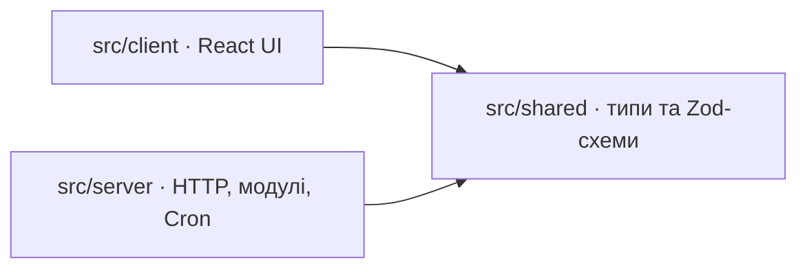

# Архітектурні інваріанти Unicorn

Зведення погоджених рішень для узгодженої реалізації модулів. **Фінальний дизайн після reviewer gate; реалізація ще не розпочата.**
Позначка `[ADOPTED]` означає успадковане рішення власника, а не результат
перевірки коду чи нове погодження цього документа.

Джерела істини — [вимоги](../../../../requirements.md) та
[D-001–D-179](../../../../decisions.md). Кожен AD нижче стискає ці рішення,
не замінюючи їхніх винятків. Контекст і альтернативи збережені у
[журналі сеансу](.memlog.md) та [архітектурних нотатках](../../../../architecture-notes.md).
Людський огляд — [дизайн системи](../../../../system-design.md);
порядок робіт і докази — [implementation plan](../../../../implementation-plan.md).

## Парадигма та напрям залежностей

Один модульний моноліт: HTTP API та scheduled handler одного Worker,
одна primary D1, спільний журнал подій із транзакційним outbox.
React-клієнт викликає API; звіт читає D1; доставка працює незалежно
від відкритого браузера. Модулі квізу/профілю, оферів/переходів,
постбеків і звіту мають спільний реліз (D-027–D-035, D-055).

Стрілки нижче означають дозволений імпорт за D-117. `shared` містить
безпечні контракти й чисті схеми; залежностей назад і доступу клієнта
до SQL, секретів чи повного каталогу немає.

## Інваріанти

### AD-1 — Межі одного безкоштовного демо [ADOPTED]

- **Binds:** усі модулі, інфраструктура та план робіт.
- **Prevents:** незалежні сервіси, платне масштабування чи майбутні функції в MVP.
- **Rule:** один домен, один квіз, один преленд у UI, один Worker і одна D1;
  лише Cloudflare Free та малі синтетичні дані. Другий преленд — тестові
  дані. Реальний BigQuery, партнерський сайт, розсилки, адмінка й автоматичний
  EPU не реалізуються. Демо показує збережені назву/URL/ClickID; HTTP-редирект
  перевіряється без відкриття партнера. 12 млн подій/місяць, 200/с протягом
  5 хвилин і p95 ≤ 500 мс для двох узбереж США — неперевірені цілі дизайну.
  D-003, D-016, D-021, D-024, D-026–D-030, D-058.

### AD-2 — Браузерна ідентичність і доступ до власного стану [ADOPTED]

- **Binds:** bootstrap, контекст квізу, команди, результати та cookie.
- **Prevents:** відновлення профілю за UserID/email або непомітна заміна чинного користувача.
- **Rule:** сервер створює UserID і окремий секрет HttpOnly-cookie;
  у D1 зберігається SHA-256 секрету. UserID та `X-Expected-User-ID` лише
  перевіряють контекст, не авторизують. Читання контексту відрізняє
  `ready/missing/invalid`; втрату доступу відновлюємо явним новим початком.
  Web Lock координує лише початкову видачу cookie: повторно читаємо контекст
  під lock, чекаємо до 30 секунд без перехоплення, rate-limit паузу чекаємо
  поза ним. Чинний доступ не замінюємо; прострочення й `revoked_at`
  перевіряємо перед записом. D-003, D-051–D-052, D-085, D-125–D-126,
  D-134, D-136–D-142.

### AD-3 — Серверний вибір і незмінний результат переходу [ADOPTED]

- **Binds:** профіль, каталог, вибір офера, ClickID та UI результату.
- **Prevents:** різне ранжування в клієнті й сервері або переписування минулого переходу.
- **Rule:** найновіший Lead серед активних оферів має пріоритет, за рівності
  часу — мінімальний OfferID. Інакше активний спеціалізований збіг за обома
  вподобаннями: максимум EPU, потім мінімальний ID; далі активний 007 або
  `no_offer`. Повернення й доступність `step` застосовують D-004–D-007/D-023.
  Каталог — перевірений конфіг Git, одна незмінна версія на спробу;
  `catalog_version` — SHA-256 його нормалізованого змісту. Вибір фіксується
  разом із ClickID, атрибуцією, назвою та готовим URL з єдиним `click_id`.
  Повтор повертає знімок, нова дія обирає заново. `no_offer` зберігається
  без переходу; повторний вибір — явна нова B. Purchase не впливає на вибір MVP.
  D-008, D-011, D-028, D-032, D-039–D-040, D-093–D-094, D-173–D-176.

### AD-4 — Атомарний запис і перевірка конкурентного стану [ADOPTED]

- **Binds:** усі шляхи зміни профілю, подій, переходів, результатів і бюджетів.
- **Prevents:** успішний бізнес-запис без журналу або вибір за вже застарілими передумовами.
- **Rule:** прямий SQL через D1 binding; команда, її події, початковий стан
  доставки, результат/ключ і прирости місткості фіксуються одним batch.
  `transaction_assertions` із CHECK/NOT NULL завжди перевіряє передумови
  всередині batch; невдача відкочує всі ефекти. Серверний `selection_revision`
  перевіряють B, покази, Q1/Q2 та A; лише доведений конфлікт допускає
  до трьох спроб із незмінними ключами/payload і перечитуванням стану.
  Revision зростає один раз при фактичній зміні вподобань, email/його
  підтвердження, компактного Lead чи доступу; Purchase, доставка й лише
  `last_active_at` її не змінюють. Відповідь змінює своє поле; перемагає
  останній успішний запис. Невідомий результат не означає rollback.
  D-015, D-017, D-063–D-065, D-068, D-160–D-162.

### AD-5 — Незмінна ідентичність повтору [ADOPTED]

- **Binds:** команди браузера, постбеки, експортер і приймач.
- **Prevents:** подвійне виконання після таймауту чи зміна даних під старим ключем.
- **Rule:** ключ браузера — `(user_id, operation_id)`, партнера —
  `(partner_id, event_type, partner_event_id)`, експорту — EventID.
  Унікальність забезпечує запис у транзакції, не попередній SELECT.
  Після авторизації однаковий ключ і нормалізований зміст повертають
  прийнятий результат, відмінний зміст дає конфлікт. Браузерний fingerprint —
  HMAC-SHA-256 із версіями ключа/формату; збережений результат доступний
  7 днів без поновлення, потім лишається tombstone до очищення профілю
  і повертається `operation_expired`. Новий OperationID не дублює зайнятий
  EventID; старий повтор не перезаписує новішу відповідь. D-010, D-036–D-037,
  D-065, D-071, D-077–D-078, D-083, D-122, D-133.

### AD-6 — Журнал фактів і причинні посилання [ADOPTED]

- **Binds:** генерація подій, аналітика, експорт та очищення.
- **Prevents:** вгадування проходження за поточним профілем, часом або подвійними таблицями.
- **Rule:** рівно шість типів: `funnel_entered`, `question_viewed`,
  `answer_confirmed`, `offer_transition`, `Lead`, `Purchase`. Браузер
  створює EventID перших двох; сервер — решти. Фактичні reload/Back-покази
  відрізняються від ререндеру й retry. Показ має `entry_event_id`,
  підтвердження — `view_event_id`, перехід — `entry_event_id` та серверний
  `flow_mode`; лише `quiz` має `completion_event_id` конкретної A.
  Посилання перевіряють тип, користувача, преленд і питання; залежні нові команди
  потребують входу/показу з віком строго менше 90 діб. Відомий повтор
  не переоцінює старі залежності. Подія зберігає незмінний експортний JSON
  і `schema_version`. Підтвердження не містить значення відповіді чи його
  хешу; актуальні значення — лише в профілі. D-034, D-041–D-044, D-078,
  D-152–D-157, D-167–D-168.

### AD-7 — Відновлювані A/B і межі локальної пам’яті [ADOPTED]

- **Binds:** UI квізу, фінальний крок, навігація й читання результатів.
- **Prevents:** повторне підтвердження email або новий ClickID під час відновлення.
- **Rule:** після записаного показу A підтверджує email, потім окрема B
  обирає офер; кожна має свій OperationID. Збій B не відкочує A; bypass
  виконує B без A лише за чинних серверних підстав. Перед повтором A/B
  після reload читаємо результат. Один версійований запис sessionStorage
  з прив’язкою до UserID/преленду має незмінний дедлайн `server_time + 24h`;
  перед використанням перевіряємо його свіжим серверним часом. Після A
  прибираємо email; збій збереження нової фази зупиняє невиконану B.
  Підтверджену B показуємо й при локальному збої. Первинні факти та
  незавершені Q1/Q2 живуть лише в пам’яті документа. Таймаут 10 секунд
  або нова явна дія не скасовують старий запит у польоті.
  D-038, D-043, D-047–D-050, D-079–D-080, D-124, D-127–D-130, D-158–D-159.

### AD-8 — Партнерська атрибуція й компактний Lead [ADOPTED]

- **Binds:** партнерський API, ClickID, журнал і вибір при поверненні.
- **Prevents:** прив’язка до останнього переходу, втрата Lead після очищення чи злиття покупок.
- **Rule:** одна Lead/Purchase на запит; партнер визначається Bearer-секретом
  і перевіряється проти історичного `partner_id` ClickID. Атрибуцію копіюємо
  з переходу; `events` і `partner_events` представляють одну подію зі
  спільним EventID. Компактний Lead — максимум `occurred_at` для
  `(user_id, offer_id)`, окремо від історії. Purchase не потребує Lead;
  різні partner_event_id означають різні покупки. Час допустимий включно
  від `click.created_at − 5m` до `received_at + 5m`. Новий постбек можливий,
  поки повний ClickID збережений, навіть після 90 днів; відомий повтор
  перевіряється за ключем і атрибуцією після видалення переходу. Прострочений
  профіль постбек не відновлює. D-009–D-012, D-033–D-034, D-037,
  D-082, D-091–D-093, D-122–D-123, D-132.

### AD-9 — Чотири бюджети й окрема пауза цілісності [ADOPTED]

- **Binds:** admission, створення профілів, ACK, очищення й технічний статус.
- **Prevents:** конкурентне перевищення місткості або помилкове розблокування іншого ресурсу.
- **Rule:** `capacity_control` має незалежні `undelivered/events/profiles/command_keys`
  з лімітами 1000/10 000/1000/20 000: undelivered рахує pending + in_flight,
  решта — всі фізичні рядки відповідної категорії. Усі потрібні прирости
  резервуються атомарно; нульовий приріст не витрачає бюджет. Попередження
  на 80%, критичний рівень на 95%, пауза при заповненні/невміщенні цілої
  команди; відновлення строго нижче 80%. `capacity_epoch` змінюється
  при переході нижче порогу й службовому відновленні. Після доведеної
  відмови окремий запис паузи перевіряє незмінний epoch і count не нижче
  порогу 80%: падіння між записами може не зберегти прапорець,
  але верхня межа захищена. Розбіжність count
  дає загальну `integrity_paused` і `history_unverified`: нові бізнес-записи,
  доставка та звичайне очищення зупинені до явної діагностики. Undelivered
  звіряємо перед доставкою, інші три count — раз на годину UTC одним зрізом
  із підтвердженим правом на годину, без автоматичного виправлення.
  D-059, D-066–D-067, D-088–D-089, D-163–D-166.

### AD-10 — Доставка з lease та індивідуальним ACK [ADOPTED]

- **Binds:** Cron, `event_delivery`, імітатор і бюджет `undelivered`.
- **Prevents:** втрата прийнятого, подвійне зарахування чи запис результату застарілої спроби.
- **Rule:** стани `pending/in_flight/delivered`; щохвилини один пакет до
  10 готових подій, timeout приймача 5 секунд, lease 2 хвилини.
  Відбір за `next_attempt_at`, потім EventID; backoff 1/2/4/8/15 хвилин
  зі зменшенням на 0–10%, без видалення після N невдач. Невідомий claim
  не дозволяє відправку чи негайний повтор захоплення. Приймач окремою
  транзакцією фіксує EventID/зміст до ACK; той самий зміст дедуплікується.
  Увесь ACK `{schema_version: 1, results}` валідовується до запису;
  статуси `accepted/retry/conflict`, відсутній ID непідтверджений.
  Застосовуємо лише чинні token/lease; результати й фактичне зменшення
  undelivered — один batch. Невідомий результат ACK не компенсуємо.
  Хмарний імітатор у D1 має `normal/unavailable`; складні збої — локальні
  fixtures. D-035, D-055–D-058, D-076, D-167, D-169–D-172.

### AD-11 — Логічні строки та явне очищення залежностей [ADOPTED]

- **Binds:** API доступу, Cron, усі таблиці й повнота звіту.
- **Prevents:** каскадна втрата прийнятого або продовження доступу через затримку Cron.
- **Rule:** email — 30 діб від підтвердження; профіль/компактні Lead —
  180 діб від активності у воронці; події — 90 діб від received_at,
  ClickID — 90 діб від створення. Постбеки, retry, доставка й звіт активність
  не поновлюють. Cron виконує перевірку цілісності → порційне очищення →
  доставку; звичайного `ON DELETE CASCADE` немає. Pending/in_flight,
  причинні залежності та потрібні ключі утримуються; ключ партнера
  переживає і подію, і перехід, ключ приймача — всі дозволені повтори.
  Прострочений профіль за потреби лишається мінімальним неактивним UserID
  без відповідей, доступу й Lead. Tombstone не звільняє бюджет ключів;
  фізичне видалення звільняє count атомарно. Integrity-пауза зупиняє
  навіть очищення email; логічні TTL діють незалежно. D-019, D-025,
  D-037, D-058, D-084, D-090–D-092, D-153–D-156, D-164, D-166.

### AD-12 — Когорти й незмінна семантика звіту [ADOPTED]

- **Binds:** SQL звіту, DTO metrics та підписи інтерфейсу.
- **Prevents:** ділення незалежних лічильників або перенесення покупки на чужу групу переходів.
- **Rule:** `quiz/offers` окремо містять `activity/conversions`.
  Активність фільтрується за часом події; конверсія — за групою входу
  в періоді та її прийнятими результатами станом на зріз, включно з пізніми.
  Одиниця — унікальний UserID; покупки мають ще окрему кількість подій.
  Квіз рахує прогрес від першого початку в обраному зрізі між поверненнями;
  перехід після квізу потребує `flow_mode=quiz` і конкретної A. Партнерські
  результати належать тільки ClickID групи. Фільтр офера змінює лише
  offers; раннім питанням офер не дописуємо. Повертаємо numerator/denominator;
  `0/0` — немає даних, інваріант `0 ≤ numerator ≤ denominator` обов’язковий.
  D-013–D-014, D-022, D-045, D-146, D-151–D-155; контроль — SC-14.

### AD-13 — Один зріз і відмова від неповної історії [ADOPTED]

- **Binds:** запити звіту, метадані історії, retention та автооновлення.
- **Prevents:** часткові цифри під виглядом повного звіту або розходження метрик у часі.
- **Rule:** один SELECT до primary D1 без кешу повертає всі метрики,
  available_from й updated_at. Дати UTC включні у UI та напіввідкриті
  в SQL; майбутній день заборонений. `available_from` — максимум початкової
  дати обліку, межі відомих прогалин і строго наступної UTC-доби після
  дати `updated_at − 90d + 5m`. Початкова дата створюється до перших записів
  лише для нової історії. Неповний період дає `unavailable/period_unavailable`,
  неперевірена історія — `unavailable/history_unverified`, без metrics.
  Прийнята партнерська подія з допустимим майбутнім часом уже входить
  до когорти. Звіт оновлюється через 60 секунд після завершення попередньої
  спроби у видимій вкладці, без накладання циклів;
  помилка/недоступність прибирає числа, старі відповіді не міняють нові
  фільтри. Status/filters — незалежні читання з власним часом.
  D-045–D-046, D-086–D-087, D-114–D-116, D-143–D-150.

### AD-14 — Межі API, авторизація й безпечні дані [ADOPTED]

- **Binds:** групи quiz/partner/report під `/api/v1`, shared-схеми та логи.
- **Prevents:** обхід доступу через інший маршрут, поблажлива нормалізація чи витік payload.
- **Rule:** cookie квізу, Bearer партнера й Basic Auth звіту не взаємозамінні.
  Браузерні зміни — JSON POST із точно дозволеним Origin; GET/HEAD не
  змінюють бізнес-стан. Zod 4 strictObject без coercion; нормалізація лише
  за D-071–D-074/D-077. Помилки мають безпечні code/message/retryable,
  необов’язкові fields без значень. Rate limit: грубий довірений IP-рівень
  і серверно встановлений суб’єкт; збій/відсутня довірена адреса дає 503,
  перевищення — 429, без бізнес-ефектів. Сумарне очікування limiter ≤ 1 с;
  паузи 60/30 с та до трьох автоматичних повторів квізу не змінюють ключі.
  Дані повертаємо з `no-store`; email, секрети, сирі тіла й IP не пишемо
  в URL або технічні логи. D-020, D-053, D-069–D-075, D-081–D-083,
  D-095, D-100–D-107, D-118–D-121, D-131–D-135.

### AD-15 — Сумісний ручний реліз та контрольоване відновлення [ADOPTED]

- **Binds:** локальне середовище, хмарне демо, CI, міграції й операційні сценарії.
- **Prevents:** прихований deploy, автоматичний відкат даних або мовчазна втрата сумісності повторів.
- **Rule:** один package.json/lockfile; локальна D1 відокремлена від однієї
  хмарної демо-бази; репозиторій лишається приватним до явного рішення власника.
  Послідовність: локальні перевірки → сумісна міграція →
  перевірка схеми → Worker/assets → smoke. Старий Worker має працювати
  під час міграції; API v1, формати чинних ключів/чернеток і експортних
  знімків зберігають сумісність. Push/CI не запускає deploy; GitHub Actions
  використовує синтетичні дані й локальну D1 без deploy-секретів, у перевірених
  безкоштовних межах. Time Travel — окремо погоджений restore зі зупинкою
  записів/доставки/очищення й перевіркою цілісності до поновлення; нульову
  втрату новіших записів не обіцяємо. Логи й закритий status показують
  безпечні коди, бюджети, вік backlog, Cron та час зрізу; зовнішніх алертів немає.
  D-060, D-095–D-100, D-117, D-167, D-177.

### AD-16 — Докази завершення та межі майбутніх розширень [ADOPTED]

- **Binds:** критерії готовності, тести, README, AI-worklog та DEL-03.
- **Prevents:** видавання дизайн-очікувань за пройдені тести або розширення MVP під час реалізації.
- **Rule:** Vitest перевіряє правила й інтеграції D1, Playwright — браузерні
  сценарії за D-110; обов’язкові нестабільні тести блокують реліз.
  Перевіряємо SC-01–SC-14, rollback, повтори, гонки, пізні повідомлення,
  lease/ACK, retention, ліміти й звіт на синтетичних даних, без benchmark.
  Демо наповнюється через звичайний квіз і локальний CLI постбеків;
  deploy не очищає історію. README розділяє реалізоване, імітоване й дизайн;
  AI-worklog фіксує лише фактичні доручення, рішення та перевірки.
  D-178/D-179 лише пояснюють майбутні Purchase-виключення та EPU за
  доходом платформи; P-154 знято з активного плану, його не реалізуємо.
  D-001–D-002, D-024, D-026, D-108–D-113, D-178–D-179; DEL-04–DEL-07.

## Спільні формати

| Межа | Контракт |
| --- | --- |
| ID | UserID/ClickID/EventID/OperationID — UUID v4; partner_event_id — окремий регістрозалежний ASCII-рядок 1–128 символів; OfferID — три ASCII-цифри. D-077/D-175 |
| Час | UTC із точністю до мілісекунд; квіз використовує серверний час першого прийняття, партнер — перевірений occurred_at та окремий received_at. D-044/D-074 |
| Purchase | Сума необов’язкова; якщо задана — ціле 1–1 000 000 у центах USD, із currency; це вартість покупки, не автоматично дохід платформи. D-054/D-120/D-121/D-179 |
| Байти UTF-8 | Вхідний JSON 8 KiB; повна експортна подія 4 KiB; пакет 64 KiB; ACK 8 KiB; готовий URL 2 KiB; назва офера 256 байтів; result 4 KiB. Перевірка до запису, без обрізання. D-075/D-076/D-174 |

## Початкова структура та власники даних

Це seed до коду, а не готові міграції. Зв’язки історичних ID логічні:
фізичний FK можливий лише коли батько гарантовано живе весь строк
дочірнього запису; точна карта задається спільною схемою до залежних
модулів (D-090).

| Дані | Відповідальність і зв’язок |
| --- | --- |
| `users` | Квіз/профіль: поточні відповіді, доступ, активність і selection_revision. D-031/D-051/D-161 |
| Каталог; `clicks` | Офери/переходи: перевірений конфіг і незмінна атрибуція UserID–OfferID–PrelandID–partner_id, знімок результату та причинні посилання. D-028/D-032/D-152–D-155 |
| `partner_events`; `user_offer_leads` | Постбеки: детальна історія 1:1 з events і компактний максимум Lead на user/offer. Ключ повтору має окремий строк. D-033/D-037 |
| `events`; `request_results` | Спільний журнал і результати команд; бізнес-модуль створює їх лише всередині атомарної команди. Звіт/експорт не переписують бізнес-факти. D-034/D-036/D-167 |
| `event_delivery`; `mock_received_events` | Експортер володіє станом доставки; імітатор — окремою стійкою копією й дедуплікацією. Запис приймача не змінює доставку напряму. D-035/D-058 |
| `capacity_control`; службові метадані | Атомарні бюджети, паузи, звірки й довіра до історії; звіт лише читає. `transaction_assertions` порожня після завершення batch. D-114–D-116/D-162–D-166 |

Погоджений стек: React + TypeScript + Vite, Hono, Zod 4, Cloudflare
Workers/D1, Vitest і Playwright (D-030, D-061–D-063, D-109, D-118).
[Кандидат версій і датовані докази](../../../../bmad/reviews/2026-10-30-design-final/platform-evidence.md)
перевірено за метаданими; остаточний lockfile, build та runtime pin — M0.

## Відповідність вимог архітектурі

| Вимоги / результат | Де реалізується або пояснюється | AD |
| --- | --- | --- |
| FR-01–FR-04 | UI, профіль, ідентичність, журнал | AD-2, AD-4–AD-7, AD-14 |
| FR-05–FR-08 | Серверний вибір, каталог, компактні Lead | AD-3, AD-4, AD-8 |
| FR-09–FR-10 | Партнерський API, атрибуція й повтори | AD-5, AD-8, AD-14 |
| FR-11–FR-12 | Звіт за журналом, когорти й доступність | AD-6, AD-11–AD-13 |
| FR-13 | Імітований результат і тест редиректу | AD-1, AD-3, AD-7, AD-16 |
| NFR-01, NFR-04 | Межі демо; [оцінка потоку й ресурсів](../../../../capacity-and-delivery.md) | AD-1, AD-9–AD-10, AD-15–AD-16 |
| NFR-02–NFR-03 | Незалежні запис, звіт і доставка | AD-4, AD-10, AD-12–AD-13 |
| NFR-05 | Конкурентність, повтори, причинність і відмови | AD-4–AD-11, AD-16 |
| NFR-06 | Доступ, мінімізація, строки й безпечні логи | AD-2, AD-6, AD-11, AD-14–AD-15 |
| NFR-07 | Бюджети, retention, status і ресурсна оцінка | AD-9–AD-11, AD-15 |
| DEL-01–DEL-02 | Spine, короткий дизайн, схема й implementation plan | AD-1–AD-16 |
| DEL-03 | Лише пояснення майбутніх Purchase-виключення й EPU | AD-1, AD-16 |
| DEL-04–DEL-05 | Демо, приватний GitHub, README, CI та фактичні перевірки | AD-1, AD-15–AD-16 |
| DEL-06–DEL-07 | AI-worklog і матеріали відтворення/розбору | AD-16 |

## Відкладена деталізація та gate

- **M0/M1 до залежної реалізації:** спільна SQL-схема, ключі/FK/індекси,
  конкретні batch/guard та retention-запити, Zod DTO/канонізація,
  порції Cron, pin інструментів і перевірка їх сумісності. Це технічне
  втілення AD, не повторне погодження бізнес-правил. Результат має бути
  спільним контрактом модулів, не незалежними локальними трактуваннями.
- **Перед хмарним релізом:** підтверджені Free-механізм rate limit,
  ресурси/квоти акаунта й CI, секрети поза Git, операційний runbook
  відновлення та успішні обов’язкові перевірки за implementation plan.
- **За межами MVP:** реальний BigQuery, production-пропускна здатність,
  незалежні резервні копії, зовнішні алерти й політики D-178/D-179.
  Вони повертаються до розгляду лише при розширенні обсягу.
- **Gate документації:** лінтер, звірка джерел та незалежні rubric,
  adversarial і technology перевірки виконані;
  [докази та межі](../../../../bmad/reviews/2026-10-30-design-final/report.md).
  Це не виконані SQL-тести, готовність демо чи дозвіл почати реалізацію.
