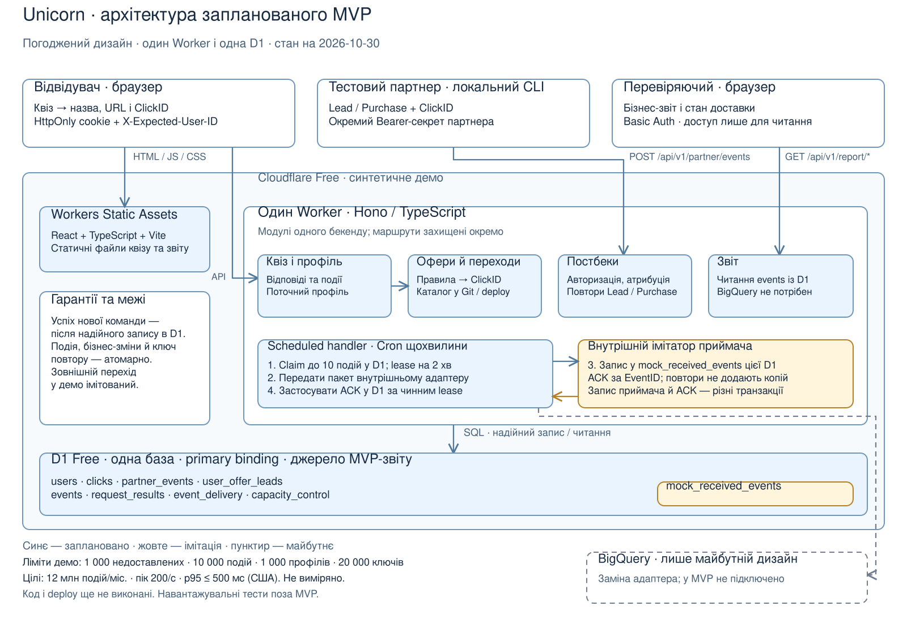

# Системний дизайн Unicorn

Оновлено: 2026-10-30. **Проєктування завершено; зведення D-001–D-179.**
Стан реалізації відстежується в [плані](plan.md): на 2026-11-01 M0–M4
реалізовано й перевірено локально. Пакет здачі/перевірки M5 та хмарний
реліз M6 ще попереду. [Аудит M4](bmad/reviews/2026-11-01-m4/report.md). Джерела:
[вимоги](requirements.md), [рішення](decisions.md),
[детальні контракти та історія](architecture-notes.md), [сценарії](scenarios.md).
Наступний етап — [implementation plan](implementation-plan.md).

## 1. Обсяг і статус

Один квіз: бажана стать партнера, етніка, email. Email не є авторизацією
чи Lead. Сервер обирає офер із заданого каталогу; партнерські постбеки
підтверджують реєстрації й покупки. Закритий звіт читає записані події.
Один домен і профіль браузера; перенесення між браузерами, VisitID,
Amplitude та адмінка поза MVP.

| Частина | Обсяг і статус реалізації |
|---|---|
| Квіз, вибір, події, постбеки, звіт | Локальний зріз M2 реалізовано; хмарне розгортання на Free — M6 |
| Партнер і зовнішній перехід | CLI надсилає тестові постбеки; UI показує назву/URL; редирект перевіряється без відкриття партнера |
| Приймач експорту | Внутрішній імітатор у тій самій D1, Cron/lease/ACK, cleanup і звірки реалізовано локально в M4 |
| BigQuery, production-масштаб, Purchase-виключення, фактичний EPU | Лише дизайн, без реалізації |

Американський регіон — припущення. 12 млн подій/місяць, пік 200/с
протягом 5 хвилин, свіжість до 15 хвилин і p95 API ≤500 мс зі східного
й західного узбереж США — цілі дизайну, не виміряні характеристики Free.
Навантажувальні тести не є умовою тестового (D-016/D-026).

## 2. Компоненти та доступ

[Редагована схема Excalidraw](diagrams/system-context.excalidraw).
Схема показує цільовий склад MVP. Локально готові M0–M4, включно з
Cron/cleanup; хмарного розгортання немає.

Модульний моноліт: один Cloudflare Worker з Hono та scheduled handler.
React + TypeScript + Vite — статичний клієнт. Один пакет client/server/shared,
Zod для суворої валідації й типів, параметризований SQL через D1 без ORM.

| Модуль | Відповідальність / доступ |
|---|---|
| Quiz / profile | Відповіді, контекст, вхід/показ/підтвердження; HttpOnly-cookie |
| Offer selection | Каталог із Git, Lead/EPU/fallback, атомарний ClickID |
| Partner events | Lead/Purchase; окремий Bearer-секрет партнера |
| Report | Бізнес-звіт, фільтри й технічний стан; Basic Auth лише для читання |
| Delivery / cleanup | Cron, lease/ACK, повтори, очищення й звірка лічильників |

API: `/api/v1/quiz`, `/partner`, `/report`. Авторизації розділені;
браузер не читає D1 напряму. API не кешується. Секрети лише на сервері;
email, відповіді, IP, cookie й сирі URL/payload відсутні в технічних логах.

## 3. Дані та зв’язки

| Сутність | Ключ / зв’язки | Джерело істини для |
|---|---|---|
| `users` і браузерний доступ | UserID; вподобання, email, activity, revision; окремий секрет, лише SHA-256 у D1, revoked_at | Поточних відповідей та права доступу |
| `clicks` | ClickID → user/offer/partner/preland; entry, optional completion | Незмінного переходу: назва/URL/catalog_version, flow_mode quiz/bypass |
| `partner_events` | UNIQUE `(partner_id, event_type, partner_event_id)` → ClickID/EventID | Повторів та атрибутованих результатів партнера |
| `user_offer_leads` | UNIQUE `(user_id, offer_id)`; найновіший час реєстрації | Компактного Lead незалежно від деталізації переходів |
| `events` | EventID; user/preland, час, причинні посилання | Звіту й незмінного експортного знімка |
| `request_results` | UNIQUE `(user_id, operation_id)`; тип, HMAC-відбиток, результат | Повторного читання результату команди |
| `event_delivery` | EventID 1:1; status, lease, retry, ACK | Доставки окремо від змісту події |
| `capacity_control` | Чотири бюджети, лічильники, пауза, epoch | Прикладної місткості |
| `mock_received_events` | UNIQUE EventID, незмінний знімок | Ідемпотентного приймання імітатором; не джерело звіту |

Каталог — конфіг, не таблиця. Валідація до deploy, SHA-256 версія,
заборона перевикористання ID. Постбек перевіряє історичну належність
офера партнеру на момент переходу. Точні SQL-типи, індекси й міграції
перевіряються під час реалізації; власники даних та операцій визначені.

Шість типів: `funnel_entered`, `question_viewed`, `answer_confirmed`,
`offer_transition`, `Lead`, `Purchase`. Початок квізу — фактичний показ,
завершення — підтвердження email. У події лише факт підтвердження,
без значень відповідей чи email (D-168). Повний квіз дає 8 подій до
постбеків, bypass — 2. Reload — новий вхід і показ; Back — новий показ;
ререндер і повтор доставки не додають подій (D-041/D-042).

## 4. Основні потоки

**Вхід.** Cookie дає контекст ready/missing/invalid. UserID не є секретом;
X-Expected-User-ID захищає від виконання старої чернетки в іншому профілі.
Ініціалізація не замінює чинний профіль; Web Lock захищає лише первинну
видачу cookie. Без робочої cookie квіз зупиняється (D-051/D-052/D-134–D-142).

Без step починаємо квіз зі збереженими відповідями; зі step — доступне
питання або перше незаповнене попереднє. Email підтверджується явно.
Записи по питаннях: останній успішний перемагає, живої синхронізації
вкладок немає. Активний Lead дозволяє bypass. Якщо всі офери з Lead
неактивні, але вподобання допустимі, виконуємо новий вибір без квізу.

**Вибір.** Найновіший Lead серед активних оферів, при рівному часі —
найменший OfferID. Інакше активний спеціалізований збіг за двома
вподобаннями: найбільший EPU, потім найменший ID. Без збігу — активний
007; інакше no_offer. Purchase у MVP не виключає офер.

**Фінальний крок.** A підтверджує email; B окремо фіксує вибір, ClickID
і offer_transition або no_offer. Один каталог на спробу. Для quiz B має
completion_event_id конкретної A, для bypass його немає. Показ і
підтвердження мають entry/view-посилання; сервер перевіряє належність
і логічний строк 90 діб (D-152–D-160).

**Постбек.** Один POST `/api/v1/partner/events` приймає одну подію.
ClickID визначає користувача, офер і преленд. Стабільний ID та обов’язковий
час із явним поясом, до мілісекунд; допустима похибка 5 хвилин.
Ідентичний повтор — те саме підтвердження без duplicate; змінений зміст —
конфлікт. Дві покупки мають різні ID. Purchase допустимий без Lead,
не створює його. Необов’язкові сума/валюта йдуть разом: для демо
1–1 000 000 центів USD (D-009–D-012/D-120–D-123).

## 5. Атомарність і відновлення

Успіх API — після D1 commit. Одна транзакційна batch містить бізнес-зміну,
подію, pending, результат/ключ повтору та бюджети. CHECK-guard забезпечує
повний rollback при порушенні умови; нуль змінених рядків сам собою
не є rollback. Зовнішніх викликів усередині транзакції немає.

selection_revision захищає читання перед записом; конфлікт означає
перечитування/перерахунок з тим самим OperationID, до трьох спроб.
Унікальний ключ дозволяє прочитати вже зафіксований результат; running
немає. Пауза при переповненні — окремий запис із capacity_epoch:
межа гарантії D-163 не дорівнює атомарності відхилення й цієї паузи.

Після reload спочатку GET результату, потім за потреби повтор із тим самим
ключем і змістом. Чернетка A/B у sessionStorage має незмінний серверний
дедлайн 24 години; email прибирається після підтвердженої A. Нова спроба
не скасовує можливе пізнє завершення старої. Втрата доступу, прострочене
посилання або недоступний крок мають явне відновлення без мовчазного
скидання профілю. Деталі локальних збоїв — D-047–D-050/D-127–D-130.

Помилки: code/message/retryable, optional fields. Невідомі поля, хибні
типи й неявний null відхиляються без часткового запису. JSON ≤8 KiB.
Rate limit — 429; недоступний limiter/довірений IP — 503 без виконання.
Паузи, ключі й межі повторів — D-101–D-107/D-124–D-126.

## 6. Звіт і retention

Один SQL-запит до D1, без кешу, єдиний as_of. UTC-період визначає групу
входу; подальші прийняті результати рахуються станом на зріз. Унікальних
користувачів, покази/підтвердження та окремі покупки не змішуємо.
Офер фільтрує лише переходи й партнерські результати. Формули — D-013,
D-014, D-022; контрольні числа — SC-14. API віддає точні лічильники й
чисельник/знаменник, UI форматує відсотки; нульовий знаменник не є 0%.

Фільтри — в URL, початково поточний день UTC. Оновлення кожні 60 секунд
у видимій вкладці й вручну. Неповний період або непідтверджена цілісність
історії — unavailable без бізнес-чисел; технічний стан читається окремо.

| Дані | Строк / правило |
|---|---|
| Email | 30 днів від підтвердження |
| Профіль, вподобання, компактний Lead | 180 днів неактивності за D-025 |
| Події й переходи | 90 днів; потрібні недоставленим подіям залежності зберігаються |
| Результат команди / ключ | 7 днів / до очищення профілю |
| Партнерські ключі | За строками події та переходу; відомий повтор підтверджується навіть після очищення ClickID |

Cron чистить порціями, явно за залежностями, без cascade. Неактивний
прострочений профіль може лишатися для залежностей, але не авторизує.
Новий пізній постбек після 90 днів приймається лише за повних потрібних
даних. Вікно звіту не розширюється через затримку фізичного очищення.

## 7. Доставка, обмеження й експлуатація

Cron щохвилини: до 10 подій, timeout 5 с, lease 2 хв, повтори до 15 хв.
Pending → in_flight → delivered; ACK кожного EventID застосовується лише
за чинним lease. Невідомий claim — без відправлення. Загублений ACK —
повтор того самого знімка, який імітатор не зараховує вдруге. Подія має
schema_version, ≤4 KiB; пакет ≤64 KiB, ACK ≤8 KiB.

Бюджети: 1000 недоставлених, 10 000 подій, 1000 профілів, 20 000 ключів.
Попередження 80/95%, після заповнення відновлення нижче 80%. Нові записи
відхиляються, прийняті не видаляються через переповнення. Розбіжність
лічильників — пауза, діагностика й ручне відновлення. Технічний звіт/логи
показують місткість, вік недоставлених, помилки, паузи й цілісність історії.

[Оцінки ресурсів і шлях до BigQuery](capacity-and-delivery.md) відокремлюють
мале демо від цільового потоку. Імітатор не доводить роботу BigQuery.
Free-доступність конкретного rate-limit binding треба підтвердити до
хмарного використання; невідоме не називаємо перевіреним.

Локальне середовище й одне демо, без staging. Ручний deploy: перевірки →
сумісна міграція → Worker → smoke. Автовідкату даних немає. Time Travel
потребує перевірки повноти звіту після відновлення. CI перевіряє код
у безкоштовних межах, але не розгортає (D-095–D-100/D-177).

## 8. Альтернативи

| Обрано | Альтернатива | Причина / компроміс |
|---|---|---|
| Один Worker + D1 | Кілька сервісів/баз | Простіший узгоджений запис; обмеження одного сховища |
| React + Vite, Hono | SSR / Next.js | SSR цьому квізу не потрібний; статичний клієнт |
| Прямий SQL | ORM | Видимі транзакційні умови; запити й міграції перевіряємо самі |
| Каталог у Git | Адмінка / таблиця оферів | Відтворювана версія; зміни через deploy |
| D1 outbox + Cron | Черга як єдина копія | Збереження прийнятого запису; додаткові рядки та lease-протокол |
| Звіт у D1, імітатор | BigQuery у MVP | Наскрізне демо без зайвого сервісу; зовнішні гарантії не перевірені |

## 9. Майбутні розширення

Лише DEL-03, погоджені D-178/D-179. Виключення після Purchase використає
компактну ознаку UserID–OfferID перед Lead/EPU/fallback. Зміна ознаки та
revision атомарна; створений ClickID незмінний. Очищення журналу саме
по собі не скасовує виключення.

Фактичний EPU — підтверджений дохід платформи від переходів групи /
унікальні направлені UserID, включно з користувачами без покупок.
Атрибуція через ClickID, дедуплікація за ID, пізні результати — на as_of.
Ціна покупки не обов’язково дорівнює доходу платформи. Невідомі гроші/
повнота чи нульовий знаменник означають недоступний показник.
Строк виключення, повернення коштів і застосування EPU до рейтингу
визначатимуться перед розширеннями; P-154 не є активним пунктом.
